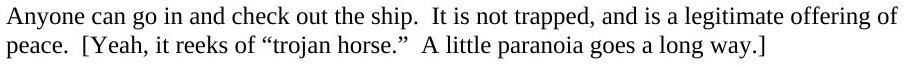
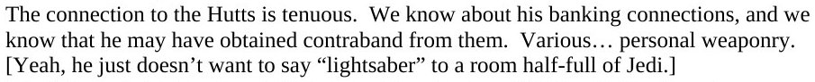

# Owner Material 037 — Star Wars D20 Drive folder (Core, Revised Core and Saga Edition): Living Force Campaign/Adventures/Among the Stars/Year 1/104 - Eye of the Sun - An Uneasy Peace.pdf [Star Wars Roleplaying Game Revised Core (d20, 2002)]

- **Source:** Wizards of the Coast Star Wars Roleplaying Game books, web enhancements, Living Force campaign modules and articles (2000–2010), from the owner's "Star Wars D20" Drive folder (only the three edition subfolders; "General" was not read, as instructed). Secondary source (licensed Legends reference). Scan OCR'd on the box; the scan stays box-only and is **not** published.
- **Method:** every scanned page was OCR'd and machine-screened sentence by sentence for power-relevant statements (fights, kills, defeats, Force feats, rankings, superweapons) that name a character on our roster; each kept sentence is quoted verbatim from the OCR text and has a crop of the printed passage directly under it. Pages with nothing power-relevant are still listed with what is on them.
- **Citation:** "*104 - Eye of the Sun - An Uneasy Peace* (SWRPG d20 Revised Core), p.X" by printed page ("scan p.X" where no printed number applies). **Weight:** Licensed RPG material: a secondary source. Narrative text sums up Legends lore; game statistics are rules for players, not canon power levels, and rank lowest.

## scan p.1 (scan page 1)

Page contents: 503 words, 11 paragraphs | headings/entries: An Uneasy Peace; The story

## scan p.2 (scan page 2)

Page contents: 539 words, 7 paragraphs | headings/entries: 

## scan p.1–2 (scan page 1)

Page contents: Story and details (straw poll, proxies, Loogg, Wir, Ch'hala trees) (hand-read)

## scan p.3 (scan page 3)

Page contents: 362 words, 14 paragraphs | headings/entries: The Setting; Scene 1: The Square; Scene 3: The Jedi Enclave; NPCs present: Mol Beldun (Adam), some assistant; Scene 4: Joh's; Scene 6: The Transmission Room

## scan p.4 (scan page 4)

Page contents: 50 words, 2 paragraphs | headings/entries: 

## scan p.3–4 (scan page 3)

Page contents: Settings: square, cantina, Jedi enclave, Joh's, transmission room (hand-read)

## scan p.5 (scan page 5)

Page contents: 420 words, 12 paragraphs | headings/entries: The Opening; Citizens of Cularin, I bid you welcome!

## scan p.6 (scan page 6)

Page contents: 50 words, 2 paragraphs | headings/entries: 

## scan p.5–6 (scan page 5)

Page contents: Opening; Governor Chistor's address (hand-read)

## scan p.7 (scan page 7)

Page contents: 452 words, 14 paragraphs | headings/entries: Thurm Loogg's Address; THINGS LOOGG KNOWS

- **No single roster character (rules/setting/general)** — entry/section: Loogg's turbolaser ship "reeks of trojan horse": "Anyone can go in and check out the ship. It is not trapped, and is a legitimate offering of peace. [Yeah, it reeks of "trojan horse." A little paranoia goes a long way.]" Source: *104 - Eye of the Sun - An Uneasy Peace* (SWRPG d20 Revised Core), scan p.7
  

## scan p.8 (scan page 8)

Page contents: 202 words, 7 paragraphs | headings/entries: 

- **No single roster character (rules/setting/general)** — entry/section: Loogg won't say "lightsaber" to a room half-full of Jedi: "The connection to the Hutts is tenuous. We know about his banking connections, and we know that he may have obtained contraband from them. Various... personal weaponry. [Yeah, he just doesn't want to say "lightsaber" to a room half-full of Jedi.]" Source: *104 - Eye of the Sun - An Uneasy Peace* (SWRPG d20 Revised Core), scan p.8
  

## scan p.7–8 (scan page 7)

Page contents: Thurm Loogg's address; things Loogg knows (hand-read)

## scan p.9 (scan page 9)

Page contents: 356 words, 13 paragraphs | headings/entries: The NPCs Barnab Chistor; Len Markus

## scan p.10 (scan page 10)

Page contents: 154 words, 4 paragraphs | headings/entries: 

## scan p.9–10 (scan page 9)

Page contents: NPC stat blocks and notes (hand-read)

