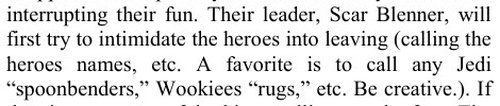
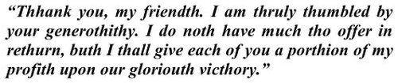
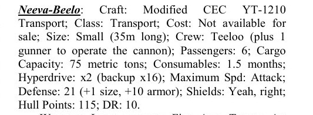
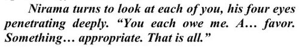

# Owner Material 037 — Star Wars D20 Drive folder (Core, Revised Core and Saga Edition): Living Force Campaign/Adventures/Among the Stars/Year 1/105 - The Price of Business.pdf [Star Wars Roleplaying Game Revised Core (d20, 2002)]

- **Source:** Wizards of the Coast Star Wars Roleplaying Game books, web enhancements, Living Force campaign modules and articles (2000–2010), from the owner's "Star Wars D20" Drive folder (only the three edition subfolders; "General" was not read, as instructed). Secondary source (licensed Legends reference). Scan OCR'd on the box; the scan stays box-only and is **not** published.
- **Method:** every scanned page was OCR'd and machine-screened sentence by sentence for power-relevant statements (fights, kills, defeats, Force feats, rankings, superweapons) that name a character on our roster; each kept sentence is quoted verbatim from the OCR text and has a crop of the printed passage directly under it. Pages with nothing power-relevant are still listed with what is on them.
- **Citation:** "*105 - The Price of Business* (SWRPG d20 Revised Core), p.X" by printed page ("scan p.X" where no printed number applies). **Weight:** Licensed RPG material: a secondary source. Narrative text sums up Legends lore; game statistics are rules for players, not canon power levels, and rank lowest.

## scan p.1 (scan page 1)

Page contents: 87 words, 5 paragraphs | headings/entries: The Price of Business; By Lee Pickler

## scan p.2 (scan page 2)

Page contents: 905 words, 19 paragraphs | headings/entries: Character Earnings; GM Overview; The Price of Business; Page 2

## scan p.3 (scan page 3)

Page contents: 884 words, 21 paragraphs | headings/entries: OPENING CUTSCENE; END OF CUTSCENE; Player Introduction; The Price of Business; Page 3

## scan p.1–3 (scan page 1)

Page contents: Title; RPGA scoring; earnings; GM overview; opening cutscene (hand-read)

## scan p.4 (scan page 4)

Page contents: 896 words, 22 paragraphs | headings/entries: SCENE 1 Rodians and Raptors; The Price of Business; Page 4

- **No single roster character (rules/setting/general)** — entry/section: Raptors call any Jedi "spoonbenders": "Their leader, Scar Blenner, will first try to intimidate the heroes into leaving (calling the heroes names, etc. A favorite is to call any Jedi "spoonbenders," Wookiees "rugs," etc. Be creative.)." Source: *105 - The Price of Business* (SWRPG d20 Revised Core), scan p.4
  

## scan p.5 (scan page 5)

Page contents: 819 words, 29 paragraphs | headings/entries: Skills: Intimidate +4; Feats: Toughness; Skills: Intimidate +4; Feats: Toughness; The Price of Business; Page 5

## scan p.6 (scan page 6)

Page contents: 907 words, 18 paragraphs | headings/entries: Teeloo's Story; The Price of Business; Page 6

- **No single roster character (rules/setting/general)** — entry/section: Teeloo's lisped thanks: ""Thhank you, my friendth. I am thruly thumbled by your generothithy. I do noth have much tho offer in rethurn, buth I thall give each of you a porthion of my profith upon our gloriouth victhory."" Source: *105 - The Price of Business* (SWRPG d20 Revised Core), scan p.6
  
- **No single roster character (rules/setting/general)** — entry/section: Neeva-Beelo shields: "Yeah, right": "Neeva-Beelo: Craft: Modified CEC YT-1210 Transport; ... Shields: Yeah, right; Hull Points: 115; DR: 10." Source: *105 - The Price of Business* (SWRPG d20 Revised Core), scan p.6
  

## scan p.7 (scan page 7)

Page contents: 879 words, 27 paragraphs | headings/entries: SCENE 2 Strangers in the Night; For groups averaging 1*-3" level heroes:; Skills: Intimidate +4; Feats: Toughness; For groups averaging 4"-6" level heroes:; The Price of Business; Page 7

## scan p.3–7 (scan page 3)

Page contents: Player intro; Scene 1 Raptors and Teeloo; Teeloo's story; Neeva-Beelo repairs (hand-read)

## scan p.8 (scan page 8)

Page contents: 837 words, 22 paragraphs | headings/entries: Skills: Intimidate +6; Feats: Toughness; SCENE 3 Racing the Tunnels; To the Moon; The Price of Business; Page 8

## scan p.7–8 (scan page 7)

Page contents: Scene 2 night attack (hand-read)

## scan p.9 (scan page 9)

Page contents: 829 words, 22 paragraphs | headings/entries: Racing the Tunnels; The Price of Business; Page 9

## scan p.10 (scan page 10)

Page contents: 866 words, 27 paragraphs | headings/entries: The Ship's Condition; Sample Problems:; Stage One — The Entrance Tunnel; Stage Two - The Spiral; Stage Three ~ Sharp Turn; Stage Four — Skinning the Mynock; The Price of Business; Page 10

## scan p.11 (scan page 11)

Page contents: 882 words, 25 paragraphs | headings/entries: Stage Five — The Incident; Stage Seven — The Cavern of Teeth; The Price of Business; Page 11

## scan p.12 (scan page 12)

Page contents: 760 words, 29 paragraphs | headings/entries: Stage Nine - The End; SCENE 4 Choices ... and Pirates; For groups averaging 1*-3" level heroes:; For groups averaging 4'"-6" level heroes:; The Price of Business; Page 12

## scan p.8–12 (scan page 8)

Page contents: Scene 3 breakfast, betting, Gael, tunnel race stages (hand-read)

## scan p.13 (scan page 13)

Page contents: 891 words, 31 paragraphs | headings/entries: Scene 4a: The Asteroid Field; Scene 4b: Race To Nub Saar; The Price of Business; Page 13

## scan p.14 (scan page 14)

Page contents: 774 words, 28 paragraphs | headings/entries: Skills: Intimidate +4; Feats: Toughness; Skills: Intimidate +4; Feats: Toughness; The Price of Business; Page 14

## scan p.12–14 (scan page 12)

Page contents: Scene 4 pirates; asteroid field; Nub Saar (hand-read)

## scan p.15 (scan page 15)

Page contents: 827 words, 24 paragraphs | headings/entries: Then, with a lopsided smile, he continues:; SCENE 6 Meeting Nirama; The Price of Business; Page 15

## scan p.16 (scan page 16)

Page contents: 796 words, 33 paragraphs | headings/entries: FINAL CUTSCENE; Vell Narot; END OF CUTSCENE; THE END; Experience Point Summary; The Price of Business; Page 16

- **No single roster character (rules/setting/general)** — entry/section: Nirama: "You each owe me. A... favor.": "Nirama turns to look at each of you, his four eyes penetrating deeply. "You each owe me. A... favor. Something... appropriate. That is all."" Source: *105 - The Price of Business* (SWRPG d20 Revised Core), scan p.16
  

## scan p.14–16 (scan page 14)

Page contents: Scene 5 Raptors and Len Markus; Scene 6 Nirama; final cutscene (hand-read)

## scan p.17 (scan page 17)

Page contents: 356 words, 16 paragraphs | headings/entries: Adventure Experience Award:; Treasure Summary; Debt to Nirama:; Teeloo's Gratitude:; Blood Raptors 6 blaster pistols 6 knives; The Price of Business; Page 17

## scan p.16–17 (scan page 16)

Page contents: XP; treasure (hand-read)

## scan p.18 (scan page 18)

Page contents: 584 words, 12 paragraphs | headings/entries: GENARIUS:; TOLEA BIQUA:; The Price of Business Page 18

## scan p.19 (scan page 19)

Page contents: 378 words, 16 paragraphs | headings/entries: Gamemaster Information Sheet Il: NPCs; The Price of Business; Page 19

## scan p.20 (scan page 20)

Page contents: 18 words, 5 paragraphs | headings/entries: Page 20; The Price of Business

## scan p.21 (scan page 21)

Page contents: 314 words, 13 paragraphs | headings/entries: Player Handout |: Tolea Biqua; The Price of Business Page 21

## scan p.22 (scan page 22)

Page contents: 223 words, 6 paragraphs | headings/entries: Player Handout Il: "Neeva-Beelo"; The Price of Business Page 22

## scan p.18–22 (scan page 18)

Page contents: GM info sheets; NPC stats; race map; player handouts (hand-read)

