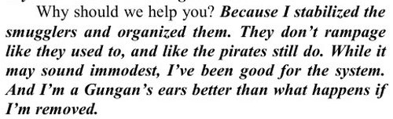
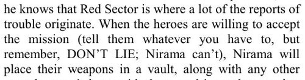
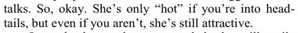
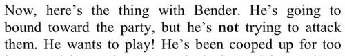
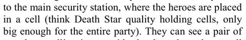
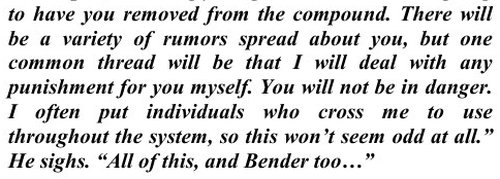

# Owner Material 037 — Star Wars D20 Drive folder (Core, Revised Core and Saga Edition): Living Force Campaign/Adventures/Among the Stars/Year 1/106 - Between the Worlds - TopWorld.pdf [Star Wars Roleplaying Game Revised Core (d20, 2002)]

- **Source:** Wizards of the Coast Star Wars Roleplaying Game books, web enhancements, Living Force campaign modules and articles (2000–2010), from the owner's "Star Wars D20" Drive folder (only the three edition subfolders; "General" was not read, as instructed). Secondary source (licensed Legends reference). Scan OCR'd on the box; the scan stays box-only and is **not** published.
- **Method:** every scanned page was OCR'd and machine-screened sentence by sentence for power-relevant statements (fights, kills, defeats, Force feats, rankings, superweapons) that name a character on our roster; each kept sentence is quoted verbatim from the OCR text and has a crop of the printed passage directly under it. Pages with nothing power-relevant are still listed with what is on them.
- **Citation:** "*106 - Between the Worlds - TopWorld* (SWRPG d20 Revised Core), p.X" by printed page ("scan p.X" where no printed number applies). **Weight:** Licensed RPG material: a secondary source. Narrative text sums up Legends lore; game statistics are rules for players, not canon power levels, and rank lowest.

## p.1 (scan page 1)

Page contents: 109 words, 6 paragraphs | headings/entries: TopWorld; A One-Round Living Force Adventure

## p.2 (scan page 2)

Page contents: 837 words, 23 paragraphs | headings/entries: Character Earnings; General Notes to the GM; GM Overview; TopWorld; Page 2

## p.3 (scan page 3)

Page contents: 809 words, 21 paragraphs | headings/entries: Encounter 1: The Call; Encounter 2: The Briefing; Encounter 3: The Insertion; Encounter 4: The Contact; Encounter 5: The Trials; Encounter 6: The Discovery; Encounter 7: The "Arrest"; Opening Crawl; Top World; Page 3

## p.4 (scan page 4)

Page contents: 866 words, 21 paragraphs | headings/entries: Encounter 1: The Call; Top World; Page 4

## p.1–4 (scan page 1)

Page contents: Title; RPGA scoring; GM notes; overview; encounter summaries; crawl (hand-read)

## p.5 (scan page 5)

Page contents: 865 words, 25 paragraphs | headings/entries: Encounter 2: The Briefing; Top World; Page 5

## p.4–5 (scan page 4)

Page contents: Enc 1: transport, Jasper, Cannibalizer attack (hand-read)

## p.6 (scan page 6)

Page contents: 815 words, 22 paragraphs | headings/entries: TopWorld; Page 6

## p.7 (scan page 7)

Page contents: 852 words, 21 paragraphs | headings/entries: Encounter 3: The Insertion; The Hutt's Tail; TopWorld; Page 7

- **No single roster character (rules/setting/general)** — entry/section: Nirama: "a Gungan's ears better": "Why should we help you? Because I stabilized the smugglers and organized them. They don't rampage like they used to, and like the pirates still do. While it may sound immodest, I've been good for the system. And I'm a Gungan's ears better than what happens if I'm removed." Source: *106 - Between the Worlds - TopWorld* (SWRPG d20 Revised Core), p.7
  
- **No single roster character (rules/setting/general)** — entry/section: Nirama can't lie: "When the heroes are willing to accept the mission (tell them whatever you have to, but remember, DON'T LIE; Nirama can't), Nirama will place their weapons in a vault" Source: *106 - Between the Worlds - TopWorld* (SWRPG d20 Revised Core), p.7
  

## p.5–7 (scan page 5)

Page contents: Enc 2: Nirama stats and Q&A; Bender call (hand-read)

## p.8 (scan page 8)

Page contents: 844 words, 25 paragraphs | headings/entries: Encounter 4: The Contact; TopWorld; Page 8

- **No single roster character (rules/setting/general)** — entry/section: Kor Pastar: only "hot" if you're into headtails: "So, okay. She's only "hot" if you're into headtails, but even if you aren't, she's still attractive." Source: *106 - Between the Worlds - TopWorld* (SWRPG d20 Revised Core), p.8
  

## p.7–8 (scan page 7)

Page contents: Enc 3: Red Sector; Hutt's Tail; Vel and Kor Pastar (hand-read)

## p.9 (scan page 9)

Page contents: 906 words, 25 paragraphs | headings/entries: TopWorld; Page 9

## p.10 (scan page 10)

Page contents: 905 words, 19 paragraphs | headings/entries: Encounter 5: The Trials; Top World; Page 10

## p.8–10 (scan page 8)

Page contents: Enc 4: the Cell interview (hand-read)

## p.11 (scan page 11)

Page contents: 965 words, 18 paragraphs | headings/entries: TopWorld; Page 11

- **No single roster character (rules/setting/general)** — entry/section: Bender the juvenile rancor wants to play: "Now, here's the thing with Bender. He's going to bound toward the party, but he's not trying to attack them. He wants to play!" Source: *106 - Between the Worlds - TopWorld* (SWRPG d20 Revised Core), p.11
  

## p.12 (scan page 12)

Page contents: 898 words, 23 paragraphs | headings/entries: Encounter 6: The Discovery; Top World; Page 12

## p.10–12 (scan page 10)

Page contents: Enc 5: Mokada's Place; Bender; trials (hand-read)

## p.13 (scan page 13)

Page contents: 913 words, 21 paragraphs | headings/entries: Encounter 7: The "Arrest"; Top World; Page 13

- **No single roster character (rules/setting/general)** — entry/section: Death Star quality holding cells: "the heroes are placed in a cell (think Death Star quality holding cells, only big enough for the entire party)." Source: *106 - Between the Worlds - TopWorld* (SWRPG d20 Revised Core), p.13
  

## p.12–13 (scan page 12)

Page contents: Enc 6: napkin; Trandoshan thug squad (hand-read)

## p.14 (scan page 14)

Page contents: 892 words, 21 paragraphs | headings/entries: Conclusion; TopWorld; Page 14

- **No single roster character (rules/setting/general)** — entry/section: Nirama: "All of this, and Bender too...": ""There will be a variety of rumors spread about you, but one common thread will be that I will deal with any punishment for you myself. You will not be in danger. I often put individuals who cross me to use throughout the system, so this won't seem odd at all." He sighs. "All of this, and Bender too..."" Source: *106 - Between the Worlds - TopWorld* (SWRPG d20 Revised Core), p.14
  

## p.15 (scan page 15)

Page contents: XP; loot; Favor of Nirama (hand-read)

## p.13–15 (scan page 13)

Page contents: Enc 7: arrest; Nirama debrief; conclusion (hand-read)

## p.16 (scan page 16)

Page contents: 189 words, 7 paragraphs | headings/entries: Player Handout 1: Datapad Text; TopWorld Page 16

## p.17 (scan page 17)

Page contents: 11 words, 3 paragraphs | headings/entries: Player Handout #2: Map of Mokada's Place; TopWorld Page 17

## p.18 (scan page 18)

Page contents: 164 words, 12 paragraphs | headings/entries: Mack Oides — Human Male; Blarg — Trandoshan Female; Horssk — Trandoshan Male; Janna — Human Female; Beebo — Rodian Female; Re'Nicu — Cerean Male; Gebs — Ithorian; TopWorld Page 18

## p.19 (scan page 19)

Page contents: 187 words, 11 paragraphs | headings/entries: Critical Event Summary Topworld; Yes No; TopWorld Page 19

## p.16–19 (scan page 16)

Page contents: Handouts; DM aid names; critical event summary (hand-read)

