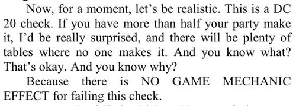
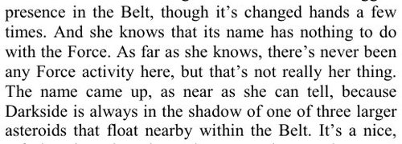
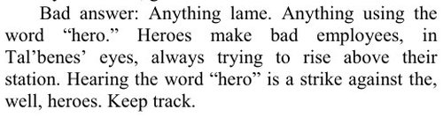
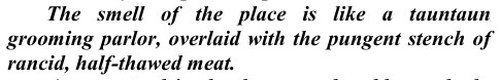
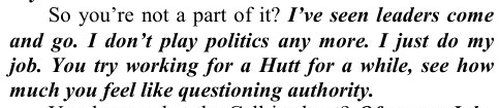
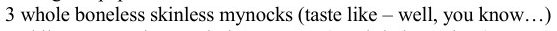

# Owner Material 037 — Star Wars D20 Drive folder (Core, Revised Core and Saga Edition): Living Force Campaign/Adventures/Among the Stars/Year 1/107 - Between the Worlds - MidWorld.pdf [Star Wars Roleplaying Game Revised Core (d20, 2002)]

- **Source:** Wizards of the Coast Star Wars Roleplaying Game books, web enhancements, Living Force campaign modules and articles (2000–2010), from the owner's "Star Wars D20" Drive folder (only the three edition subfolders; "General" was not read, as instructed). Secondary source (licensed Legends reference). Scan OCR'd on the box; the scan stays box-only and is **not** published.
- **Method:** every scanned page was OCR'd and machine-screened sentence by sentence for power-relevant statements (fights, kills, defeats, Force feats, rankings, superweapons) that name a character on our roster; each kept sentence is quoted verbatim from the OCR text and has a crop of the printed passage directly under it. Pages with nothing power-relevant are still listed with what is on them.
- **Citation:** "*107 - Between the Worlds - MidWorld* (SWRPG d20 Revised Core), p.X" by printed page ("scan p.X" where no printed number applies). **Weight:** Licensed RPG material: a secondary source. Narrative text sums up Legends lore; game statistics are rules for players, not canon power levels, and rank lowest.

## p.1 (scan page 1)

Page contents: 125 words, 5 paragraphs | headings/entries: MidWorld

## p.2 (scan page 2)

Page contents: 886 words, 19 paragraphs | headings/entries: General Notes to the GM; GM Overview; Encounter 1: A Return Engagement; MidWorld; Page 2

## p.3 (scan page 3)

Page contents: 847 words, 20 paragraphs | headings/entries: Encounter 2: Assignment Darkside; Encounter 3: Security Detail; Encounter 4: Contraband Detail; Encounter 5: Kitchen Detail; Encounter 6: Payday; Encounter 7: Cell Out; Opening Crawl; MidWorld; Page 3

## p.1–3 (scan page 1)

Page contents: Title; RPGA scoring; earnings; GM notes; overview; encounter summaries; crawl (hand-read)

## p.4 (scan page 4)

Page contents: 872 words, 27 paragraphs | headings/entries: Encounter 1: A Return Engagement; They are conspiring with Nirama to overthrow; MidWorld; Page 4

## p.5 (scan page 5)

Page contents: 835 words, 23 paragraphs | headings/entries: MidWorld; Page 5

## p.4–5 (scan page 4)

Page contents: Enc 1: rumors; Jobril; Nirama Q&A (hand-read)

## p.6 (scan page 6)

Page contents: 864 words, 23 paragraphs | headings/entries: Encounter 2: Assignment Darkside; Equipment: Two blaster pistols, combat jumpsuit; MidWorld; Page 6

- **No single roster character (rules/setting/general)** — entry/section: No game mechanic effect for failing this check: "Now, for a moment, let's be realistic. This is a DC 20 check. If you have more than half your party make it, I'd be really surprised, and there will be plenty of tables where no one makes it. And you know what? That's okay. And you know why? Because there is NO GAME MECHANIC EFFECT for failing this check." Source: *107 - Between the Worlds - MidWorld* (SWRPG d20 Revised Core), p.6
  

## p.7 (scan page 7)

Page contents: 863 words, 21 paragraphs | headings/entries: MidWorld; Page 7

- **No single roster character (rules/setting/general)** — entry/section: Darkside's name has nothing to do with the Force: "And she knows that its name has nothing to do with the Force. As far as she knows, there's never been any Force activity here, but that's not really her thing. The name came up, as near as she can tell, because Darkside is always in the shadow of one of three larger asteroids that float nearby within the Belt." Source: *107 - Between the Worlds - MidWorld* (SWRPG d20 Revised Core), p.7
  
- **No single roster character (rules/setting/general)** — entry/section: Tal'benes: "hero" is a strike: "Bad answer: Anything lame. Anything using the word "hero." Heroes make bad employees, in Tal'benes' eyes, always trying to rise above their station. Hearing the word "hero" is a strike against the, well, heroes. Keep track." Source: *107 - Between the Worlds - MidWorld* (SWRPG d20 Revised Core), p.7
  

## p.8 (scan page 8)

Page contents: 850 words, 25 paragraphs | headings/entries: Encounter 3: Security Detail; The following description is key:; MidWorld; Page 8

## p.6–8 (scan page 6)

Page contents: Enc 2: Xav Verivax; Dina Mertz; Tal'benes (hand-read)

## p.9 (scan page 9)

Page contents: 931 words, 20 paragraphs | headings/entries: Encounter 4: Contraband Detail; MidWorld; Page 9

## p.8–9 (scan page 8)

Page contents: Enc 3: Nala Noos; shadow lurkers; green room (hand-read)

## p.10 (scan page 10)

Page contents: 986 words, 18 paragraphs | headings/entries: MidWorld; Page 10

## p.11 (scan page 11)

Page contents: 891 words, 21 paragraphs | headings/entries: Encounter 5: Kitchen Detail; MidWorld; Page 11

- **No single roster character (rules/setting/general)** — entry/section: The smell of a tauntaun grooming parlor: "The smell of the place is like a tauntaun grooming parlor, overlaid with the pungent stench of rancid, half-thawed meat." Source: *107 - Between the Worlds - MidWorld* (SWRPG d20 Revised Core), p.11
  

## p.9–11 (scan page 9)

Page contents: Enc 4: contraband detail; thermal detonators (hand-read)

## p.12 (scan page 12)

Page contents: 895 words, 24 paragraphs | headings/entries: MidWorld; Page 12

- **No single roster character (rules/setting/general)** — entry/section: Karlo: "You try working for a Hutt for a while": "So you're not a part of it? I've seen leaders come and go. I don't play politics any more. I just do my job. You try working for a Hutt for a while, see how much you feel like questioning authority." Source: *107 - Between the Worlds - MidWorld* (SWRPG d20 Revised Core), p.12
  

## p.13 (scan page 13)

Page contents: 874 words, 25 paragraphs | headings/entries: Encounter 6: Payday; MidWorld; Page 13

## p.11–13 (scan page 11)

Page contents: Enc 5: Karlo; exorants; menu; Karlo Q&A (hand-read)

## p.14 (scan page 14)

Page contents: 818 words, 22 paragraphs | headings/entries: DC Information Gained; Encounter 7: Cell Out; MidWorld; Page 14

## p.13–14 (scan page 13)

Page contents: Enc 6: payday; info chart; Jasper (hand-read)

## p.15 (scan page 15)

Page contents: 906 words, 23 paragraphs | headings/entries: MidWorld; Page 15

## p.16 (scan page 16)

Page contents: 766 words, 22 paragraphs | headings/entries: Conclusion; Here Ends MidWorld; Adventure Experience Award:; MidWorld; Page 16

## p.14–16 (scan page 14)

Page contents: Enc 7: Cell meeting; stats; talk or fight; conclusion (hand-read)

## p.17 (scan page 17)

Page contents: 85 words, 8 paragraphs | headings/entries: Loot Summary; Encounter 6 — Payday 300 credits (pay); Conclusion; From Nirama: 1500 credits; MidWorld; Page 17

## p.16–17 (scan page 16)

Page contents: XP; loot (hand-read)

## p.18 (scan page 18)

Page contents: 138 words, 21 paragraphs | headings/entries: Player Handout A: Contents of the Freezer; MidWorld; Page 18

- **No single roster character (rules/setting/general)** — entry/section: Mynocks "taste like -- well, you know...": "3 whole boneless skinless mynocks (taste like -- well, you know...)" Source: *107 - Between the Worlds - MidWorld* (SWRPG d20 Revised Core), p.18
  

## p.19 (scan page 19)

Page contents: 169 words, 16 paragraphs | headings/entries: Critical Event Summary MidWorld; Yes No; Jasper Kruss Gaal Michael; Or email to: [email removed]; Or fax to: (517) 351-0288; MidWorld Page 19

## p.18–19 (scan page 18)

Page contents: Handout A freezer; critical event summary (hand-read)

