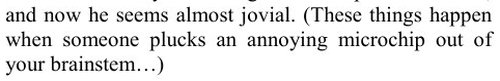
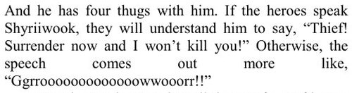
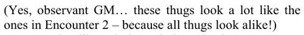
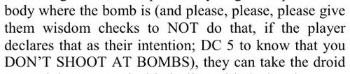
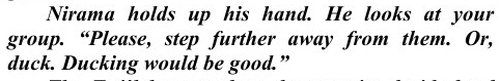
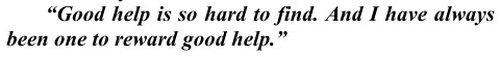
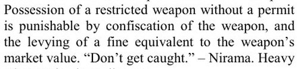

# Owner Material 037 — Star Wars D20 Drive folder (Core, Revised Core and Saga Edition): Living Force Campaign/Adventures/Among the Stars/Year 1/108 - Between the Worlds - UnderWorld.pdf [Star Wars Roleplaying Game Revised Core (d20, 2002)]

- **Source:** Wizards of the Coast Star Wars Roleplaying Game books, web enhancements, Living Force campaign modules and articles (2000–2010), from the owner's "Star Wars D20" Drive folder (only the three edition subfolders; "General" was not read, as instructed). Secondary source (licensed Legends reference). Scan OCR'd on the box; the scan stays box-only and is **not** published.
- **Method:** every scanned page was OCR'd and machine-screened sentence by sentence for power-relevant statements (fights, kills, defeats, Force feats, rankings, superweapons) that name a character on our roster; each kept sentence is quoted verbatim from the OCR text and has a crop of the printed passage directly under it. Pages with nothing power-relevant are still listed with what is on them.
- **Citation:** "*108 - Between the Worlds - UnderWorld* (SWRPG d20 Revised Core), p.X" by printed page ("scan p.X" where no printed number applies). **Weight:** Licensed RPG material: a secondary source. Narrative text sums up Legends lore; game statistics are rules for players, not canon power levels, and rank lowest.

## p.1 (scan page 1)

Page contents: 151 words, 5 paragraphs | headings/entries: UnderWorld

## p.2 (scan page 2)

Page contents: 903 words, 19 paragraphs | headings/entries: General Notes to the GM; DM Overview; UnderWorld; Page 2

## p.3 (scan page 3)

Page contents: 879 words, 17 paragraphs | headings/entries: Encounter 1: Once More, With Feeling; Encounter 2: Rothe Gate; Encounter 3: Living Quarters; Encounter 4: Personnel Records; Encounter 7: Closing the Gate; UnderWorld; Page 3

## p.4 (scan page 4)

Page contents: 872 words, 17 paragraphs | headings/entries: Opening Crawl; Encounter 1: Once More, With Feeling; UnderWorld; Page 4

- **No single roster character (rules/setting/general)** — entry/section: Jobril's jovial mood: "(These things happen when someone plucks an annoying microchip out of your brainstem...)" Source: *108 - Between the Worlds - UnderWorld* (SWRPG d20 Revised Core), p.4
  

## p.1–4 (scan page 1)

Page contents: Title; RPGA scoring; GM notes; overview; encounter summaries; crawl (hand-read)

## p.5 (scan page 5)

Page contents: 874 words, 18 paragraphs | headings/entries: Encounter 2: Rothe Gate; UnderWorld; Page 5

## p.4–5 (scan page 4)

Page contents: Enc 1: Jobril compromised; transport Q&A (hand-read)

## p.6 (scan page 6)

Page contents: 863 words, 27 paragraphs | headings/entries: UnderWorld; Page 6

- **No single roster character (rules/setting/general)** — entry/section: Blark: "Ggrrooo0000000000wwooorr!!": "If the heroes speak Shyriiwook, they will understand him to say, "Thief! Surrender now and I won't kill you!" Otherwise, the speech comes out more like, "Ggrrooo0000000000wwooorr!!"" Source: *108 - Between the Worlds - UnderWorld* (SWRPG d20 Revised Core), p.6
  

## p.7 (scan page 7)

Page contents: 852 words, 21 paragraphs | headings/entries: Encounter 3: Living Quarters; UnderWorld; Page 7

## p.5–7 (scan page 5)

Page contents: Enc 2: Rothe Gate; Blark; N3-A2 briefing (hand-read)

## p.8 (scan page 8)

Page contents: 924 words, 19 paragraphs | headings/entries: For heroes averaging level 1-3:; UnderWorld; Page 8

## p.9 (scan page 9)

Page contents: 834 words, 31 paragraphs | headings/entries: Encounter 4: Personnel Records; UnderWorld; Page 9

- **No single roster character (rules/setting/general)** — entry/section: All thugs look alike: "(Yes, observant GM... these thugs look a lot like the ones in Encounter 2 -- because all thugs look alike!)" Source: *108 - Between the Worlds - UnderWorld* (SWRPG d20 Revised Core), p.9
  

## p.7–9 (scan page 7)

Page contents: Enc 3: living quarters; pins; Gorssk (hand-read)

## p.10 (scan page 10)

Page contents: 865 words, 27 paragraphs | headings/entries: Conversing with Nala will reveal the following:; UnderWorld; Page 10

## p.11 (scan page 11)

Page contents: 807 words, 24 paragraphs | headings/entries: IN EITHER CASE; Encounter 5: An Unexpected Review; UnderWorld; Page 11

## p.9–11 (scan page 9)

Page contents: Enc 4: Nala Noos; personnel records upload (hand-read)

## p.12 (scan page 12)

Page contents: 935 words, 23 paragraphs | headings/entries: In the Hangar; UnderWorld; Page 12

## p.13 (scan page 13)

Page contents: 832 words, 20 paragraphs | headings/entries: UnderWorld; Page 13

## p.11–13 (scan page 11)

Page contents: Enc 5: review; Nirama speech; sneaking contingency; security droids (hand-read)

## p.14 (scan page 14)

Page contents: 928 words, 17 paragraphs | headings/entries: And let the fun begin!; Encounter 7: Closing the Gate; UnderWorld; Page 14

- **No single roster character (rules/setting/general)** — entry/section: DC 5 to know that you DON'T SHOOT AT BOMBS: "please, please, please give them wisdom checks to NOT do that, if the player declares that as their intention; DC 5 to know that you DON'T SHOOT AT BOMBS" Source: *108 - Between the Worlds - UnderWorld* (SWRPG d20 Revised Core), p.14
  

## p.13–14 (scan page 13)

Page contents: Enc 6: 3-A2 bomb; Ari Melast chip (hand-read)

## p.15 (scan page 15)

Page contents: 825 words, 25 paragraphs | headings/entries: UnderWorld; Page 15

- **No single roster character (rules/setting/general)** — entry/section: Nirama: "Or, duck. Ducking would be good.": "Nirama holds up his hand. He looks at your group. "Please, step further away from them. Or, duck. Ducking would be good."" Source: *108 - Between the Worlds - UnderWorld* (SWRPG d20 Revised Core), p.15
  

## p.16 (scan page 16)

Page contents: 858 words, 27 paragraphs | headings/entries: For heroes level 1-3:; Round 1:; Round 2:; Round 3:; UnderWorld; Page 16

## p.17 (scan page 17)

Page contents: 810 words, 31 paragraphs | headings/entries: For heroes level 4-6:; Round 1:; Round 2:; Round 3:; Round 4:; Round 5:; Round 6:; Conclusion Conclusion A: Nirama Taken; Conclusion B: Nirama Not Taken; Conclusion C: Nirama Accidentally Killed in Firefight; UnderWorld; Page 17

- **No single roster character (rules/setting/general)** — entry/section: Nirama: "Good help is so hard to find.": ""Good help is so hard to find. And I have always been one to reward good help."" Source: *108 - Between the Worlds - UnderWorld* (SWRPG d20 Revised Core), p.17
  

## p.14–17 (scan page 14)

Page contents: Enc 7: Chamber 9; Twi'leks; decision; Cell attack; conclusions (hand-read)

## p.18 (scan page 18)

Page contents: XP; loot (hand-read)

- **No single roster character (rules/setting/general)** — entry/section: "Don't get caught." -- Nirama: "Possession of a restricted weapon without a permit is punishable by confiscation of the weapon, and the levying of a fine equivalent to the weapon's market value. "Don't get caught." -- Nirama." Source: *108 - Between the Worlds - UnderWorld* (SWRPG d20 Revised Core), p.18
  

## p.19 (scan page 19)

Page contents: 139 words, 10 paragraphs | headings/entries: Player Handout 1: Suspected Traitor File; Darkon Lakade Male, Cerean; Rothe Gate engineer; UnderWorld Page 19

## p.20 (scan page 20)

Page contents: 8 words, 2 paragraphs | headings/entries: Player Handout 2: Cell Symbol; UnderWorld Page 20

## p.21 (scan page 21)

Page contents: 60 words, 7 paragraphs | headings/entries: Player Handout #3: Decrypted Message; Decryption Algorithm 722b, mark 8&sd999-#@user-91972 Key BR68-C411; Gal; UnderWorld Page 21

## p.22 (scan page 22)

Page contents: 300 words, 11 paragraphs | headings/entries: DM Aid #1: Nirama and Len Markus; UnderWorld Page 22

## p.23 (scan page 23)

Page contents: 164 words, 8 paragraphs | headings/entries: Critical Event Summary UnderWorld; Or email to: [email removed]; UnderWorld Page 23

## p.19–23 (scan page 19)

Page contents: Handouts; DM aid stats; critical event summary (hand-read)

