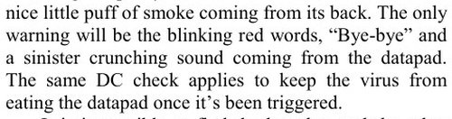
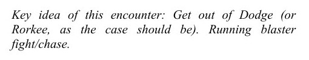
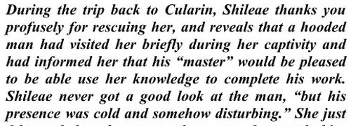
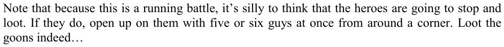
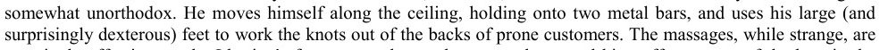
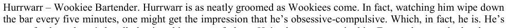

# Owner Material 037 — Star Wars D20 Drive folder (Core, Revised Core and Saga Edition): Living Force Campaign/Adventures/Among the Stars/Year 1/109 - Clouds of Genarius - Head in the Clouds.pdf [Star Wars Roleplaying Game Revised Core (d20, 2002)]

- **Source:** Wizards of the Coast Star Wars Roleplaying Game books, web enhancements, Living Force campaign modules and articles (2000–2010), from the owner's "Star Wars D20" Drive folder (only the three edition subfolders; "General" was not read, as instructed). Secondary source (licensed Legends reference). Scan OCR'd on the box; the scan stays box-only and is **not** published.
- **Method:** every scanned page was OCR'd and machine-screened sentence by sentence for power-relevant statements (fights, kills, defeats, Force feats, rankings, superweapons) that name a character on our roster; each kept sentence is quoted verbatim from the OCR text and has a crop of the printed passage directly under it. Pages with nothing power-relevant are still listed with what is on them.
- **Citation:** "*109 - Clouds of Genarius - Head in the Clouds* (SWRPG d20 Revised Core), p.X" by printed page ("scan p.X" where no printed number applies). **Weight:** Licensed RPG material: a secondary source. Narrative text sums up Legends lore; game statistics are rules for players, not canon power levels, and rank lowest.

## p.1 (scan page 1)

Page contents: 111 words, 6 paragraphs | headings/entries: Head in the Clouds; A One-Round Living Force Adventure

## p.2 (scan page 2)

Page contents: 873 words, 23 paragraphs | headings/entries: Hero Earnings; Post-Scenario Paperwork; Dark Side Points; General Notes to the GM; Head in the Clouds; Page 2

## p.3 (scan page 3)

Page contents: 812 words, 27 paragraphs | headings/entries: DM Overview; Plot Summary; Encounter 1:; Encounter 2:; Encounter 3:; Encounter 4:; Encounter 5:; Encounter 6:; Encounter 7:; Head in the Clouds; Page 3

## p.4 (scan page 4)

Page contents: 828 words, 18 paragraphs | headings/entries: Opening Crawl; Encounter 1:; Head in the Clouds; Page 4

## p.1–4 (scan page 1)

Page contents: Title; RPGA scoring; GM notes; DM overview; plot summary; crawl (hand-read)

## p.5 (scan page 5)

Page contents: 869 words, 16 paragraphs | headings/entries: Encounter 2:; Encounter 3:; Head in the Clouds; Page 5

## p.4–5 (scan page 4)

Page contents: Enc 1: Fesvk Wefos hires heroes; background Q&A (hand-read)

## p.6 (scan page 6)

Page contents: 966 words, 18 paragraphs | headings/entries: Head in the Clouds; Page 6

## p.7 (scan page 7)

Page contents: 790 words, 29 paragraphs | headings/entries: Head in the Clouds; Page 7

## p.8 (scan page 8)

Page contents: Enc 4: dig site; Blibbie; secret door (hand-read)

- **No single roster character (rules/setting/general)** — entry/section: Datapad virus: "Bye-bye": "The only warning will be the blinking red words, "Bye-bye" and a sinister crunching sound coming from the datapad." Source: *109 - Clouds of Genarius - Head in the Clouds* (SWRPG d20 Revised Core), p.8
  

## p.5–8 (scan page 5)

Page contents: Enc 2-3: arrival at Rorkee; Lujei; hotel tour; sabacc rules; clues; brawler chip virus (hand-read)

## p.9 (scan page 9)

Page contents: 836 words, 26 paragraphs | headings/entries: Encounter 6:; Conclusion:; Head in the Clouds; Page 9

- **No single roster character (rules/setting/general)** — entry/section: "Get out of Dodge (or Rorkee...)": "Key idea of this encounter: Get out of Dodge (or Rorkee, as the case should be). Running blaster fight/chase." Source: *109 - Clouds of Genarius - Head in the Clouds* (SWRPG d20 Revised Core), p.9
  
- **No single roster character (rules/setting/general)** — entry/section: Hooded man's "master" (Shileae): "Shileae thanks you profusely for rescuing her, and reveals that a hooded man had visited her briefly during her captivity and had informed her that his "master" would be pleased to be able use her knowledge to complete his work. Shileae never got a good look at the man, "but his presence was cold and somehow disturbing."" Source: *109 - Clouds of Genarius - Head in the Clouds* (SWRPG d20 Revised Core), p.9
  

## p.10 (scan page 10)

Page contents: 331 words, 21 paragraphs | headings/entries: Here Ends Head in the Clouds; Experience Point Summary; Adventure Experience Award:; Loot Summary; Encounter 3; Conclusion; Head in the Clouds; Page 10

## p.8–10 (scan page 8)

Page contents: Enc 5-6: service tunnels; escape; conclusion; XP; loot (hand-read)

## p.11 (scan page 11)

Page contents: 123 words, 3 paragraphs | headings/entries: Player Handout 1:; Head in the Clouds Page 11

## p.12 (scan page 12)

Page contents: 232 words, 3 paragraphs | headings/entries: Player Handout 2:; Head in the Clouds Page 12

## p.13 (scan page 13)

Page contents: 38 words, 3 paragraphs | headings/entries: Player Handout 3:; Head in the Clouds Page 13

## p.14 (scan page 14)

Page contents: 13 words, 3 paragraphs | headings/entries: Player Handout 4 Map of Dig Site; Page 14; Head in the Clouds

## p.15 (scan page 15)

Page contents: 36 words, 4 paragraphs | headings/entries: DM Aid #1:; Page 15; Head in the Clouds

## p.16 (scan page 16)

Page contents: 24 words, 6 paragraphs | headings/entries: A= Collapse Area; B = Blbbie Emerged; S = Secret Door; DM Aid #2 Map of Dig Site; Page 16; Head in the Clouds

## p.17 (scan page 17)

Page contents: 42 words, 15 paragraphs | headings/entries: ECEEEEEE Hn ae; Fpapopoe be Ee; HECHE-EeE EEE -CPEC-Pa Pe; SUL AESAAAEREEREU ERUSUUUERRREEEEREE; BOgiaie besastonats; Map of Work Area; DM Aid #3:; Page 17; Head in the Clouds

## p.11–17 (scan page 11)

Page contents: Player handouts; maps (hand-read)

## p.18 (scan page 18)

Page contents: Goon stats (Thug 1 / Thug 3) (hand-read)

- **No single roster character (rules/setting/general)** — entry/section: "Loot the goons indeed...": "Note that because this is a running battle, it's silly to think that the heroes are going to stop and loot. If they do, open up on them with five or six guys at once from around a corner. Loot the goons indeed..." Source: *109 - Clouds of Genarius - Head in the Clouds* (SWRPG d20 Revised Core), p.18
  

## p.19 (scan page 19)

Page contents: 764 words, 13 paragraphs | headings/entries: Appendix A: NPCs; Casino NPCs:; Restaurant/Stage NPCs:; Head in the Clouds Page 19

## p.20 (scan page 20)

Page contents: 700 words, 11 paragraphs | headings/entries: Day Spa NPCs:; Front Desk NPCs:; Bar NPCs:; Dig NPCs:; Head in the Clouds Page 20

- **No single roster character (rules/setting/general)** — entry/section: Ulo Enan's foot massage: "He moves himself along the ceiling, holding onto two metal bars, and uses his large (and surprisingly dexterous) feet to work the knots out of the backs of prone customers." Source: *109 - Clouds of Genarius - Head in the Clouds* (SWRPG d20 Revised Core), p.20
  
- **No single roster character (rules/setting/general)** — entry/section: Hurrwarr the neat-freak Wookiee: "Hurrwarr is as neatly groomed as Wookiees come. In fact, watching him wipe down the bar every five minutes, one might get the impression that he's obsessive-compulsive. Which, in fact, he is." Source: *109 - Clouds of Genarius - Head in the Clouds* (SWRPG d20 Revised Core), p.20
  

## p.21 (scan page 21)

Page contents: 131 words, 5 paragraphs | headings/entries: Head in the Clouds Page 21

## p.19–21 (scan page 19)

Page contents: Appendix A NPCs; critical event summary (hand-read)

