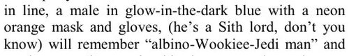
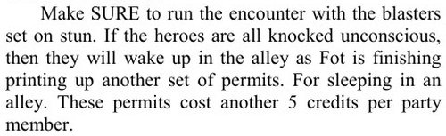
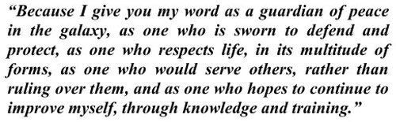
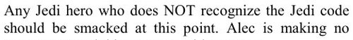
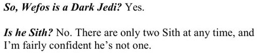
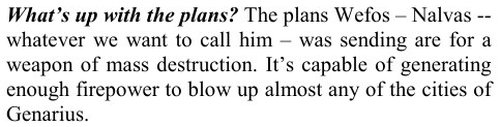
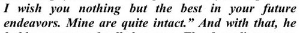
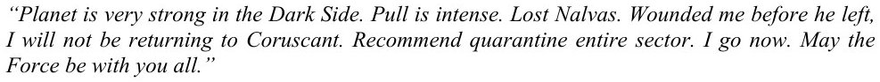
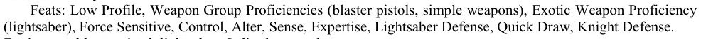

# Owner Material 037 — Star Wars D20 Drive folder (Core, Revised Core and Saga Edition): Living Force Campaign/Adventures/Among the Stars/Year 1/110 - Clouds of Genarius - Clouded Paths.pdf [Star Wars Roleplaying Game Revised Core (d20, 2002)]

- **Source:** Wizards of the Coast Star Wars Roleplaying Game books, web enhancements, Living Force campaign modules and articles (2000–2010), from the owner's "Star Wars D20" Drive folder (only the three edition subfolders; "General" was not read, as instructed). Secondary source (licensed Legends reference). Scan OCR'd on the box; the scan stays box-only and is **not** published.
- **Method:** every scanned page was OCR'd and machine-screened sentence by sentence for power-relevant statements (fights, kills, defeats, Force feats, rankings, superweapons) that name a character on our roster; each kept sentence is quoted verbatim from the OCR text and has a crop of the printed passage directly under it. Pages with nothing power-relevant are still listed with what is on them.
- **Citation:** "*110 - Clouds of Genarius - Clouded Paths* (SWRPG d20 Revised Core), p.X" by printed page ("scan p.X" where no printed number applies). **Weight:** Licensed RPG material: a secondary source. Narrative text sums up Legends lore; game statistics are rules for players, not canon power levels, and rank lowest.

## p.1 (scan page 1)

Page contents: 141 words, 6 paragraphs | headings/entries: Clouded Paths; A One-Round Living Force Adventure

## p.2 (scan page 2)

Page contents: 857 words, 27 paragraphs | headings/entries: Clouded Paths is a_ standard RPGA Network; Hero Earnings; Post-Scenario Paperwork; Dark Side Points; General Notes to the GM; Clouded Paths; Page 2

## p.3 (scan page 3)

Page contents: 847 words, 23 paragraphs | headings/entries: DM Overview; Encounter 1: Into the Clouds, Again; Encounter 2: Arrival at Depatar; Encounter 3: Grande Game?; Encounter 4: Club 111; Encounter 5: Is that Permitted?; Encounter 6: Five Star Entertainment; Encounter 7: Closure; Clouded Paths; Page 3

## p.4 (scan page 4)

Page contents: 881 words, 20 paragraphs | headings/entries: Opening Crawl; Encounter 1: Into the Clouds, Again; Clouded Paths; Page 4

## p.1–4 (scan page 1)

Page contents: Title; RPGA scoring; GM notes; DM overview; encounter summaries; crawl (hand-read)

## p.5 (scan page 5)

Page contents: 833 words, 24 paragraphs | headings/entries: Encounter 2: Arrival at Depatar; Clouded Paths; Page 5

## p.4–5 (scan page 4)

Page contents: Enc 1: Fesvk Wefos hires heroes again (hand-read)

## p.6 (scan page 6)

Page contents: 951 words, 17 paragraphs | headings/entries: Clouded Paths; Page 6

## p.7 (scan page 7)

Page contents: 887 words, 23 paragraphs | headings/entries: Encounter 3: Grande Game?; Asking Around; Clouded Paths; Page 7

## p.5–7 (scan page 5)

Page contents: Enc 2: Depatar; permitors; Fot Ducela; leads (hand-read)

## p.8 (scan page 8)

Page contents: 879 words, 24 paragraphs | headings/entries: Encounter 4: Club 111; The Line; On the Inside; Clouded Paths; Page 8

- **No single roster character (rules/setting/general)** — entry/section: "he's a Sith lord, don't you know": "a male in glow-in-the-dark blue with a neon orange mask and gloves, (he's a Sith lord, don't you know) will remember "albino-Wookiee-Jedi man"" Source: *110 - Clouds of Genarius - Clouded Paths* (SWRPG d20 Revised Core), p.8
  

## p.7–8 (scan page 7)

Page contents: Enc 3: Grande Game casino; gambling rules; clues (hand-read)

## p.9 (scan page 9)

Page contents: 806 words, 30 paragraphs | headings/entries: Encounter 5: Is that Permitted?; Lower Levels (1-3); Clouded Paths; Page 9

## p.8–9 (scan page 8)

Page contents: Enc 4: Club 111; Sebaracca; clues (hand-read)

## p.10 (scan page 10)

Page contents: 804 words, 28 paragraphs | headings/entries: Higher Levels (4-6); Encounter 6: Five Star Entertainment; Sneaky Way In; Clouded Paths; Page 10

- **No single roster character (rules/setting/general)** — entry/section: "For sleeping in an alley.": "If the heroes are all knocked unconscious, then they will wake up in the alley as Fot is finishing printing up another set of permits. For sleeping in an alley. These permits cost another 5 credits per party member." Source: *110 - Clouds of Genarius - Clouded Paths* (SWRPG d20 Revised Core), p.10
  

## p.9–10 (scan page 9)

Page contents: Enc 5: permitted ambush; Ambush Squad stats (hand-read)

## p.11 (scan page 11)

Page contents: 789 words, 28 paragraphs | headings/entries: On the Stage; If the heroes open fire; If the heroes talk; Encounter 7: Closure?; Clouded Paths; Page 11

- **No single roster character (rules/setting/general)** — entry/section: Alec's oath: ""Because I give you my word as a guardian of peace in the galaxy, as one who is sworn to defend and protect, as one who respects life, in its multitude of forms, as one who would serve others, rather than ruling over them, and as one who hopes to continue to improve myself, through knowledge and training."" Source: *110 - Clouds of Genarius - Clouded Paths* (SWRPG d20 Revised Core), p.11
  
- **No single roster character (rules/setting/general)** — entry/section: Smack Jedi who miss the Code: "Any Jedi hero who does NOT recognize the Jedi code should be smacked at this point." Source: *110 - Clouds of Genarius - Clouded Paths* (SWRPG d20 Revised Core), p.11
  

## p.10–11 (scan page 10)

Page contents: Enc 6: Five Star theater; Danil; Alec; Defense Squad stats (hand-read)

## p.12 (scan page 12)

Page contents: 853 words, 29 paragraphs | headings/entries: Conclusion; Clouded Paths; Page 12

- **No single roster character (rules/setting/general)** — entry/section: "There are only two Sith at any time": "Is he Sith? No. There are only two Sith at any time, and I'm fairly confident he's not one." Source: *110 - Clouds of Genarius - Clouded Paths* (SWRPG d20 Revised Core), p.12
  
- **No single roster character (rules/setting/general)** — entry/section: Weapon of mass destruction: "The plans Wefos -- Nalvas -whatever we want to call him -- was sending are for a weapon of mass destruction. It's capable of generating enough firepower to blow up almost any of the cities of Genarius." Source: *110 - Clouds of Genarius - Clouded Paths* (SWRPG d20 Revised Core), p.12
  

## p.13 (scan page 13)

Page contents: 764 words, 23 paragraphs | headings/entries: Here Ends Clouded Paths; Experience Point Summary; Clouded Paths; Page 13

- **No single roster character (rules/setting/general)** — entry/section: "Mine are quite intact.": ""I wish you nothing but the best in your future endeavors. Mine are quite intact."" Source: *110 - Clouds of Genarius - Clouded Paths* (SWRPG d20 Revised Core), p.13
  

## p.14 (scan page 14)

Page contents: 261 words, 7 paragraphs | headings/entries: Loot Summary; Clouded Paths; Page 14

## p.11–14 (scan page 11)

Page contents: Enc 7: Q&A with Alec; conclusion; astromech bomb; XP; loot (hand-read)

## p.15 (scan page 15)

Page contents: 825 words, 16 paragraphs | headings/entries: Player Handout 1: Background on Depatar; Sample permit prices are listed below:; Clouded Paths; Page 15

## p.16 (scan page 16)

Page contents: 176 words, 5 paragraphs | headings/entries: Player Handout #2: Karae Nalvas; Clouded Paths Page 16

- **No single roster character (rules/setting/general)** — entry/section: Nalvas's Master's last transmission: ""Planet is very strong in the Dark Side. Pull is intense. Lost Nalvas. Wounded me before he left, I will not be returning to Coruscant. Recommend quarantine entire sector. I go now. May the Force be with you all."" Source: *110 - Clouds of Genarius - Clouded Paths* (SWRPG d20 Revised Core), p.16
  

## p.15–16 (scan page 15)

Page contents: Handout 1 Depatar background; Handout 2 Karae Nalvas (hand-read)

## p.17 (scan page 17)

Page contents: 751 words, 17 paragraphs | headings/entries: The Grande Game NPC suggestions:; Club 111 NPC suggestions:; Clouded Paths; Page 17

## p.18 (scan page 18)

Page contents: 258 words, 7 paragraphs | headings/entries: Appendix A: Other NPC Stats; Clouded Paths Page 18

- **No single roster character (rules/setting/general)** — entry/section: Alec, Jedi Guardian 8 (feats): "Feats: Low Profile, Weapon Group Proficiencies (blaster pistols, simple weapons), Exotic Weapon Proficiency (lightsaber), Force Sensitive, Control, Alter, Sense, Expertise, Lightsaber Defense, Quick Draw, Knight Defense." Source: *110 - Clouds of Genarius - Clouded Paths* (SWRPG d20 Revised Core), p.18
  

## p.19 (scan page 19)

Page contents: 155 words, 9 paragraphs | headings/entries: Critical Event Summary Clouded Paths; Clouded Paths Page 19

## p.17–19 (scan page 17)

Page contents: DM Aid NPCs; Appendix A stats (Fot Ducela, Alec); critical event summary (hand-read)

