# Owner Material 037 — Star Wars D20 Drive folder (Core, Revised Core and Saga Edition): Living Force Campaign/Adventures/Among the Stars/Year 1/111 - Clouds of Genarius - Into the Storm Clouds.pdf [Star Wars Roleplaying Game Revised Core (d20, 2002)]

- **Source:** Wizards of the Coast Star Wars Roleplaying Game books, web enhancements, Living Force campaign modules and articles (2000–2010), from the owner's "Star Wars D20" Drive folder (only the three edition subfolders; "General" was not read, as instructed). Secondary source (licensed Legends reference). Scan OCR'd on the box; the scan stays box-only and is **not** published.
- **Method:** every scanned page was OCR'd and machine-screened sentence by sentence for power-relevant statements (fights, kills, defeats, Force feats, rankings, superweapons) that name a character on our roster; each kept sentence is quoted verbatim from the OCR text and has a crop of the printed passage directly under it. Pages with nothing power-relevant are still listed with what is on them.
- **Citation:** "*111 - Clouds of Genarius - Into the Storm Clouds* (SWRPG d20 Revised Core), p.X" by printed page ("scan p.X" where no printed number applies). **Weight:** Licensed RPG material: a secondary source. Narrative text sums up Legends lore; game statistics are rules for players, not canon power levels, and rank lowest.

## p.1 (scan page 1)

Page contents: 126 words, 6 paragraphs | headings/entries: Into the Storm Clouds; A One-Round Living Force Adventure

## p.2 (scan page 2)

Page contents: 867 words, 29 paragraphs | headings/entries: Character Earnings; Into the Storm Clouds; Post-Scenario Paperwork; General Notes to the GM; DM Overview; Page 2

## p.3 (scan page 3)

Page contents: 874 words, 22 paragraphs | headings/entries: Encounter 1: Old Friends; Encounter 2: Intelligence; Into the Storm Clouds; Encounter 3: Prelude; Encounter 5: Sabotage!; Encounter 7: Denouement; Page 3

## p.4 (scan page 4)

Page contents: 849 words, 23 paragraphs | headings/entries: Opening Crawl; Encounter 1: Old Friends; Into the Storm Clouds; Page 4

## p.1–4 (scan page 1)

Page contents: Title; RPGA scoring; GM notes; DM overview; encounter summaries; crawl (hand-read)

## p.5 (scan page 5)

Page contents: 880 words, 22 paragraphs | headings/entries: Into the Storm Clouds; Encounter 2: Intelligence; Page 5

## p.4–5 (scan page 4)

Page contents: Enc 1: Alec and Dr. Shilaea Motacc; briefing (hand-read)

## p.6 (scan page 6)

Page contents: 955 words, 23 paragraphs | headings/entries: Questions Alec can answer:; Into the Storm Clouds; Page 6

- **No single roster character (rules/setting/general)** — entry/section: "Are you nuts? This plan will never work!": "Are you nuts? This plan will never work! Like I said, feel free to modify it. But a frontal assault would never work. Add any stealthy touches you can think of." Source: *111 - Clouds of Genarius - Into the Storm Clouds* (SWRPG d20 Revised Core), p.6
  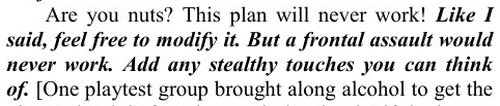
- **No single roster character (rules/setting/general)** — entry/section: "Valek is a Dangerous man": ""Be careful." He looks at each of you. "Even if you don't find Nalvas, you may run afoul of my former Padawan, who is now learning the dark side from Nalvas. Valek is a Dangerous man, and he still has my lightsaber." Source: *111 - Clouds of Genarius - Into the Storm Clouds* (SWRPG d20 Revised Core), p.6
  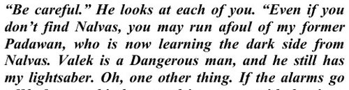

## p.7 (scan page 7)

Page contents: 915 words, 24 paragraphs | headings/entries: Encounter 3: Prelude; Into the Storm Clouds; Higher Tier; Page 7

- **No single roster character (rules/setting/general)** — entry/section: Pirate prank hail: ""Attention freighter, you are entering a restricted military test site. Stop your engines and prepare to be boarded. If you attempt to flee, you will be destroyed!"" Source: *111 - Clouds of Genarius - Into the Storm Clouds* (SWRPG d20 Revised Core), p.7
  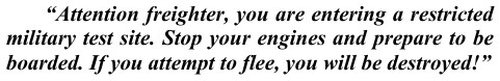

## p.5–7 (scan page 5)

Page contents: Enc 2: Alec's plan; Q&A (hand-read)

## p.8 (scan page 8)

Page contents: 862 words, 26 paragraphs | headings/entries: Into the Storm Clouds; Page 8

- **No single roster character (rules/setting/general)** — entry/section: Gus-Gus Tren hail: ""Yousa shuttle comin' to da restricted space. My gonna gib yousa ten seconds to gib da codes dat's keepin' yousa livin'." Source: *111 - Clouds of Genarius - Into the Storm Clouds* (SWRPG d20 Revised Core), p.8
  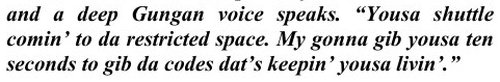
- **No single roster character (rules/setting/general)** — entry/section: Gus-Gus Tren on old codes: ""Yousa got da OLD codes. Whatta yousa haulin'? What yousa shuttle designatinger?"" Source: *111 - Clouds of Genarius - Into the Storm Clouds* (SWRPG d20 Revised Core), p.8
  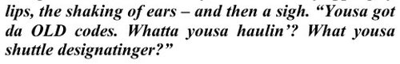

## p.7–8 (scan page 7)

Page contents: Enc 3: Asteroid L-7 pirates (Ytram, Naand, Triven) (hand-read)

## p.9 (scan page 9)

Page contents: 914 words, 26 paragraphs | headings/entries: DOCKING; Into the Storm Clouds; TO THE PROPULSION CENTER; Page 9

## p.10 (scan page 10)

Page contents: 869 words, 23 paragraphs | headings/entries: DC | Information 5 "Look, sir! Droids!"; Into the Storm Clouds; Encounter 5: Sabotage!; Page 10

- **No single roster character (rules/setting/general)** — entry/section: "Look, sir! Droids!": "DC | Information 5 "Look, sir! Droids!"" Source: *111 - Clouds of Genarius - Into the Storm Clouds* (SWRPG d20 Revised Core), p.10
  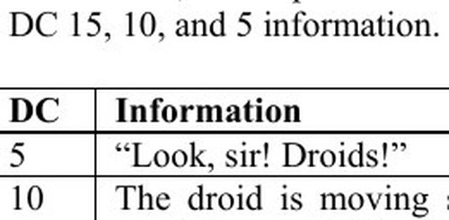
- **No single roster character (rules/setting/general)** — entry/section: "Stupid circuit.": "The droid mutters something quietly and brings a metal fist down on its own side. "Stupid circuit. Stupid circuit." It looks back at your group. "You good with droids? You good with droids?"" Source: *111 - Clouds of Genarius - Into the Storm Clouds* (SWRPG d20 Revised Core), p.10
  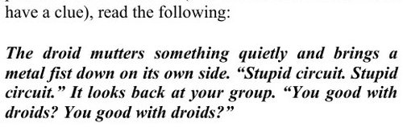

## p.8–10 (scan page 8)

Page contents: Enc 4: Gus-Gus Tren; docking; dark side pull; Tar Jiloma; security droid (hand-read)

## p.11 (scan page 11)

Page contents: 889 words, 24 paragraphs | headings/entries: LAYER ONE —- THE FLOOR; LAYER TWO — THE LOGIN; Into the Storm Clouds; LAYER THREE — THE ANTIVIRUS; LAYER FOUR — DID | MENTION GUARDS?; Page 11

## p.12 (scan page 12)

Page contents: 868 words, 26 paragraphs | headings/entries: Lower Tier; Into the Storm Clouds; Encounter 6: Fully Armed and Operational; RUNNING FIGHT; Page 12

- **No single roster character (rules/setting/general)** — entry/section: Reactor leak bluff: "assign 50 bonus XP to anyone who tries a variant on, "Um, negative, we've got a reactor leak here, we're trying to lock it down. Very Dangerous."" Source: *111 - Clouds of Genarius - Into the Storm Clouds* (SWRPG d20 Revised Core), p.12
  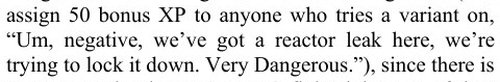

## p.10–12 (scan page 10)

Page contents: Enc 5: propulsion security layers; guards (hand-read)

## p.13 (scan page 13)

Page contents: 920 words, 24 paragraphs | headings/entries: IN THE HANGAR; Into the Storm Clouds; Lower Tier; Page 13

- **No single roster character (rules/setting/general)** — entry/section: Wefos: "Kill them!": ""It appears that I underestimated you." His holographic image shakes its head, and he pulls back the edge of his cloak, revealing a lightsaber at his belt. "If my beautiful city is going to go down, then you're going to go down with it. Enjoy your last moments of life. My apprentice, Saren Valek, will make them as painless as possible, as will my guards. "Kill them!"" Source: *111 - Clouds of Genarius - Into the Storm Clouds* (SWRPG d20 Revised Core), p.13
  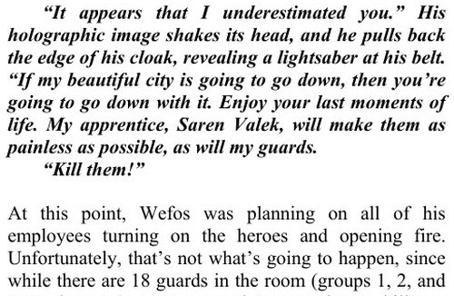

## p.14 (scan page 14)

Page contents: 888 words, 30 paragraphs | headings/entries: Into the Storm Clouds; STARTING THE SHIP; Encounter 7: Denouement; Page 14

- **No single roster character (rules/setting/general)** — entry/section: Saren Valek, Jedi Guardian 5 (feats): "Feats: Weapons (simple, blaster, lightsaber), Force Sensitive, Control, Heroic Surge, Dissipate Energy, Alter, Sense, Weapon Finesse: Lightsaber." Source: *111 - Clouds of Genarius - Into the Storm Clouds* (SWRPG d20 Revised Core), p.14
  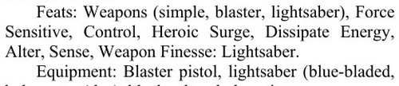

## p.12–14 (scan page 12)

Page contents: Enc 6: running fight; hangar; Wefos holo; Saren Valek; thug groups (hand-read)

## p.15 (scan page 15)

Page contents: 883 words, 20 paragraphs | headings/entries: Into the Storm Clouds; Dark Side Touch; Dark Side Reach; Page 15

## p.16 (scan page 16)

Page contents: 940 words, 20 paragraphs | headings/entries: Into the Storm Clouds; Conclusion; Page 16

## p.17 (scan page 17)

Page contents: 705 words, 29 paragraphs | headings/entries: Here Ends Into the Storm Clouds; Experience Point Summary; Into the Storm Clouds; Adventure Experience Award:; Loot Summary; From the Brotherhood:; From Conkesta:; Page 17

## p.18 (scan page 18)

Page contents: 471 words, 26 paragraphs | headings/entries: From the Escape: One per hero:; From Alec:; Into the Storm Clouds; From SoroSuub:; Page 18

## p.14–18 (scan page 14)

Page contents: Enc 7: escape; Dark Side Touch/Reach; conclusion; XP; loot (hand-read)

## p.19 (scan page 19)

Page contents: 15 words, 4 paragraphs | headings/entries: Page 19; Clouds; Into the Storm

## p.20 (scan page 20)

Page contents: 103 words, 22 paragraphs | headings/entries: Player Handout #2: Basic Map Legend; Hangar; Security Center; Showers; Backup Computer Center Kitchen; Mess Hall; Barracks; Hygiene Facilities; Storage Area; Storage Area; Storage Area; Storage Area; Storage Area; Storage Area; Storage Area; Into the Storm Clouds; Page 20

## p.21 (scan page 21)

Page contents: 556 words, 12 paragraphs | headings/entries: Player Handout #3: A Choice; Into the Storm Clouds Page 21

- **No single roster character (rules/setting/general)** — entry/section: Ghost Twi'lek: "forever will it dominate your destiny": ""If it is your will, you may embrace the dark side. You will live, much as you have lived all your life, but you will forever be tainted by the dark side. Once you begin down this path, forever will it dominate your destiny."" Source: *111 - Clouds of Genarius - Into the Storm Clouds* (SWRPG d20 Revised Core), p.21
  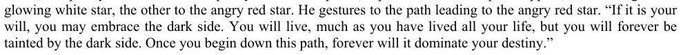

## p.22 (scan page 22)

Page contents: 19 words, 3 paragraphs | headings/entries: GM Aid #1: Map of Asteroid L-7; Basic Layout of Pirate. Asteroid L-7; Into the Storm Clouds Page 22

## p.23 (scan page 23)

Page contents: 950 words, 28 paragraphs | headings/entries: Il. Locked Storage Area: Empty; Into the Storm Clouds Page 23

- **No single roster character (rules/setting/general)** — entry/section: Elite strike force in the bathroom: "9. Hygiene Facilities: If anyone gets cute and says, "I have to go to the bathroom" on the way out, they're in trouble. There's an elite strike force assembling in this area -- 4 soldiers, 3 scoundrels, all high level." Source: *111 - Clouds of Genarius - Into the Storm Clouds* (SWRPG d20 Revised Core), p.23
  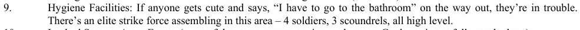
- **No single roster character (rules/setting/general)** — entry/section: "Crit on these droids, and they pop.": "And ALWAYS REMEMBER: Crit on these droids, and they pop." Source: *111 - Clouds of Genarius - Into the Storm Clouds* (SWRPG d20 Revised Core), p.23
  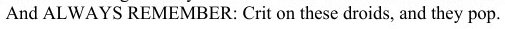

## p.24 (scan page 24)

Page contents: 65 words, 4 paragraphs | headings/entries: Into the Storm Clouds Page 24

## p.25 (scan page 25)

Page contents: 608 words, 30 paragraphs | headings/entries: Higher-level stat blocks; Into the Storm Clouds Page 25

## p.26 (scan page 26)

Page contents: 288 words, 14 paragraphs | headings/entries: Untiered Baddies; Into the Storm Clouds Page 26

## p.27 (scan page 27)

Page contents: 275 words, 10 paragraphs | headings/entries: Appendix B: Survey Questions for Event Onset; Ref Save; Will Save; Into the Storm Clouds Page 27

## p.28 (scan page 28)

Page contents: 186 words, 8 paragraphs | headings/entries: Critical Event Summary Into the Storm Clouds; Yes No; Into the Storm Clouds Page 28

## p.19–28 (scan page 19)

Page contents: Handouts; GM Aids; Appendix A stats; Appendix B; critical events (hand-read)

