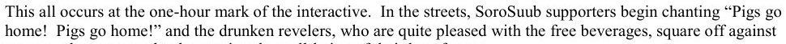
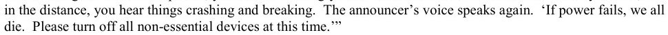
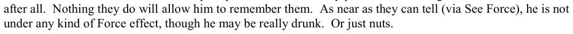
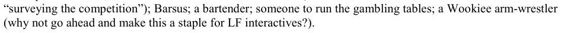
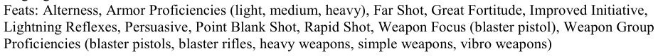
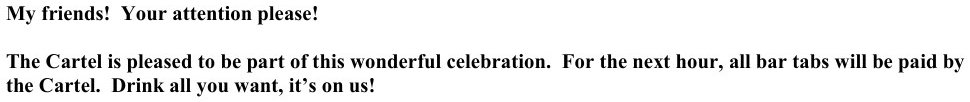
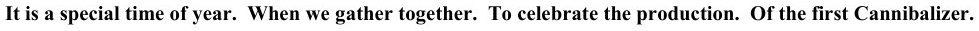
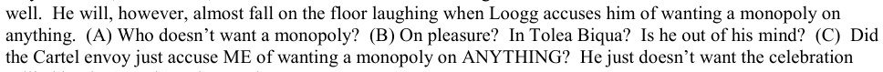
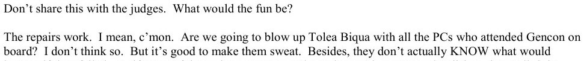
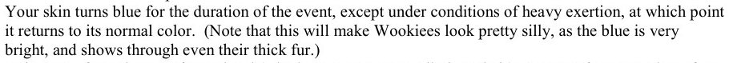

# Owner Material 037 — Star Wars D20 Drive folder (Core, Revised Core and Saga Edition): Living Force Campaign/Adventures/Among the Stars/Year 1/112 - Clouds of Genarius - Blown Away.pdf [Star Wars Roleplaying Game Revised Core (d20, 2002)]

- **Source:** Wizards of the Coast Star Wars Roleplaying Game books, web enhancements, Living Force campaign modules and articles (2000–2010), from the owner's "Star Wars D20" Drive folder (only the three edition subfolders; "General" was not read, as instructed). Secondary source (licensed Legends reference). Scan OCR'd on the box; the scan stays box-only and is **not** published.
- **Method:** every scanned page was OCR'd and machine-screened sentence by sentence for power-relevant statements (fights, kills, defeats, Force feats, rankings, superweapons) that name a character on our roster; each kept sentence is quoted verbatim from the OCR text and has a crop of the printed passage directly under it. Pages with nothing power-relevant are still listed with what is on them.
- **Citation:** "*112 - Clouds of Genarius - Blown Away* (SWRPG d20 Revised Core), p.X" by printed page ("scan p.X" where no printed number applies). **Weight:** Licensed RPG material: a secondary source. Narrative text sums up Legends lore; game statistics are rules for players, not canon power levels, and rank lowest.

## p.1 (scan page 1)

Page contents: 584 words, 14 paragraphs | headings/entries: Blown Away —- Gencon 2001; Blown Away; Gencon 2001 Living Force Interactive; By Morrie Mullins and Jason Nichols; The Story; The Details

## p.2 (scan page 2)

Page contents: 679 words, 16 paragraphs | headings/entries: Blown Away —- Gencon 2001; TURN THE LIGHTS BACK ON

- **No single roster character (rules/setting/general)** — entry/section: "Pigs go home!": "In the streets, SoroSuub supporters begin chanting "Pigs go home! Pigs go home!"" Source: *112 - Clouds of Genarius - Blown Away* (SWRPG d20 Revised Core), p.2
  
- **No single roster character (rules/setting/general)** — entry/section: "If power fails, we all die.": "The announcer's voice speaks again. 'If power fails, we all die. Please turn off all non-essential devices at this time.'" Source: *112 - Clouds of Genarius - Blown Away* (SWRPG d20 Revised Core), p.2
  

## p.3 (scan page 3)

Page contents: 463 words, 9 paragraphs | headings/entries: Blown Away - Gencon 2001

## p.1–3 (scan page 1)

Page contents: Story; announcement timeline; questions; group sign-ups (hand-read)

## p.4 (scan page 4)

Page contents: 188 words, 6 paragraphs | headings/entries: Blown Away - Gencon 2001; The Setting; Scene 1: The Big Party

- **No single roster character (rules/setting/general)** — entry/section: Xav Verivax: drunk or nuts: "As near as they can tell (via See Force), he is not under any kind of Force effect, though he may be really drunk. Or just nuts." Source: *112 - Clouds of Genarius - Blown Away* (SWRPG d20 Revised Core), p.4
  

## p.5 (scan page 5)

Page contents: 355 words, 6 paragraphs | headings/entries: Blown Away - Gencon 2001; Scene 2: Vanster Enan's Cantina

- **No single roster character (rules/setting/general)** — entry/section: Wookiee arm-wrestler staple: "a Wookiee arm-wrestler (why not go ahead and make this a staple for LF interactives?)." Source: *112 - Clouds of Genarius - Blown Away* (SWRPG d20 Revised Core), p.5
  

## p.6 (scan page 6)

Page contents: 546 words, 9 paragraphs | headings/entries: Blown Away —- Gencon 2001; Scene 3: Thaereian Military "Information Station"; NPC present: Major Kurth San; Equipment: Uniform, blaster pistol

- **No single roster character (rules/setting/general)** — entry/section: Major Kurth San (feats): "Feats: Alterness, Armor Proficiencies (light, medium, heavy), Far Shot, Great Fortitude, Improved Initiative, Lightning Reflexes, Persuasive, Point Blank Shot, Rapid Shot, Weapon Focus (blaster pistol), Weapon Group Proficiencies (blaster pistols, blaster rifles, heavy weapons, simple weapons, vibro weapons)" Source: *112 - Clouds of Genarius - Blown Away* (SWRPG d20 Revised Core), p.6
  

## p.7 (scan page 7)

Page contents: 78 words, 4 paragraphs | headings/entries: Blown Away - Gencon 2001; Scene 4: The Jedi Enclave; NPCs present: Various Jedi

## p.8 (scan page 8)

Page contents: 441 words, 16 paragraphs | headings/entries: Blown Away —- Gencon 2001; Scene 5: Taleah Novran's Force Adept Matchmakers; Taleah Novran (female, Tarasin); Traits: Strong-willed, even-handed, determined; Her agents are:; Dole Happ (Twi'lek Force Adept, Male); Traits: Lighthearted, Curious, Adventurous; Rilly Raadun (Sullustan Force Adept, Female); Otee Nom (Rodian Force Adept, Female); Traits: Practical, Thoughtful, Honest

## p.9 (scan page 9)

Page contents: 4 words, 1 paragraphs | headings/entries: 

## p.10 (scan page 10)

Page contents: 15 words, 3 paragraphs | headings/entries: Blown Away —- Gencon 2001

## p.4–10 (scan page 4)

Page contents: Scenes 1-7 (party, cantina, Thaereian station with Major Kurth San, Jedi enclave, Force Adept matchmakers, droid shop, placeholder) (hand-read)

## p.11 (scan page 11)

Page contents: 155 words, 7 paragraphs | headings/entries: Blown Away - Gencon 2001; Scene 8: The Debate Room

## p.12 (scan page 12)

Page contents: 162 words, 7 paragraphs | headings/entries: Blown Away - Gencon 2001; The Opening

## p.13 (scan page 13)

Page contents: 364 words, 10 paragraphs | headings/entries: Blown Away - Gencon 2001; Thurm Loogg's address; My friends! Your attention please!

- **No single roster character (rules/setting/general)** — entry/section: Thurm Loogg's address: "My friends! Your attention please! The Cartel is pleased to be part of this wonderful celebration. For the next hour, all bar tabs will be paid by the Cartel. Drink all you want, it's on us!" Source: *112 - Clouds of Genarius - Blown Away* (SWRPG d20 Revised Core), p.13
  

## p.14 (scan page 14)

Page contents: 454 words, 13 paragraphs | headings/entries: Blown Away —- Gencon 2001; Miim Te'Suub's address; Miim's motivations are as follow:

- **No single roster character (rules/setting/general)** — entry/section: Miim Te'Suub's address: "It is a special time of year. When we gather together. To celebrate the production. Of the first Cannibalizer." Source: *112 - Clouds of Genarius - Blown Away* (SWRPG d20 Revised Core), p.14
  
- **No single roster character (rules/setting/general)** — entry/section: Monopoly on pleasure: "(A) Who doesn't want a monopoly? (B) On pleasure? In Tolea Biqua? Is he out of his mind? (C) Did the Cartel envoy just accuse ME of wanting a monopoly on ANYTHING?" Source: *112 - Clouds of Genarius - Blown Away* (SWRPG d20 Revised Core), p.14
  

## p.11–14 (scan page 11)

Page contents: Scene 8 debate room; opening handout; Loogg and Te'Suub addresses (hand-read)

## p.15 (scan page 15)

Page contents: 400 words, 10 paragraphs | headings/entries: Blown Away —- Gencon 2001; Side Event 1: The Mediators

## p.16 (scan page 16)

Page contents: 661 words, 18 paragraphs | headings/entries: Blown Away —- Gencon 2001; Side Event 2: Fighting Your Way Through

## p.17 (scan page 17)

Page contents: 192 words, 4 paragraphs | headings/entries: Blown Away - Gencon 2001

## p.18 (scan page 18)

Page contents: 604 words, 13 paragraphs | headings/entries: Blown Away —- Gencon 2001; Side Event 3: The Task at Hand

## p.15–18 (scan page 15)

Page contents: Side Events 1-3 (mediators; fighting through with Cerean triplets; generator repair) (hand-read)

## p.19 (scan page 19)

Page contents: 208 words, 8 paragraphs | headings/entries: Blown Away - Gencon 2001; FOR THE INTERACTIVE STAFF ONLY

- **No single roster character (rules/setting/general)** — entry/section: "Are we going to blow up Tolea Biqua": "The repairs work. I mean, c'mon. Are we going to blow up Tolea Biqua with all the PCs who attended Gencon on board? I don't think so. But it's good to make them sweat." Source: *112 - Clouds of Genarius - Blown Away* (SWRPG d20 Revised Core), p.19
  

## p.20 (scan page 20)

Page contents: 743 words, 38 paragraphs | headings/entries: Blown Away —- Gencon 2001; Appendix: Minor Radiation Effects; SOOO SON S89) [S91

- **No single roster character (rules/setting/general)** — entry/section: Blue skin radiation effect: "Your skin turns blue for the duration of the event, except under conditions of heavy exertion, at which point it returns to its normal color. (Note that this will make Wookiees look pretty silly, as the blue is very bright, and shows through even their thick fur.)" Source: *112 - Clouds of Genarius - Blown Away* (SWRPG d20 Revised Core), p.20
  

## p.19–20 (scan page 19)

Page contents: Staff-only ending; minor radiation effects (hand-read)

