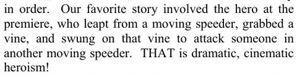
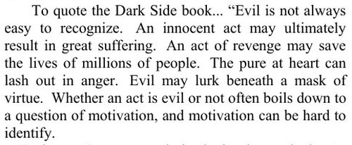
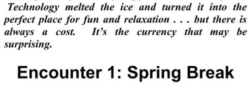
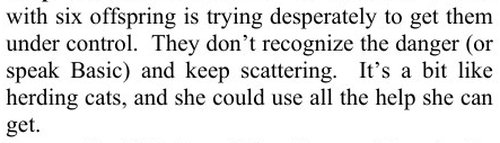
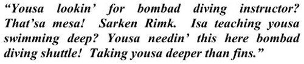
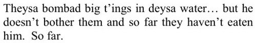
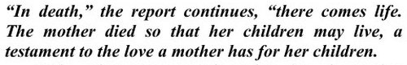
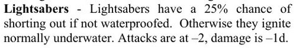

# Owner Material 037 — Star Wars D20 Drive folder (Core, Revised Core and Saga Edition): Living Force Campaign/Adventures/Among the Stars/Year 1/113 - Broken Orbits - Depths of Dorumaa.pdf [Star Wars Roleplaying Game Revised Core (d20, 2002)]

- **Source:** Wizards of the Coast Star Wars Roleplaying Game books, web enhancements, Living Force campaign modules and articles (2000–2010), from the owner's "Star Wars D20" Drive folder (only the three edition subfolders; "General" was not read, as instructed). Secondary source (licensed Legends reference). Scan OCR'd on the box; the scan stays box-only and is **not** published.
- **Method:** every scanned page was OCR'd and machine-screened sentence by sentence for power-relevant statements (fights, kills, defeats, Force feats, rankings, superweapons) that name a character on our roster; each kept sentence is quoted verbatim from the OCR text and has a crop of the printed passage directly under it. Pages with nothing power-relevant are still listed with what is on them.
- **Citation:** "*113 - Broken Orbits - Depths of Dorumaa* (SWRPG d20 Revised Core), p.X" by printed page ("scan p.X" where no printed number applies). **Weight:** Licensed RPG material: a secondary source. Narrative text sums up Legends lore; game statistics are rules for players, not canon power levels, and rank lowest.

## p.1 (scan page 1)

Page contents: 146 words, 6 paragraphs | headings/entries: Depths of Dorumaa; Broken Orbits |; A One-Round Living Force Adventure

## p.2 (scan page 2)

Page contents: 874 words, 22 paragraphs | headings/entries: Depths of Dorumaa; Character Earnings; Post-Scenario Paperwork; Issuing Force and Dark Side Points; Page 2

- **No single roster character (rules/setting/general)** — entry/section: Vine-swinging Force Point story: "Our favorite story involved the hero at the premiere, who leapt from a moving speeder, grabbed a vine, and swung on that vine to attack someone in another moving speeder. THAT is dramatic, cinematic heroism!" Source: *113 - Broken Orbits - Depths of Dorumaa* (SWRPG d20 Revised Core), p.2
  

## p.3 (scan page 3)

Page contents: 873 words, 24 paragraphs | headings/entries: General Notes to the GM; Depths of Dorumaa; GM Overview; Page 3

- **No single roster character (rules/setting/general)** — entry/section: Dark Side book quoted: ""Evil is not always easy to recognize. An innocent act may ultimately result in great suffering. An act of revenge may save the lives of millions of people. The pure at heart can lash out in anger. Evil may lurk beneath a mask of virtue. Whether an act is evil or not often boils down to a question of motivation, and motivation can be hard to identify." Source: *113 - Broken Orbits - Depths of Dorumaa* (SWRPG d20 Revised Core), p.3
  

## p.4 (scan page 4)

Page contents: 756 words, 33 paragraphs | headings/entries: Encounter 1: Spring Break; Encounter 2: Splash Down; Encounter 3: Run Silent, Run Deep; Encounter 7: A Whale of a Tale; Depths of Dorumaa; Opening Crawl; Encounter 1: Spring Break; Page 4

- **No single roster character (rules/setting/general)** — entry/section: Crawl: "It's the currency that may be surprising.": "Technology melted the ice and turned it into the perfect place for fun and relaxation ... but there is always a cost. It's the currency that may be surprising." Source: *113 - Broken Orbits - Depths of Dorumaa* (SWRPG d20 Revised Core), p.4
  

## p.1–4 (scan page 1)

Page contents: Title; RPGA scoring; Force/DSP guidance; GM notes; overview; encounter summaries; crawl (hand-read)

## p.5 (scan page 5)

Page contents: 834 words, 23 paragraphs | headings/entries: Encounter 2: Splash Down; Depths of Dorumaa; Page 5

- **No single roster character (rules/setting/general)** — entry/section: "a bit like herding cats": "They don't recognize the danger (or speak Basic) and keep scattering. It's a bit like herding cats, and she could use all the help she can get." Source: *113 - Broken Orbits - Depths of Dorumaa* (SWRPG d20 Revised Core), p.5
  

## p.4–5 (scan page 4)

Page contents: Enc 1: meteor strike, tidal wave, rescues (hand-read)

## p.6 (scan page 6)

Page contents: 816 words, 26 paragraphs | headings/entries: Depths of Dorumaa; Encounter 3: Run Silent, Run Deep; Page 6

## p.5–6 (scan page 5)

Page contents: Enc 2: El'Tar Miskin and Mar Daghreb hire the heroes (hand-read)

## p.7 (scan page 7)

Page contents: 832 words, 40 paragraphs | headings/entries: Depths of Dorumaa; Page 7

- **No single roster character (rules/setting/general)** — entry/section: Sarken Rimk greeting: ""Yousa lookin' for bombad diving instructor? That'sa mesa! Sarken Rimk. Isa teaching yousa swimming deep? Yousa needin' this here bombad diving shuttle! Taking yousa deeper than fins."" Source: *113 - Broken Orbits - Depths of Dorumaa* (SWRPG d20 Revised Core), p.7
  
- **No single roster character (rules/setting/general)** — entry/section: Sarken: "So far.": "Theysa bombad big tings in deysa water... but he doesn't bother them and so far they haven't eaten him. So far." Source: *113 - Broken Orbits - Depths of Dorumaa* (SWRPG d20 Revised Core), p.7
  

## p.8 (scan page 8)

Page contents: Enc 4: dive; the Leviathan (hand-read)

## p.6–8 (scan page 6)

Page contents: Enc 3: Rena Laut; Sarken Rimk; gear (hand-read)

## p.9 (scan page 9)

Page contents: 767 words, 37 paragraphs | headings/entries: Skills: Intimidate +2, Listen +2, Swim +8; Feats: Weapon Group Proficiency (vibroweapons); Skills: Intimidate +2, Swim +4; Feats: Weapon Group Proficiency (vibroweapons); Skills: Intimidate +2, Swim +4; Feats: Weapon Group Proficiency (vibroweapons); Depths of Dorumaa; Weapon Group; Divestream AquaSkimmer; Page 9

## p.8–9 (scan page 8)

Page contents: Enc 5: poachers; AquaSkimmer (hand-read)

## p.10 (scan page 10)

Page contents: 740 words, 25 paragraphs | headings/entries: Encounter 6: All Creatures Great and Small; Feats: Power Attack; Encounter 7: A Whale of a Tale; Depths of Dorumaa; If the calves survived, add the following:; Conclusion; If the calves survived, read the following:; Page 10

## p.11 (scan page 11)

Page contents: 579 words, 26 paragraphs | headings/entries: If the calves died, read the following:; Continue with the following:; Uffel..."; Here Ends, "Depths of Dorumaa"; Experience Point Summary; Depths of Dorumaa; Adventure Experience Award:; Loot Summary; Page 11

- **No single roster character (rules/setting/general)** — entry/section: "In death, there comes life.": ""In death," the report continues, "there comes life. The mother died so that her children may live, a testament to the love a mother has for her children." Source: *113 - Broken Orbits - Depths of Dorumaa* (SWRPG d20 Revised Core), p.11
  

## p.10–11 (scan page 10)

Page contents: Enc 6-7: calves; return; conclusion; XP; loot (hand-read)

## p.12 (scan page 12)

Page contents: 702 words, 22 paragraphs | headings/entries: Appendix A: Underwater Adventuring; Breathing; Drowning; Depths of Dorumaa; Speech; Visibility; Temperature; Combat; Page 12

- **No single roster character (rules/setting/general)** — entry/section: Lightsabers underwater: "Lightsabers - Lightsabers have a 25% chance of shorting out if not waterproofed. Otherwise they ignite normally underwater. Attacks are at -2, damage is —1d." Source: *113 - Broken Orbits - Depths of Dorumaa* (SWRPG d20 Revised Core), p.12
  

## p.13 (scan page 13)

Page contents: 101 words, 5 paragraphs | headings/entries: Critical Event Summary; Depths of Dorumaa Page 13

## p.12–13 (scan page 12)

Page contents: Appendix A underwater rules; critical events (hand-read)

