# Owner Material 037 — Star Wars D20 Drive folder (Core, Revised Core and Saga Edition): Living Force Campaign/Adventures/Among the Stars/Year 1/114 - Broken Orbits - Something Uffel.pdf [Star Wars Roleplaying Game Revised Core (d20, 2002)]

- **Source:** Wizards of the Coast Star Wars Roleplaying Game books, web enhancements, Living Force campaign modules and articles (2000–2010), from the owner's "Star Wars D20" Drive folder (only the three edition subfolders; "General" was not read, as instructed). Secondary source (licensed Legends reference). Scan OCR'd on the box; the scan stays box-only and is **not** published.
- **Method:** every scanned page was OCR'd and machine-screened sentence by sentence for power-relevant statements (fights, kills, defeats, Force feats, rankings, superweapons) that name a character on our roster; each kept sentence is quoted verbatim from the OCR text and has a crop of the printed passage directly under it. Pages with nothing power-relevant are still listed with what is on them.
- **Citation:** "*114 - Broken Orbits - Something Uffel* (SWRPG d20 Revised Core), p.X" by printed page ("scan p.X" where no printed number applies). **Weight:** Licensed RPG material: a secondary source. Narrative text sums up Legends lore; game statistics are rules for players, not canon power levels, and rank lowest.

## p.1 (scan page 1)

Page contents: 111 words, 6 paragraphs | headings/entries: Something Uffel

## p.2 (scan page 2)

Page contents: 873 words, 22 paragraphs | headings/entries: Something Uffel; Character Earnings; Post-Scenario Paperwork; Issuing Force and Dark Side Points; Page 2

## p.3 (scan page 3)

Page contents: 859 words, 19 paragraphs | headings/entries: General Notes to the GM; Something Uffel; DM Overview; Encounter 1: The Tour; Page 3

- **No single roster character (rules/setting/general)** — entry/section: Hesk Beldross's last order: ""Bring me all of your kind that you can. I want droids. Lots of droids."" Source: *114 - Broken Orbits - Something Uffel* (SWRPG d20 Revised Core), p.3
  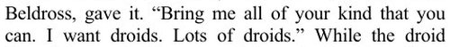

## p.4 (scan page 4)

Page contents: 825 words, 23 paragraphs | headings/entries: Encounter 2: Line One (MSF Droids); Encounter 3: Line Two (Protocol Droids); Encounter 4: Line Three (Military Grade; Encounter 5: R&D; Encounter 6: Security Summons; Encounter 7: Stop, or I'll Reprogram!; Something Uffel; Opening Crawl; Encounter 1: The Tour; Page 4

- **No single roster character (rules/setting/general)** — entry/section: Judges: "We're dealing with droids, here.": "Important Note to Judges: We're dealing with droids, here. Some of the players' favorite tricks are not going to work. Affect Mind, See Force, Sense Motive — if what they're trying to do depends on the other individual being alive, then it just isn't going to work." Source: *114 - Broken Orbits - Something Uffel* (SWRPG d20 Revised Core), p.4
  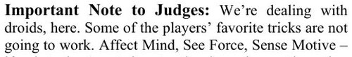

## p.1–4 (scan page 1)

Page contents: Title; boilerplate; overview (LN-73, Hesk Beldross); encounter summaries; crawl (hand-read)

## p.5 (scan page 5)

Page contents: 905 words, 18 paragraphs | headings/entries: Something Uffel; Page 5

## p.6 (scan page 6)

Page contents: 874 words, 24 paragraphs | headings/entries: Something Uffel; Page 6

## p.7 (scan page 7)

Page contents: 911 words, 24 paragraphs | headings/entries: Something Uffel; Page 7

- **No single roster character (rules/setting/general)** — entry/section: Translator: "That would be... unpleasant.": "I ask that you remove these from your ears prior to leaving Uffel, since they are protected technology, and will explode once they are more than a kilometer from X2-4. That would be... unpleasant." Source: *114 - Broken Orbits - Something Uffel* (SWRPG d20 Revised Core), p.7
  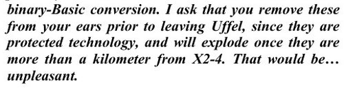

## p.4–7 (scan page 4)

Page contents: Enc 1: tour, LV-15, HG-211, Gor Kolomo Q&A, IT-R9 (hand-read)

## p.8 (scan page 8)

Page contents: 828 words, 23 paragraphs | headings/entries: Encounter 2: Line One (MSF Droids); Something Uffel; Page 8

- **No single roster character (rules/setting/general)** — entry/section: Mouse droid on the explosion: "Oh there was a big explosion and the droids on the line all blew up and the droids working the line got hurt and after a big explosion there are always pieces of stuff around and you have to clean it up otherwise you can't get the line going again so I'm just cleaning up the pieces and I hope we don't have another big explosion because that would be bad." Source: *114 - Broken Orbits - Something Uffel* (SWRPG d20 Revised Core), p.8
  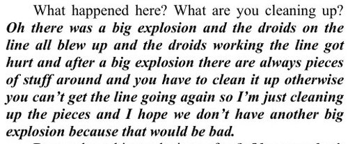

## p.9 (scan page 9)

Page contents: 917 words, 27 paragraphs | headings/entries: Something Uffel; GB; Page 9

- **No single roster character (rules/setting/general)** — entry/section: SV droids on R&D: "Self-important blow-hards. They wouldn't be anything without the SV line to watch what's going on." Source: *114 - Broken Orbits - Something Uffel* (SWRPG d20 Revised Core), p.9
  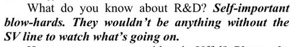
- **No single roster character (rules/setting/general)** — entry/section: Gor Kolomo litany: "Gor Kolomo is the proprietor of Uffel. He is a good and kind master. We are very fortunate to work for him." Source: *114 - Broken Orbits - Something Uffel* (SWRPG d20 Revised Core), p.9
  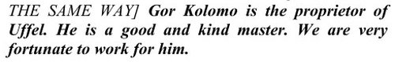
- **No single roster character (rules/setting/general)** — entry/section: LN-73: "The good of Uffel is the good of LN-73.": ""The good of Uffel is the good of LN-73. It would be inappropriate for me to accept repairs when X2-4 needs them so desperately. Allow me to continue my work, and when it is convenient for the others, I will be repaired."" Source: *114 - Broken Orbits - Something Uffel* (SWRPG d20 Revised Core), p.9
  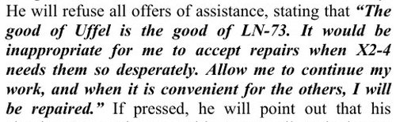
- **No single roster character (rules/setting/general)** — entry/section: LN-73: "he rolled really well!": "The DC of his electronic forgery is 50, because of the direct access he had to the personnel file creation programs and his detailed knowledge of Uffel. Plus, he rolled really well!" Source: *114 - Broken Orbits - Something Uffel* (SWRPG d20 Revised Core), p.9
  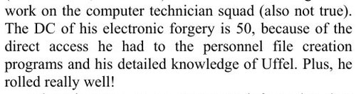

## p.10 (scan page 10)

Page contents: 875 words, 24 paragraphs | headings/entries: IT-R9; Encounter 3: Line Two (Protocol Droids); Something Uffel; Lower Tier; Page 10

## p.8–10 (scan page 8)

Page contents: Enc 2: MSF line droids; LN-73; satellite worm; mouse droid tail (hand-read)

## p.11 (scan page 11)

Page contents: 844 words, 20 paragraphs | headings/entries: Something Uffel; Page 11

- **No single roster character (rules/setting/general)** — entry/section: "Tell him 'No.'": "This is the point where the guy two seats to your left asks if he can start picking up the pieces of weapons himself, to use to make bigger guns. Tell him "No."" Source: *114 - Broken Orbits - Something Uffel* (SWRPG d20 Revised Core), p.11
  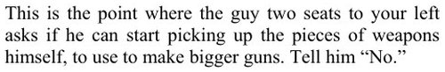

## p.10–11 (scan page 10)

Page contents: Enc 3: protocol droid trap (hand-read)

## p.12 (scan page 12)

Page contents: 840 words, 26 paragraphs | headings/entries: Something Uffel; Page 12

- **No single roster character (rules/setting/general)** — entry/section: LV-15: 2,398,113 to one: "The odds of an Uffelproduced droid being successfully reprogrammed while on Uffel are 2,398,113 to one. Give or take 5." Source: *114 - Broken Orbits - Something Uffel* (SWRPG d20 Revised Core), p.12
  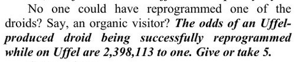

## p.13 (scan page 13)

Page contents: 845 words, 25 paragraphs | headings/entries: What they find; Something Uffel; Encounter 5: R&D; Page 13

- **No single roster character (rules/setting/general)** — entry/section: Tour member: "That's not natural!": "Everything in here looks suspicious to me. All these droids that don't talk, don't look at you, don't do anything except work. That's not natural!" Source: *114 - Broken Orbits - Something Uffel* (SWRPG d20 Revised Core), p.13
  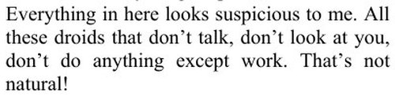

## p.11–13 (scan page 11)

Page contents: Enc 4: military line; LV-15 Q&A; tour group; search results (hand-read)

## p.14 (scan page 14)

Page contents: 828 words, 35 paragraphs | headings/entries: Something Uffel; I!; Page 14

- **No single roster character (rules/setting/general)** — entry/section: N-4PO introduction: ""R6-D6 will deal with any questions you have. Good day."" Source: *114 - Broken Orbits - Something Uffel* (SWRPG d20 Revised Core), p.14
  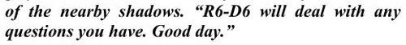
- **No single roster character (rules/setting/general)** — entry/section: R6-D6: "Reprogrammed was vocabulator my.": "What in the world is up with your speech? Reprogrammed was vocabulator my." Source: *114 - Broken Orbits - Something Uffel* (SWRPG d20 Revised Core), p.14
  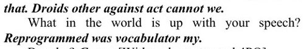

## p.15 (scan page 15)

Page contents: 838 words, 26 paragraphs | headings/entries: Encounter 6: A Security Summons; Something Uffel; Page 15

## p.13–15 (scan page 13)

Page contents: Enc 5: R&D, N-4PO, R6-D6 (hand-read)

## p.16 (scan page 16)

Page contents: 923 words, 21 paragraphs | headings/entries: Encounter 7: Stop, or Ill Reprogram!; Something Uffel; Page 16

- **No single roster character (rules/setting/general)** — entry/section: LN-73: "There they are! Get them!": "The droid atop the scaffold points to you and shrieks in an alarm-like voice. "There they are! Get them!"" Source: *114 - Broken Orbits - Something Uffel* (SWRPG d20 Revised Core), p.16
  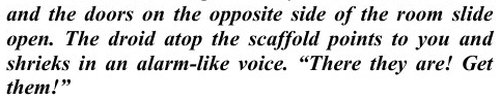

## p.15–16 (scan page 15)

Page contents: Enc 6: report to 211; power surge (hand-read)

## p.17 (scan page 17)

Page contents: 949 words, 19 paragraphs | headings/entries: Tactics, Lower Tier; Something Uffel; Tactics, Higher Tier; Page 17

- **No single roster character (rules/setting/general)** — entry/section: LN-73 (feats): "Feats: Armor Proficiency (light), Skill Emphasis (Forgery), Skill Emphasis (Computer Use), Weapons (simple, blasters, vibro)." Source: *114 - Broken Orbits - Something Uffel* (SWRPG d20 Revised Core), p.17
  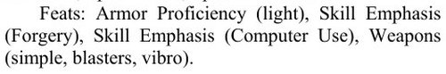

## p.18 (scan page 18)

Page contents: 817 words, 21 paragraphs | headings/entries: Conclusion; Something Uffel; Page 18

- **No single roster character (rules/setting/general)** — entry/section: HG-211: "if a droid could spit": ""We believe his creator is one of the droid production facilities in Hutt-space." You believe that if a droid could spit, this one would." Source: *114 - Broken Orbits - Something Uffel* (SWRPG d20 Revised Core), p.18
  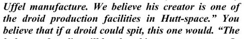

## p.19 (scan page 19)

Page contents: 526 words, 26 paragraphs | headings/entries: Here Ends, "Something Uffel"; Experience Point Summary; Adventure Experience Award:; Something Uffel; Loot Summary; Page 19

## p.16–19 (scan page 16)

Page contents: Enc 7: LN-73 and rival party; conclusions; XP; loot (MSF-111) (hand-read)

## p.20 (scan page 20)

Page contents: 666 words, 30 paragraphs | headings/entries: Lower Tier; Something Uffel; Page 20

- **No single roster character (rules/setting/general)** — entry/section: Ba'Ols (feats, lower tier): "Feats: Weapons (simple, blaster pistols, lightsaber), Alertness, Force Sensitive, Control, Weapon Focus (Lightsaber)." Source: *114 - Broken Orbits - Something Uffel* (SWRPG d20 Revised Core), p.20
  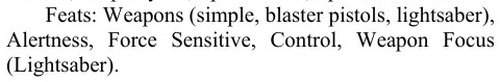

## p.21 (scan page 21)

Page contents: 693 words, 28 paragraphs | headings/entries: Higher Tier; Something Uffel; Page 21

- **No single roster character (rules/setting/general)** — entry/section: Nikolo (feats, higher tier): "Feats: Weapons (simple, blaster pistols), Iron Will, Dodge, Skill Emphasis (Hide), Skill Emphasis (Move Silently)." Source: *114 - Broken Orbits - Something Uffel* (SWRPG d20 Revised Core), p.21
  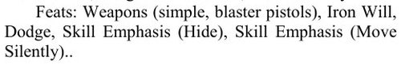

## p.22 (scan page 22)

Page contents: 151 words, 10 paragraphs | headings/entries: Critical Event Summary Something Uffel; If so, did they continue fighting anyway?; Yes No; Something Uffel Page 22

## p.20–22 (scan page 20)

Page contents: Appendix A rival stats both tiers; critical events (hand-read)

