# Owner Material 037 — Star Wars D20 Drive folder (Core, Revised Core and Saga Edition): Living Force Campaign/Adventures/Among the Stars/Year 1/115 - Broken Orbits - Tilnes Rising.pdf [Star Wars Roleplaying Game Revised Core (d20, 2002)]

- **Source:** Wizards of the Coast Star Wars Roleplaying Game books, web enhancements, Living Force campaign modules and articles (2000–2010), from the owner's "Star Wars D20" Drive folder (only the three edition subfolders; "General" was not read, as instructed). Secondary source (licensed Legends reference). Scan OCR'd on the box; the scan stays box-only and is **not** published.
- **Method:** every scanned page was OCR'd and machine-screened sentence by sentence for power-relevant statements (fights, kills, defeats, Force feats, rankings, superweapons) that name a character on our roster; each kept sentence is quoted verbatim from the OCR text and has a crop of the printed passage directly under it. Pages with nothing power-relevant are still listed with what is on them.
- **Citation:** "*115 - Broken Orbits - Tilnes Rising* (SWRPG d20 Revised Core), p.X" by printed page ("scan p.X" where no printed number applies). **Weight:** Licensed RPG material: a secondary source. Narrative text sums up Legends lore; game statistics are rules for players, not canon power levels, and rank lowest.

## p.1 (scan page 1)

Page contents: 97 words, 5 paragraphs | headings/entries: Tilnes Rising

## p.2 (scan page 2)

Page contents: 880 words, 21 paragraphs | headings/entries: Character Earnings; Post-Scenario Paperwork; Issuing Force and Dark Side Points; Tilnes Rising; Page 2

## p.3 (scan page 3)

Page contents: 863 words, 17 paragraphs | headings/entries: General Notes to the GM; DM Overview; Encounter 1: The (Way) Underground; Encounter 2: The Pit and the Parasites; Tilnes Rising; Page 3

## p.4 (scan page 4)

Page contents: 811 words, 23 paragraphs | headings/entries: Encounter 3: The Dark Beyond; Encounter 4: The Descent; Encounter 5: The Gentle Ascent; Encounter 6: The Rest of the Party; Encounter 7: The Crux of the Problem; Opening Crawl; Encounter 1: The (Way) Underground; Tilnes Rising; Page 4

## p.1–4 (scan page 1)

Page contents: Title; boilerplate; overview; encounter summaries; crawl (hand-read)

## p.5 (scan page 5)

Page contents: 880 words, 19 paragraphs | headings/entries: Tilnes Rising; Page 5

- **No single roster character (rules/setting/general)** — entry/section: S-4QD: "Why is it always the left arm?": "He keeps murmuring, "Not again. Not the left arm. Why is it always the left arm?"" Source: *115 - Broken Orbits - Tilnes Rising* (SWRPG d20 Revised Core), p.5
  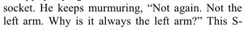
- **No single roster character (rules/setting/general)** — entry/section: Maris Gen grumbling: "grumbling all the while about "Fools who don't know how rescues work."" Source: *115 - Broken Orbits - Tilnes Rising* (SWRPG d20 Revised Core), p.5
  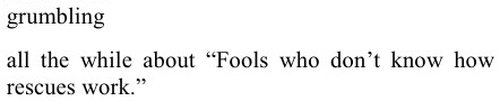

## p.6 (scan page 6)

Page contents: 857 words, 21 paragraphs | headings/entries: Encounter 2: The Pit and the Parasites; Tilnes Rising; Page 6

- **No single roster character (rules/setting/general)** — entry/section: Philinda's panic: ""S-s-something hit th-th-the surface. I was th-ththere, saw it come down. Big rocks, and then, ev-evev-everything was falling, and the ceiling was falling, and, and I ran, and there were lots of holes, and I knew you'd be here, and it's really bad out there!"" Source: *115 - Broken Orbits - Tilnes Rising* (SWRPG d20 Revised Core), p.6
  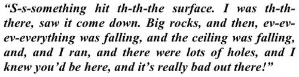
- **No single roster character (rules/setting/general)** — entry/section: Maris Gen: "It's a mining complex, after all.": ""It's not," he says in somewhat awkward Basic, "like this isn't something they plan for. It's a mining complex, after all."" Source: *115 - Broken Orbits - Tilnes Rising* (SWRPG d20 Revised Core), p.6
  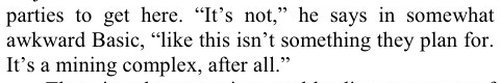
- **No single roster character (rules/setting/general)** — entry/section: Nia: "You feel up to the task?": ""Sounds like there are people who need help. You feel up to the task?"" Source: *115 - Broken Orbits - Tilnes Rising* (SWRPG d20 Revised Core), p.6
  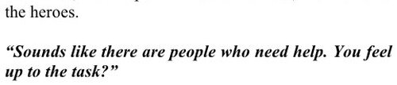

## p.4–6 (scan page 4)

Page contents: Enc 1: The (Way) Underground cave-in (hand-read)

## p.7 (scan page 7)

Page contents: 928 words, 18 paragraphs | headings/entries: Encounter 3: The Dark Beyond; Tilnes Rising; Page 7

## p.6–7 (scan page 6)

Page contents: Enc 2: pit, arask beetles, Caarite (hand-read)

## p.8 (scan page 8)

Page contents: 998 words, 19 paragraphs | headings/entries: Tilnes Rising; Page 8

## p.9 (scan page 9)

Page contents: 922 words, 21 paragraphs | headings/entries: Encounter 4: The Descent; Tilnes Rising; Page 9

- **No single roster character (rules/setting/general)** — entry/section: Nerra Ziveri's prophecy: ""A day will come when darkness threatens Cularin. The darkness will begin within the confines of this moon, and will rise to encompass all of the system, and the stars and moons and planets will know fear. Seek out the darkness. Where the focus is found, look to the stone beneath for the missing piece of the picture. Through stone and star, find the darkness, and bring it to the light. Only through the forces of goodness and hope can the darkness be kept from destroying all that we love. This is the future as I have foreseen it. - NZ"" Source: *115 - Broken Orbits - Tilnes Rising* (SWRPG d20 Revised Core), p.9
  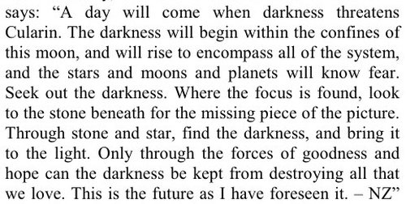

## p.7–9 (scan page 7)

Page contents: Enc 3: yri worms; NZ mural and prophecy (hand-read)

## p.10 (scan page 10)

Page contents: 977 words, 17 paragraphs | headings/entries: Encounter 5: The Gentle Ascent; Tilnes Rising; Page 10

## p.9–10 (scan page 9)

Page contents: Enc 4: shaft; neonocks (hand-read)

## p.11 (scan page 11)

Page contents: 832 words, 26 paragraphs | headings/entries: Passenger One: The Dead Pilot; DC Information Gained; Passenger Two: The Droid Co-Pilot; The Ship Itself; The Moaning; Tilnes Rising; Page 11

## p.12 (scan page 12)

Page contents: 862 words, 25 paragraphs | headings/entries: The Transmitter; The Impact; Encounter 6: The Rest of the Party; Tilnes Rising; Page 12

- **No single roster character (rules/setting/general)** — entry/section: "Drop the roof on them. Literally.": "Anyway, once they've (a) done everything there is to do here, (b) run out of ideas, or (c) start annoying you, drop the roof on them." Source: *115 - Broken Orbits - Tilnes Rising* (SWRPG d20 Revised Core), p.12
  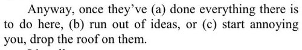
- **No single roster character (rules/setting/general)** — entry/section: Non-lethal lightsaber: "(And don't let any Jedi "hero" tell you, "There's no way to attack non-lethally with a lightsaber!" There are plenty of rules in the SWRPG for doing exactly that — disarming and attacking weapons being two of my favorites.)" Source: *115 - Broken Orbits - Tilnes Rising* (SWRPG d20 Revised Core), p.12
  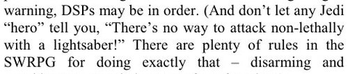

## p.10–12 (scan page 10)

Page contents: Enc 5: crashed Cannibalizer, dead captain, droid, message, beacon (hand-read)

## p.13 (scan page 13)

Page contents: 818 words, 27 paragraphs | headings/entries: Tilnes Rising; Page 13

- **No single roster character (rules/setting/general)** — entry/section: Caarite search squad (feats): "Feats: Armor (light, medium, & heavy), Weapon Proficiency (simple, blaster pistols, blaster rifles, vibroweapons, heavy weapons), Dodge, Point Blank Shot, Mobility, Weapon Focus (blaster pistol), Heroic Surge." Source: *115 - Broken Orbits - Tilnes Rising* (SWRPG d20 Revised Core), p.13
  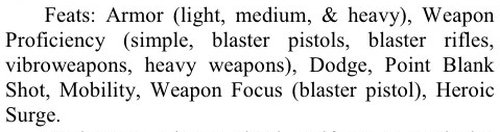
- **No single roster character (rules/setting/general)** — entry/section: Thurm Loogg greeting: ""Greetings, brave citizens of Cularin! I am Thurm Loogg, your friend in the Cartel. And who might you be?"" Source: *115 - Broken Orbits - Tilnes Rising* (SWRPG d20 Revised Core), p.13
  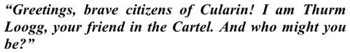

## p.14 (scan page 14)

Page contents: 829 words, 25 paragraphs | headings/entries: Encounter 7: The Crux of the Problem; Tilnes Rising; Page 14

- **No single roster character (rules/setting/general)** — entry/section: Loogg: "how much the Cartel loves you": "If only you understood how much the Cartel loves you, you might not be so angry!" Source: *115 - Broken Orbits - Tilnes Rising* (SWRPG d20 Revised Core), p.14
  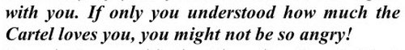
- **No single roster character (rules/setting/general)** — entry/section: Loogg on Velin Wir: "Can you give us any good reason to trust you? Given the actions of Velin Wir, I cannot." Source: *115 - Broken Orbits - Tilnes Rising* (SWRPG d20 Revised Core), p.14
  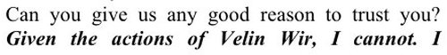

## p.12–14 (scan page 12)

Page contents: Enc 6: Cartel search squad (stats in p12 image); Thurm Loogg (hand-read)

## p.15 (scan page 15)

Page contents: 873 words, 32 paragraphs | headings/entries: Questions Osten can answer:; Tilnes Rising; Page 15

- **No single roster character (rules/setting/general)** — entry/section: Osten dal'Nay introduction: ""I'm Osten dal'Nay. I was born on Cularin, but I always wanted to be a soldier, so I joined the Thaereian Navy. Thought it would be good, since I could get posted near home." Source: *115 - Broken Orbits - Tilnes Rising* (SWRPG d20 Revised Core), p.15
  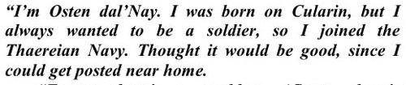
- **No single roster character (rules/setting/general)** — entry/section: Osten: "That's kind of the point.": "Surveillance cams? We didn't see any surveillance cams. That's kind of the point." Source: *115 - Broken Orbits - Tilnes Rising* (SWRPG d20 Revised Core), p.15
  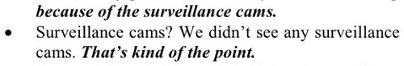
- **No single roster character (rules/setting/general)** — entry/section: Thaereian gunner and the pill: ""I hate that stuff, but it's better than being Jedi mind-tricked!"" Source: *115 - Broken Orbits - Tilnes Rising* (SWRPG d20 Revised Core), p.15
  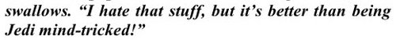
- **No single roster character (rules/setting/general)** — entry/section: "I think the word was 'expendable.'": ""Yeah. Some guy named [Hero name]. I think the word was 'expendable.'" They all laugh." Source: *115 - Broken Orbits - Tilnes Rising* (SWRPG d20 Revised Core), p.15
  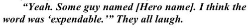

## p.16 (scan page 16)

Page contents: 836 words, 26 paragraphs | headings/entries: Station one: 18/13; Station two: 20/15; Station three: 12/7; Lower Tier; Conclusion; Tilnes Rising; Page 16

## p.14–16 (scan page 14)

Page contents: Enc 7: Osten dal'Nay; e-web; running fight; guards (hand-read)

## p.17 (scan page 17)

Page contents: 671 words, 27 paragraphs | headings/entries: Here Ends Tilnes Rising; Experience Point Summary; Adventure Experience Award:; Loot Summary; From the Crashed Ship e¢ Combination holorecorder/holoprojector; From Verga Mer Mining Company; Tilnes Rising; Page 17

- **No single roster character (rules/setting/general)** — entry/section: Osten: "You have my word.": "I'll be in touch with you soon. You have my word." Source: *115 - Broken Orbits - Tilnes Rising* (SWRPG d20 Revised Core), p.17
  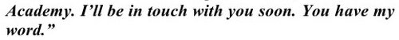
- **No single roster character (rules/setting/general)** — entry/section: Osten: Cularin militia: ""What Cularin really needs is a militia of her own. I would very much like to start one. Would you be interested in assisting me, in helping me build such a military?"" Source: *115 - Broken Orbits - Tilnes Rising* (SWRPG d20 Revised Core), p.17
  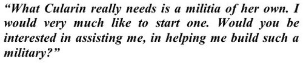

## p.18 (scan page 18)

Page contents: 264 words, 4 paragraphs | headings/entries: Q-B}; Tilnes Rising Page 18

## p.16–18 (scan page 16)

Page contents: Conclusion (Lanius, Kirlocca, Osten); XP; loot (hand-read)

## p.19 (scan page 19)

Page contents: 112 words, 4 paragraphs | headings/entries: Tilnes Rising Page 19

## p.20 (scan page 20)

Page contents: 146 words, 7 paragraphs | headings/entries: Player Handout 2: The Captain's Holorecording; Tilnes Rising Page 20

- **No single roster character (rules/setting/general)** — entry/section: Captain Delas Fotrin's recording: ""Captain Delas Fotrin, Special Reserves, Project Wooden Rancor. On a routine circuit of mining moon above target, encountered atmospheric disturbance."" Source: *115 - Broken Orbits - Tilnes Rising* (SWRPG d20 Revised Core), p.20
  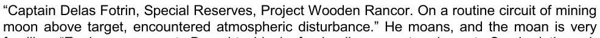
- **No single roster character (rules/setting/general)** — entry/section: Fotrin: Order 1138: ""Pursuant to Order 1138, have avoided activating homing beacon. No chance of escape. To aid in recovery of ship, will activate beacon soon." Source: *115 - Broken Orbits - Tilnes Rising* (SWRPG d20 Revised Core), p.20
  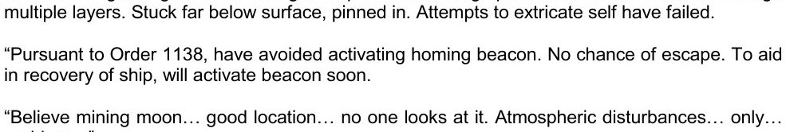

## p.21 (scan page 21)

Page contents: 68 words, 4 paragraphs | headings/entries: DM Aid #1: The Descent; Tilnes Rising Page 21

## p.22 (scan page 22)

Page contents: 22 words, 3 paragraphs | headings/entries: Tilnes Rising Page 22

## p.23 (scan page 23)

Page contents: 160 words, 11 paragraphs | headings/entries: Critical Event Summary; Tilnes Rising; Convention Coordinator:; Or email to: [email removed]; Tilnes Rising Page 23

## p.19–23 (scan page 19)

Page contents: Handouts 1-2; DM aids (maps); critical events (hand-read)

