# Owner Material 037 — Star Wars D20 Drive folder (Core, Revised Core and Saga Edition): Living Force Campaign/Adventures/Among the Stars/Year 1/116 - Oblivions Kiss.pdf [Star Wars Roleplaying Game Revised Core (d20, 2002)]

- **Source:** Wizards of the Coast Star Wars Roleplaying Game books, web enhancements, Living Force campaign modules and articles (2000–2010), from the owner's "Star Wars D20" Drive folder (only the three edition subfolders; "General" was not read, as instructed). Secondary source (licensed Legends reference). Scan OCR'd on the box; the scan stays box-only and is **not** published.
- **Method:** every scanned page was OCR'd and machine-screened sentence by sentence for power-relevant statements (fights, kills, defeats, Force feats, rankings, superweapons) that name a character on our roster; each kept sentence is quoted verbatim from the OCR text and has a crop of the printed passage directly under it. Pages with nothing power-relevant are still listed with what is on them.
- **Citation:** "*116 - Oblivions Kiss* (SWRPG d20 Revised Core), p.X" by printed page ("scan p.X" where no printed number applies). **Weight:** Licensed RPG material: a secondary source. Narrative text sums up Legends lore; game statistics are rules for players, not canon power levels, and rank lowest.

## p.1 (scan page 1)

Page contents: 107 words, 5 paragraphs | headings/entries: Oblivion's Kiss; A One-Round Living Force Adventure

## p.2 (scan page 2)

Page contents: 902 words, 24 paragraphs | headings/entries: Character Earnings; Oblivion's Kiss; General Notes to the GM; DM Overview; Page 2

## p.3 (scan page 3)

Page contents: 893 words, 21 paragraphs | headings/entries: Encounter 1:; Encounter 2:; Oblivion's Kiss; Encounter 3:; Encounter 4:; Encounter 5:; Encounter 6:; Page 3

## p.4 (scan page 4)

Page contents: 760 words, 20 paragraphs | headings/entries: Encounter 7:; Opening Crawl; Oblivion's Kiss; Page 4

- **No single roster character (rules/setting/general)** — entry/section: Crawl: "Oblivion is for sale": "Amid the green fields and blue oceans of Cularin, a fortune can be had helping people to forget their pain... if only for a while. Oblivion is for sale, and business has never been better." Source: *116 - Oblivions Kiss* (SWRPG d20 Revised Core), p.4
  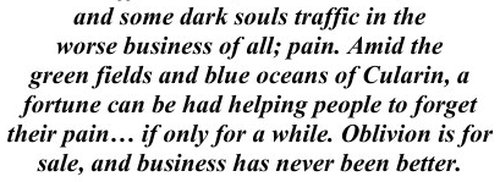
- **No single roster character (rules/setting/general)** — entry/section: Portraying Lavina Wren: "Lavina Wren is professional, calm, and a/ways composed. She treats everyone fairly and politely, regardless of species." Source: *116 - Oblivions Kiss* (SWRPG d20 Revised Core), p.4
  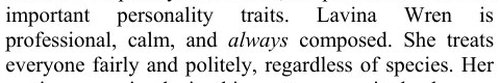

## p.1–4 (scan page 1)

Page contents: Title; boilerplate; overview; encounter summaries; judge notes; crawl (hand-read)

## p.5 (scan page 5)

Page contents: 943 words, 20 paragraphs | headings/entries: Oblivion's Kiss; Page 5

- **No single roster character (rules/setting/general)** — entry/section: Kel's takeout note: ""Kel here. I've got what you need. You know where to be. I'm waiting"." Source: *116 - Oblivions Kiss* (SWRPG d20 Revised Core), p.5
  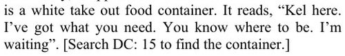

## p.6 (scan page 6)

Page contents: 858 words, 22 paragraphs | headings/entries: Oblivion's Kiss; Page 6

- **No single roster character (rules/setting/general)** — entry/section: Thurm Loogg: "much aid I can offer": ""Come, good people of Cularin. You have much business, I think, and I have much aid I can offer."" Source: *116 - Oblivions Kiss* (SWRPG d20 Revised Core), p.6
  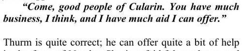
- **No single roster character (rules/setting/general)** — entry/section: Loogg on addiction: ""Poor man. Of course, an addiction, any addiction, can become one's bane if left to grow beyond one's control. Iam sorry to hear of his plight."" Source: *116 - Oblivions Kiss* (SWRPG d20 Revised Core), p.6
  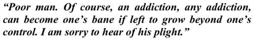
- **No single roster character (rules/setting/general)** — entry/section: Loogg: "That's all the remuneration I require.": ""Oh... let's not discuss such things at this time. A man's life lies in the balance and I have the power to tip those scales. It is enough for me that Senator Wren knows of my involvement in this affair. That's all the remuneration I require."" Source: *116 - Oblivions Kiss* (SWRPG d20 Revised Core), p.6
  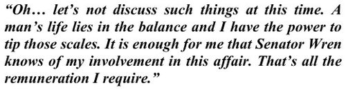

## p.4–6 (scan page 4)

Page contents: Enc 1: Merik Darou's apartment; Aleth Par (hand-read)

## p.7 (scan page 7)

Page contents: 899 words, 23 paragraphs | headings/entries: Oblivion's Kiss; Encounter 3: Living Fast... and Dying Faster; Page 7

- **No single roster character (rules/setting/general)** — entry/section: Naytha: "pretty wizard": ""What I can give you is pretty wizard though. I know where he's been buying his blue. It's just a shack-dive in smoketown Ged, but I can give you the address. That good?"" Source: *116 - Oblivions Kiss* (SWRPG d20 Revised Core), p.7
  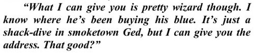
- **No single roster character (rules/setting/general)** — entry/section: Naytha on Merik's habit: ""Merik was a user, but he never wanted the Senator to get in trouble for his habit. He only ever bought the stuff one dose at a time. That way, he'd never get nailed for intent to distribute if he was caught."" Source: *116 - Oblivions Kiss* (SWRPG d20 Revised Core), p.7
  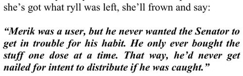

## p.6–7 (scan page 6)

Page contents: Enc 2: Thurm Loogg and Naytha (hand-read)

## p.8 (scan page 8)

Page contents: 882 words, 21 paragraphs | headings/entries: Oblivion's Kiss; Page 8

## p.7–8 (scan page 7)

Page contents: Enc 3: Spanner's (hand-read)

## p.9 (scan page 9)

Page contents: 891 words, 24 paragraphs | headings/entries: Oblivion's Kiss; Page 9

## p.8–9 (scan page 8)

Page contents: Enc 4: Kelkan's apartment (hand-read)

## p.10 (scan page 10)

Page contents: 885 words, 23 paragraphs | headings/entries: Oblivion's Kiss; Page 10

## p.9–10 (scan page 9)

Page contents: Enc 5: spaceport (hand-read)

## p.11 (scan page 11)

Page contents: 861 words, 22 paragraphs | headings/entries: Encounter 6: Nowhere to Run... or Hide; Oblivion's Kiss; Page 11

- **No single roster character (rules/setting/general)** — entry/section: Esker at the checkpoint: ""Please place any personal weapons in the receptacle," he says as he indicates a large lock box on this side of a blast door, "and submit to a scan before boarding."" Source: *116 - Oblivions Kiss* (SWRPG d20 Revised Core), p.11
  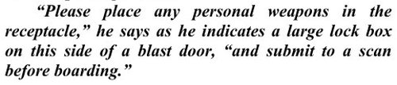
- **No single roster character (rules/setting/general)** — entry/section: C4-P5 greeting: ""Greetings. I am C4-P5, one of the stewards aboard this fine ship. I am here to help you get settled into your cabins for the jump to lightspeed. If you will follow me, I will lead you there."" Source: *116 - Oblivions Kiss* (SWRPG d20 Revised Core), p.11
  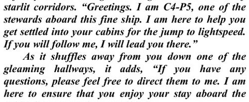

## p.12 (scan page 12)

Page contents: 907 words, 22 paragraphs | headings/entries: Oblivion's Kiss; Page 12

- **No single roster character (rules/setting/general)** — entry/section: Kelkan: "quality blue": ""It's quality blue, I'm telling you. Straight from a Twi'lek freighter!", he'll say with a nervous grin." Source: *116 - Oblivions Kiss* (SWRPG d20 Revised Core), p.12
  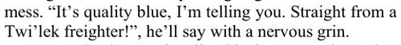

## p.11–12 (scan page 11)

Page contents: Enc 6: White Nova; Kelkan (hand-read)

## p.13 (scan page 13)

Page contents: 762 words, 27 paragraphs | headings/entries: Conclusion; Oblivion's Kiss; Here Ends Oblivion's Kiss; Experience Point Summary; Adventure Experience Award:; Page 13

- **No single roster character (rules/setting/general)** — entry/section: Naytha: "Hello again": ""Hello again," says the Twi'lek Naytha quietly from beside a sleeping palette." Source: *116 - Oblivions Kiss* (SWRPG d20 Revised Core), p.13
  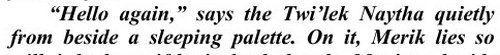

## p.14 (scan page 14)

Page contents: 160 words, 10 paragraphs | headings/entries: Loot Summary; From Kelkan: e Fine Combat Gloves; From Lavina Wren:; Oblivion's Kiss; Page 14

## p.12–14 (scan page 12)

Page contents: Enc 7; conclusion; XP; loot (hand-read)

## p.15 (scan page 15)

Page contents: 865 words, 26 paragraphs | headings/entries: NPC Statistics:; Weapon; Oblivion's Kiss; Page 15

- **No single roster character (rules/setting/general)** — entry/section: Pellko (feats): "Feats: Skill Emphasis: Knowledge (Streetwise), Weapon (simple), Fame" Source: *116 - Oblivions Kiss* (SWRPG d20 Revised Core), p.15
  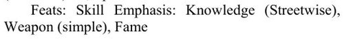
- **No single roster character (rules/setting/general)** — entry/section: Vel-Kan (feats): "Feats: Weapon (simple), Weapon (blaster pistols), Skill Emphasis: Forgery, Weapon Focus (blaster pistol), Improved Initiative, Quick Draw" Source: *116 - Oblivions Kiss* (SWRPG d20 Revised Core), p.15
  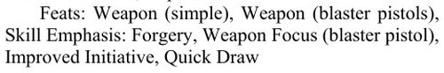

## p.16 (scan page 16)

Page contents: 828 words, 23 paragraphs | headings/entries: Skills: Intimidate +2, Spot +1; Weapon; Oblivion's Kiss; Page 16

- **No single roster character (rules/setting/general)** — entry/section: Kisskk (feats): "Feats: Toughness x2, Weapon (simple), Weapon (blaster pistol), Weapon (blaster rifle), Weapon (vibro), Weapon (heavy), Armor (light), Armor (medium), Armor (heavy), Weapon Focus (vibroaxe)" Source: *116 - Oblivions Kiss* (SWRPG d20 Revised Core), p.16
  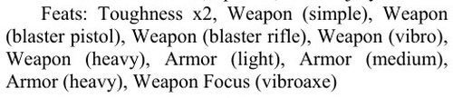
- **No single roster character (rules/setting/general)** — entry/section: Kelkan D'vrosh (feats): "Feats: Weapon (simple), Weapon (blaster pistol), Weapon (blaster rifle), Weapon (heavy), Weapon (vibro), Armor (light), Armor (medium), Armor (heavy), Dodge, Martial Arts, Weapon Finesse (combat glove), Weapon Focus (unarmed strike), Heroic Surge." Source: *116 - Oblivions Kiss* (SWRPG d20 Revised Core), p.16
  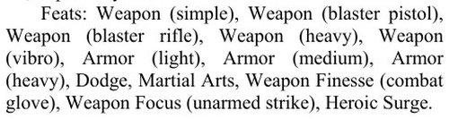

## p.15–16 (scan page 15)

Page contents: NPC statistics (hand-read)

## p.17 (scan page 17)

Page contents: 509 words, 13 paragraphs | headings/entries: Good Citizen of Cularin,; Oblivion's Kiss Page 17

- **No single roster character (rules/setting/general)** — entry/section: Lavina Wren's communique: "I will confide in you what has not been released to media sources or to the local authorities; Merik has an unfortunate habit and it threatens to kill him now." Source: *116 - Oblivions Kiss* (SWRPG d20 Revised Core), p.17
  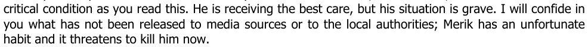
- **No single roster character (rules/setting/general)** — entry/section: Wren: "the sole mark of success": "I consider my aide's survival the sole mark of success." Source: *116 - Oblivions Kiss* (SWRPG d20 Revised Core), p.17
  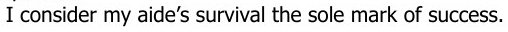

## p.18 (scan page 18)

Page contents: 114 words, 12 paragraphs | headings/entries: Critical Event Summary Oblivion's Kiss; Yes No 4. Was Kelkan killed?; Yes No; Robert Wiese, RPGA HQ [mailing address]; Or email to [email removed]; Oblivion's Kiss Page 18

## p.17–18 (scan page 17)

Page contents: Player handout (Wren's communique); critical events (hand-read)

