# Owner Material 037 — Star Wars D20 Drive folder (Core, Revised Core and Saga Edition): Living Force Campaign/Adventures/Among the Stars/Year 2/201 - Blinking Eyes - Quarters.pdf [Star Wars Roleplaying Game Revised Core (d20, 2002)]

- **Source:** Wizards of the Coast Star Wars Roleplaying Game books, web enhancements, Living Force campaign modules and articles (2000–2010), from the owner's "Star Wars D20" Drive folder (only the three edition subfolders; "General" was not read, as instructed). Secondary source (licensed Legends reference). Scan OCR'd on the box; the scan stays box-only and is **not** published.
- **Method:** every scanned page was OCR'd and machine-screened sentence by sentence for power-relevant statements (fights, kills, defeats, Force feats, rankings, superweapons) that name a character on our roster; each kept sentence is quoted verbatim from the OCR text and has a crop of the printed passage directly under it. Pages with nothing power-relevant are still listed with what is on them.
- **Citation:** "*201 - Blinking Eyes - Quarters* (SWRPG d20 Revised Core), p.X" by printed page ("scan p.X" where no printed number applies). **Weight:** Licensed RPG material: a secondary source. Narrative text sums up Legends lore; game statistics are rules for players, not canon power levels, and rank lowest.

## p.1 (scan page 1)

Page contents: 139 words, 5 paragraphs | headings/entries: Quarters

## p.2 (scan page 2)

Page contents: 857 words, 29 paragraphs | headings/entries: Quarters; Character Earnings; Post-Scenario Paperwork; Issuing Force and Dark Side Points; Page 2

## p.3 (scan page 3)

Page contents: 830 words, 17 paragraphs | headings/entries: General Notes to the GM; GM History; Quarters; GM Overview; Page 3

## p.4 (scan page 4)

Page contents: 760 words, 20 paragraphs | headings/entries: Encounter 1: "The Raging Rancor"; Encounter 2: "No! Not In My Bar!"; Encounter 3: Smuggler's Blues; Encounter 5:"Hey!You Don't Live Here!"; Quarters; Encounter 6: A Final Plea; Encounter 7: In Over Our Heads; Opening Crawl; Page 4

## p.1–4 (scan page 1)

Page contents: Title; boilerplate; FP/DSP; GM history; overview; summaries; crawl (hand-read)

## p.5 (scan page 5)

Page contents: 864 words, 22 paragraphs | headings/entries: Encounter 1: The Raging Rancor; Items of Interest:; Quarters; Page 5

## p.6 (scan page 6)

Page contents: 801 words, 15 paragraphs | headings/entries: Quarters; Encounter 2: "No! Not in my bar!"; Page 6

- **No single roster character (rules/setting/general)** — entry/section: Salld Nrump: "They will kill us all for this!": "In Basic, he croaks, "Please - you must help me. They are going to kill me. They will kill us all for this!" He thrusts a datapad towards you." Source: *201 - Blinking Eyes - Quarters* (SWRPG d20 Revised Core), p.6
  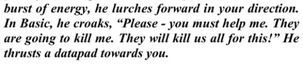

## p.5–6 (scan page 5)

Page contents: Enc 1: Raging Rancor cantina (hand-read)

## p.7 (scan page 7)

Page contents: 762 words, 23 paragraphs | headings/entries: FOR HEROES AVERAGE LEVEL 1-3; Quarters; FOR HEROES AVERAGE LEVEL 4-6; Page 7

- **No single roster character (rules/setting/general)** — entry/section: Mercenary (tier 1-3, feats): "Feats: Weapon Group Proficiencies (Simple Weapons, Blaster Pistols), Armor Proficiencies (Light), Weapon Focus (Blaster Pistol)." Source: *201 - Blinking Eyes - Quarters* (SWRPG d20 Revised Core), p.7
  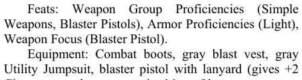

## p.8 (scan page 8)

Page contents: 770 words, 20 paragraphs | headings/entries: FOR HEROES AVERAGE LEVEL 7-9; Quarters; Round by Round NPC/Bad Guy Cinematic Highlights:; Page 8

- **No single roster character (rules/setting/general)** — entry/section: "scarier than the Jedi": "They fear failing far more than they fear death, having been told that someone "scarier than the Jedi" is footing the bill for this operation" Source: *201 - Blinking Eyes - Quarters* (SWRPG d20 Revised Core), p.8
  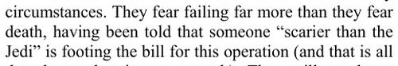

## p.9 (scan page 9)

Page contents: 770 words, 38 paragraphs | headings/entries: Surprise Round:; Round 1:; Round 2:; Quarters; Round 3:; Round 4+:; Page 9

- **No single roster character (rules/setting/general)** — entry/section: "no one is dead in boxed text": "HOWEVER, so long as there is a warm body and the potential for heroism, no one is dead in boxed text." Source: *201 - Blinking Eyes - Quarters* (SWRPG d20 Revised Core), p.9
  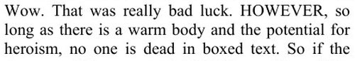
- **No single roster character (rules/setting/general)** — entry/section: Mercenary leader: "Leave no witnesses!": ""Bring me the datapad. Leave no witnesses!"" Source: *201 - Blinking Eyes - Quarters* (SWRPG d20 Revised Core), p.9
  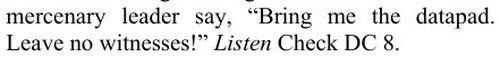
- **No single roster character (rules/setting/general)** — entry/section: The Thermal Detonator reminder: "If you haven't thrown the thermal detonator yet, the fight is either over, or you aren't using the module." Source: *201 - Blinking Eyes - Quarters* (SWRPG d20 Revised Core), p.9
  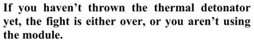

## p.10 (scan page 10)

Page contents: 812 words, 21 paragraphs | headings/entries: Quarters; Page 10

- **No single roster character (rules/setting/general)** — entry/section: Control: "Execute plan Delta.": ""Team 3, this is Control, over. Team 3 this is Control, respond, over. All teams, this is Control. Team 3 compromised. Execute plan Delta. Switch coms to new frequency."" Source: *201 - Blinking Eyes - Quarters* (SWRPG d20 Revised Core), p.10
  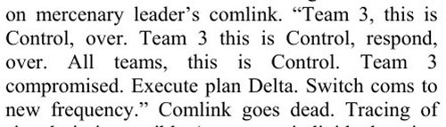

## p.11 (scan page 11)

Page contents: 866 words, 17 paragraphs | headings/entries: Quarters; Encounter 3: Smuggler's Blues; Page 11

- **No single roster character (rules/setting/general)** — entry/section: Famier: "TEAM 3!": ""Man, did you hear that? Team 3? TEAM 3! That means there's at least a team | and 2. Me and Rrelbocco are getting out of here and laying low for a while, I suggest you do the same!"" Source: *201 - Blinking Eyes - Quarters* (SWRPG d20 Revised Core), p.11
  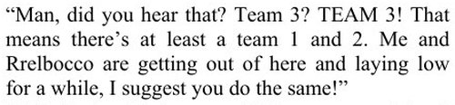
- **No single roster character (rules/setting/general)** — entry/section: Famier: "the only law on Varna Biqua": ""Call the law? Man, you ARE new around here! This is the only law on Varna Biqua!" He brandishes his pistol." Source: *201 - Blinking Eyes - Quarters* (SWRPG d20 Revised Core), p.11
  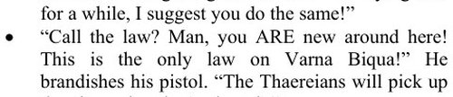
- **No single roster character (rules/setting/general)** — entry/section: Famier: "my favorite Sabacc Deck": "I'd bet my favorite Sabacc Deck they know who we are. I'm officially on an extended vacation as of right now!"" Source: *201 - Blinking Eyes - Quarters* (SWRPG d20 Revised Core), p.11
  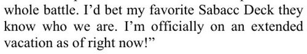
- **No single roster character (rules/setting/general)** — entry/section: Gerzott: "Hey, you're late!": ""Hey, you're late! Which one of you is Salld, and what's with the entourage? Our deal was passage to Cularin for one."" Source: *201 - Blinking Eyes - Quarters* (SWRPG d20 Revised Core), p.11
  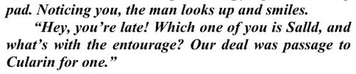

## p.6–11 (scan page 6)

Page contents: Enc 2: mercenary attack; aftermath (hand-read)

## p.12 (scan page 12)

Page contents: 836 words, 18 paragraphs | headings/entries: Quarters; Troubleshooting:; Page 12

- **No single roster character (rules/setting/general)** — entry/section: Gerzott and N4 on Jedi tricks: ""Now don't go trying any of those Jedi tricks on me either. I don't like other people poking around in my head, it makes me and my friend N4 up there very nervous!"" Source: *201 - Blinking Eyes - Quarters* (SWRPG d20 Revised Core), p.12
  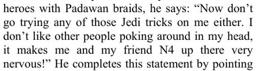
- **No single roster character (rules/setting/general)** — entry/section: Gerzott: "pay the piper": ""Everybody always wants to do things the hard way. But, me and old N4 there," he points to Enforcer droid mockup, "well, we like to bargain in good faith. It makes things a lot easier when it comes time to pay the piper, catch my meaning?"" Source: *201 - Blinking Eyes - Quarters* (SWRPG d20 Revised Core), p.12
  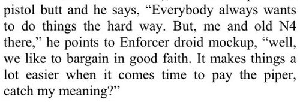
- **No single roster character (rules/setting/general)** — entry/section: Gerzott (feats): "Feats: Weapon Group Proficiencies (simple weapons, blaster pistols, blaster rifles, heavy weapons, vibro weapons), Armor Proficiencies (Light, Medium), Dodge, Improved Initiative, Starship Operations (Space Transports, fighters), Spacer, Skill Emphasis (Pilot), Starship Dodge (Space Transports)" Source: *201 - Blinking Eyes - Quarters* (SWRPG d20 Revised Core), p.12
  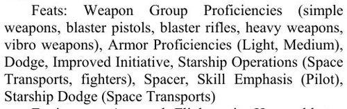

## p.11–12 (scan page 11)

Page contents: Enc 3: Gerzott and the Panada's Kiss (hand-read)

## p.13 (scan page 13)

Page contents: 737 words, 22 paragraphs | headings/entries: Quarters; Encounter 5: "Hey, You Don't Live Here!"; Page 13

- **No single roster character (rules/setting/general)** — entry/section: Krol-Pek: "Where is Salld?": "As he approaches your group, he says in a high-pitched voice, "I am Krol-Pek. Where is Salld?"" Source: *201 - Blinking Eyes - Quarters* (SWRPG d20 Revised Core), p.13
  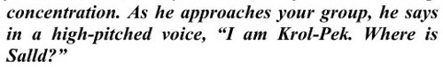
- **No single roster character (rules/setting/general)** — entry/section: Krol-Pek: "I swear!": ""Well, it's too damaged to decode without special equipment now! Great job you bunch of lousy, trigger-happy ... <stops and looks at the heroes and their weapons> Um, what I mean is that we have to take it to my house to fix it now. I have the right equipment there...Don't look at me like that! It's true! I swear!"" Source: *201 - Blinking Eyes - Quarters* (SWRPG d20 Revised Core), p.13
  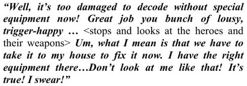
- **No single roster character (rules/setting/general)** — entry/section: Krol-Pek (feats): "Feats: Weapon Proficiencies (Simple Weapons, Blaster Pistols), Gearhead, Skill Emphasis (Computer Use)." Source: *201 - Blinking Eyes - Quarters* (SWRPG d20 Revised Core), p.13
  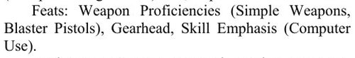

## p.12–13 (scan page 12)

Page contents: Enc 4: Krol-Pek (hand-read)

## p.14 (scan page 14)

Page contents: 901 words, 13 paragraphs | headings/entries: Quarters; Page 14

- **No single roster character (rules/setting/general)** — entry/section: Yarian Kak's offer: ""Greetings good citizens. I hope this message finds you well. I am Yarian Kak, trade advocate, and I believe you may have in your possession some information that is very valuable to my client." Source: *201 - Blinking Eyes - Quarters* (SWRPG d20 Revised Core), p.14
  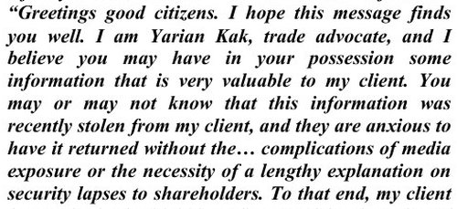
- **No single roster character (rules/setting/general)** — entry/section: Borus Ferthyn: "Give it to the politicians...": "The only words you hear are, "Give it to the politicians..."" Source: *201 - Blinking Eyes - Quarters* (SWRPG d20 Revised Core), p.14
  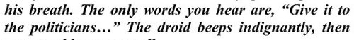
- **No single roster character (rules/setting/general)** — entry/section: Borus Ferthyn: "better'n the Cartel": "he does have a moment of lucidity, saying, "What we got's better'n the Cartel, yeah?"" Source: *201 - Blinking Eyes - Quarters* (SWRPG d20 Revised Core), p.14
  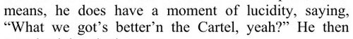

## p.15 (scan page 15)

Page contents: 818 words, 21 paragraphs | headings/entries: After the Battle:; Quarters; Encounter 6: The Final Plea; Page 15

- **No single roster character (rules/setting/general)** — entry/section: OPS Trooper (feats): "Feats: Weapon Group Proficiencies (blaster pistols, blaster rifles, heavy weapons, vibro weapons), Armor Proficiencies (Light, Medium, Heavy), Weapon Focus (Heavy Blaster Pistol), Point Blank Shot, Precise shot, Rapid shot." Source: *201 - Blinking Eyes - Quarters* (SWRPG d20 Revised Core), p.15
  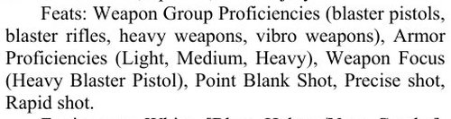
- **No single roster character (rules/setting/general)** — entry/section: Sergeant Morton: "never a dull moment": ""Well!" Sergeant Morton says with a grin. "TI bet there's never a dull moment around you guys! I was looking for you." Source: *201 - Blinking Eyes - Quarters* (SWRPG d20 Revised Core), p.15
  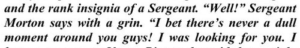
- **No single roster character (rules/setting/general)** — entry/section: Krol-Pek: "before we all get killed!": ""Let's hurry up and get rid of this thing before we all get killed!"" Source: *201 - Blinking Eyes - Quarters* (SWRPG d20 Revised Core), p.15
  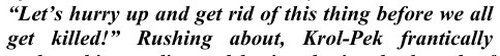

## p.13–15 (scan page 13)

Page contents: Enc 5: Borus Ferthyn; Yarian Kak; Krol-Pek's house; OPS (hand-read)

## p.16 (scan page 16)

Page contents: 765 words, 21 paragraphs | headings/entries: Encounter 7: In Over Our Heads; Yarian Kak, and the Metatheran Cartel; Quarters; The Cularin Government; The Jedi Academy; Page 16

- **No single roster character (rules/setting/general)** — entry/section: The Jedi Academy option: "Frankly, we expect this to be the most common choice. But hey — we could be wrong." Source: *201 - Blinking Eyes - Quarters* (SWRPG d20 Revised Core), p.16
  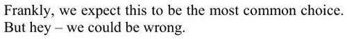

## p.15–16 (scan page 15)

Page contents: Enc 6: decoding; Jedi Academy plea (hand-read)

## p.17 (scan page 17)

Page contents: 598 words, 33 paragraphs | headings/entries: Conclusion; Here Ends Quarters; For any scenario feedback, please email: [email removed]; Experience Point Summary; Adventure Experience Award:; Quarters; Adventure Experience: Roleplaying Experience:; Loot Summary; Encounter 2:; Encounter 7:; Page 17

- **No single roster character (rules/setting/general)** — entry/section: Leaving it up to Krol-Pek: "Smack any party that wants to do this, and tell them to make a real decision." Source: *201 - Blinking Eyes - Quarters* (SWRPG d20 Revised Core), p.17
  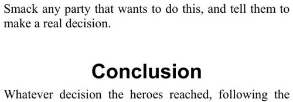
- **No single roster character (rules/setting/general)** — entry/section: News: 'The Syndicate': ""Recent activity in the criminal underworld suggests that certain fringe elements may be readying for a move to power. A group calling itself 'The Syndicate' has been speaking out against the Cartel, and against the governments of Cularin herself." Source: *201 - Blinking Eyes - Quarters* (SWRPG d20 Revised Core), p.17
  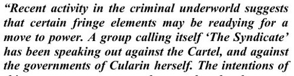

## p.18 (scan page 18)

Page contents: 232 words, 4 paragraphs | headings/entries: Quarters Page 18

## p.16–18 (scan page 16)

Page contents: Enc 7 options; conclusion; XP; loot/favors (hand-read)

## p.19 (scan page 19)

Page contents: 152 words, 4 paragraphs | headings/entries: Player Handout 1: Varna Biqua; Quarters Page 19

- **No single roster character (rules/setting/general)** — entry/section: Varna Biqua saying: "A common saying on Varna Biqua is "Live and let live...unless they get in your way. Then kill them."" Source: *201 - Blinking Eyes - Quarters* (SWRPG d20 Revised Core), p.19
  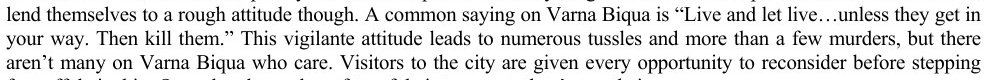

## p.20 (scan page 20)

Page contents: 148 words, 23 paragraphs | headings/entries: Rancor Hide Jacket: Rancor Hide Cloak:; Rancor Tooth Weapon Handles; Rancor Claw Weapon Handles; Rancor Bone Weapon Handles; Souvenir Holo in Fake Rancor Maw; Rancor Masks/Gloves; Quarters; Page 20

## p.21 (scan page 21)

Page contents: 137 words, 6 paragraphs | headings/entries: Player Handout 3: Datacard. Friends,; Capt. Drom Virbilge Thaereian Military Special Ops; Quarters Page 21

- **No single roster character (rules/setting/general)** — entry/section: Capt. Drom Virbilge's datacard: "You are in grave danger. The information you possess could undermine the security of the entire Cularin System and throw the region into chaos." Source: *201 - Blinking Eyes - Quarters* (SWRPG d20 Revised Core), p.21
  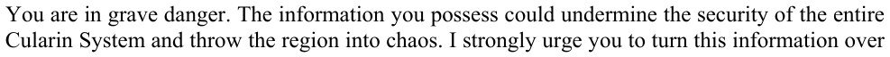
- **No single roster character (rules/setting/general)** — entry/section: Virbilge: "Don't say I didn't warn you.": "PPS: If you are reading this, your datapad is ruined! Don't say I didn't warn you." Source: *201 - Blinking Eyes - Quarters* (SWRPG d20 Revised Core), p.21
  

## p.19–21 (scan page 19)

Page contents: Player handouts 1-3 (hand-read)

## p.22 (scan page 22)

Page contents: 666 words, 16 paragraphs | headings/entries: NPCs of Note in Cantina:

## p.23 (scan page 23)

Page contents: 218 words, 19 paragraphs | headings/entries: Cover available in the cantina; Firing around corners of walls (reinforced metal); Concealment available in the cantina; DM QUICK COMBAT AID:; Merce; Quarters Page 23

## p.24 (scan page 24)

Page contents: 20 words, 7 paragraphs | headings/entries: DM Aid #2: Raging Rancor Cantina Map; Facilities; Kitchen; Arcade Games Gambling Tables Tables; Booths; Mechanical Rancor; Quarters Page 24

## p.25 (scan page 25)

Page contents: 555 words, 12 paragraphs | headings/entries: DM Aid #3: Krol-Pek's House Combat Information; Quarters Page 25

## p.26 (scan page 26)

Page contents: 573 words, 12 paragraphs | headings/entries: Quarters Page 26

- **No single roster character (rules/setting/general)** — entry/section: Famier Denzmorren (feats): "Feats: Weapon Group Proficiencies (blaster pistols, blaster rifles, heavy weapons, vibro weapons), Armor Proficiencies (Light, Medium), Weapon Focus (Heavy Blaster Pistol), Point Blank Shot, Precise Shot, Rapid Shot, Quickdraw, Skill Emphasis (Disable Device.)" Source: *201 - Blinking Eyes - Quarters* (SWRPG d20 Revised Core), p.26
  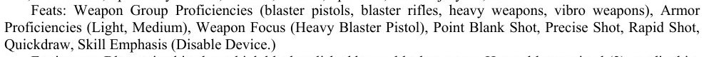
- **No single roster character (rules/setting/general)** — entry/section: Rrelbocco (feats): "Feats: Point Blank Shot, Rapid Shot, Exotic Weapon Proficiency (Bowcaster), Weapon Focus (Bowcaster), Starship Operations (Space Transports)" Source: *201 - Blinking Eyes - Quarters* (SWRPG d20 Revised Core), p.26
  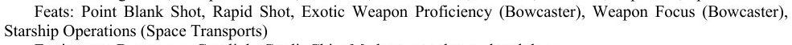
- **No single roster character (rules/setting/general)** — entry/section: A well-mannered Wookiee: "What is really interesting to Famier is that a well mannered Wookiee seems even more scary and intimidating to most patrons than an angry one." Source: *201 - Blinking Eyes - Quarters* (SWRPG d20 Revised Core), p.26
  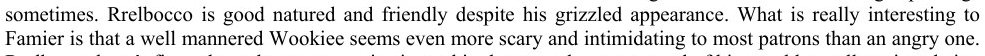

## p.27 (scan page 27)

Page contents: 370 words, 8 paragraphs | headings/entries: 

## p.28 (scan page 28)

Page contents: 149 words, 7 paragraphs | headings/entries: Critical Event Summary Quarters

## p.22–28 (scan page 22)

Page contents: DM aids; Appendix A-B; critical events (hand-read)

