# Owner Material 037 — Star Wars D20 Drive folder (Core, Revised Core and Saga Edition): Living Force Campaign/Adventures/Among the Stars/Year 2/202 - Blinking Eyes - Halves.pdf [Star Wars Roleplaying Game Revised Core (d20, 2002)]

- **Source:** Wizards of the Coast Star Wars Roleplaying Game books, web enhancements, Living Force campaign modules and articles (2000–2010), from the owner's "Star Wars D20" Drive folder (only the three edition subfolders; "General" was not read, as instructed). Secondary source (licensed Legends reference). Scan OCR'd on the box; the scan stays box-only and is **not** published.
- **Method:** every scanned page was OCR'd and machine-screened sentence by sentence for power-relevant statements (fights, kills, defeats, Force feats, rankings, superweapons) that name a character on our roster; each kept sentence is quoted verbatim from the OCR text and has a crop of the printed passage directly under it. Pages with nothing power-relevant are still listed with what is on them.
- **Citation:** "*202 - Blinking Eyes - Halves* (SWRPG d20 Revised Core), p.X" by printed page ("scan p.X" where no printed number applies). **Weight:** Licensed RPG material: a secondary source. Narrative text sums up Legends lore; game statistics are rules for players, not canon power levels, and rank lowest.

## p.1 (scan page 1)

Page contents: 124 words, 5 paragraphs | headings/entries: Halves

## p.2 (scan page 2)

Page contents: 857 words, 31 paragraphs | headings/entries: Halves; Character Earnings; Post-Scenario Paperwork; Issuing Force and Dark Side Points; Page 2

## p.3 (scan page 3)

Page contents: 865 words, 20 paragraphs | headings/entries: General Notes to the GM; GM Overview; Halves; ENCOUNTER ONE: THE STAR SHOCKED; Page 3

## p.4 (scan page 4)

Page contents: 735 words, 23 paragraphs | headings/entries: Encounter Three: The Neon Bantha; ENCOUNTER FouR: THE HOLO MAN; Halves; ENCOUNTER SIx: NARL'S APARTMENT; ENCOUNTER SEVEN: THUGS; ENCOUNTER EIGHT: SHOCKING RETURN; Opening Crawl; Page 4

- **No single roster character (rules/setting/general)** — entry/section: Crawl: "Mostly.": "As these two men have always sniped at each other, and though there is definitely no love lost between them, their discourses usually remain civil. Mostly." Source: *202 - Blinking Eyes - Halves* (SWRPG d20 Revised Core), p.4
  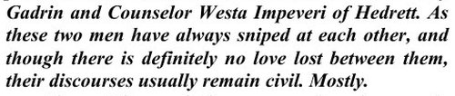

## p.1–4 (scan page 1)

Page contents: Title; boilerplate; FP/DSP; overview; summaries; crawl (hand-read)

## p.5 (scan page 5)

Page contents: 865 words, 18 paragraphs | headings/entries: Encounter One: the Star Shocked; Halves; Page 5

- **No single roster character (rules/setting/general)** — entry/section: Heckler: "Stinkin' Cartel lover.": "some one in the crowd shouted "Stinkin' Cartel lover. I always knew you were in wit' those cheats!"" Source: *202 - Blinking Eyes - Halves* (SWRPG d20 Revised Core), p.5
  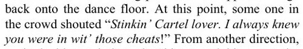
- **No single roster character (rules/setting/general)** — entry/section: "seeing the proton torpedo coming straight for you": "Yep. Looking around, it's like being a reactor core and seeing the proton torpedo coming straight for you." Source: *202 - Blinking Eyes - Halves* (SWRPG d20 Revised Core), p.5
  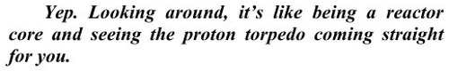

## p.6 (scan page 6)

Page contents: 859 words, 30 paragraphs | headings/entries: Halves; Skill Emphasis (Craft,; Page 6

- **No single roster character (rules/setting/general)** — entry/section: Chistor's bodyguards (feats): "Feats: Alertness, Armor Proficiency (light, medium), Improved Initiative, Quick Draw, Toughness, Weapon Group Proficiency (blaster pistols, blaster rifles, heavy weapons, simple weapons, vibro weapons)." Source: *202 - Blinking Eyes - Halves* (SWRPG d20 Revised Core), p.6
  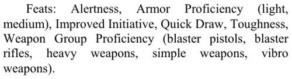

## p.7 (scan page 7)

Page contents: 860 words, 25 paragraphs | headings/entries: Halves; Page 7

- **No single roster character (rules/setting/general)** — entry/section: OPS Officer (feats): "Feats: Armor Proficiency (light), Weapon Group Proficiencies (blaster pistols, blaster rifles, simple weapons). Human officers also have the Alertness feat." Source: *202 - Blinking Eyes - Halves* (SWRPG d20 Revised Core), p.7
  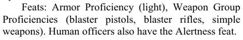

## p.5–7 (scan page 5)

Page contents: Enc 1: Star Shocked standoff (hand-read)

## p.8 (scan page 8)

Page contents: 751 words, 14 paragraphs | headings/entries: Halves; Encounter Three: Neon Bantha; Page 8

## p.7–8 (scan page 7)

Page contents: Enc 2: OPS; datacards; hold-out (hand-read)

## p.9 (scan page 9)

Page contents: 873 words, 30 paragraphs | headings/entries: Roll 0-5 "What? Go bother somebody else."; Halves; Page 9

- **No single roster character (rules/setting/general)** — entry/section: The Neon Bantha passphrase: ""To get in to see him, tell the butchers Baash koy unda tra bantha jouwa." (Dosh for "I desire three day old bantha meat.")" Source: *202 - Blinking Eyes - Halves* (SWRPG d20 Revised Core), p.9
  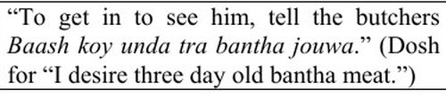
- **No single roster character (rules/setting/general)** — entry/section: "Fakes are to him what stench is to a Hutt.": ""Forgeries are his specialty. Fakes are to him what stench is to a Hutt." Source: *202 - Blinking Eyes - Halves* (SWRPG d20 Revised Core), p.9
  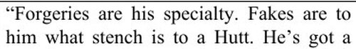
- **No single roster character (rules/setting/general)** — entry/section: Trandoshan butcher: "What you want?": "Turning to face the heroes, he growls, " What you want?" in Basic." Source: *202 - Blinking Eyes - Halves* (SWRPG d20 Revised Core), p.9
  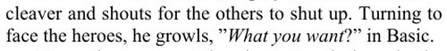

## p.10 (scan page 10)

Page contents: 780 words, 20 paragraphs | headings/entries: Tier 3:; Halves; Page 10

- **No single roster character (rules/setting/general)** — entry/section: Trandoshan butchers, Tier 3 (feats): "Feats: Infamy, Power Attack, Weapon Proficiency Group (blaster pistols, simple weapons, vibro weapons)." Source: *202 - Blinking Eyes - Halves* (SWRPG d20 Revised Core), p.10
  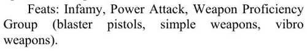
- **No single roster character (rules/setting/general)** — entry/section: Neon Bantha: "Haku?": ""Haku?" is the response ("What?" in Huttese)." Source: *202 - Blinking Eyes - Halves* (SWRPG d20 Revised Core), p.10
  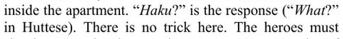

## p.11 (scan page 11)

Page contents: 844 words, 23 paragraphs | headings/entries: Halves; Neon Bantha knows the following:; Encounter Four: The Holo Man; Page 11

- **No single roster character (rules/setting/general)** — entry/section: Neon Bantha (feats): "Feats: Fame, Gearhead, Improved Initiative, Skill Emphasis (Computer Use), Weapon Proficiency Group (blaster pistols, simple weapons)." Source: *202 - Blinking Eyes - Halves* (SWRPG d20 Revised Core), p.11
  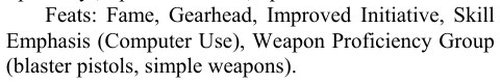
- **No single roster character (rules/setting/general)** — entry/section: Neon Bantha on "Dasc": "He gave me his name as Dasc. Probably not his real name though. His money was good enough. That's all I care about." Source: *202 - Blinking Eyes - Halves* (SWRPG d20 Revised Core), p.11
  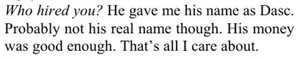

## p.8–11 (scan page 8)

Page contents: Enc 3: Neon Bantha (hand-read)

## p.12 (scan page 12)

Page contents: 843 words, 22 paragraphs | headings/entries: Roll Information; Halves; Tier 1:; Page 12

## p.13 (scan page 13)

Page contents: 789 words, 33 paragraphs | headings/entries: Tier 3:; Halves; Page 13

- **No single roster character (rules/setting/general)** — entry/section: Varin Teska, Tier 3 (feats): "Feats: Armor Proficiency (light, medium, heavy), Heroic Surge, Improved Initiative, Multishot, Point Blank Shot, Precise Shot, Rapid Shot, Weapon Focus (blaster pistol), Weapon Proficiency Group (blaster pistols, blaster rifles, heavy weapons, simple weapons, vibro weapons)." Source: *202 - Blinking Eyes - Halves* (SWRPG d20 Revised Core), p.13
  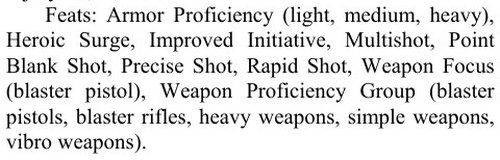
- **No single roster character (rules/setting/general)** — entry/section: Varin Teska: "It's only money.": "A large group of professional-looking individuals showing up on your doorstep does that. It's only money." Source: *202 - Blinking Eyes - Halves* (SWRPG d20 Revised Core), p.13
  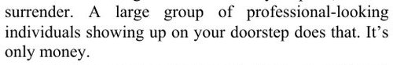
- **No single roster character (rules/setting/general)** — entry/section: Varin: "I don't even know if it's a him.": "Someone anonymous. Everything was handled over the computer. I don't know him, and he doesn't know me. I don't even know if it's a him." Source: *202 - Blinking Eyes - Halves* (SWRPG d20 Revised Core), p.13
  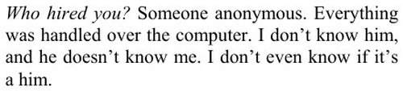
- **No single roster character (rules/setting/general)** — entry/section: Varin: "The contract was not on Chistor.": "Chistor? The contract was not on Chistor. It was on his assistant Narl Gorjax. I was supposed to make it look like a botched hit on the Governor, but get Gorjax." Source: *202 - Blinking Eyes - Halves* (SWRPG d20 Revised Core), p.13
  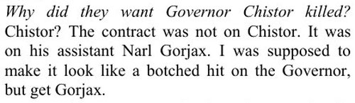
- **No single roster character (rules/setting/general)** — entry/section: Varin: "It's all about money.": "Come on. It's all about money. I asked a few beings to keep an eye out for anyone asking about me." Source: *202 - Blinking Eyes - Halves* (SWRPG d20 Revised Core), p.13
  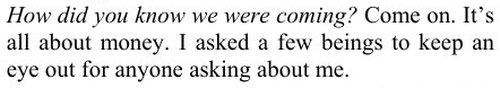

## p.14 (scan page 14)

Page contents: 888 words, 19 paragraphs | headings/entries: Halves; Page 14

- **No single roster character (rules/setting/general)** — entry/section: Vellna: "How may I be of assistance?": ""How may I be of assistance?" he asks in a deep, double-voice." Source: *202 - Blinking Eyes - Halves* (SWRPG d20 Revised Core), p.14
  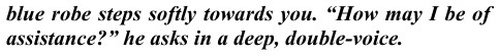
- **No single roster character (rules/setting/general)** — entry/section: Lowban Terlq: "Please sit, and let us talk": ""Please sit, and let us talk," announces the Ithorian in basic." Source: *202 - Blinking Eyes - Halves* (SWRPG d20 Revised Core), p.14
  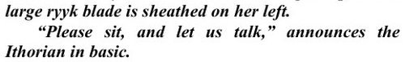

## p.11–14 (scan page 11)

Page contents: Enc 4: Varin Teska (hand-read)

## p.15 (scan page 15)

Page contents: 795 words, 23 paragraphs | headings/entries: Halves; Encounter Six: Narl's Apartment; Page 15

- **No single roster character (rules/setting/general)** — entry/section: Lowban Terlq (feats): "Feats: Fame, Skill Emphasis (Diplomacy), Trustworthy, Weapon Group Proficiency (blaster pistols, simple weapons)." Source: *202 - Blinking Eyes - Halves* (SWRPG d20 Revised Core), p.15
  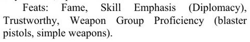
- **No single roster character (rules/setting/general)** — entry/section: Gworrall (feats): "Feats: Armor Proficiency (light, medium, heavy), Cleave, Improved Initiative, Martial Arts, Power Attack, Weapon Proficiency Group (blaster pistols, blaster rifles, heavy weapons, simple weapons, vibro weapons)." Source: *202 - Blinking Eyes - Halves* (SWRPG d20 Revised Core), p.15
  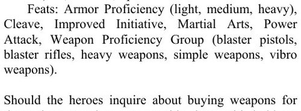

## p.14–15 (scan page 14)

Page contents: Enc 5: Lowban Terlq (hand-read)

## p.16 (scan page 16)

Page contents: 804 words, 23 paragraphs | headings/entries: Halves; Encounter Seven: Thugs; Page 16

## p.15–16 (scan page 15)

Page contents: Enc 6: Narl's apartment (hand-read)

## p.17 (scan page 17)

Page contents: 802 words, 28 paragraphs | headings/entries: Encounter Eight: Shocking Return; Halves; Page 17

- **No single roster character (rules/setting/general)** — entry/section: Thugs, Tier 3 (feats): "Feats: Heroic Surge, Improved _ Initiative, Toughness, Weapon Proficiency Group (blaster pistols, simple weapons)." Source: *202 - Blinking Eyes - Halves* (SWRPG d20 Revised Core), p.17
  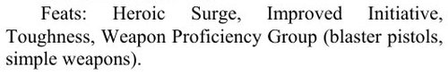
- **No single roster character (rules/setting/general)** — entry/section: Red lightsaber on the roof: "Standing there against a background of blue neon is a dark figure. Its features are hidden except for one -- a glowing red lightsaber. The dark shape calmly turns and disappears from view." Source: *202 - Blinking Eyes - Halves* (SWRPG d20 Revised Core), p.17
  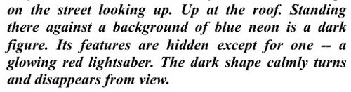
- **No single roster character (rules/setting/general)** — entry/section: Syndicate Thugs (feats): "Feats: Heroic Surge, Weapon Proficiency Group (blaster pistols, simple weapons)." Source: *202 - Blinking Eyes - Halves* (SWRPG d20 Revised Core), p.17
  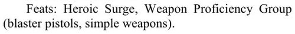

## p.16–17 (scan page 16)

Page contents: Enc 7: thugs (hand-read)

## p.18 (scan page 18)

Page contents: 730 words, 25 paragraphs | headings/entries: Tier 1:; Tier 2:; Halves; Tier 3:; Page 18

## p.19 (scan page 19)

Page contents: 897 words, 20 paragraphs | headings/entries: Halves; Page 19

- **No single roster character (rules/setting/general)** — entry/section: Cavin Chistor, Tier 3 (feats): "Feats: Fame, Iron Will, Skill Emphasis (Bluff), Skill Emphasis (Diplomacy), Trustworthy, Weapon Proficiency Group (blaster pistols, simple weapons)." Source: *202 - Blinking Eyes - Halves* (SWRPG d20 Revised Core), p.19
  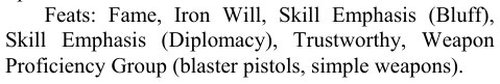
- **No single roster character (rules/setting/general)** — entry/section: Dexx Molay, Tier 3 (feats): "Feats: Armor Proficiency (light), Persuasive, Skill Emphasis (Intimidate), Sharp-eyed, Trustworthy, Weapon Focus (blaster pistol), Weapon Proficiency Group (blaster pistols, blaster rifles, heavy weapons, simple weapons, vibro weapons)." Source: *202 - Blinking Eyes - Halves* (SWRPG d20 Revised Core), p.19
  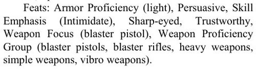

## p.20 (scan page 20)

Page contents: 650 words, 28 paragraphs | headings/entries: Conclusion; The End of Halves; Halves; Experience Summary; ADVENTURE EXPERIENCE AWARD:; Loot Summary; Encounter 3:; Page 20

- **No single roster character (rules/setting/general)** — entry/section: Westa Impeveri: apology: ""First, my deepest apologies to Governor Chistor. I believed the information on his guilt to be true and valid." Source: *202 - Blinking Eyes - Halves* (SWRPG d20 Revised Core), p.20
  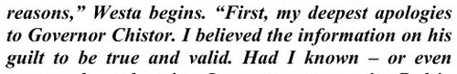
- **No single roster character (rules/setting/general)** — entry/section: Westa Impeveri: "their cancer": ""Secondly, I am not guilty of conspiring with the Trade Federation. Whatever you may think of me, I would beg of you to believe that. After my previous accusations against Governor Chistor, I know this is difficult, but I would not conspire to bring their cancer back into our system." Source: *202 - Blinking Eyes - Halves* (SWRPG d20 Revised Core), p.20
  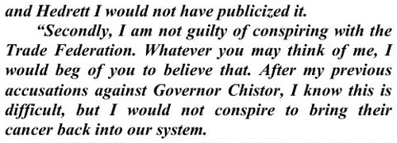
- **No single roster character (rules/setting/general)** — entry/section: Westa Impeveri: "I know I will.": ""I firmly believe I will be found innocent of these charges. I know I will. Thank you."" Source: *202 - Blinking Eyes - Halves* (SWRPG d20 Revised Core), p.20
  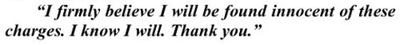

## p.17–20 (scan page 17)

Page contents: Enc 8: confrontation; aftermath; conclusion; XP (hand-read)

## p.21 (scan page 21)

Page contents: 152 words, 14 paragraphs | headings/entries: Encounter 5:; Ithorian weapon dealer); Encounter 7: 6 Blaster pistols 6 Clubs; Encounter 8: Chrome-plated blaster pistol Hold-out blaster; Halves; Page 21

## p.20–21 (scan page 20)

Page contents: Loot (hand-read)

