# Owner Material 037 — Star Wars D20 Drive folder (Core, Revised Core and Saga Edition): Living Force Campaign/Adventures/Among the Stars/Year 2/203 - Blinking Eyes - Holes.pdf [Star Wars Roleplaying Game Revised Core (d20, 2002)]

- **Source:** Wizards of the Coast Star Wars Roleplaying Game books, web enhancements, Living Force campaign modules and articles (2000–2010), from the owner's "Star Wars D20" Drive folder (only the three edition subfolders; "General" was not read, as instructed). Secondary source (licensed Legends reference). Scan OCR'd on the box; the scan stays box-only and is **not** published.
- **Method:** every scanned page was OCR'd and machine-screened sentence by sentence for power-relevant statements (fights, kills, defeats, Force feats, rankings, superweapons) that name a character on our roster; each kept sentence is quoted verbatim from the OCR text and has a crop of the printed passage directly under it. Pages with nothing power-relevant are still listed with what is on them.
- **Citation:** "*203 - Blinking Eyes - Holes* (SWRPG d20 Revised Core), p.X" by printed page ("scan p.X" where no printed number applies). **Weight:** Licensed RPG material: a secondary source. Narrative text sums up Legends lore; game statistics are rules for players, not canon power levels, and rank lowest.

## p.1 (scan page 1)

Page contents: 112 words, 5 paragraphs | headings/entries: Holes

## p.2 (scan page 2)

Page contents: 888 words, 29 paragraphs | headings/entries: Character Earnings; Post-Scenario Paperwork; Issuing Force and Dark Side Points; Holes; Page 2

## p.3 (scan page 3)

Page contents: 853 words, 24 paragraphs | headings/entries: General Notes to the GM; GM Overview; Encounter 1: Welcome to the Jungle; Encounter 2: Mother of the Hiironi; Holes; Page 3

## p.4 (scan page 4)

Page contents: 777 words, 24 paragraphs | headings/entries: Encounter 3: Pirates and the Jungle; Encounter 4: Bounty Hunters; Encounter 5: The Ishkik Caverns; Encounter 6: The Syndicate; Opening Crawl; Encounter 1: Welcome to the Jungle; Holes; Page 4

## p.1–4 (scan page 1)

Page contents: Title; boilerplate; FP/DSP; overview; summaries; crawl (hand-read)

## p.5 (scan page 5)

Page contents: 869 words, 23 paragraphs | headings/entries: Holes; Page 5

- **No single roster character (rules/setting/general)** — entry/section: Sclarin (feats): "Feats: Improved Initiative, Stealthy." Source: *203 - Blinking Eyes - Holes* (SWRPG d20 Revised Core), p.5
  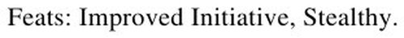

## p.6 (scan page 6)

Page contents: 815 words, 29 paragraphs | headings/entries: Holes; Page 6

- **No single roster character (rules/setting/general)** — entry/section: Cryalira: "Greetings": ""Greetings," she says in Tarasinese. "Please accept my thanks for the help you provided to us earlier. It was most welcome."" Source: *203 - Blinking Eyes - Holes* (SWRPG d20 Revised Core), p.6
  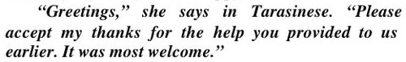
- **No single roster character (rules/setting/general)** — entry/section: Cryalira: "The Mother of the Hiironi requests": ""The Mother of the Hiironi requests that you join her in her tent." It seems more a demand than request." Source: *203 - Blinking Eyes - Holes* (SWRPG d20 Revised Core), p.6
  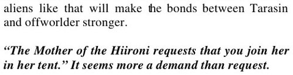
- **No single roster character (rules/setting/general)** — entry/section: Dariana: "You are our heroes?": "Her brown eyes pierce you to the very core. "You are our heroes?"" Source: *203 - Blinking Eyes - Holes* (SWRPG d20 Revised Core), p.6
  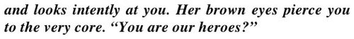
- **No single roster character (rules/setting/general)** — entry/section: Dariana: "You have saved the Tarasin once.": ""You have saved the Tarasin once. I need you to do so again." Source: *203 - Blinking Eyes - Holes* (SWRPG d20 Revised Core), p.6
  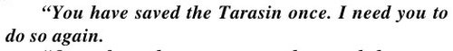
- **No single roster character (rules/setting/general)** — entry/section: Dariana: "Age seems to have caught up to me": ""Pardon me. Age seems to have caught up to me with a vengeance. I am not what I used to be."" Source: *203 - Blinking Eyes - Holes* (SWRPG d20 Revised Core), p.6
  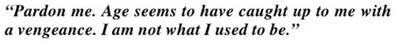

## p.4–6 (scan page 4)

Page contents: Enc 1: celebration; Liriana's storm; sclarin (hand-read)

## p.7 (scan page 7)

Page contents: 900 words, 23 paragraphs | headings/entries: Holes; Page 7

- **No single roster character (rules/setting/general)** — entry/section: Dariana: "All I can sense from them is darkness and evil.": ""I have used the Force to attempt to pierce the caverns. All I can sense from them is darkness and evil. Something very bad is in those caverns. I was at a loss for what to do." Source: *203 - Blinking Eyes - Holes* (SWRPG d20 Revised Core), p.7
  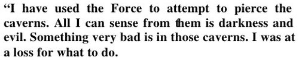
- **No single roster character (rules/setting/general)** — entry/section: Dariana: "I knew I would learn your faces.": ""The vision only told me you would come, not who you were. But I knew I would learn your faces. And so you are here."" Source: *203 - Blinking Eyes - Holes* (SWRPG d20 Revised Core), p.7
  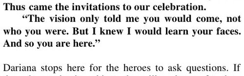
- **No single roster character (rules/setting/general)** — entry/section: Dariana on Tassa'to: "He is mean and terrible, but teaches the hunters a few tricks to go along with their injuries and bruised egos. I do not think any Tarasin could ever kill Tassa'to. And he does not kill Tarasin. Just cuts and bruises. It is a ritual for our hunters and, heh, fun for him." Source: *203 - Blinking Eyes - Holes* (SWRPG d20 Revised Core), p.7
  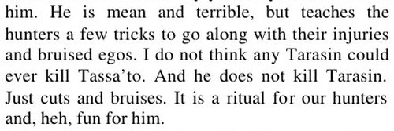

## p.6–7 (scan page 6)

Page contents: Enc 2: Dariana's charge (hand-read)

## p.8 (scan page 8)

Page contents: 767 words, 28 paragraphs | headings/entries: Encounter 3: Pirates and the Jungle; Holes; Page 8

- **No single roster character (rules/setting/general)** — entry/section: Dariana: "I trust you rested peacefully?": ""Good morning." Dariana bows her head slightly to you. She is dressed in a loose, white robe this morning and leaning heavily on her staff. "I trust you rested peacefully?"" Source: *203 - Blinking Eyes - Holes* (SWRPG d20 Revised Core), p.8
  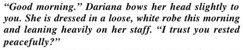
- **No single roster character (rules/setting/general)** — entry/section: Slillek (feats): "Feats: Skill Emphasis (Survival), Track, Weapon Group Proficiency (blaster pistols, blaster rifles, simple weapons)." Source: *203 - Blinking Eyes - Holes* (SWRPG d20 Revised Core), p.8
  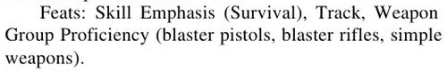

## p.9 (scan page 9)

Page contents: 857 words, 27 paragraphs | headings/entries: Holes; Page 9

- **No single roster character (rules/setting/general)** — entry/section: Rock Rogues (feats): "Feats: Toughness, Weapon Group Proficiency (blaster pistols, simple weapons)." Source: *203 - Blinking Eyes - Holes* (SWRPG d20 Revised Core), p.9
  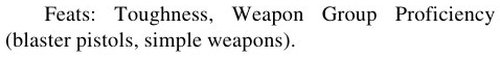
- **No single roster character (rules/setting/general)** — entry/section: Fleeing Rock Rogues: ""Fire up the engines! We've got company coming! We have to get back and tell the boss!"" Source: *203 - Blinking Eyes - Holes* (SWRPG d20 Revised Core), p.9
  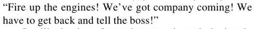

## p.8–9 (scan page 8)

Page contents: Enc 3: Slillek; Rock Rogues; skiff (hand-read)

## p.10 (scan page 10)

Page contents: 877 words, 24 paragraphs | headings/entries: Encounter 4: Bounty Hunters; Holes; Page 10

- **No single roster character (rules/setting/general)** — entry/section: Koll Jovas: "May the oceans bring you pleasure.": ""May the oceans bring you pleasure. I am Koll Jovas. These are my companions. May we share your camp?"" Source: *203 - Blinking Eyes - Holes* (SWRPG d20 Revised Core), p.10
  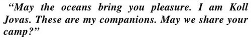
- **No single roster character (rules/setting/general)** — entry/section: Koll Jovas (feats): "Feats: Armor Proficiency (light), Fame, Skill Emphasis (Bluff), Weapon Group Proficiency (blaster pistols, blaster rifles, heavy weapons, simple weapons, vibro weapons)." Source: *203 - Blinking Eyes - Holes* (SWRPG d20 Revised Core), p.10
  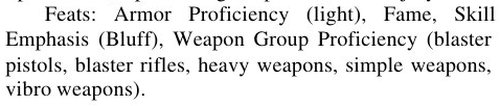

## p.11 (scan page 11)

Page contents: 752 words, 30 paragraphs | headings/entries: Encounter 5: The Ishkik Caverns; Holes; Page 11

- **No single roster character (rules/setting/general)** — entry/section: Sina Voosha (feats): "Feats: Armor Proficiency (light, medium, heavy), Heroic Surge, Martial Artist, Persuasion, Skill Emphasis (Tumble), Weapon Finesse (Unarmed), Weapon Group Proficiency (blaster pistols, blaster rifles, heavy weapons, simple weapons, vibro weapons)." Source: *203 - Blinking Eyes - Holes* (SWRPG d20 Revised Core), p.11
  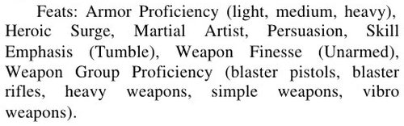
- **No single roster character (rules/setting/general)** — entry/section: Koll Jovas: "Maybe we'll meet again": ""Maybe we'll meet again," he says as his group disappears into the jungle." Source: *203 - Blinking Eyes - Holes* (SWRPG d20 Revised Core), p.11
  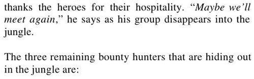
- **No single roster character (rules/setting/general)** — entry/section: Fir Kashal (feats): "Feats: Armor Proficiency (light, medium, heavy), Heroic Surge, Point Blank Shot, Precise Shot, Rapid Shot, Weapon Group Proficiency (blaster pistols, blaster rifles, heavy weapons, simple weapons, vibro weapons)." Source: *203 - Blinking Eyes - Holes* (SWRPG d20 Revised Core), p.11
  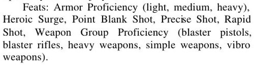
- **No single roster character (rules/setting/general)** — entry/section: Liinu Oran (feats): "Feats: Heroic Surge, Point Blank Shot, Skill Emphasis (Survival), Track, Weapon Group Proficiency (blaster pistols, blaster rifles, simple weapons)." Source: *203 - Blinking Eyes - Holes* (SWRPG d20 Revised Core), p.11
  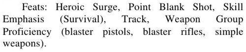
- **No single roster character (rules/setting/general)** — entry/section: Jith Zesjoo (feats): "Feats: Quick-Draw, Weapon Focus (Blaster pistol), Weapon Group Proficiency (blaster pistols, blaster rifles, simple weapons)." Source: *203 - Blinking Eyes - Holes* (SWRPG d20 Revised Core), p.11
  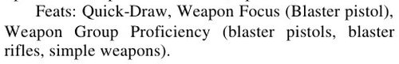

## p.10–11 (scan page 10)

Page contents: Enc 4: bounty hunters (hand-read)

## p.12 (scan page 12)

Page contents: 939 words, 21 paragraphs | headings/entries: Holes; Page 12

## p.13 (scan page 13)

Page contents: 855 words, 26 paragraphs | headings/entries: The Direct Way; The Indirect Way; Encounter 1: Miners; Encounter 2: Tarasin Artifacts; Holes; Page 13

- **No single roster character (rules/setting/general)** — entry/section: Syndicate Guards (feats): "Feats: Armor Proficiency (light), Heroic Surge, Weapon Focus (blaster pistol), Weapon Group Proficiency (blaster pistols, simple weapons)." Source: *203 - Blinking Eyes - Holes* (SWRPG d20 Revised Core), p.13
  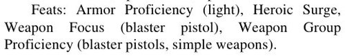

## p.14 (scan page 14)

Page contents: 894 words, 33 paragraphs | headings/entries: Encounter 6: The Syndicate; Holes; Page 14

- **No single roster character (rules/setting/general)** — entry/section: "Army of Wookiees, anyone?": "Sheer Strength. If takes an effective Str of 40 to get it open. Army of Wookiees, anyone?" Source: *203 - Blinking Eyes - Holes* (SWRPG d20 Revised Core), p.14
  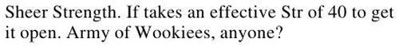

## p.11–14 (scan page 11)

Page contents: Enc 5: Ishkik Caverns (hand-read)

## p.15 (scan page 15)

Page contents: 943 words, 24 paragraphs | headings/entries: Holes; Page 15

- **No single roster character (rules/setting/general)** — entry/section: Syndicate Mercs (feats): "Feats: Armor Proficiency (light), Heroic Surge, Weapon Group Proficiency (blaster pistols, simple weapons)." Source: *203 - Blinking Eyes - Holes* (SWRPG d20 Revised Core), p.15
  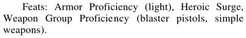

## p.16 (scan page 16)

Page contents: 779 words, 36 paragraphs | headings/entries: Equipment: Robes, hold-out blaster; Holes; Page 16

- **No single roster character (rules/setting/general)** — entry/section: Alina Impeveri, Tier 1 (feats): "Feats: Force Sensitive, Skill Emphasis (Affect Mind), Skill Emphasis (Illusion), Weapon Group Proficiency (blaster pistols, primitive weapons, simple weapons). Force Feats: Alter, Sense." Source: *203 - Blinking Eyes - Holes* (SWRPG d20 Revised Core), p.16
  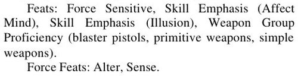
- **No single roster character (rules/setting/general)** — entry/section: Bhassi Kloor, Tier 1 (feats): "Feats: Armor Proficiency (light, medium, heavy), Force Sensitive, Heroic Surge, Power Attack, Weapon Group Proficiency (blaster pistols, blaster rifles, heavy weapons, simple weapons, vibro weapons). Force Feats: Control, Rage." Source: *203 - Blinking Eyes - Holes* (SWRPG d20 Revised Core), p.16
  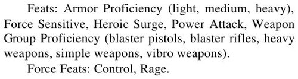
- **No single roster character (rules/setting/general)** — entry/section: Neebuk Garbos, Tier 1 (feats): "Feats: Ambidexterity, Armor Proficiency (light, medium, heavy), Point Blank Shot, Rapid Shot, Two Weapon Fighting, Weapon Group Proficiency (blaster pistols, blaster rifles, heavy weapons, simple weapons, vibro weapons)." Source: *203 - Blinking Eyes - Holes* (SWRPG d20 Revised Core), p.16
  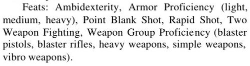
- **No single roster character (rules/setting/general)** — entry/section: Verkul Seimbo, Tier 1 (feats): "Feats: Iron Will, Trustworthy, Weapon Group Proficiency (simple weapons)." Source: *203 - Blinking Eyes - Holes* (SWRPG d20 Revised Core), p.16
  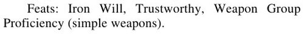

## p.17 (scan page 17)

Page contents: 778 words, 35 paragraphs | headings/entries: Equipment: Robes, hold-out blaster; Holes; Page 17

## p.18 (scan page 18)

Page contents: 820 words, 23 paragraphs | headings/entries: Holes; Page 18

- **No single roster character (rules/setting/general)** — entry/section: Alina Impeveri, Tier 3 (feats): "Feats: Force Sensitive, Iron Will, Skill Emphasis (Affect Mind), Skill Emphasis (Illusion), Weapon Group Proficiency (blaster pistols, primitive weapons, simple weapons). Force Feats: Alter, Control, Sense, Summon Storm." Source: *203 - Blinking Eyes - Holes* (SWRPG d20 Revised Core), p.18
  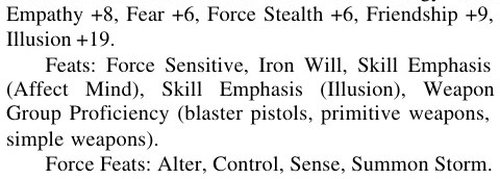
- **No single roster character (rules/setting/general)** — entry/section: Bhassi Kloor, Tier 3 (feats): "Feats: Armor Proficiency (light, medium, heavy), Expertise, Force Sensitive, Heroic Surge, Martial Arts, Power Attack, Weapon Focus (Ryyk blade), Weapon Group Proficiency (blaster pistols, blaster rifles, heavy weapons, simple weapons, vibro weapons). Force Feats: Alter, Burst of Speed, Control, Hatred, Rage, Sense." Source: *203 - Blinking Eyes - Holes* (SWRPG d20 Revised Core), p.18
  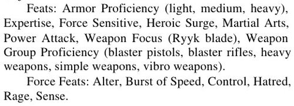
- **No single roster character (rules/setting/general)** — entry/section: Neebuk Garbos, Tier 3 (feats): "Feats: Ambidexterity, Armor Proficiency (light, medium, heavy), Improved Initiative, Improved Two Weapon Fighting, Multishot, Point Blank Shot, Precise Shot, Quick-Draw, Rapid Shot, Two Weapon Fighting, Weapon Group Proficiency (blaster pistols, blaster rifles, heavy weapons, simple weapons, vibro weapons)." Source: *203 - Blinking Eyes - Holes* (SWRPG d20 Revised Core), p.18
  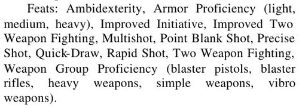
- **No single roster character (rules/setting/general)** — entry/section: Verkul Seimbo, Tier 3 (feats): "Feats: Iron Will, Skill Emphasis (Diplomacy), Trustworthy, Weapon Group Proficiency (simple weapons)." Source: *203 - Blinking Eyes - Holes* (SWRPG d20 Revised Core), p.18
  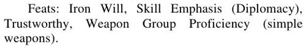

## p.19 (scan page 19)

Page contents: 667 words, 34 paragraphs | headings/entries: Conclusion; Here Ends Holes; Experience Point Summary; Adventure Experience Award:; Loot Summary; Encounter 3: Pirates and the Jungle; Encounter 6: The Syndicate; Holes; Page 19

- **No single roster character (rules/setting/general)** — entry/section: Thurm Loogg: "The Cartel LOVES Cularin!": "Thurm Loogg denounces the "rogue" faction and insists they were operating without the knowledge or approval of the Cartel. Because, of course, "The Cartel LOVES Cularin!"" Source: *203 - Blinking Eyes - Holes* (SWRPG d20 Revised Core), p.19
  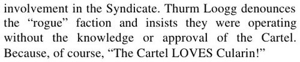

## p.14–19 (scan page 14)

Page contents: Enc 6: the Syndicate; tiers; aftermath (hand-read)

## p.20 (scan page 20)

Page contents: 106 words, 6 paragraphs | headings/entries: Conclusion; Holes; Page 20

## p.19–20 (scan page 19)

Page contents: Conclusion; XP; loot; amulet (hand-read)

## p.21 (scan page 21)

Page contents: 176 words, 4 paragraphs | headings/entries: DM Aid #1: Terrifying Presence; From the Alien Anthology; Holes Page 21

## p.22 (scan page 22)

Page contents: 27 words, 5 paragraphs | headings/entries: Page 22; Holes

## p.23 (scan page 23)

Page contents: 150 words, 10 paragraphs | headings/entries: Yes No; Yes No; Convention Coordinator:; Holes; Page 23

## p.21–23 (scan page 21)

Page contents: DM Aids; map; critical events (hand-read)

