# Owner Material 037 — Star Wars D20 Drive folder (Core, Revised Core and Saga Edition): Living Force Campaign/Adventures/Among the Stars/Year 2/204 - Blinking Eyes - Peaces.pdf [Star Wars Roleplaying Game Revised Core (d20, 2002)]

- **Source:** Wizards of the Coast Star Wars Roleplaying Game books, web enhancements, Living Force campaign modules and articles (2000–2010), from the owner's "Star Wars D20" Drive folder (only the three edition subfolders; "General" was not read, as instructed). Secondary source (licensed Legends reference). Scan OCR'd on the box; the scan stays box-only and is **not** published.
- **Method:** every scanned page was OCR'd and machine-screened sentence by sentence for power-relevant statements (fights, kills, defeats, Force feats, rankings, superweapons) that name a character on our roster; each kept sentence is quoted verbatim from the OCR text and has a crop of the printed passage directly under it. Pages with nothing power-relevant are still listed with what is on them.
- **Citation:** "*204 - Blinking Eyes - Peaces* (SWRPG d20 Revised Core), p.X" by printed page ("scan p.X" where no printed number applies). **Weight:** Licensed RPG material: a secondary source. Narrative text sums up Legends lore; game statistics are rules for players, not canon power levels, and rank lowest.

## p.1 (scan page 1)

Page contents: 145 words, 6 paragraphs | headings/entries: Peaces

## p.2 (scan page 2)

Page contents: 904 words, 18 paragraphs | headings/entries: Issuing Force and Dark Side Points; General Notes to the GM; Peaces; Page 2

## p.3 (scan page 3)

Page contents: 920 words, 15 paragraphs | headings/entries: The Story; The Details; Peaces; Page 3

- **No single roster character (rules/setting/general)** — entry/section: Barrit Bosch to Skall Delos: "Delos was given a copy of the materials used to create the forgery, and told, "If anything happens, you'll know how to use these."" Source: *204 - Blinking Eyes - Peaces* (SWRPG d20 Revised Core), p.3
  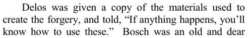

## p.1–3 (scan page 1)

Page contents: Title; boilerplate; FP/DSP; The Story (hand-read)

## p.4 (scan page 4)

Page contents: 896 words, 19 paragraphs | headings/entries: The opening announcement for the interactive:; Peaces; Page 4

- **No single roster character (rules/setting/general)** — entry/section: Hril Bast: "Really! Trust me!": "He will deny any knowledge of (a) the incidents in the Ishkik Caverns, and (b) the transmitters. The Cartel would NEVER engage in such activities! Really! Trust me!" Source: *204 - Blinking Eyes - Peaces* (SWRPG d20 Revised Core), p.4
  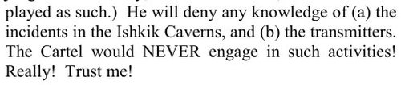

## p.5 (scan page 5)

Page contents: 838 words, 20 paragraphs | headings/entries: Impeveri's Announcement; Thurm Loogg's Announcement; Peaces; Page 5

- **No single roster character (rules/setting/general)** — entry/section: Broof Yurdel on the Thaereian Navy: "he's very anti-Cartel, and has never been a big fan of the Thaereian Navy, whom he believes to be "very much wid da heavy hand; deysa bombad militaristics."" Source: *204 - Blinking Eyes - Peaces* (SWRPG d20 Revised Core), p.5
  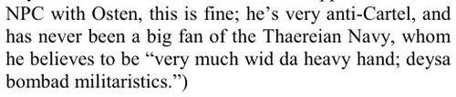
- **No single roster character (rules/setting/general)** — entry/section: Race announcer: Delos crashes: "Delos drops back to the rear of the pack — probably going to use his trademark come from behind maneuver. But it looks like something's gone wrong! Delos's right engine seemed to give out, and he just careened into the side of one of the rusted-out pieces of mining equipment. Look at that fireball! The rescue patrol is already on its way." Source: *204 - Blinking Eyes - Peaces* (SWRPG d20 Revised Core), p.5
  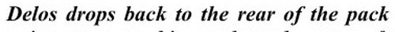
- **No single roster character (rules/setting/general)** — entry/section: Westa Impeveri: "I will be in your debt.": ""Friends — citizens — Skall Delos contacted me when he arrived on Cularin. He claims to have information that will exonerate me. I've heard the rumor that he might not have died in that crash, and would very much appreciate it if you could put together a team to go and find him. I will be in your debt."" Source: *204 - Blinking Eyes - Peaces* (SWRPG d20 Revised Core), p.5
  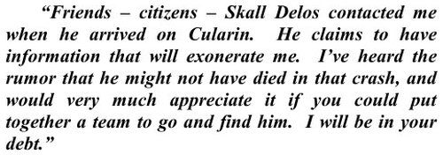

## p.6 (scan page 6)

Page contents: 826 words, 22 paragraphs | headings/entries: Delos. We -"; The Setting; Scene 1: The Big Party; Other tidbits that are floating around:; Scene 2: Vanster Enan's; Peaces; Page 6

- **No single roster character (rules/setting/general)** — entry/section: Hril Bast: "The Cartel is most fond of Delos.": ""I understand that you may be in a position to locate the missing Delos. This is good, yes. This is good. The Cartel very much wants Delos returned. The Cartel is most fond of Delos. Should Delos be turned over to the Cartel immediately upon his recovery, it would be worth a great deal to the Cartel. Say, 3000 credits to each of you? No, no. Don't answer now. Think about it. And here's my comm code."" Source: *204 - Blinking Eyes - Peaces* (SWRPG d20 Revised Core), p.6
  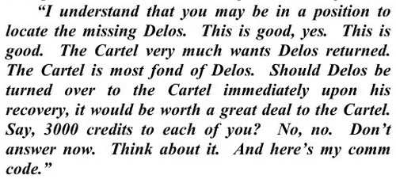

## p.3–6 (scan page 3)

Page contents: The Details: rumors; NPCs; crash; announcements; Hril Bast (hand-read)

## p.7 (scan page 7)

Page contents: 793 words, 20 paragraphs | headings/entries: Scene 3: Cularin Militia Recruiting Station; NPC present: Osten Dal'Nay, Broof Yurdel; Scene 4: The Jedi Enclave; NPCs present: Various Jedi; Scene 5: Lony Hertz's Force Adept Club; NPCs present: Lony Hertz; Peaces; Page 7

## p.6–7 (scan page 6)

Page contents: Scenes 1-5 (hand-read)

## p.8 (scan page 8)

Page contents: 895 words, 21 paragraphs | headings/entries: Mini-Mission; Feats: Improved Grab, Track; The Search; Peaces; Page 8

- **No single roster character (rules/setting/general)** — entry/section: Carnivorous Dianoga (feats): "Feats: Improved Grab, Track" Source: *204 - Blinking Eyes - Peaces* (SWRPG d20 Revised Core), p.8
  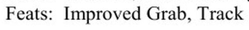
- **No single roster character (rules/setting/general)** — entry/section: "DO NOT KILL CHARACTERS WITH THE DIANOGA.": "Let me spell it out for you: DO NOT KILL CHARACTERS WITH THE DIANOGA." Source: *204 - Blinking Eyes - Peaces* (SWRPG d20 Revised Core), p.8
  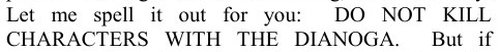
- **No single roster character (rules/setting/general)** — entry/section: Ceiling message: ""Get the right one, and he's yours. If not... boom."" Source: *204 - Blinking Eyes - Peaces* (SWRPG d20 Revised Core), p.8
  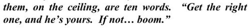

## p.9 (scan page 9)

Page contents: 955 words, 15 paragraphs | headings/entries: The Conclusion; Peaces; Page 9

- **No single roster character (rules/setting/general)** — entry/section: Skall Delos: "They're trying to kill me!": ""You've got to get us out of here! They're trying to kill me!"" Source: *204 - Blinking Eyes - Peaces* (SWRPG d20 Revised Core), p.9
  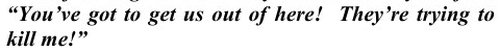

## p.8–9 (scan page 8)

Page contents: Mini-mission: dianoga; illusory Skalls; Delos (hand-read)

## p.10 (scan page 10)

Page contents: 559 words, 22 paragraphs | headings/entries: Here Ends, "Peaces"; Experience Point Summary; Adventure Experience Award:; Loot Summary; OR; Peaces; Page 10

- **No single roster character (rules/setting/general)** — entry/section: Westa Impeveri: "justified my faith": ""My friends, I thank you. You have again justified my faith in the people of Cularin. I will be resuming my position on the Hedrett Council immediately, and will be commissioning a task force to locate my nowerrant daughter, and bring her to justice!"" Source: *204 - Blinking Eyes - Peaces* (SWRPG d20 Revised Core), p.10
  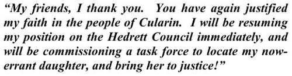
- **No single roster character (rules/setting/general)** — entry/section: Westa Impeveri thanks the Cartel: ""I would also like to thank our friends, the Metatheran Cartel, for their assistance in bringing Delos back." He grimaces. "Without them... well, there's no telling where we'd be."" Source: *204 - Blinking Eyes - Peaces* (SWRPG d20 Revised Core), p.10
  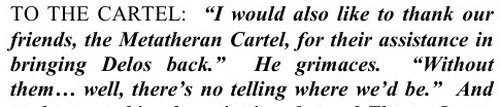

## p.9–10 (scan page 9)

Page contents: Conclusion; XP; loot (hand-read)

## p.11 (scan page 11)

Page contents: Appendix 1: Thurm Loogg's address (hand-read)

- **No single roster character (rules/setting/general)** — entry/section: Thurm Loogg: "because the Cartel LOVES you!": "that's right, racing courtesy of the Cartel, because the Cartel LOVES you! Perhaps negotiations may even include a new pod racer for the lucky individual... we're always willing to negotiate." Source: *204 - Blinking Eyes - Peaces* (SWRPG d20 Revised Core), p.11
  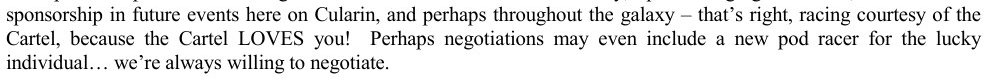
- **No single roster character (rules/setting/general)** — entry/section: Thurm Loogg: "Enjoy!": "Enjoy this grand day, citizens of Cularin! Enjoy!" Source: *204 - Blinking Eyes - Peaces* (SWRPG d20 Revised Core), p.11
  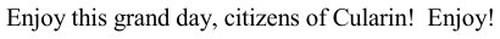

## p.12 (scan page 12)

Page contents: 536 words, 16 paragraphs | headings/entries: DM Aid #1: Skall Delos; Peaces Page 12

- **No single roster character (rules/setting/general)** — entry/section: Skall Delos (feats): "Feats: Armor Proficiency (light, medium), Fame, Force Sensitive, Heroic Surge, Skill Emphasis (Pilot), Spacer, Weapon Group Proficiency (blaster pistols, blaster rifles, heavy weapons, simple weapons, vibro weapons)." Source: *204 - Blinking Eyes - Peaces* (SWRPG d20 Revised Core), p.12
  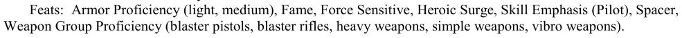

## p.13 (scan page 13)

Page contents: 423 words, 27 paragraphs | headings/entries: Pod racer 1:; Pod racer 2:; Pod racer 3:; Pod racer 4:; Pod racer 5:; Peaces Page 13

## p.14 (scan page 14)

Page contents: 84 words, 6 paragraphs | headings/entries: Pod racer 6:; Peaces Page 14

## p.15 (scan page 15)

Page contents: 149 words, 9 paragraphs | headings/entries: Z 3 4 a; Peaces Page 15

## p.16 (scan page 16)

Page contents: 404 words, 12 paragraphs | headings/entries: DM Aid #4: Podracing Rules Podracing Rules; Peaces Page 16

## p.12–16 (scan page 12)

Page contents: DM Aids 1-4: Skall Delos; pods; track; rules (hand-read)

## p.17 (scan page 17)

Page contents: 62 words, 32 paragraphs | headings/entries: HEAT ONE; Player Name; Hero Name; Class(es); Level(s); OV) U1) BION]; HEAT TWO; Player Name; Hero Name; Class(es); Level(s); OUT) -BRI/ QW) NN] Re; HEAT THREE; Player Name; Hero Name; Class(es); Level(s); OV) UT) BR] Q) NR; HEAT FOUR; Player Name; Hero Name; Class(es); Level(s); OV) UT) BIW IN] Re; HEAT FIVE; Player Name; Hero Name; Class(es); Level(s); D/U/BR]W)N]e; Peaces; Page 17

## p.18 (scan page 18)

Page contents: 62 words, 32 paragraphs | headings/entries: HEAT SIX; Player Name; Hero Name; Class(es); Level(s); OV) U1) BION]; HEAT SEVEN; Player Name; Hero Name; Class(es); Level(s); OUT) -BRI/ QW) NN] Re; HEAT EIGHT; Player Name; Hero Name; Class(es); Level(s); OV) UT) BR] Q) NR; HEAT NINE; Player Name; Hero Name; Class(es); Level(s); OV) UT) BIW IN] Re; HEAT TEN; Player Name; Hero Name; Class(es); Level(s); D/U/BR]W)N]e; Peaces; Page 18

## p.19 (scan page 19)

Page contents: 205 words, 36 paragraphs | headings/entries: DMA; INITIATIVE; Racer Name: Initiative:; Top Speed:; Acceleration:; ACCELERATE; DECELERATE; Hull Points: Cooling: Defense:; MANEUVERS; Accelerate; Attack Target Against Pilot Against Vehicle; Pict Skt + Pockacer trating; DAMAGE TRACK; Bump Target Opposed Pilot Checks; Flick Skill + Podracer Turning; REGAIN CONTROL; Ram Target Pilot Check against Target's Defense; Pik Shill + Podracer Thectior; REPAIR; Regain Control Regain Control Check; Repair Podracer Repair Check; Pilot Repav + Podracer Ot; OUT OF CONTROL ENGINE TEMPERATURE; HICH = DANGER CRITICAL; Page 19; Peaces

## p.20 (scan page 20)

Page contents: 0 words, 0 paragraphs | headings/entries: 

## p.17–20 (scan page 17)

Page contents: Heat grids; DM Aid 6 stat sheet; critical event summary (hand-read)

