# Owner Material 037 — Star Wars D20 Drive folder (Core, Revised Core and Saga Edition): Living Force Campaign/Adventures/Among the Stars/Year 2/205 - An Official Engagement.pdf [Star Wars Roleplaying Game Revised Core (d20, 2002)]

- **Source:** Wizards of the Coast Star Wars Roleplaying Game books, web enhancements, Living Force campaign modules and articles (2000–2010), from the owner's "Star Wars D20" Drive folder (only the three edition subfolders; "General" was not read, as instructed). Secondary source (licensed Legends reference). Scan OCR'd on the box; the scan stays box-only and is **not** published.
- **Method:** every scanned page was OCR'd and machine-screened sentence by sentence for power-relevant statements (fights, kills, defeats, Force feats, rankings, superweapons) that name a character on our roster; each kept sentence is quoted verbatim from the OCR text and has a crop of the printed passage directly under it. Pages with nothing power-relevant are still listed with what is on them.
- **Citation:** "*205 - An Official Engagement* (SWRPG d20 Revised Core), p.X" by printed page ("scan p.X" where no printed number applies). **Weight:** Licensed RPG material: a secondary source. Narrative text sums up Legends lore; game statistics are rules for players, not canon power levels, and rank lowest.

## p.1 (scan page 1)

Page contents: 109 words, 5 paragraphs | headings/entries: An Official Engagement; A One-Round Star Wars Living Force Adventure

## p.2 (scan page 2)

Page contents: 894 words, 21 paragraphs | headings/entries: An Official Engagement; Character Earnings; Issuing Force and Dark Side Points; Page 2

## p.3 (scan page 3)

Page contents: 907 words, 15 paragraphs | headings/entries: General Notes to the GM; GM Overview; An Official Engagement; Page 3

- **No single roster character (rules/setting/general)** — entry/section: Graffiti: "This wedding will never occur": "Within 48 hours of the announcement, the words, "This wedding will never occur" began to appear on walls, in holovids, and all over the place." Source: *205 - An Official Engagement* (SWRPG d20 Revised Core), p.3
  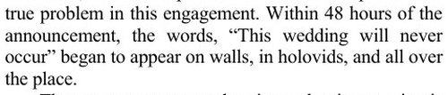
- **No single roster character (rules/setting/general)** — entry/section: Carilla's planned advert: ""This wedding would have never occurred, without Carilla's Catering and Wedding Planning."" Source: *205 - An Official Engagement* (SWRPG d20 Revised Core), p.3
  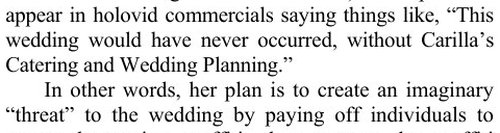

## p.4 (scan page 4)

Page contents: 892 words, 20 paragraphs | headings/entries: Encounter 1: What do you know?; Encounter 2: Where do you go?; Encounter 3: What's in the town?; Encounter 4: What's upside-down?; An Official Engagement; Encounter 6: What's in the cake?; Encounter 7: What's at the end?; Opening Crawl; Page 4

## p.1–4 (scan page 1)

Page contents: Title; boilerplate; earnings; FP/DSP; GM overview; encounter summaries; opening crawl start (hand-read)

## p.5 (scan page 5)

Page contents: 802 words, 18 paragraphs | headings/entries: Encounter 1: What Do You Know?; An Official Engagement; Page 5

- **No single roster character (rules/setting/general)** — entry/section: Call for assistance: ""Anyone with information regarding the threats on Senator Wren's life, as linked to her upcoming wedding, is requested to attend a meeting on Chola Mavra on [current day]. Transportation provided free of charge for those in need."" Source: *205 - An Official Engagement* (SWRPG d20 Revised Core), p.5
  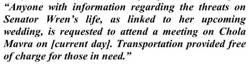
- **No single roster character (rules/setting/general)** — entry/section: Horil Damlo: "the Ootasstakoyswuh": "Who are you? I'm Horil Damlo, the Ootasstakoyswuh." Source: *205 - An Official Engagement* (SWRPG d20 Revised Core), p.5
  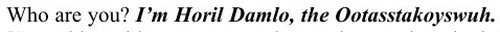
- **No single roster character (rules/setting/general)** — entry/section: Horil Damlo: "Did I get your name already?": "I would presume you're here because you know something that may be helpful in preventing any wrongdoing at Senator Wren's wedding. Did I get your name already?" Source: *205 - An Official Engagement* (SWRPG d20 Revised Core), p.5
  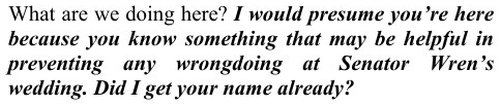

## p.6 (scan page 6)

Page contents: 837 words, 22 paragraphs | headings/entries: An Official Engagement; Page 6

- **No single roster character (rules/setting/general)** — entry/section: Horil Damlo: "Someone important, I'm sure.": "Who will we be meeting with? It varies from group to group. Someone important, I'm sure." Source: *205 - An Official Engagement* (SWRPG d20 Revised Core), p.6
  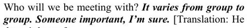
- **No single roster character (rules/setting/general)** — entry/section: Bobe Ojgrib: "Please, to come with me?": ""Please, to come with me?"" Source: *205 - An Official Engagement* (SWRPG d20 Revised Core), p.6
  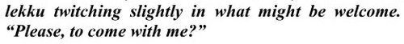
- **No single roster character (rules/setting/general)** — entry/section: Lavina Wren: "I am anxious to hear": ""Please, have a seat. I am anxious to hear what you have to tell me."" Source: *205 - An Official Engagement* (SWRPG d20 Revised Core), p.6
  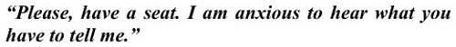
- **No single roster character (rules/setting/general)** — entry/section: Lavina Wren: "I fear unrest in the system.": ""My security teams are working on this as we speak, but I was hoping to enlist the help of some of the citizens — like yourselves — as well. The more individuals we have working on this, the sooner we can get it behind us. I don't ask this of you because it is my wedding — it could be any public affair. I ask it because I fear unrest in the system."" Source: *205 - An Official Engagement* (SWRPG d20 Revised Core), p.6
  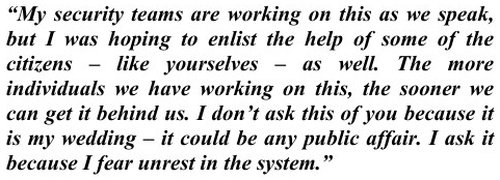

## p.7 (scan page 7)

Page contents: 810 words, 24 paragraphs | headings/entries: An Official Engagement; Talking to the Kids; Page 7

- **No single roster character (rules/setting/general)** — entry/section: Lavina Wren: "Ask them.": "Why hasn't OPS already caught the perpetrators? Ask them." Source: *205 - An Official Engagement* (SWRPG d20 Revised Core), p.7
  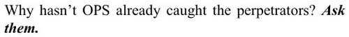
- **No single roster character (rules/setting/general)** — entry/section: Lavina Wren: badge of the Republic: "Because you don't wear the badge of the Republic, it may be easier for you to talk to those who would not talk to my teams." Source: *205 - An Official Engagement* (SWRPG d20 Revised Core), p.7
  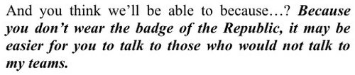
- **No single roster character (rules/setting/general)** — entry/section: Lavina Wren on the Jedi: "Absolutely not. I hold the Order in the highest regard. It has simply been the case that while our goals are similar, our methods for accomplishing them are necessarily different. I very much hope to develop a stronger working relationship with Master Lanius and the Academy." Source: *205 - An Official Engagement* (SWRPG d20 Revised Core), p.7
  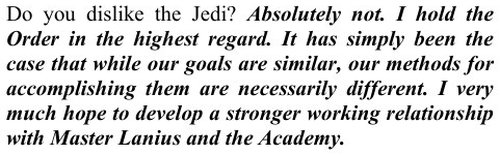
- **No single roster character (rules/setting/general)** — entry/section: Lavina Wren: "Jarid is his own man.": "Jarid is his own man. He respects the Jedi and their way of life, but it was not right for him." Source: *205 - An Official Engagement* (SWRPG d20 Revised Core), p.7
  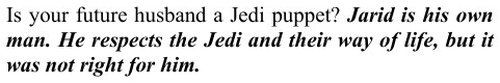

## p.5–7 (scan page 5)

Page contents: Opening crawl; Enc 1 Chola Mavra: Horil Damlo, Bobe Ojgrib, Senator Wren (hand-read)

## p.8 (scan page 8)

Page contents: 885 words, 23 paragraphs | headings/entries: Talking to the Tarasin; An Official Engagement; Page 8

- **No single roster character (rules/setting/general)** — entry/section: Slice on the vandals: "Slice calls them "little space-worms with nothing better to do and no goals in life."" Source: *205 - An Official Engagement* (SWRPG d20 Revised Core), p.8
  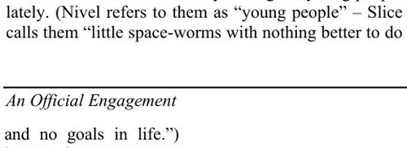
- **No single roster character (rules/setting/general)** — entry/section: Gruunelda on the Cartel: "Metatheran Cartel? Not likely. Some of the graffiti was more than a meter off the ground." Source: *205 - An Official Engagement* (SWRPG d20 Revised Core), p.8
  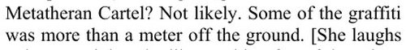
- **No single roster character (rules/setting/general)** — entry/section: Gruunelda: the "Lover's Kiss": "I don't know anything about "The Cave." It's the kind of place I don't like to go, when I'm off duty. There's a nice little bar that I do enjoy, though... the "Lover's Kiss," here in town." Source: *205 - An Official Engagement* (SWRPG d20 Revised Core), p.8
  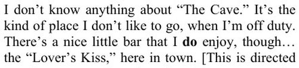

## p.9 (scan page 9)

Page contents: 800 words, 20 paragraphs | headings/entries: Talking to Renna's; Heading to a Cantina; An Official Engagement; Encounter 3: What's in the town?; Page 9

- **No single roster character (rules/setting/general)** — entry/section: Gruunelda on Slice and Nivel: "Slice and Nivel? They're harmless, and they get some good bootleg Trandoshan music every once in a while. Great for a romantic mood." Source: *205 - An Official Engagement* (SWRPG d20 Revised Core), p.9
  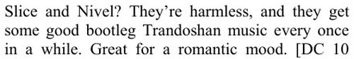
- **No single roster character (rules/setting/general)** — entry/section: Cantina rumor (DC 15): "No one from Hedrett would do that. Bad for the local economy. I think it's someone from off-planet." Source: *205 - An Official Engagement* (SWRPG d20 Revised Core), p.9
  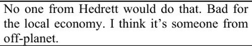
- **No single roster character (rules/setting/general)** — entry/section: Lora: "Welcome to Forard.": ""Welcome to Forard."" Source: *205 - An Official Engagement* (SWRPG d20 Revised Core), p.9
  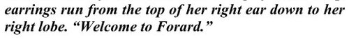

## p.7–9 (scan page 7)

Page contents: Enc 2 Hedrett: Dani, Nivel and Slice, Gruunelda, cantina (hand-read)

## p.10 (scan page 10)

Page contents: 951 words, 17 paragraphs | headings/entries: The Warehouse Patrol; An Official Engagement; Page 10

- **No single roster character (rules/setting/general)** — entry/section: Illy and Bon: "Halt. Security check.": ""Halt. Security check. State your business."" Source: *205 - An Official Engagement* (SWRPG d20 Revised Core), p.10
  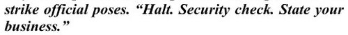
- **No single roster character (rules/setting/general)** — entry/section: Illy and Bon: "Nothing happens on our watch.": "Nothing happens on our watch. No way, no how." Source: *205 - An Official Engagement* (SWRPG d20 Revised Core), p.10
  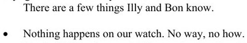

## p.11 (scan page 11)

Page contents: 877 words, 17 paragraphs | headings/entries: The Soup Kitchen; An Official Engagement; Encounter 4: What's upsidedown?; Page 11

- **No single roster character (rules/setting/general)** — entry/section: Robbi: "Wizard, huh?": ""I'm just tryin' to make a cred. Nothin' against the lady senator person. I got fifty creds put in my hand, and some paint, and told to come here and do up a crate. Easy to get in here, and all." ... "I never done this before, but other kids have. Been going on a couple weeks. Fifty creds is the going rate. Wizard, huh?"" Source: *205 - An Official Engagement* (SWRPG d20 Revised Core), p.11
  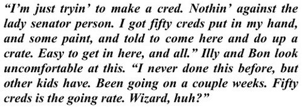
- **No single roster character (rules/setting/general)** — entry/section: Robbi overheard: ""Yeah, I'm gonna hit that warehouse down by the pads next hour. It'll be wizard! Got four colors of paint and everything. Dumb Bothans and their skylight."" Source: *205 - An Official Engagement* (SWRPG d20 Revised Core), p.11
  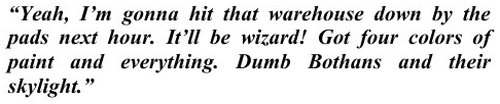

## p.9–11 (scan page 9)

Page contents: Enc 3 Forard: Lora, Illy and Bon, Robbi (hand-read)

## p.12 (scan page 12)

Page contents: 848 words, 28 paragraphs | headings/entries: An Official Engagement; Page 12

- **No single roster character (rules/setting/general)** — entry/section: Spacer on The Cave: "It is, as more than one spacer has put it, "a nice transition from being in a ship, to being in a city."" Source: *205 - An Official Engagement* (SWRPG d20 Revised Core), p.12
  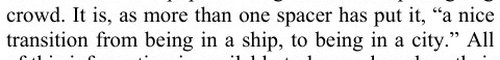
- **No single roster character (rules/setting/general)** — entry/section: Devaronian thug: "One job is good as another job.": "Boss said we want to work for some bounty hunter. Bounty hunter shut off grav, we started shooting. One job is good as another job." Source: *205 - An Official Engagement* (SWRPG d20 Revised Core), p.12
  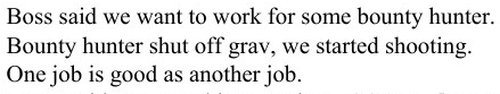

## p.11–12 (scan page 11)

Page contents: Enc 4 The Cave: Devaronians, zero-g (hand-read)

## p.13 (scan page 13)

Page contents: 887 words, 22 paragraphs | headings/entries: An Official Engagement; Page 13

- **No single roster character (rules/setting/general)** — entry/section: Carilla: "You must spend money to make money": "I paid twenty or so youngsters fifty credits each to do this. You must spend money to make money... I suppose..." Source: *205 - An Official Engagement* (SWRPG d20 Revised Core), p.13
  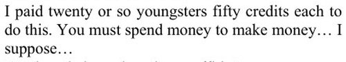
- **No single roster character (rules/setting/general)** — entry/section: Carilla: "I never meant it to happen like that!": "I've heard about the other graffiti. I guess someone saw the first ones, and thought it a good idea. I never meant it to happen like that!" Source: *205 - An Official Engagement* (SWRPG d20 Revised Core), p.13
  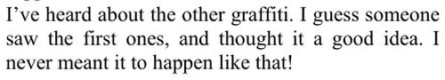
- **No single roster character (rules/setting/general)** — entry/section: Carilla: "Bounty hunters? Goodness no!": "Bounty hunters? Goodness no!" Source: *205 - An Official Engagement* (SWRPG d20 Revised Core), p.13
  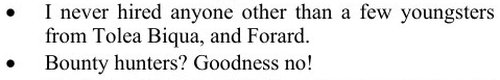
- **No single roster character (rules/setting/general)** — entry/section: Carilla's holovid advert: ""This wedding would never have happened, if not for Carilla's Catering and Wedding Planning."" Source: *205 - An Official Engagement* (SWRPG d20 Revised Core), p.13
  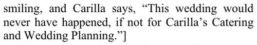

## p.14 (scan page 14)

Page contents: 914 words, 19 paragraphs | headings/entries: An Official Engagement; Encounter 6: What's in the cake?; Carilla's Life; Asora's Goods; The Chase; Page 14

- **No single roster character (rules/setting/general)** — entry/section: Carilla: "a good idea at the time?": "Um... it seemed like a good idea at the time?" Source: *205 - An Official Engagement* (SWRPG d20 Revised Core), p.14
  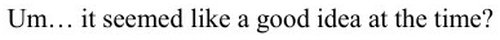
- **No single roster character (rules/setting/general)** — entry/section: "SHOOT HER.": "After you tire of playing the crying grandmother, SHOOT HER." Source: *205 - An Official Engagement* (SWRPG d20 Revised Core), p.14
  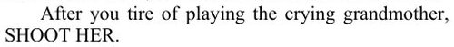

## p.15 (scan page 15)

Page contents: 929 words, 18 paragraphs | headings/entries: An Official Engagement; Encounter 7: What's at the end?; Page 15

- **No single roster character (rules/setting/general)** — entry/section: Asora: "my frosting!": ""Hurry, they're going to get away with my frosting! Oh, and the guns they used to shoot at you!"" Source: *205 - An Official Engagement* (SWRPG d20 Revised Core), p.15
  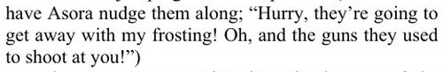
- **No single roster character (rules/setting/general)** — entry/section: Lavina Wren on Carilla: ""It's far from the worst thing that's ever happened to me, because I'm a public figure"" Source: *205 - An Official Engagement* (SWRPG d20 Revised Core), p.15
  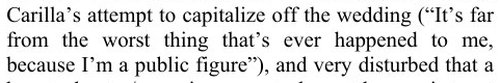
- **No single roster character (rules/setting/general)** — entry/section: Lavina Wren on the assassin: ""It's part of being in the public eye, I suppose."" Source: *205 - An Official Engagement* (SWRPG d20 Revised Core), p.15
  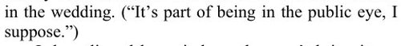

## p.13–15 (scan page 13)

Page contents: Enc 5-6: Carilla, Asora, chase (hand-read)

## p.16 (scan page 16)

Page contents: 1028 words, 16 paragraphs | headings/entries: An Official Engagement; Page 16

- **No single roster character (rules/setting/general)** — entry/section: Wedding cake inscription: ""The Force will be with us, always."" Source: *205 - An Official Engagement* (SWRPG d20 Revised Core), p.16
  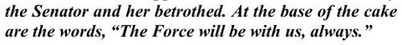
- **No single roster character (rules/setting/general)** — entry/section: Message on the groom's cake platter: ""Jarid DeBell — for crimes against the people of the galaxy, and against the territories of the Outer Rim, and for your policies regarding Hutt space, you have been sentenced to death. Never let it be said that Hutts are without mercy, you who die with sweetness on your thin human lips."" Source: *205 - An Official Engagement* (SWRPG d20 Revised Core), p.16
  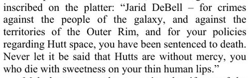
- **No single roster character (rules/setting/general)** — entry/section: Melo Centris: "They're poisoning that cake!": ""They're poisoning that cake!"" Source: *205 - An Official Engagement* (SWRPG d20 Revised Core), p.16
  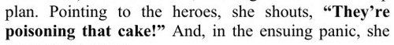

## p.17 (scan page 17)

Page contents: 788 words, 23 paragraphs | headings/entries: Conclusion; An Official Engagement; Here Ends, "An Official Engagement"; Experience Point Summary; Adventure Experience Award:; Page 17

- **No single roster character (rules/setting/general)** — entry/section: Master Lanius: "Lovely ceremony": ""Such matters are better left for other times. Lovely ceremony, don't you think?"" Source: *205 - An Official Engagement* (SWRPG d20 Revised Core), p.17
  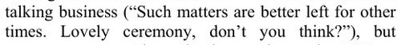
- **No single roster character (rules/setting/general)** — entry/section: Master Lanius on Wren: ""She's a very competent woman. She will be good for the system."" Source: *205 - An Official Engagement* (SWRPG d20 Revised Core), p.17
  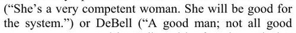
- **No single roster character (rules/setting/general)** — entry/section: Master Lanius on DeBell: ""A good man; not all good men or women need be Jedi, and he found a path that suits him."" Source: *205 - An Official Engagement* (SWRPG d20 Revised Core), p.17
  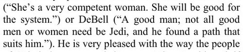
- **No single roster character (rules/setting/general)** — entry/section: Jarid DeBell: "May the Force be with you.": ""Thank you," they say in unison, then look at one another and laugh. Jarid looks at his new bride. "May I?" She nods, and he looks to you. "May the Force be with you."" Source: *205 - An Official Engagement* (SWRPG d20 Revised Core), p.17
  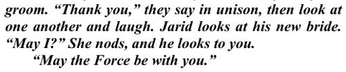

## p.15–17 (scan page 15)

Page contents: Enc 7 wedding; conclusion; XP (hand-read)

## p.18 (scan page 18)

Page contents: 311 words, 18 paragraphs | headings/entries: Loot Summary; From Carilla (if she lived); From Senator Wren and Husband; From Melo; An Official Engagement; Page 18

## p.19 (scan page 19)

Page contents: 275 words, 9 paragraphs | headings/entries: Yours in the Force,; Master; An Official Engagement Page 19

- **No single roster character (rules/setting/general)** — entry/section: Jedi Master's letter: "Remember, the fact that DeBell chose to leave the Order does not mean that he has forsaken the path of peace and justice; he has worked for them, in his own way, and has accomplished much. He remains a good man, and worthy of our attention when threats such as those levied against the wedding party arise." Source: *205 - An Official Engagement* (SWRPG d20 Revised Core), p.19
  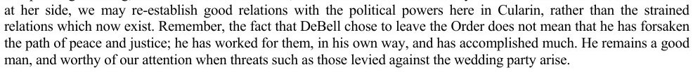

## p.20 (scan page 20)

Page contents: 641 words, 10 paragraphs | headings/entries: Player Handout 2: What other individuals know; An Official Engagement Page 20

- **No single roster character (rules/setting/general)** — entry/section: Graffiti on Gadrin: "graffiti depicting Senator Wren wielding a lightsaber, with the caption, "The galaxy will be mine!" Below that were the words, "The wedding must be stopped, or all is lost."" Source: *205 - An Official Engagement* (SWRPG d20 Revised Core), p.20
  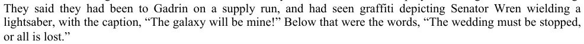
- **No single roster character (rules/setting/general)** — entry/section: Forard local on the wedding: ""After all," one local said, "everyone knows she hates the Jedi. Why's she marrying one? It's no wonder someone wants to stop the wedding. Who can trust that kind of alliance?"" Source: *205 - An Official Engagement* (SWRPG d20 Revised Core), p.20
  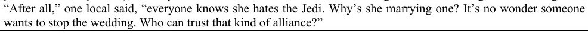

## p.21 (scan page 21)

Page contents: 370 words, 7 paragraphs | headings/entries: Player Handout #3: Jarid DeBell; An Official Engagement Page 21

## p.18–21 (scan page 18)

Page contents: Loot; Player Handouts 1-3 (hand-read)

## p.22 (scan page 22)

Page contents: 948 words, 30 paragraphs | headings/entries: DM Aid #1: Melo Centris; Lower Tier (Average Character Levels 1-3); Middle Tier (Average Character Levels 4-6); An Official Engagement; Upper Tier (Average Character Levels 7-9); Page 22

- **No single roster character (rules/setting/general)** — entry/section: Melo Centris, lower tier (feats): "Feats: Weapons (primitive, simple, blaster pistols), Dodge, Mobility, Stealthy. Force Feats: Force Sensitive, Alter, Sense." Source: *205 - An Official Engagement* (SWRPG d20 Revised Core), p.22
  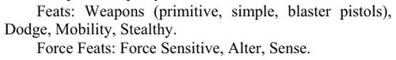
- **No single roster character (rules/setting/general)** — entry/section: Melo Centris, middle tier (feats): "Feats: Weapons (primitive, simple, blaster pistols), Dodge, Mobility, Stealthy, Skill Emphasis: Force Stealth, Skill Emphasis: Fear. Force Feats: Force Sensitive, Alter, Sense, Control." Source: *205 - An Official Engagement* (SWRPG d20 Revised Core), p.22
  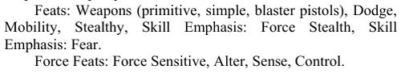
- **No single roster character (rules/setting/general)** — entry/section: Melo Centris, upper tier (feats): "Feats: Weapons (primitive, simple, blaster pistols), Dodge, Mobility, Stealthy, Skill Emphasis: Force Stealth, Skill Emphasis: Fear, Skill Emphasis: Move Silently. Force Feats: Force Sensitive, Alter, Sense, Control, Burst of Speed." Source: *205 - An Official Engagement* (SWRPG d20 Revised Core), p.22
  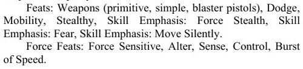

## p.23 (scan page 23)

Page contents: 600 words, 21 paragraphs | headings/entries: DM Aid #2: The Devaronian Thug Squad; Lower Tier:; Middle Tier:; Upper Tier:; An Official Engagement Page 23

- **No single roster character (rules/setting/general)** — entry/section: Devaronian Thugs 4 / Scoundrels 4 (feats): "Feats: Weapon Proficiency (simple, blaster pistols), Improved Initiative, Toughness. ... Feats: Weapon Proficiency (simple, blaster pistols), Zero-G Combat, Improved Initiative." Source: *205 - An Official Engagement* (SWRPG d20 Revised Core), p.23
  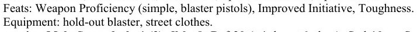

## p.24 (scan page 24)

Page contents: 78 words, 8 paragraphs | headings/entries: Critical Event Summary An Official Engagement; Yes No; Convention Coordinator:; An Official Engagement Page 24

## p.22–24 (scan page 22)

Page contents: DM Aid 1 Melo Centris; DM Aid 2 Devaronians; critical event summary (hand-read)

