# Owner Material 037 — Star Wars D20 Drive folder (Core, Revised Core and Saga Edition): Living Force Campaign/Adventures/Among the Stars/Year 2/206 - Almas, Sweet Almas - The Kaluthin Are Always Greener.pdf [Star Wars Roleplaying Game Revised Core (d20, 2002)]

- **Source:** Wizards of the Coast Star Wars Roleplaying Game books, web enhancements, Living Force campaign modules and articles (2000–2010), from the owner's "Star Wars D20" Drive folder (only the three edition subfolders; "General" was not read, as instructed). Secondary source (licensed Legends reference). Scan OCR'd on the box; the scan stays box-only and is **not** published.
- **Method:** every scanned page was OCR'd and machine-screened sentence by sentence for power-relevant statements (fights, kills, defeats, Force feats, rankings, superweapons) that name a character on our roster; each kept sentence is quoted verbatim from the OCR text and has a crop of the printed passage directly under it. Pages with nothing power-relevant are still listed with what is on them.
- **Citation:** "*206 - Almas, Sweet Almas - The Kaluthin Are Always Greener* (SWRPG d20 Revised Core), p.X" by printed page ("scan p.X" where no printed number applies). **Weight:** Licensed RPG material: a secondary source. Narrative text sums up Legends lore; game statistics are rules for players, not canon power levels, and rank lowest.

## p.1 (scan page 1)

Page contents: 132 words, 6 paragraphs | headings/entries: A One-Round Living Force Adventure

## p.2 (scan page 2)

Page contents: 918 words, 23 paragraphs | headings/entries: The Kaluthin Are Always Greener; Hero Earnings; Issuing Force and Dark Side Points; Page 2

## p.3 (scan page 3)

Page contents: 825 words, 25 paragraphs | headings/entries: General Notes to the GM; GM Overview; The Kaluthin Are Always Greener; Encounter 2: A Dying World; Encounter 3: A Planet Divided; Encounter 4: Down on the Farm; Encounter 5: Red-handed; Encounter 6: Showdown; Page 3

## p.4 (scan page 4)

Page contents: 839 words, 22 paragraphs | headings/entries: Opening Crawl; The Kaluthin Are Always Greener; See DM Aid #1 for Stats; Page 4

- **No single roster character (rules/setting/general)** — entry/section: Opening crawl: "A thousand years ago, darkness stalked Almas. Over time, the evil washed away, sinking deep beneath the surface of the planet. Now, as Cularin enters a time of great turmoil, that darkness has begun to stir..." Source: *206 - Almas, Sweet Almas - The Kaluthin Are Always Greener* (SWRPG d20 Revised Core), p.4
  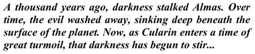
- **No single roster character (rules/setting/general)** — entry/section: Welrin Maduk: "they pulled lightsaberrrrrs!": "I don't know who they werrrrre. They claimed to be porrrrt authorrrity, but when I said I'd been inspected, they pulled lightsaberrrrrs!" Source: *206 - Almas, Sweet Almas - The Kaluthin Are Always Greener* (SWRPG d20 Revised Core), p.4
  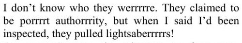
- **No single roster character (rules/setting/general)** — entry/section: Welrin Maduk: "Sounded... wet.": "One was Gungan, the otherrrrr, no face seen. Sounded... wet." Source: *206 - Almas, Sweet Almas - The Kaluthin Are Always Greener* (SWRPG d20 Revised Core), p.4
  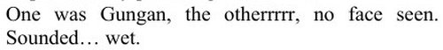

## p.1–4 (scan page 1)

Page contents: Title; boilerplate; FP/DSP; GM overview; encounter summaries; opening crawl (hand-read)

## p.5 (scan page 5)

Page contents: 834 words, 24 paragraphs | headings/entries: Encounter 2: A Dying World; The Kaluthin Are Always Greener; Page 5

- **No single roster character (rules/setting/general)** — entry/section: Welrin Maduk: "Can you escorrrrt?": "I worrrry about this trip. Bad to have lightsaberrrrs pulled on one. Can you escorrrrt?" Source: *206 - Almas, Sweet Almas - The Kaluthin Are Always Greener* (SWRPG d20 Revised Core), p.5
  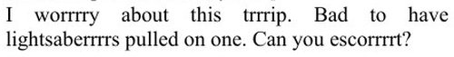
- **No single roster character (rules/setting/general)** — entry/section: Welrin Maduk: Almas is unique: ""I thought you might want to see this," the captain says from the pilot's seat. "Almas is quite...unique, in this mannerrr."" Source: *206 - Almas, Sweet Almas - The Kaluthin Are Always Greener* (SWRPG d20 Revised Core), p.5
  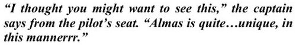
- **No single roster character (rules/setting/general)** — entry/section: Welrin Maduk: "It's rrreally something.": ""It's rrreally something. I've been to just about everrry corrrnerrr of the galaxy, and I can't rrrememberrr anything else quite like Almas."" Source: *206 - Almas, Sweet Almas - The Kaluthin Are Always Greener* (SWRPG d20 Revised Core), p.5
  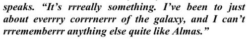
- **No single roster character (rules/setting/general)** — entry/section: Welrin Maduk: the Wasteland: ""Therrre...that's the Wasteland. The kaluthin are rrresponsible for the glow, but they don't grrrow out therrre. No one is quite surrre why, eitherrr."" Source: *206 - Almas, Sweet Almas - The Kaluthin Are Always Greener* (SWRPG d20 Revised Core), p.5
  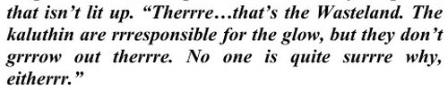
- **No single roster character (rules/setting/general)** — entry/section: Welrin Maduk: "That's not rrright.": ""That's not rrright. I thought the Wasteland was the only place that the kaluthin didn't grrrow."" Source: *206 - Almas, Sweet Almas - The Kaluthin Are Always Greener* (SWRPG d20 Revised Core), p.5
  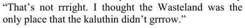

## p.4–5 (scan page 4)

Page contents: Enc 1: Hedrett hangar, Welrin Maduk (hand-read)

## p.6 (scan page 6)

Page contents: 848 words, 21 paragraphs | headings/entries: The Kaluthin Are Always Greener; Page 6

- **No single roster character (rules/setting/general)** — entry/section: Welrin Maduk: "Too easy.": "Maduk brings the craft in flawlessly and smiles. "Too easy."" Source: *206 - Almas, Sweet Almas - The Kaluthin Are Always Greener* (SWRPG d20 Revised Core), p.6
  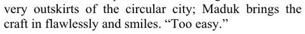
- **No single roster character (rules/setting/general)** — entry/section: Welrin Maduk: "rrrememberrr our encounterrr": ""Well," Maduk breathes, shutting the engines down and standing, "I'll open up the aft carrrgo hatch. If you folks would like to strrretch yourrr legs out firrrst, that's fine. But don't take too much time...rrrememberrr our encounterrr on Cularrrin. I would verrry much like to avoid a similarrr experrrience."" Source: *206 - Almas, Sweet Almas - The Kaluthin Are Always Greener* (SWRPG d20 Revised Core), p.6
  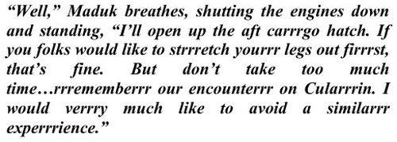
- **No single roster character (rules/setting/general)** — entry/section: Gilloma: "Maduk, my friend": ""Maduk, my friend," the hammerhead manages in near-stereo Basic, "I hope the trip was uneventful."" Source: *206 - Almas, Sweet Almas - The Kaluthin Are Always Greener* (SWRPG d20 Revised Core), p.6
  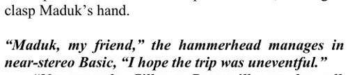
- **No single roster character (rules/setting/general)** — entry/section: Welrin Maduk: "Not nearrrly, Gilloma.": ""Not nearrrly, Gilloma. But we'll save that talk forrr laterrr. Wherrre do you want yourrr equipment?"" Source: *206 - Almas, Sweet Almas - The Kaluthin Are Always Greener* (SWRPG d20 Revised Core), p.6
  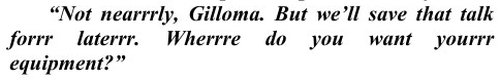

## p.7 (scan page 7)

Page contents: 838 words, 22 paragraphs | headings/entries: The Kaluthin Are Always Greener; Things Gilloma knows:; Page 7

- **No single roster character (rules/setting/general)** — entry/section: Gilloma: "It seems that we are in a bind.": ""Thank you for your assistance of our friend Maduk. I know your agreement only extended to the delivery of the equipment, but I would appreciate your attending my offer of another matter." ... "It seems that we are in a bind."" Source: *206 - Almas, Sweet Almas - The Kaluthin Are Always Greener* (SWRPG d20 Revised Core), p.7
  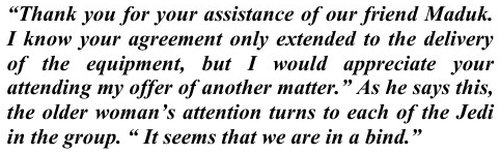
- **No single roster character (rules/setting/general)** — entry/section: Gilloma: "but a simple botanist": ""My apologies. My manners are slipping. My associates... This young man is the head of our genetics division — Garvin Delquist." ... "Treegin, my nervous friend, is the head of our computer division. I am Gilloma; I am but a simple botanist, with the honor of a most prestigious assignment."" Source: *206 - Almas, Sweet Almas - The Kaluthin Are Always Greener* (SWRPG d20 Revised Core), p.7
  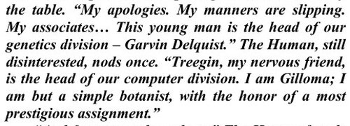
- **No single roster character (rules/setting/general)** — entry/section: Seenlu Kir: "not much of a publicist": ""And far too much modesty." The Human female stands. "I am Seenlu Kir. I represent the Jedi Academy." ... "I believe I know some of you already." "Gilloma is an amazing botanist and chemist, but not much of a publicist."" Source: *206 - Almas, Sweet Almas - The Kaluthin Are Always Greener* (SWRPG d20 Revised Core), p.7
  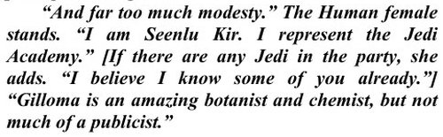
- **No single roster character (rules/setting/general)** — entry/section: Gilloma: "this world is dying.": ""My friends...this world is dying. The kaluthin are an integral part of the ecosystem — without them, this planet will revert back to being an uninhabitable rock. Something is killing the kaluthin, and we have not yet been able to determine what it is."" Source: *206 - Almas, Sweet Almas - The Kaluthin Are Always Greener* (SWRPG d20 Revised Core), p.7
  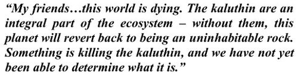

## p.8 (scan page 8)

Page contents: 781 words, 26 paragraphs | headings/entries: The Kaluthin Are Always Greener; Page 8

- **No single roster character (rules/setting/general)** — entry/section: Seenlu Kir: "Take care.": ""Take care. There are those on-planet who have heard tales of the individual who created the kaluthin, and have developed a slight distrust of the Jedi. This is the other reason I very much want others investigating matters."" Source: *206 - Almas, Sweet Almas - The Kaluthin Are Always Greener* (SWRPG d20 Revised Core), p.8
  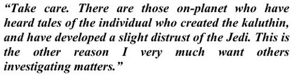

## p.5–8 (scan page 5)

Page contents: Enc 2: Almas; research station; Gilloma, Treegin, Delquist, Seenlu Kir (hand-read)

## p.9 (scan page 9)

Page contents: 887 words, 17 paragraphs | headings/entries: The Kaluthin Are Always Greener; Encounter 4: Down on the Farm; Page 9

- **No single roster character (rules/setting/general)** — entry/section: Kressis: the Kaiburr crystal: "The attack on Sotose's farm was the string that shattered the Kaiburr crystal." Source: *206 - Almas, Sweet Almas - The Kaluthin Are Always Greener* (SWRPG d20 Revised Core), p.9
  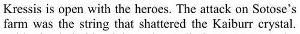

## p.8–9 (scan page 8)

Page contents: Enc 3: cantina mob; Lo Pelkar, Rulo, Kressis (hand-read)

## p.10 (scan page 10)

Page contents: 887 words, 20 paragraphs | headings/entries: The Kaluthin Are Always Greener; Encounter 5: Red-Handed; Page 10

- **No single roster character (rules/setting/general)** — entry/section: Farmer: "Halt and identify yourselves": ""Halt and identify yourselves, or we fire!"" Source: *206 - Almas, Sweet Almas - The Kaluthin Are Always Greener* (SWRPG d20 Revised Core), p.10
  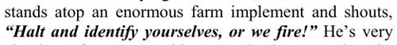
- **No single roster character (rules/setting/general)** — entry/section: "These are not the bad guys you're looking for.": "whatever it takes to convince the heroes that (waving hand) "These are not the bad guys you're looking for."" Source: *206 - Almas, Sweet Almas - The Kaluthin Are Always Greener* (SWRPG d20 Revised Core), p.10
  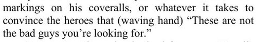

## p.9–10 (scan page 9)

Page contents: Enc 4: Sotose farm (hand-read)

## p.11 (scan page 11)

Page contents: 810 words, 26 paragraphs | headings/entries: Encounter 6: Showdown; The Kaluthin Are Always Greener; Page 11

- **No single roster character (rules/setting/general)** — entry/section: Thugs' chant: "the thugs will at first chant "Death to Unbelievers", over and over. They know that Kosa-Yin Hadu and "the fishy one" are their leaders" Source: *206 - Almas, Sweet Almas - The Kaluthin Are Always Greener* (SWRPG d20 Revised Core), p.11
  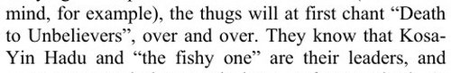
- **No single roster character (rules/setting/general)** — entry/section: Thug: "Oh, yes, this datapad...": ""Everything we need to know we are told when we need to know it, or it's on the datapad. Oh, yes, this datapad..."" Source: *206 - Almas, Sweet Almas - The Kaluthin Are Always Greener* (SWRPG d20 Revised Core), p.11
  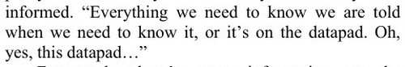
- **No single roster character (rules/setting/general)** — entry/section: Response to calls for help: "We will have someone there as soon as possible. Go ahead, scout the area, and if you can, neutralize the threat. You will have backup shortly." Source: *206 - Almas, Sweet Almas - The Kaluthin Are Always Greener* (SWRPG d20 Revised Core), p.11
  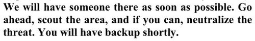
- **No single roster character (rules/setting/general)** — entry/section: Gilloma: "Here is your payment": ""Here is your payment," the Ithorian says in stereo. "I can't express how thankful we are that you've ended this threat."" Source: *206 - Almas, Sweet Almas - The Kaluthin Are Always Greener* (SWRPG d20 Revised Core), p.11
  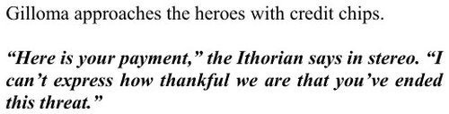

## p.10–11 (scan page 10)

Page contents: Enc 5: Red-Handed (hand-read)

## p.12 (scan page 12)

Page contents: 663 words, 29 paragraphs | headings/entries: Conclusion; Here Ends The Kaluthin Are Always Greener; Experience Point Summary; The Kaluthin Are Always Greener; Adventure Experience Award:; Loot Summary; One heavy blaster pistol (illegal, certed); Kosa-Yin Hadu's Lightsaber:; Page 12

- **No single roster character (rules/setting/general)** — entry/section: Gilloma: an anti-toxin: ""It seems that we've enough samples here, and from the other sites, to begin work on an anti-toxin for this biological terror. Please, my friends, come back to the station. We can't offer much more, but what we have is yours. We will meet you back at the station."" Source: *206 - Almas, Sweet Almas - The Kaluthin Are Always Greener* (SWRPG d20 Revised Core), p.12
  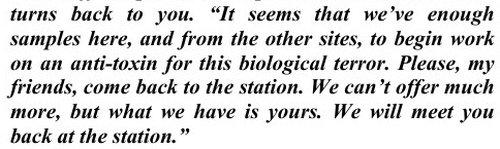
- **No single roster character (rules/setting/general)** — entry/section: Rodian girl: "Found. In. Tent.": ""Found. In. Tent."" Source: *206 - Almas, Sweet Almas - The Kaluthin Are Always Greener* (SWRPG d20 Revised Core), p.12
  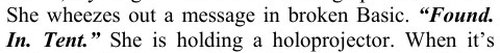
- **No single roster character (rules/setting/general)** — entry/section: Shadowed figure: "Accelerate the timetable.": ""So," the shadow speaks. "The Jedi have learned of our presence. Accelerate the timetable. The two of you are only the first wave in the tide that will wash the Jedi scourge from my planet."" Source: *206 - Almas, Sweet Almas - The Kaluthin Are Always Greener* (SWRPG d20 Revised Core), p.12
  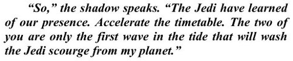

## p.11–12 (scan page 11)

Page contents: Enc 6-7; conclusion; XP; loot (hand-read)

- **No single roster character (rules/setting/general)** — entry/section: Seenlu Kir on Kosa-Yin Hadu: ""We discovered the identity of the Gungan Jedi. His name was Kosa-Yin Hadu. He was the Padawan of a Knight named Kin-Ya Dosun, who was also a Gungan. The pair of them disappeared on a mission for the Coruscant temple about two years ago. We're trying to find out what that mission was and where they were lost, but all our inquiries are coming up empty. I'll see that you're kept informed."" Source: *206 - Almas, Sweet Almas - The Kaluthin Are Always Greener* (SWRPG d20 Revised Core), p.11–12
  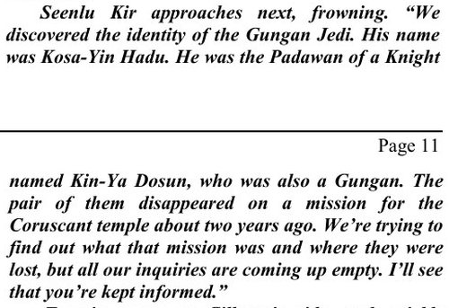

## p.13 (scan page 13)

Page contents: 15 words, 2 paragraphs | headings/entries: The Kaluthin Are Always Greener Page 13

## p.14 (scan page 14)

Page contents: 497 words, 24 paragraphs | headings/entries: DM Aid #1: NPC Stats; Lower Tier (Average hero level 1-3):; The Kaluthin Are Always Greener; Middle Tier (Average hero level 4-6):; Upper Tier (Average hero level 7-9):; Page 14

- **No single roster character (rules/setting/general)** — entry/section: Attack Droids (feats): "Feats: Weapon Focus (Blaster Pistol), Weapon Group Proficiency (Blaster pistols, simple weapons)." Source: *206 - Almas, Sweet Almas - The Kaluthin Are Always Greener* (SWRPG d20 Revised Core), p.14
  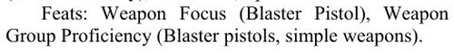

## p.15 (scan page 15)

Page contents: 502 words, 27 paragraphs | headings/entries: Encounter 3 — A Planet Divided; Equipment: Lightsaber, comlink; Skills: Various appropriate for farmers and laborers; Feats: Weapon Group Proficiencies (Simple Weapons); The Kaluthin Are Always Greener; Encounter 5 — Red Handed; Lower Tier (Average hero level 1-3):; Equipment: Combat boots, blast vest, utility; Equipment: Combat boots, blast vest, utility; Page 15

- **No single roster character (rules/setting/general)** — entry/section: Lo Pelkar, Jedi Guardian 4 (feats): "Feats: Alter, Blind-Fight, Burst of Speed, Control, Exotic Weapon Proficiency (lightsaber), Force-Sensitive, Sense, Weapon Group Proficiencies (Simple Weapons, Blaster Pistols)" Source: *206 - Almas, Sweet Almas - The Kaluthin Are Always Greener* (SWRPG d20 Revised Core), p.15
  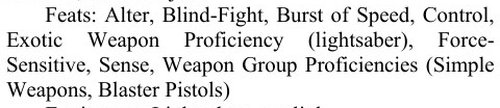

## p.16 (scan page 16)

Page contents: 753 words, 30 paragraphs | headings/entries: Encounter 6 — Showdown; Equipment:; The Kaluthin Are Always Greener; Lower Tier (Levels 1-3); Middle Tier (Levels 4-6); Page 16

- **No single roster character (rules/setting/general)** — entry/section: Kosa-Yin Hadu (feats): "Feats: Armor Proficiency (light), Exotic Weapon Proficiency (lightsaber), Force-Sensitive, Improved Initiative, Power Attack, Weapons Group Proficiency (blaster pistols, blaster rifles, primitive weapons, simple weapons, vibro weapons) Force Feats: Alter, Control, Hatred, Lightsaber Defense, Rage, Sense" Source: *206 - Almas, Sweet Almas - The Kaluthin Are Always Greener* (SWRPG d20 Revised Core), p.16
  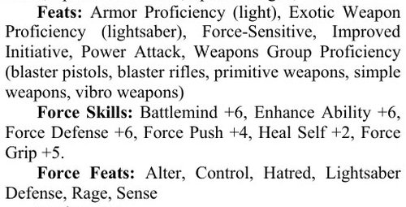
- **No single roster character (rules/setting/general)** — entry/section: Various Expendable Thug 1 (12) (feats): "Feats: Toughness, Weapons (simple, blaster pistols)." Source: *206 - Almas, Sweet Almas - The Kaluthin Are Always Greener* (SWRPG d20 Revised Core), p.16
  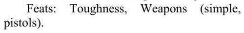

## p.17 (scan page 17)

Page contents: 271 words, 9 paragraphs | headings/entries: Upper Tier (Levels 7-9); The Kaluthin Are Always Greener; Page 17

## p.18 (scan page 18)

Page contents: 26 words, 2 paragraphs | headings/entries: The Kaluthin Are Always Greener Page 18

## p.19 (scan page 19)

Page contents: 30 words, 4 paragraphs | headings/entries: KR _ | \> score yy; The Kaluthin Are Always Greener Page 19

## p.20 (scan page 20)

Page contents: 20 words, 2 paragraphs | headings/entries: The Kaluthin Are Always Greener Page 20

## p.21 (scan page 21)

Page contents: 146 words, 6 paragraphs | headings/entries: Yes No; The Kaluthin Are Always Greener Page 21

## p.13–21 (scan page 13)

Page contents: Handout map; DM Aid 1 stats (headers from the images); maps; critical event summary (hand-read)

