# Owner Material 037 — Star Wars D20 Drive folder (Core, Revised Core and Saga Edition): Living Force Campaign/Adventures/Among the Stars/Year 2/207 - Almas, Sweet Almas - Desert Cries.pdf [Star Wars Roleplaying Game Revised Core (d20, 2002)]

- **Source:** Wizards of the Coast Star Wars Roleplaying Game books, web enhancements, Living Force campaign modules and articles (2000–2010), from the owner's "Star Wars D20" Drive folder (only the three edition subfolders; "General" was not read, as instructed). Secondary source (licensed Legends reference). Scan OCR'd on the box; the scan stays box-only and is **not** published.
- **Method:** every scanned page was OCR'd and machine-screened sentence by sentence for power-relevant statements (fights, kills, defeats, Force feats, rankings, superweapons) that name a character on our roster; each kept sentence is quoted verbatim from the OCR text and has a crop of the printed passage directly under it. Pages with nothing power-relevant are still listed with what is on them.
- **Citation:** "*207 - Almas, Sweet Almas - Desert Cries* (SWRPG d20 Revised Core), p.X" by printed page ("scan p.X" where no printed number applies). **Weight:** Licensed RPG material: a secondary source. Narrative text sums up Legends lore; game statistics are rules for players, not canon power levels, and rank lowest.

## p.1 (scan page 1)

Page contents: 129 words, 6 paragraphs | headings/entries: Desert Cries

## p.2 (scan page 2)

Page contents: 903 words, 22 paragraphs | headings/entries: Desert Cries; Hero Earnings; Issuing Force and Dark Side Points; Page 2

## p.3 (scan page 3)

Page contents: 796 words, 29 paragraphs | headings/entries: General Notes to the GM; DM Overview; Encounter 1: Into the Fire; Desert Cries; Encounter 2: Mayday; Encounter 3: Salvage Rights; Encounter 4: Camping Trip; Encounter 5: Padawan Found; Encounter 6: Up the Cliff; Encounter 7: The Cave; Important Note to Judges:; Page 3

## p.4 (scan page 4)

Page contents: 858 words, 22 paragraphs | headings/entries: Opening Crawl; Encounter 1: Into the fire; Desert Cries; Then, without warning, the placard...explodes!; Page 4

- **No single roster character (rules/setting/general)** — entry/section: Opening crawl: "Problems with the kaluthin, the strange, bioengineered plants that cover the surface of Almas, were only the beginning. A darkness has begun to creep forth, spreading across the wasteland and reaching, at long last, for the Jedi Academy. If the darkness can touch even the Jedi, it is uncertain how long the remainder of the system can stay safe..." Source: *207 - Almas, Sweet Almas - Desert Cries* (SWRPG d20 Revised Core), p.4
  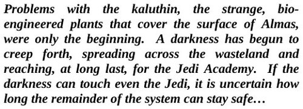
- **No single roster character (rules/setting/general)** — entry/section: Tinya: the Battle of Ossus: ""This piece is one of the more famous in the collection, and depicts a key point in the history of the Jedi. Created by the master Rodian artist Zyk-yadoon, this is the Battle of Ossus. In the foreground, here, you can see Master Ood Bnar defending some of the planet's priceless treasures against..."" Source: *207 - Almas, Sweet Almas - Desert Cries* (SWRPG d20 Revised Core), p.4
  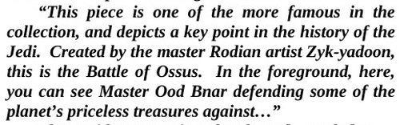

## p.1–4 (scan page 1)

Page contents: Title; boilerplate; FP/DSP; GM notes; overview; summaries; judge notes; opening crawl (hand-read)

## p.5 (scan page 5)

Page contents: 784 words, 24 paragraphs | headings/entries: Desert Cries; DC_ Information Gathered; Encounter 2: Mayday; Page 5

- **No single roster character (rules/setting/general)** — entry/section: Wall scrawl: "Death to the Unfaithful.": "Scrawled in black paint on the museum's white walls just above the blast point are the words "Death to the Unfaithful."" Source: *207 - Almas, Sweet Almas - Desert Cries* (SWRPG d20 Revised Core), p.5
  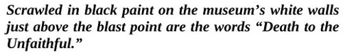
- **No single roster character (rules/setting/general)** — entry/section: Seenlu Kir: "this isn't over yet.": ""Thank you for your assistance. Would you stay and answer some questions?" Worry creases her brow; an unusual expression for the generally serene Master. "I have a feeling that this isn't over yet."" Source: *207 - Almas, Sweet Almas - Desert Cries* (SWRPG d20 Revised Core), p.5
  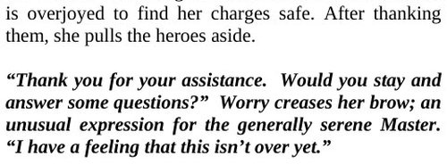
- **No single roster character (rules/setting/general)** — entry/section: Rumor (DC 15): "spoon benders": "The Jedi are using this as an excuse to finally take over the system. Why else would they shut down all transportation? I should have known there was no trusting those spoon benders! (Paranoid rumor)" Source: *207 - Almas, Sweet Almas - Desert Cries* (SWRPG d20 Revised Core), p.5
  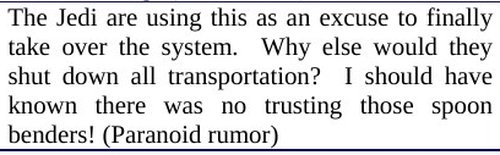
- **No single roster character (rules/setting/general)** — entry/section: Rumor (DC 30): a Wookiee bouncer: "There was an XP-34 Speeder with optional hardtop. Grey and blue pinstriping—looked like a factory job. It had three Humans in it. One of them chucked a couple of thermal detonators at the museum, and then they tore out when everything went crazy. I would've done something, but I'd just gotten done having a Wookiee bouncer dance on my face and wasn't quite mobile at that point. (True rumor)" Source: *207 - Almas, Sweet Almas - Desert Cries* (SWRPG d20 Revised Core), p.5
  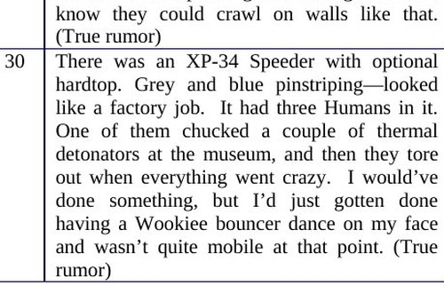

## p.4–5 (scan page 4)

Page contents: Enc 1: Remembrance Hall bombing; rumor table (hand-read)

## p.6 (scan page 6)

Page contents: 852 words, 30 paragraphs | headings/entries: Desert Cries; Things Lanius and the Academy already know:; Page 6

- **No single roster character (rules/setting/general)** — entry/section: 7-A39: ""I am 7-A39. Please, Master Kir has requested your presence at the Jedi Academy, and she seemed most urgent. If you would please come with me?"" Source: *207 - Almas, Sweet Almas - Desert Cries* (SWRPG d20 Revised Core), p.6
  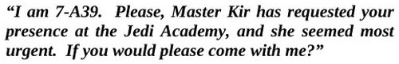
- **No single roster character (rules/setting/general)** — entry/section: Seenlu Kir: "Come with me": "Seenlu Kir strides up to the group, her face an uncharacteristically tight mask. "Come with me," she says, then turns and heads into the Academy." Source: *207 - Almas, Sweet Almas - Desert Cries* (SWRPG d20 Revised Core), p.6
  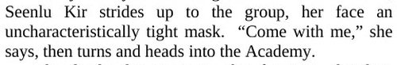
- **No single roster character (rules/setting/general)** — entry/section: Lanius Qel-Bertuk: thanks: ""On behalf of the Academy, thank you for your help during and after the attack. No one was seriously injured, in part because of your quick actions."" Source: *207 - Almas, Sweet Almas - Desert Cries* (SWRPG d20 Revised Core), p.6
  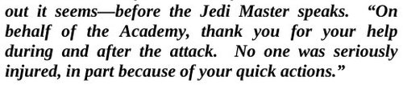
- **No single roster character (rules/setting/general)** — entry/section: Lanius Qel-Bertuk: "the Force is guiding me": ""Another situation has arisen, and I feel the Force is guiding me to answer it in a way I am not sure I am comfortable with."" Source: *207 - Almas, Sweet Almas - Desert Cries* (SWRPG d20 Revised Core), p.6
  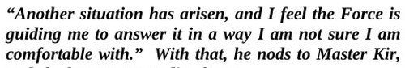
- **No single roster character (rules/setting/general)** — entry/section: Tantron Dow: last transmission: ""Academy Base, this is Knight Two. I think we have found the camp...moving around for another pass." ... "Base, this is Two! Something is targeting me! Going to try to evade... ah..." - an explosion - "...Base, I'm hit! Going down...sending coord-"" Source: *207 - Almas, Sweet Almas - Desert Cries* (SWRPG d20 Revised Core), p.6
  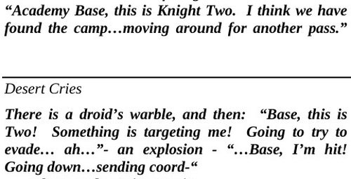
- **No single roster character (rules/setting/general)** — entry/section: Guttural voice: "Death to the Unfaithful.": "Then, there comes a low, guttural voice speaking words that are all too familiar: "Death to the Unfaithful."" Source: *207 - Almas, Sweet Almas - Desert Cries* (SWRPG d20 Revised Core), p.6
  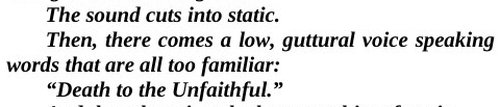
- **No single roster character (rules/setting/general)** — entry/section: Lanius Qel-Bertuk: the will of the Force: "I have attempted to divine the will of the Force. It appears that the best hopes for locating Master Kirlocca lie in your hands. [If Jedi in the party have certed Masters ...] "Your master [name of master] was part of Master Kirlocca's group—I thought you would want to be part of the search and, we hope, rescue party."" Source: *207 - Almas, Sweet Almas - Desert Cries* (SWRPG d20 Revised Core), p.6
  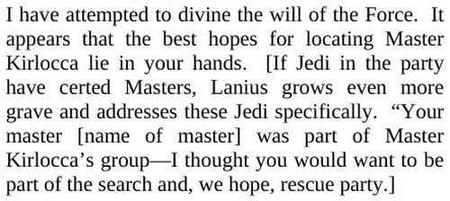
- **No single roster character (rules/setting/general)** — entry/section: Lanius Qel-Bertuk: "dangerously insane": "It does seem that someone—or something—is targeting the Jedi. Be extremely cautious. It takes someone extremely powerful—or dangerously insane—to engage in such activities." Source: *207 - Almas, Sweet Almas - Desert Cries* (SWRPG d20 Revised Core), p.6
  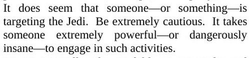
- **No single roster character (rules/setting/general)** — entry/section: Lanius Qel-Bertuk: "the return of our people is paramount": ""I want you to find Tantron Dow and his Padawan. Then, find Kirlocca and his party and bring them back to the Academy. If you find any clues as to who is behind this while you are under way, so be it, but the return of our people is paramount."" Source: *207 - Almas, Sweet Almas - Desert Cries* (SWRPG d20 Revised Core), p.6
  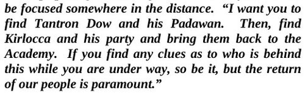

## p.7 (scan page 7)

Page contents: 893 words, 25 paragraphs | headings/entries: Encounter 3: Salvage Rights; Here's a quick primer on Squib negotiations:; Desert Cries; Page 7

- **No single roster character (rules/setting/general)** — entry/section: Seenlu Kir: "We shall see.": "No money is offered, even if the heroes ask. If they do ask, Master Kir scowls at them, and only says, "We shall see."" Source: *207 - Almas, Sweet Almas - Desert Cries* (SWRPG d20 Revised Core), p.7
  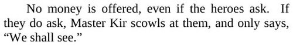
- **No single roster character (rules/setting/general)** — entry/section: Squib negotiation primer: "Anything is good as long as it's free. The more sides in a deal, the better. The more complicated a deal, the better. Intangibles (information) aren't as good as tangibles (blasters), but the value of tangibles can't be found in credits." Source: *207 - Almas, Sweet Almas - Desert Cries* (SWRPG d20 Revised Core), p.7
  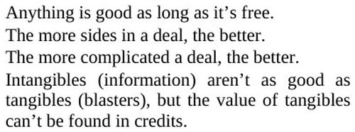

## p.5–7 (scan page 5)

Page contents: Enc 2: Mayday; Lanius Qel-Bertuk; Dow transmission (hand-read)

## p.8 (scan page 8)

Page contents: 798 words, 30 paragraphs | headings/entries: Aid #1); Tier 1 (Lvls 1-3); Tier 2 (Lvls 4-6); Tier 3 (Lvls 7-9); Desert Cries; Encounter 4: Camping Trip; Key ideas of this encounter: survival patrol; Search checks reveal the following:; Encounter 5: Padawan Found; Page 8

- **No single roster character (rules/setting/general)** — entry/section: Tantron Dow: "Murderers!": ""Murderers! Foul assassins! You will pay for the death of my Padawan!"" Source: *207 - Almas, Sweet Almas - Desert Cries* (SWRPG d20 Revised Core), p.8
  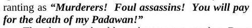
- **No single roster character (rules/setting/general)** — entry/section: Tantron Dow: "under the sway of the dark side": ""It appears I may have been under the sway of the dark side. You have my humblest apologies. Please, exercise caution."" Source: *207 - Almas, Sweet Almas - Desert Cries* (SWRPG d20 Revised Core), p.8
  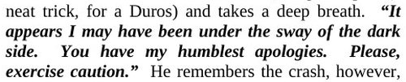

## p.7–8 (scan page 7)

Page contents: Enc 3: Squeerie and Korq; Tantron Dow (tier headings from the image) (hand-read)

## p.9 (scan page 9)

Page contents: 929 words, 26 paragraphs | headings/entries: Desert Cries; Encounter 6: Up the Cliff; Page 9

- **No single roster character (rules/setting/general)** — entry/section: Hary'nkel: Tal-Soten's vision: "Suddenly, Tal-Soten started saying that he'd had a vision, and he'd seen that Master Kirlocca would betray the Academy and the Jedi." Source: *207 - Almas, Sweet Almas - Desert Cries* (SWRPG d20 Revised Core), p.9
  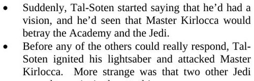
- **No single roster character (rules/setting/general)** — entry/section: Hary'nkel: "Master Vols sacrificed himself": "My Master Synred Vols, Padawan Misha Quor-Din and I [and the heroes' Masters] were the only ones who moved to help Master Kirlocca. Master Vols sacrificed himself to allow the rest of us to escape. I lost concentration as we leapt off the cliff—I saw my Master fall—and broke my leg upon landing." Source: *207 - Almas, Sweet Almas - Desert Cries* (SWRPG d20 Revised Core), p.9
  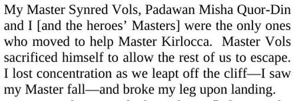
- **No single roster character (rules/setting/general)** — entry/section: Hary'nkel: "a darkness. In their eyes.": "This was not at all like them. There was something very wrong. There was...a darkness. In their eyes." Source: *207 - Almas, Sweet Almas - Desert Cries* (SWRPG d20 Revised Core), p.9
  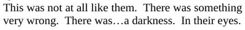

## p.8–9 (scan page 8)

Page contents: Enc 4-5: camp; Synred Vols; Hary'nkel (hand-read)

## p.10 (scan page 10)

Page contents: 814 words, 26 paragraphs | headings/entries: Aid #1); Tier 1 (Lvls 1-3); Desert Cries; Tier 3 (Lvls 7-9); Encounter 7: The Cave; Page 10

## p.9–10 (scan page 9)

Page contents: Enc 6: Up the Cliff; Kirlocca; Chrethbac (climb DCs from the image) (hand-read)

## p.11 (scan page 11)

Page contents: 830 words, 24 paragraphs | headings/entries: Desert Cries; Conclusion; The End; Experience Point Summary; Page 11

- **No single roster character (rules/setting/general)** — entry/section: Lanius Qel-Bertuk: "Come NOW.": ""Get to the top of the nearest bluff, immediately. We have extracted Kirlocca and the others; now we need to get you out of here. Come NOW." ... "A little lower," he shouts back over his shoulder, and the shuttle's ramp glides within reach. "Come aboard, now!"" Source: *207 - Almas, Sweet Almas - Desert Cries* (SWRPG d20 Revised Core), p.11
  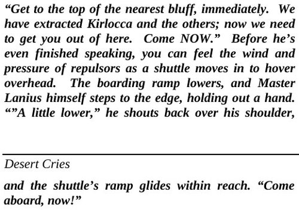
- **No single roster character (rules/setting/general)** — entry/section: Lanius Qel-Bertuk: "troubling": ""That a darkness could affect so many Jedi is ... troubling. The attack at Remembrance Hall is related, and yet... it is only a small piece of the whole. There is much hidden here, and I have only been able to pierce the mystery in a few places."" Source: *207 - Almas, Sweet Almas - Desert Cries* (SWRPG d20 Revised Core), p.11
  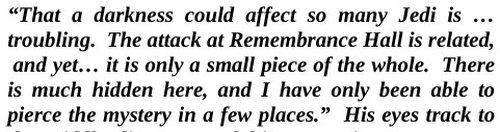
- **No single roster character (rules/setting/general)** — entry/section: Lanius Qel-Bertuk: "It is the will of the Force.": ""I cannot thank you enough for your help. My meditations tell me that we have not seen the end of your involvement in this affair. [For the non-Jedi...] We have arranged quarters for you at the Almas Haven, if you are willing to stay. I sense that your assistance is going to be needed again, soon. There are... preparations that must be made. And then, we must find our missing Padawan. It is the will of the Force."" Source: *207 - Almas, Sweet Almas - Desert Cries* (SWRPG d20 Revised Core), p.11
  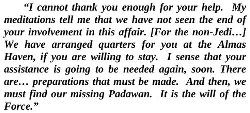

## p.12 (scan page 12)

Page contents: 316 words, 11 paragraphs | headings/entries: Adventure Experience Award:; Loot Summary; Desert Cries Page 12

## p.10–12 (scan page 10)

Page contents: Enc 7: The Cave; conclusion; XP; loot (hand-read)

## p.13 (scan page 13)

Page contents: 204 words, 5 paragraphs | headings/entries: Player Handout 1: The Kibh Jeen Story; Desert Cries Page 13

- **No single roster character (rules/setting/general)** — entry/section: Kibh Jeen story: the message: "The message? "It can happen to any of us, who would choose the path of easy power."" Source: *207 - Almas, Sweet Almas - Desert Cries* (SWRPG d20 Revised Core), p.13
  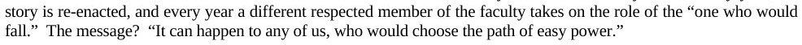

## p.14 (scan page 14)

Page contents: 81 words, 16 paragraphs | headings/entries: Player Handout #2: The Missing; Search Party: Tantron Dow (Duros Jedi Knight); Alkin Saad (Dow's Human Padawan); Synred Vols (Sullustan Jedi Knight); Hary'nkel (Twi'lek Padawan of Vols); Trevon Rey (Human Jedi Knight); Misha Quor-Din (Human Padawan of Rey); Seeth'tal (Zabrak Jedi Knight); Syr Tal-Soten (Ithorian Jedi Knight); Jedi Master; Jedi Master; Jedi Master; Desert Cries; Page 14

## p.15 (scan page 15)

Page contents: 186 words, 7 paragraphs | headings/entries: Player Handout #3—Air Speeder Statistics; Desert Cries Page 15

## p.16 (scan page 16)

Page contents: 463 words, 14 paragraphs | headings/entries: DM Aid #1: Squeerie and Korg; Squib (Paraphrased from Alien Anthology, p. 103); Desert Cries Page 16

- **No single roster character (rules/setting/general)** — entry/section: Squeerie (feats): "Feats: Alertness, Fame, Skill Focus (Diplomacy), Weapon Proficiency Group (blaster pistols, simple weapons)." Source: *207 - Almas, Sweet Almas - Desert Cries* (SWRPG d20 Revised Core), p.16
  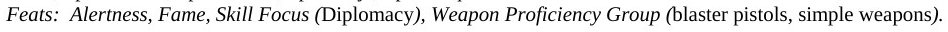
- **No single roster character (rules/setting/general)** — entry/section: Korq (feats): "Feats: Armor Proficiency (light, medium, heavy), Martial Arts, Power Attack, Weapon Focus (unarmed), Weapon Proficiency Group (blaster pistols, blaster rifles, heavy weapons, simple weapons, vibro weapons)." Source: *207 - Almas, Sweet Almas - Desert Cries* (SWRPG d20 Revised Core), p.16
  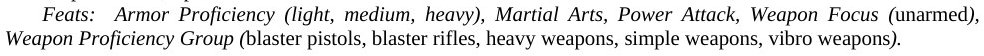

## p.17 (scan page 17)

Page contents: 594 words, 23 paragraphs | headings/entries: DM Aid #2: The Missing; Crash Party:; Force Feats: Alter, Control, Sense; Survival Trip:; Desert Cries Page 17

- **No single roster character (rules/setting/general)** — entry/section: Tantron Dow (feats): "Feats: Exotic Weapon Proficiency (lightsaber), Force-Sensitive, Skill Emphasis (Pilot), Spacer, Starship Dodge, Starship Operation (starfighter), Weapon Focus (Lightsaber), Weapons Group Proficiency (blaster pistols, simple weapons) Force Feats: Alter, Control, Sense" Source: *207 - Almas, Sweet Almas - Desert Cries* (SWRPG d20 Revised Core), p.17
  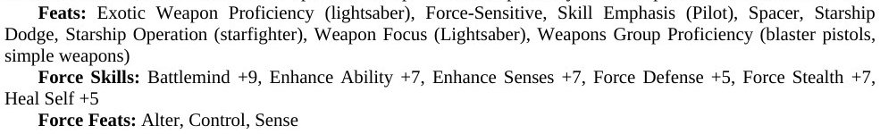
- **No single roster character (rules/setting/general)** — entry/section: Trevon Rey (feats): "Feats: Exotic Weapon Proficiency (lightsaber), Force-Sensitive, Iron Will, Weapon Finesse (Lightsaber), Weapon Focus (Lightsaber), Weapons Group Proficiency (blaster pistols, simple weapons) Force Feats: Alter, Control, Deflect Blasters, Knight Defense, Lightsaber Defense, Sense" Source: *207 - Almas, Sweet Almas - Desert Cries* (SWRPG d20 Revised Core), p.17
  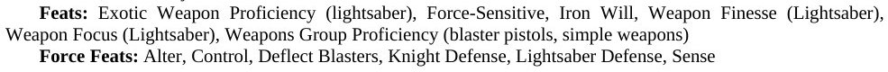

## p.18 (scan page 18)

Page contents: 407 words, 17 paragraphs | headings/entries: Force Feats: Alter, Control, Sense, Throw Lightsaber; Force Feats: Alter, Control, Force Mastery, Sense; Force Feats: Alter, Control, Sense, Summon Storm; Desert Cries Page 18

- **No single roster character (rules/setting/general)** — entry/section: Seeth'tal (feats): "Feats: Exotic Weapon Proficiency (lightsaber), Force-Sensitive, Persuasive, Weapon Finesse (Lightsaber), Weapon Focus (Lightsaber), Weapons Group Proficiency (blaster pistols, simple weapons) Force Feats: Alter, Control, Sense, Throw Lightsaber" Source: *207 - Almas, Sweet Almas - Desert Cries* (SWRPG d20 Revised Core), p.18
  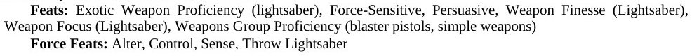
- **No single roster character (rules/setting/general)** — entry/section: Syr Tal-Soten (feats): "Feats: Exotic Weapon Proficiency (lightsaber), Force-Sensitive, Persuasive, Skill Emphasis (Heal Another), Weapon Finesse (Lightsaber), Weapon Focus (Lightsaber), Weapons Group Proficiency (blaster pistols, simple weapons) Force Feats: Alter, Control, Force Mastery, Sense" Source: *207 - Almas, Sweet Almas - Desert Cries* (SWRPG d20 Revised Core), p.18
  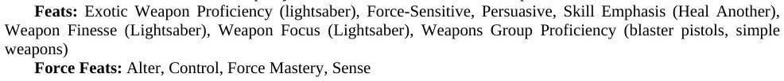
- **No single roster character (rules/setting/general)** — entry/section: Chrethbac (feats): "Feats: Force-Sensitive, Stealthy, Track, Weapons Group Proficiency (blaster pistols, primitive weapons, simple weapons) Force Feats: Alter, Control, Sense, Summon Storm" Source: *207 - Almas, Sweet Almas - Desert Cries* (SWRPG d20 Revised Core), p.18
  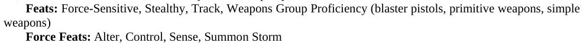

## p.19 (scan page 19)

Page contents: 15 words, 2 paragraphs | headings/entries: Desert Cries Page 19

## p.13–19 (scan page 13)

Page contents: Handouts 1-3; DM Aids 1-2 (Tantron Dow stat line from the image); crash-site map (hand-read)

