# Owner Material 037 — Star Wars D20 Drive folder (Core, Revised Core and Saga Edition): Living Force Campaign/Adventures/Among the Stars/Year 2/208 - Almas, Sweet Almas - A Dark Fortress.pdf [Star Wars Roleplaying Game Revised Core (d20, 2002)]

- **Source:** Wizards of the Coast Star Wars Roleplaying Game books, web enhancements, Living Force campaign modules and articles (2000–2010), from the owner's "Star Wars D20" Drive folder (only the three edition subfolders; "General" was not read, as instructed). Secondary source (licensed Legends reference). Scan OCR'd on the box; the scan stays box-only and is **not** published.
- **Method:** every scanned page was OCR'd and machine-screened sentence by sentence for power-relevant statements (fights, kills, defeats, Force feats, rankings, superweapons) that name a character on our roster; each kept sentence is quoted verbatim from the OCR text and has a crop of the printed passage directly under it. Pages with nothing power-relevant are still listed with what is on them.
- **Citation:** "*208 - Almas, Sweet Almas - A Dark Fortress* (SWRPG d20 Revised Core), p.X" by printed page ("scan p.X" where no printed number applies). **Weight:** Licensed RPG material: a secondary source. Narrative text sums up Legends lore; game statistics are rules for players, not canon power levels, and rank lowest.

## p.1 (scan page 1)

Page contents: 119 words, 5 paragraphs | headings/entries: A Dark Fortress

## p.2 (scan page 2)

Page contents: 884 words, 22 paragraphs | headings/entries: A Dark Fortress; Hero Earnings; Issuing Force and Dark Side Points; Page 2

## p.3 (scan page 3)

Page contents: 838 words, 20 paragraphs | headings/entries: General Notes to the GM; GM Overview; A Dark Fortress; Encounter 1: The Calling; Encounter 2: The Caves; Encounter 3: The Citadel; Encounter 4: Into the Darkness; Encounter 5: Deal with the Devil; Page 3

## p.4 (scan page 4)

Page contents: 779 words, 23 paragraphs | headings/entries: Encounter 6: The Greatest Enemy; Encounter 7: The Escape; Opening Crawl; Encounter 1: The Call; A Dark Fortress; What Master Lanius and Master Kir know:; Page 4

- **No single roster character (rules/setting/general)** — entry/section: Opening crawl: "As long as there is good in the galaxy, there will be evil. Recent events on Almas have shown that the evil of the Sith fortress, dormant for so many years, may be re-emerging. With the loss of a Padawan to the darkness, the heroes of Cularin are called upon to aid in the search..." Source: *208 - Almas, Sweet Almas - A Dark Fortress* (SWRPG d20 Revised Core), p.4
  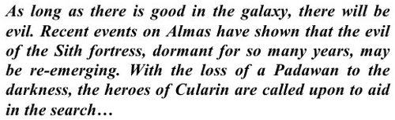
- **No single roster character (rules/setting/general)** — entry/section: Lanius Qel-Bertuk: "Are you willing?": ""Some of you have assisted us in the past. We need your assistance again now. A Padawan — Misha Quor-Din — went missing recently. We have reason to believe she is alive, but we need a large number of teams to assist in the search. Are you willing?"" Source: *208 - Almas, Sweet Almas - A Dark Fortress* (SWRPG d20 Revised Core), p.4
  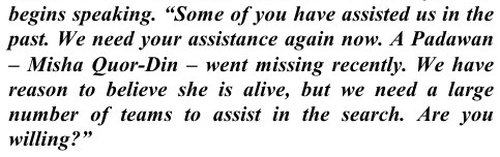
- **No single roster character (rules/setting/general)** — entry/section: Lanius Qel-Bertuk: "Will you help us?": ""I have committed what students are ready and what teachers I have to the search effort, and yet, the research facility keeps turning up new caves to be explored. I simply do not have the bodies to continue without forcing my people into groups smaller than I'm comfortable with. Will you help us?"" Source: *208 - Almas, Sweet Almas - A Dark Fortress* (SWRPG d20 Revised Core), p.4
  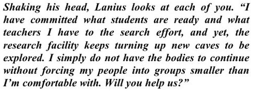
- **No single roster character (rules/setting/general)** — entry/section: Freighter hatch: "Death to the unbelievers": "The words "Death to the unbelievers" are written on the inside of the main hatch." Source: *208 - Almas, Sweet Almas - A Dark Fortress* (SWRPG d20 Revised Core), p.4
  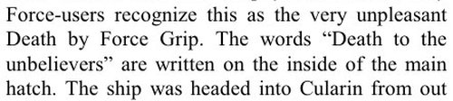

## p.1–4 (scan page 1)

Page contents: Title; boilerplate; FP/DSP; GM notes; overview; summaries; judge note; opening crawl (hand-read)

## p.5 (scan page 5)

Page contents: 953 words, 20 paragraphs | headings/entries: Encounter 2: The Cave; A Dark Fortress; Page 5

- **No single roster character (rules/setting/general)** — entry/section: Pirate: "That'll teach those smugglers": ""So then, when the boss had 'em all dead, we went and wrote 'death to the unbelievers' on the main hatch, and took off again. That'll teach those smugglers to try to mess with us!"" Source: *208 - Almas, Sweet Almas - A Dark Fortress* (SWRPG d20 Revised Core), p.5
  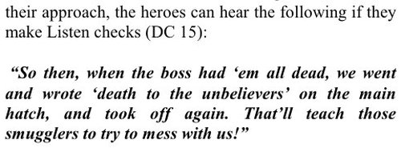

## p.4–5 (scan page 4)

Page contents: Enc 1: Lanius Qel-Bertuk's call (hand-read)

## p.6 (scan page 6)

Page contents: 860 words, 27 paragraphs | headings/entries: If captured, the pirates know the following:; Encounter 3: The Citadel; A Dark Fortress; Fortress; Page 6

- **No single roster character (rules/setting/general)** — entry/section: Captured pirates: "horrible, and painful": "You are all foolish unbelievers, and will die horribly and painfully. We are loyal to the Darkness. Always. You should repent your unbelieving ways, or you will die, horribly and painfully. ... Have we mentioned that you're going to die? And that it will be horrible, and painful? ... If you go to the Holy Place, you will die. We think you get the picture of how that death will feel. You know — horrible. And painful." Source: *208 - Almas, Sweet Almas - A Dark Fortress* (SWRPG d20 Revised Core), p.6
  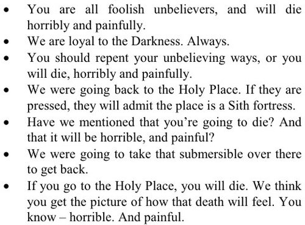
- **No single roster character (rules/setting/general)** — entry/section: Captured pirates: "We don't count.": "There are many of us there. We don't even know how many. Dozens. Hundreds. We don't count." Source: *208 - Almas, Sweet Almas - A Dark Fortress* (SWRPG d20 Revised Core), p.6
  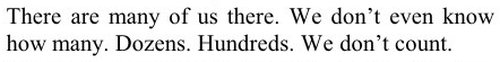
- **No single roster character (rules/setting/general)** — entry/section: Captured pirates: "She is to be a sacrifice.": "Yes, there is an unbeliever Jedi there. She is to be a sacrifice." Source: *208 - Almas, Sweet Almas - A Dark Fortress* (SWRPG d20 Revised Core), p.6
  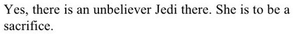
- **No single roster character (rules/setting/general)** — entry/section: Submersible droid brain: ""Attention pilot. Approaching ice flow. Prepare to take manual control."" Source: *208 - Almas, Sweet Almas - A Dark Fortress* (SWRPG d20 Revised Core), p.6
  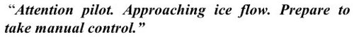

## p.5–6 (scan page 5)

Page contents: Enc 2: the caves; pirates; submersible (hand-read)

## p.7 (scan page 7)

Page contents: 795 words, 24 paragraphs | headings/entries: A Dark Fortress; Encounter 4: Into the Darkness; Page 7

- **No single roster character (rules/setting/general)** — entry/section: Pirate on the island: "Ya here to sight-see": ""Ya here to sight-see, or ta work? Start unloadin' yer sub!"" Source: *208 - Almas, Sweet Almas - A Dark Fortress* (SWRPG d20 Revised Core), p.7
  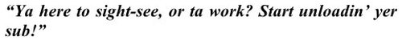

## p.6–7 (scan page 6)

Page contents: Enc 3: ice flow (DC table from the image); the citadel (hand-read)

## p.8 (scan page 8)

Page contents: 850 words, 32 paragraphs | headings/entries: LEVEL 2 (where the heroes begin); LEVEL 1 (Below the heroes); A Dark Fortress; LEVEL 3; Page 8

## p.9 (scan page 9)

Page contents: Enc 5: Nal'Reyna (Alina Impeveri) (hand-read)

- **No single roster character (rules/setting/general)** — entry/section: Nal'Reyna: "I've been expecting you.": ""Come in," she purrs, smiling broadly. "I've been expecting you."" Source: *208 - Almas, Sweet Almas - A Dark Fortress* (SWRPG d20 Revised Core), p.9
  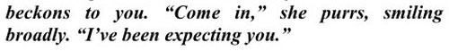
- **No single roster character (rules/setting/general)** — entry/section: Nal'Reyna: the offer: ""I know why you're here—the Jedi girl. I also know where she is, and I can deliver her to you...but you must in return do something for me. "The leader of our little enclave here has something I want. It's a pendant that he wears; I believe that it is the source of the voices he hears. I'd like to have the trinket, and, in exchange, I'll give you the girl. "It's that simple."" Source: *208 - Almas, Sweet Almas - A Dark Fortress* (SWRPG d20 Revised Core), p.9
  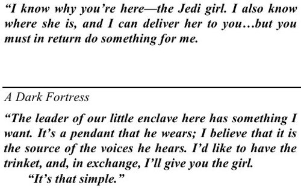
- **No single roster character (rules/setting/general)** — entry/section: Nal'Reyna: "the Dark One": "I don't have a name for the leader. He just calls himself "the Dark One."" Source: *208 - Almas, Sweet Almas - A Dark Fortress* (SWRPG d20 Revised Core), p.9
  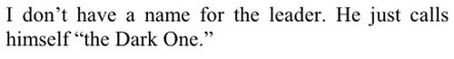
- **No single roster character (rules/setting/general)** — entry/section: Nal'Reyna: "take the turbolift up a level": ""Good. I'll ensure that you can find him — take the turbolift up a level. As soon as you have the pendant, I'll deliver the girl."" Source: *208 - Almas, Sweet Almas - A Dark Fortress* (SWRPG d20 Revised Core), p.9
  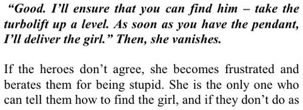

## p.7–9 (scan page 7)

Page contents: Enc 4: fortress levels; Gar Granga's chant (hand-read)

## p.10 (scan page 10)

Page contents: 941 words, 22 paragraphs | headings/entries: A Dark Fortress; Page 10

- **No single roster character (rules/setting/general)** — entry/section: Garvin Delquist: "We shall see, worms.": ""You are not mine." ... "You are from them?" ... "Pathetic. You believe you can stand before the power of the dark side? We shall see, worms."" Source: *208 - Almas, Sweet Almas - A Dark Fortress* (SWRPG d20 Revised Core), p.10
  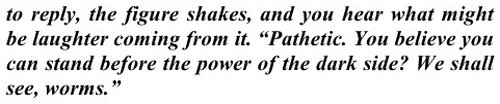
- **No single roster character (rules/setting/general)** — entry/section: Garvin Delquist: "I love her": ""You've come to take her away -- but you can't. I love her...and she will love me!"" Source: *208 - Almas, Sweet Almas - A Dark Fortress* (SWRPG d20 Revised Core), p.10
  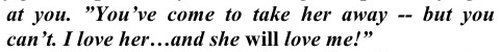
- **No single roster character (rules/setting/general)** — entry/section: Garvin Delquist: "Kill them!": ""Kill them!"" Source: *208 - Almas, Sweet Almas - A Dark Fortress* (SWRPG d20 Revised Core), p.10
  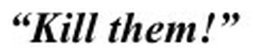

## p.11 (scan page 11)

Page contents: 882 words, 21 paragraphs | headings/entries: Encounter 7: The Escape; Key ideas of this encounter: Escape!; A Dark Fortress; Page 11

- **No single roster character (rules/setting/general)** — entry/section: Garvin Delquist: "Only wanted to love her": "If Delquist survives (not likely!), he begins babbling about how he "Only wanted to love her," and then, with the Amulet well away from him, quite clearly loses his mind and gibbers inanely at the floor." Source: *208 - Almas, Sweet Almas - A Dark Fortress* (SWRPG d20 Revised Core), p.11
  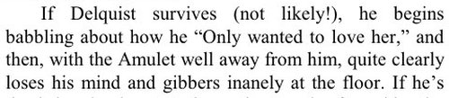

## p.9–11 (scan page 9)

Page contents: Enc 6: dark doubles; Garvin Delquist; the amulet (hand-read)

## p.12 (scan page 12)

Page contents: 715 words, 26 paragraphs | headings/entries: Conclusion; A Dark Fortress; The End; Experience Point Summary; Adventure Experience Award:; Loot Summary; Page 12

- **No single roster character (rules/setting/general)** — entry/section: Lanius Qel-Bertuk: "Surrender now": ""Surrender now, or it will not go well for you."" Source: *208 - Almas, Sweet Almas - A Dark Fortress* (SWRPG d20 Revised Core), p.12
  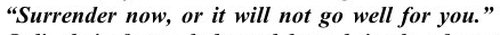
- **No single roster character (rules/setting/general)** — entry/section: Lanius Qel-Bertuk: "The Force led us here.": ""The Force led us here. I'd thought we might be too late. The strength of the energies that were in place blocked my ability to see where you had gone. It seems I need not have been concerned. You found this place, and Misha, and it looks like you were well on your way out. You've done exceptionally well."" Source: *208 - Almas, Sweet Almas - A Dark Fortress* (SWRPG d20 Revised Core), p.12
  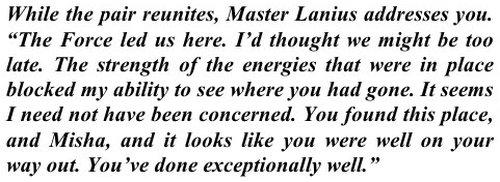

## p.13 (scan page 13)

Page contents: 176 words, 7 paragraphs | headings/entries: From D'randq (high tier only, certed) Vibro-Axe; A Dark Fortress; Page 13

## p.11–13 (scan page 11)

Page contents: Enc 7: escape; Jedi assault; conclusion; XP; loot; Mental Discipline (hand-read)

## p.14 (scan page 14)

Page contents: 191 words, 7 paragraphs | headings/entries: Player Handout 1: Gilloma's Report; A Dark Fortress Page 14

- **No single roster character (rules/setting/general)** — entry/section: Gilloma's Report: "Perhaps, as the atmosphere warmed the planet, Almas' icy surface melted, then—as water always does—found the lowest point. So it is feasible that your opponents are using the caves to access the water systems, and move about the planet undetected." Source: *208 - Almas, Sweet Almas - A Dark Fortress* (SWRPG d20 Revised Core), p.14
  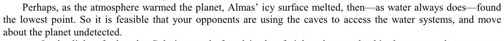

## p.15 (scan page 15)

Page contents: 45 words, 14 paragraphs | headings/entries: DM Aid #1: The Maps; To Level 4; Locked Turbolift Level 3; Meeting Rooms (#4); Kn 47; Turbolifts; Barracks (#2); Level 2; Heroes enter here; Washrooms/ Refreshers; Level 1; A Dark Fortress Page 15

## p.16 (scan page 16)

Page contents: 589 words, 27 paragraphs | headings/entries: DM Aid #2 : NPC Statistics; All Tiers:; A Dark Fortress Page 16

- **No single roster character (rules/setting/general)** — entry/section: Misha Quor-Din (feats): "Feats: Acrobatic, Exotic Weapon Proficiency (lightsaber), Force-Sensitive, Skill Emphasis (Diplomacy), Trustworthy, Weapons Group Proficiency (blaster pistols, simple weapons). Force Feats: Alter, Control, Sense." Source: *208 - Almas, Sweet Almas - A Dark Fortress* (SWRPG d20 Revised Core), p.16
  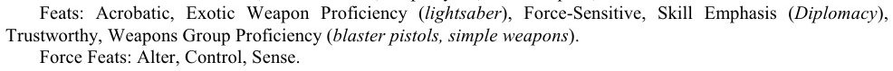
- **No single roster character (rules/setting/general)** — entry/section: Thug 2 (feats): "Feats: Heroic Surge (1/day), Toughness, Weapons (blaster pistols, simple weapons)." Source: *208 - Almas, Sweet Almas - A Dark Fortress* (SWRPG d20 Revised Core), p.16
  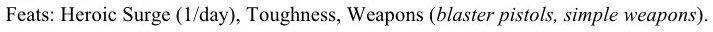
- **No single roster character (rules/setting/general)** — entry/section: Generic Dark Side Marauder (feats): "Feats: Armor Proficiency (light), Force Sensitive, Martial Artist, Power Attack, Weapon Focus (vibroblade), Weapon Group Proficiency (blaster pistols, blaster rifles, heavy weapons, primitive weapons, simple weapons, vibro weapons) Force Feats: Control, Rage." Source: *208 - Almas, Sweet Almas - A Dark Fortress* (SWRPG d20 Revised Core), p.16
  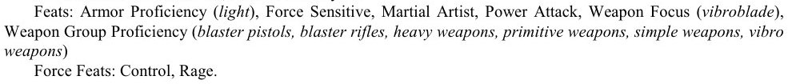

## p.17 (scan page 17)

Page contents: 644 words, 22 paragraphs | headings/entries: A Dark Fortress Page 17

- **No single roster character (rules/setting/general)** — entry/section: The Dark Side Pendant: "**The Dark Side Pendant that Delquist wears gives him the following abilities: -He does not spend vitality points to use Force skills. -He can use any non-light side Force skills — including those he possess' no rank in — as if he had the skill at +10. -He can speak and understand any language, as well as read any language." Source: *208 - Almas, Sweet Almas - A Dark Fortress* (SWRPG d20 Revised Core), p.17
  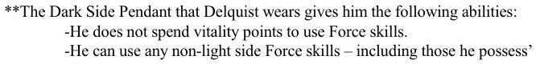
- **No single roster character (rules/setting/general)** — entry/section: Sellot Kell (feats): "Feats: Armor Proficiency (heavy, light, medium), Far Shot, Multishot, Point Blank Shot, Precise Shot, Quick Draw, Rapid Shot, Weapons Group Proficiency (blaster pistols, blaster rifles, heavy weapons, simple weapons, vibro weapons)." Source: *208 - Almas, Sweet Almas - A Dark Fortress* (SWRPG d20 Revised Core), p.17
  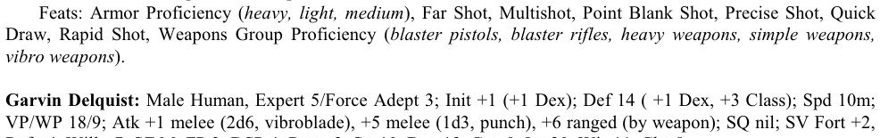

## p.18 (scan page 18)

Page contents: 662 words, 21 paragraphs | headings/entries: Tier 3:; A Dark Fortress Page 18

- **No single roster character (rules/setting/general)** — entry/section: Gar Granga (feats): "Feats: Armor Proficiency (light), Exotic Weapon Proficiency (lightsaber), Force-Sensitive, Improved Initiative, Martial Artist, Power Attack, Skill Emphasis (Battlemind), Weapons Group Proficiency (blaster pistols, blaster rifles, primitive weapons, simple weapons, vibro weapons). Force Feats: Alter, Control, Dissipate Energy, Hatred, Knight Defense, Lightsaber Defense, Rage, Sense" Source: *208 - Almas, Sweet Almas - A Dark Fortress* (SWRPG d20 Revised Core), p.18
  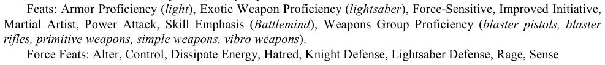
- **No single roster character (rules/setting/general)** — entry/section: D'randq (feats): "Feats: Armor Proficiency (light, medium, heavy), Cleave, Force-Sensitive, Great Cleave, Martial Artist, Power Attack, Quick Draw, Skill Emphasis (Force Push), Two-weapon Fighting, Weapons Group Proficiency (blaster pistols, blaster rifles, heavy weapons, primitive weapons, simple weapons, vibro weapons). Force Feats: Alter, Control, Hatred, Rage, Sense." Source: *208 - Almas, Sweet Almas - A Dark Fortress* (SWRPG d20 Revised Core), p.18
  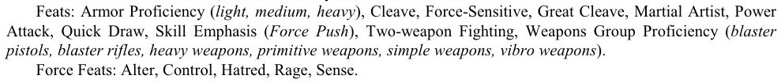

## p.19 (scan page 19)

Page contents: 323 words, 11 paragraphs | headings/entries: A Dark Fortress Page 19

## p.20 (scan page 20)

Page contents: 69 words, 5 paragraphs | headings/entries: DM Aid #3 — Cargo Skiff; Weapons: none; A Dark Fortress Page 20

## p.21 (scan page 21)

Page contents: 137 words, 8 paragraphs | headings/entries: Critical Event Summary A Dark Fortress; A Dark Fortress Page 21

## p.14–21 (scan page 14)

Page contents: Gilloma's Report; maps; NPC stats (Misha and Sellot Kell lines from the images); cargo skiff; critical event summary (hand-read)

