# Owner Material 037 — Star Wars D20 Drive folder (Core, Revised Core and Saga Edition): Living Force Campaign/Adventures/Among the Stars/Year 2/209 - Coruscani Dawn.pdf [Star Wars Roleplaying Game Revised Core (d20, 2002)]

- **Source:** Wizards of the Coast Star Wars Roleplaying Game books, web enhancements, Living Force campaign modules and articles (2000–2010), from the owner's "Star Wars D20" Drive folder (only the three edition subfolders; "General" was not read, as instructed). Secondary source (licensed Legends reference). Scan OCR'd on the box; the scan stays box-only and is **not** published.
- **Method:** every scanned page was OCR'd and machine-screened sentence by sentence for power-relevant statements (fights, kills, defeats, Force feats, rankings, superweapons) that name a character on our roster; each kept sentence is quoted verbatim from the OCR text and has a crop of the printed passage directly under it. Pages with nothing power-relevant are still listed with what is on them.
- **Citation:** "*209 - Coruscani Dawn* (SWRPG d20 Revised Core), p.X" by printed page ("scan p.X" where no printed number applies). **Weight:** Licensed RPG material: a secondary source. Narrative text sums up Legends lore; game statistics are rules for players, not canon power levels, and rank lowest.

## p.1 (scan page 1)

Page contents: 114 words, 5 paragraphs | headings/entries: Coruscant Dawn

## p.2 (scan page 2)

Page contents: 926 words, 23 paragraphs | headings/entries: Issuing Force and Dark Side Points; Coruscani Dawn; Page 2

## p.3 (scan page 3)

Page contents: 883 words, 20 paragraphs | headings/entries: General Notes to the GM; GM Overview; Encounter 1: To the Study; Encounter 2: To the Ship; Encounter 3: To the Center; Coruscani Dawn; Page 3

- **No single roster character (rules/setting/general)** — entry/section: The Pulas found in the Almas fortress: "Not long ago, a team of Jedi (including Master Kirlocca) undertook an expedition into the Sith fortress that sits in the center of the great wasteland on Almas. In a dark, forgotten corner they came across a fist-sized black crystal that pulsed with dark energy. It matched descriptions from histories of the Sith Wars of an artifact known as the Pulas, an object whose function is unclear, but which was wielded by numerous powerful Sith down through the ages." Source: *209 - Coruscani Dawn* (SWRPG d20 Revised Core), p.3
  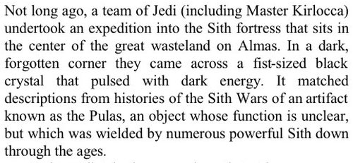
- **No single roster character (rules/setting/general)** — entry/section: Mandalorian iron boxes: "In order to make it difficult for the Believers to find the crystal, Master Lanius had a small fleet assembled, and a large number of boxes made of Mandalorian iron brought out of deep storage. This iron, in addition to being virtually indestructible (even to lightsabers), cannot be easily penetrated by attempts to utilize Force abilities (Far Seeing, See Force, etc.)." Source: *209 - Coruscani Dawn* (SWRPG d20 Revised Core), p.3
  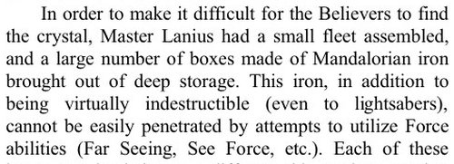

## p.4 (scan page 4)

Page contents: 876 words, 22 paragraphs | headings/entries: Encounter 4: To the Undercity; Encounter 5: To the Package; Encounter 6: To the Endgame; Encounter 7: To the Temple; Opening Crawl; Encounter 1: To the Study; Coruscani Dawn; Page 4

- **No single roster character (rules/setting/general)** — entry/section: Opening crawl: "For many centuries the Sith fortress on Almas stood abandoned but it was not forgotten. With the recent activity in the Cularin system, the Jedi of the Almas Academy have begun to investigate the fortress in more detail than they did in the past. Rumors have begun to circulate that a team of researchers found something deep within the fortress. Now the Academy must decide what to do with whatever it is they found..." Source: *209 - Coruscani Dawn* (SWRPG d20 Revised Core), p.4
  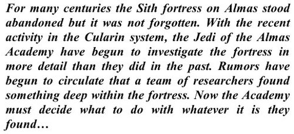
- **No single roster character (rules/setting/general)** — entry/section: Lanius Qel-Bertuk: message: ""Cularin has proven herself to be home to a great many heroes. The Jedi need the assistance of all available heroes for a mission of the utmost urgency. Please come to Almas. Now."" Source: *209 - Coruscani Dawn* (SWRPG d20 Revised Core), p.4
  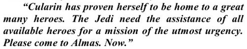

## p.1–4 (scan page 1)

Page contents: Title; scoring boilerplate; earnings; FP/DSP; GM notes; overview (the Pulas); summaries; judge note; opening crawl (hand-read)

## p.5 (scan page 5)

Page contents: 874 words, 27 paragraphs | headings/entries: Coruscani Dawn; Page 5

- **No single roster character (rules/setting/general)** — entry/section: Lora: "Hello. I'm Lora.": ""Hello. I'm Lora. If you'll please proceed to the Academy, your group will be assigned a place in line."" Source: *209 - Coruscani Dawn* (SWRPG d20 Revised Core), p.5
  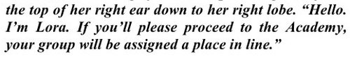
- **No single roster character (rules/setting/general)** — entry/section: Lora (description): "She is a mid-level Padawan at the Academy who detects as having seven Force levels." Source: *209 - Coruscani Dawn* (SWRPG d20 Revised Core), p.5
  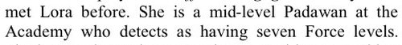
- **No single roster character (rules/setting/general)** — entry/section: Lanius Qel-Bertuk: "I'm in need of heroes.": ""I'd rise, but I'm afraid I'm rather worn out from all the talking I've done today. "I'm in need of heroes. There isn't pay involved, and it may be extremely dangerous. I can't tell you more unless you're willing to work under those two parameters. Are you interested?"" Source: *209 - Coruscani Dawn* (SWRPG d20 Revised Core), p.5
  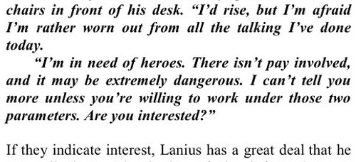
- **No single roster character (rules/setting/general)** — entry/section: Lanius Qel-Bertuk: the black crystal: "Recently, a team working deep within the Sith fortress, helping to clean it out, uncovered a black crystal with 40 facets. It radiates strongly of the dark side of the Force." Source: *209 - Coruscani Dawn* (SWRPG d20 Revised Core), p.5
  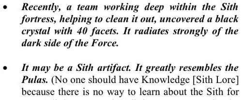
- **No single roster character (rules/setting/general)** — entry/section: Lanius: "I'm in need of heroes.": ""I'm in need of heroes. There isn't pay involved, and it may be extremely dangerous. I can't tell you more unless you're willing to work under those two parameters. Are you interested?"" Source: *209 - Coruscani Dawn* (SWRPG d20 Revised Core), p.5
  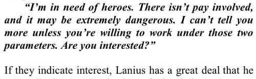

## p.6 (scan page 6)

Page contents: 755 words, 25 paragraphs | headings/entries: Encounter 2: To the Ship; Coruscani Dawn; Page 6

- **No single roster character (rules/setting/general)** — entry/section: Lanius Qel-Bertuk: the Believers: "We have every reason to expect that the Believers—that is the name that has been claimed by the cult of dark side followers that has emerged in Cularin—are trying to stop the crystal from leaving the system." Source: *209 - Coruscani Dawn* (SWRPG d20 Revised Core), p.6
  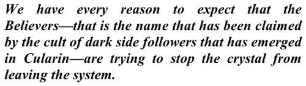
- **No single roster character (rules/setting/general)** — entry/section: Lanius Qel-Bertuk: "never, ever open the box": "It doesn't matter what the decoy boxes are holding. You should never, ever open the box. If it is actually a Sith artifact, and you are carrying it, it might take advantage of you, and you would be lost to us." Source: *209 - Coruscani Dawn* (SWRPG d20 Revised Core), p.6
  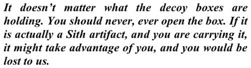
- **No single roster character (rules/setting/general)** — entry/section: Lanius Qel-Bertuk: Mandalorian iron boxes: "The boxes are made of Mandalorian iron that we've kept in storage here. They are impenetrable to most Force abilities (they block Far Seeing and See Force attempts to recognize their contents), and cannot be harmed by lightsabers." Source: *209 - Coruscani Dawn* (SWRPG d20 Revised Core), p.6
  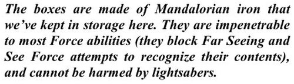
- **No single roster character (rules/setting/general)** — entry/section: Lanius Qel-Bertuk: "May the Force be with you.": ""What you are doing is vital not only to Cularin, but to the entire galaxy. May the Force be with you."" Source: *209 - Coruscani Dawn* (SWRPG d20 Revised Core), p.6
  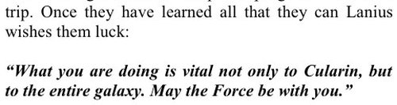
- **No single roster character (rules/setting/general)** — entry/section: E1-6RA, translating for Master Kirlocca: ""Master Kirlocca wishes you good fortune and safety on your journey to Coruscant. He is placing in your care a vital parcel. You must not under any circumstances open the box."" Source: *209 - Coruscani Dawn* (SWRPG d20 Revised Core), p.6
  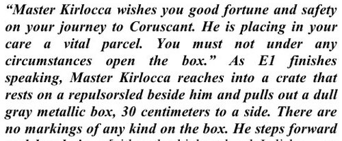
- **Mace Windu** — entry/section: Devan spoken of highly by Master Windu: "Your landing platform will be 3107. The Jedi Knight who will meet you is named Devan. She was spoken of very highly by Master Windu." Source: *209 - Coruscani Dawn* (SWRPG d20 Revised Core), p.6
  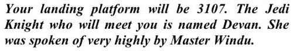

## p.4–6 (scan page 4)

Page contents: Enc 1: Lora; rumors; Lanius' briefing on the Pulas and the Mandalorian iron boxes (hand-read)

## p.7 (scan page 7)

Page contents: 1021 words, 18 paragraphs | headings/entries: Sticking to the Main Lanes; Going through the Comet Cloud; Coruscani Dawn; Page 7

- **No single roster character (rules/setting/general)** — entry/section: Lanius Qel-Bertuk: "It is time.": ""It is time." Master Lanius sounds very calm. "Pilots, plot course for the comet cloud, and when you are through, make the jump to light speed. I will see you all on Coruscant."" Source: *209 - Coruscani Dawn* (SWRPG d20 Revised Core), p.7
  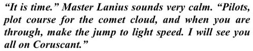

## p.8 (scan page 8)

Page contents: 903 words, 19 paragraphs | headings/entries: In Hyperspace; Encounter 3: To the Center; Coruscani Dawn; Page 8

- **No single roster character (rules/setting/general)** — entry/section: The box in hyperspace: "It's asking them to open it... they want to open it... they want to remove what is inside... it should be theirs..." Source: *209 - Coruscani Dawn* (SWRPG d20 Revised Core), p.8
  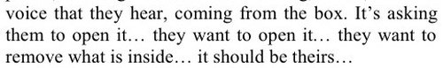
- **No single roster character (rules/setting/general)** — entry/section: Jedi Tower: ""Shuttle 3107, please proceed to assigned coordinates. You will be met by Devan. She will guide you to the safe-house where you will wait until such time as you can deliver your package."" Source: *209 - Coruscani Dawn* (SWRPG d20 Revised Core), p.8
  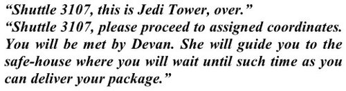
- **No single roster character (rules/setting/general)** — entry/section: The box calls in hyperspace: "In the time it takes to get to Coruscant, whatever is in the box begins trying to make itself felt. While the box stops See Force and Far Seeing, it does not stop Affect Mind and that's a variant of what the thing inside is trying to do." Source: *209 - Coruscani Dawn* (SWRPG d20 Revised Core), p.8
  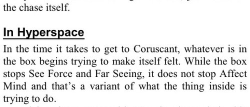
- **No single roster character (rules/setting/general)** — entry/section: Coruscant from orbit: "You come out of hyperspace and see before you a planet unlike any other in the galaxy. White hemispheres cover the poles of the planet, but everything between the sheets of polar ice is alive with light and motion. Enormous space stations orbit the planet, some anchored, others free-floating. Ships dart back and forth across your path. Your sensors are nearly overwhelmed as you scan the area ahead. Somewhere, on that planet, the Galactic Senate meets. Somewhere, on that planet, the Jedi Council deliberates the fate of the galaxy. Somewhere, on that planet, anything you can imagine can be found — living, dead, or otherwise. Welcome to Coruscant." Source: *209 - Coruscani Dawn* (SWRPG d20 Revised Core), p.8
  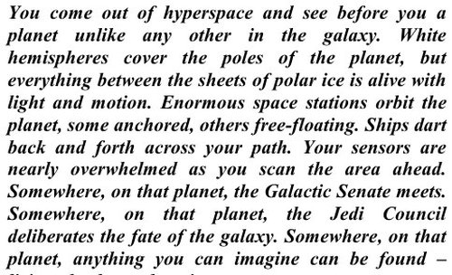

## p.6–8 (scan page 6)

Page contents: Enc 2: Kirlocca hands over the box; comet-cloud chase; the box calls in hyperspace (hand-read)

## p.9 (scan page 9)

Page contents: 878 words, 27 paragraphs | headings/entries: Coruscani Dawn; Page 9

- **No single roster character (rules/setting/general)** — entry/section: Devan (feats): "Feats: Force Sensitive, Weapons (Simple, Blaster Pistols), Exotic Weapon Proficiency: Lightsaber, Heroic Surge, Weapon Finesse: Lightsaber, Skill Emphasis: Enhance Ability. Force Feats: Control, Alter, Sense, Lightsaber Defense, Knight Defense." Source: *209 - Coruscani Dawn* (SWRPG d20 Revised Core), p.9
  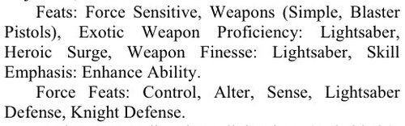
- **No single roster character (rules/setting/general)** — entry/section: Devan: "If it is the Council's will": "Do you know what's in the "real" package? I don't need to know that. If it is the Council's will for me to learn, I will learn." Source: *209 - Coruscani Dawn* (SWRPG d20 Revised Core), p.9
  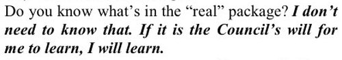
- **No single roster character (rules/setting/general)** — entry/section: Devan: "I was brought to the Jedi as an infant.": "How long have you been on Coruscant? I was brought to the Jedi as an infant. It's the only life I've known." Source: *209 - Coruscani Dawn* (SWRPG d20 Revised Core), p.9
  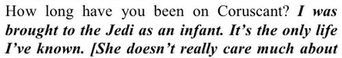
- **No single roster character (rules/setting/general)** — entry/section: Devan: "I suggest not letting it.": "Why has this box been talking to us? Off-hand? I'd guess that whatever's inside wants to come out. I suggest not letting it." Source: *209 - Coruscani Dawn* (SWRPG d20 Revised Core), p.9
  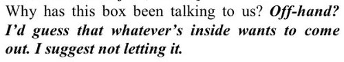

### Stat block notes (game mechanics, not feats)

- Devan: Devan, Human Female Jedi Consular 7; Def 19 (23 with lightsaber ignited); VWP/WP 44/11; Atk +9 melee (3d8-1, lightsaber*); FP 8; DSP 0; Force Skills: Enhance Ability +13, See Force +9, Battlemind +8, Affect Mind +8, Move Object +8, Heal Another +7; Force Feats: Control, Alter, Sense, Lightsaber Defense, Knight Defense. (Source: *209 - Coruscani Dawn* (SWRPG d20 Revised Core), p.9)

## p.10 (scan page 10)

Page contents: 915 words, 25 paragraphs | headings/entries: Encounter 4: To the Undercity; Coruscani Dawn; Page 10

- **No single roster character (rules/setting/general)** — entry/section: Wojarra: "Go! Get it back!": "It hasn't even been a minute yet. I shot their speeder with a tracer. Here. (He hands someone a datapad.) This allows you to track them. Go! Get it back!" Source: *209 - Coruscani Dawn* (SWRPG d20 Revised Core), p.10
  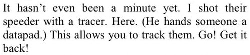
- **No single roster character (rules/setting/general)** — entry/section: Wojarra: Es'Loma: "Es'Loma was a Tarasin. No one could survive that fall. She was so excited about seeing Coruscant, too..." Source: *209 - Coruscani Dawn* (SWRPG d20 Revised Core), p.10
  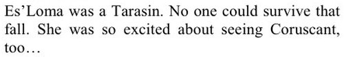
- **No single roster character (rules/setting/general)** — entry/section: Why the thieves stunned the Wookiee: "Humans are frail, and easy to kill, and Bothans are easier still. The easiest way to deal with a Wookiee, though, is to stun him before he can go into a rage and kill you." Source: *209 - Coruscani Dawn* (SWRPG d20 Revised Core), p.10
  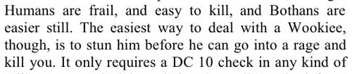

## p.8–10 (scan page 8)

Page contents: Enc 3: Coruscant; Devan; the attacked ship; Wojarra, San, Nia; Es'Loma 'falls' (hand-read)

## p.11 (scan page 11)

Page contents: 934 words, 17 paragraphs | headings/entries: Lower Tier; Coruscani Dawn; Page 11

- **No single roster character (rules/setting/general)** — entry/section: Blaise: the dark side: ""It's always there, and easy to touch, and it wants us to use it for everything"" Source: *209 - Coruscani Dawn* (SWRPG d20 Revised Core), p.11
  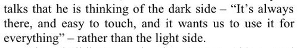
- **No single roster character (rules/setting/general)** — entry/section: Ilok: "we've got a problem": ""Upworlders, I think maybe we've got a problem."" Source: *209 - Coruscani Dawn* (SWRPG d20 Revised Core), p.11
  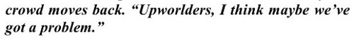
- **No single roster character (rules/setting/general)** — entry/section: Ilok, lower tier (feats): "Feats: Weapon Group Proficiencies (blaster pistols, blaster rifles, heavy weapons, vibro weapons), Armor Proficiencies (Light, Medium, Heavy), Weapon Focus (Blaster Pistol), Point Blank Shot, Precise shot." Source: *209 - Coruscani Dawn* (SWRPG d20 Revised Core), p.11
  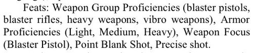
- **No single roster character (rules/setting/general)** — entry/section: Blaise on the Believers' Force: "If pressed for what it is the Believers believe in, he launches into a recitation on the power and will of the Force, but it's clear from the way he talks that he is thinking of the dark side — "It's always there, and easy to touch, and it wants us to use it for everything" — rather than the light side." Source: *209 - Coruscani Dawn* (SWRPG d20 Revised Core), p.11
  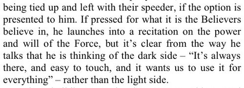

## p.12 (scan page 12)

Page contents: 829 words, 25 paragraphs | headings/entries: Middle Tier; Climb +3, Intimidate +2, Knowledge; Upper Tier; Coruscani Dawn; Page 12

- **No single roster character (rules/setting/general)** — entry/section: Ilok, middle tier (feats): "Feats: Weapon Group Proficiencies (blaster pistols, blaster rifles, heavy weapons, vibro weapons), Armor Proficiencies (Light, Medium, Heavy), Weapon Focus (Blaster Pistol), Point Blank Shot, Precise shot, Dodge, Mobility, Ambidexterity." Source: *209 - Coruscani Dawn* (SWRPG d20 Revised Core), p.12
  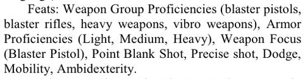
- **No single roster character (rules/setting/general)** — entry/section: Ilok, upper tier (feats): "Feats: Weapon Group Proficiencies (blaster pistols, blaster rifles, heavy weapons, vibro weapons), Armor Proficiencies (Light, Medium, Heavy), Weapon Focus (Blaster Pistol), Point Blank Shot, Precise shot, Dodge, Mobility, Ambidexterity, Two-weapon fighting, Improved two-weapon fighting." Source: *209 - Coruscani Dawn* (SWRPG d20 Revised Core), p.12
  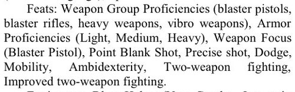

## p.13 (scan page 13)

Page contents: 893 words, 20 paragraphs | headings/entries: Encounter 5: To the Package; Coruscani Dawn; Page 13

- **No single roster character (rules/setting/general)** — entry/section: The box: "We are getting closer.": ""You're going in the right direction," "Keep going," "We are getting closer."" Source: *209 - Coruscani Dawn* (SWRPG d20 Revised Core), p.13
  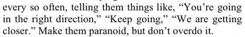
- **No single roster character (rules/setting/general)** — entry/section: Saludi's sign: ""SALUDI'S — FAVORITE OF PILOTS ACROSS THE GALAXY."" Source: *209 - Coruscani Dawn* (SWRPG d20 Revised Core), p.13
  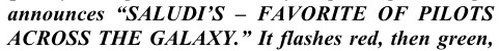
- **No single roster character (rules/setting/general)** — entry/section: Bartle's critical hits: "Note that in this tier, and this tier alone, Bartle is capable of generating a critical hit with his fists. Needless to say, this can be quite dangerous, since his base damage also increases in this tier; I recommend rolling damage for a critical hit behind a screen, since anything +8 can kill a lot of heroes, and that's not the point; the point is to show them (if they haven't already figured it out) that not everything has to be about fighting." Source: *209 - Coruscani Dawn* (SWRPG d20 Revised Core), p.13
  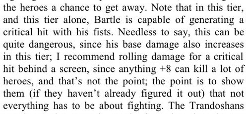

## p.10–13 (scan page 10)

Page contents: Enc 4: Undercity crash; Blaise; Ilok, Bartle, Trandoshans (tier headers from the image) (hand-read)

## p.14 (scan page 14)

Page contents: 990 words, 16 paragraphs | headings/entries: The Bartender; Coruscani Dawn; Page 14

- **No single roster character (rules/setting/general)** — entry/section: Chez O'nder: "arright ta takk ta": ""arright ta takk ta" ("all right to talk to," as it comes out when I try to say it without separating the center of my lips)." Source: *209 - Coruscani Dawn* (SWRPG d20 Revised Core), p.14
  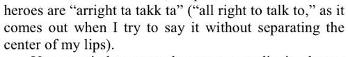
- **No single roster character (rules/setting/general)** — entry/section: Colara tosses a 400-kilo Gamorrean: "The Wookiee bouncer is named Colara, and she—yes, that was a female who tossed a 400-kilo Gamorrean (he was big, even for his species) out the door—is friendly enough, but very businesslike." Source: *209 - Coruscani Dawn* (SWRPG d20 Revised Core), p.14
  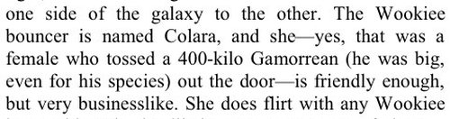
- **No single roster character (rules/setting/general)** — entry/section: Chez O'nder and the lightsaber story: "Chez O'nder likes to tell the story of the time he tried to pick his teeth with a lightsaber, and fused his lips together. In reality, he lost a bar bet and tried to eat the fuel cell from a blaster—a stupid act that nearly cost him his life." Source: *209 - Coruscani Dawn* (SWRPG d20 Revised Core), p.14
  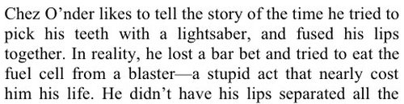

## p.15 (scan page 15)

Page contents: 872 words, 20 paragraphs | headings/entries: The Spacers; The Soldiers; Coruscani Dawn; Page 15

- **No single roster character (rules/setting/general)** — entry/section: Spacer: DC 5: "So, yeah. This is a bar. <hic> I think we're on, like, Corellia. Er, I mean, Coruscant. There are lots of people here. <hic>" Source: *209 - Coruscani Dawn* (SWRPG d20 Revised Core), p.15
  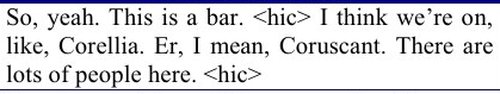
- **No single roster character (rules/setting/general)** — entry/section: Spacer: DC 10: "Rough crowd here. Did you see that big green guy get tossed out by the Wookiee? You know who knows the most about what goes on here? Chez, the bartender." Source: *209 - Coruscani Dawn* (SWRPG d20 Revised Core), p.15
  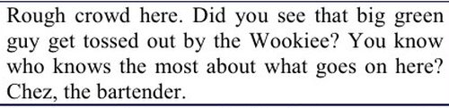
- **No single roster character (rules/setting/general)** — entry/section: Spacer: DC 15: "Saludi actually means "hidden" in some weird language. I can't remember what it is. Maybe one of the variants of Huttese." Source: *209 - Coruscani Dawn* (SWRPG d20 Revised Core), p.15
  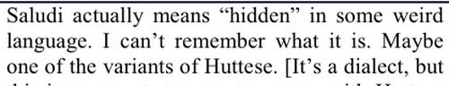
- **No single roster character (rules/setting/general)** — entry/section: Spacer: DC 25: "This place opened 50, maybe 60 years ago. Before that, I hear it was part of a bunker that goes back to one of the wars. Blast if I know which one, though." Source: *209 - Coruscani Dawn* (SWRPG d20 Revised Core), p.15
  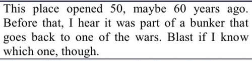
- **No single roster character (rules/setting/general)** — entry/section: Spacer: DC 30: "I hear tell there's a network of tunnels what runs under this place, and that some unpleasant types still use them." Source: *209 - Coruscani Dawn* (SWRPG d20 Revised Core), p.15
  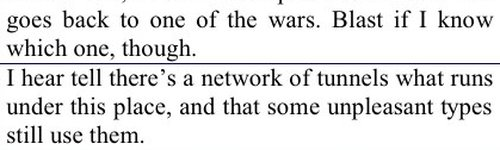
- **No single roster character (rules/setting/general)** — entry/section: Spacer: DC 35: "There's a bunch of religious fanatics from some backwater Mid-Rim world that use this place as an access point to get to their "secret base." Secret. Heh. If I know, how secret can it be? You get to it through the gambling room in the back. Trap door under the table. Thanks for the creds." Source: *209 - Coruscani Dawn* (SWRPG d20 Revised Core), p.15
  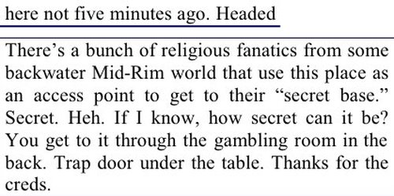

## p.16 (scan page 16)

Page contents: 944 words, 18 paragraphs | headings/entries: Colara; The Back Room; Encounter 6: To the Endgame; Coruscani Dawn; Page 16

- **No single roster character (rules/setting/general)** — entry/section: Believer guard: "It's not too late.": ""It's not too late. You can still come over to the side of the Believers, and all will be forgiven."" Source: *209 - Coruscani Dawn* (SWRPG d20 Revised Core), p.16
  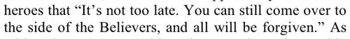

## p.13–16 (scan page 13)

Page contents: Enc 5: Saludi's; Colara; Chez O'nder; spacers; soldiers; back room (hand-read)

## p.17 (scan page 17)

Page contents: 1003 words, 19 paragraphs | headings/entries: Coruscani Dawn; Page 17

- **No single roster character (rules/setting/general)** — entry/section: Bleth Fahr: "This is ours.": ""I had thought no one would be ... foolish enough, to come down here. This is ours." He gestures to the box. "Leave now, and take your lives. Remain, and we will take them."" Source: *209 - Coruscani Dawn* (SWRPG d20 Revised Core), p.17
  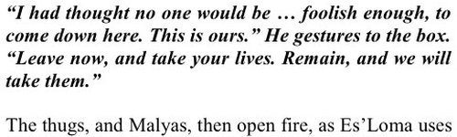
- **No single roster character (rules/setting/general)** — entry/section: Believers: "Death to the Unbelievers!": "they just shout, "Death to the Unbelievers!" and go for their lightsabers." Source: *209 - Coruscani Dawn* (SWRPG d20 Revised Core), p.17
  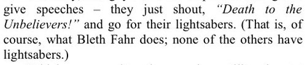
- **No single roster character (rules/setting/general)** — entry/section: Es'Loma's Hatred and Force Grip: "Also be very careful in the lower tier with the Hatred ability; Es'Loma tends to maintain her Hatred for as long as she feels it is safe to do so (so long as no one seems to spot her), but 2d6 a round (even with a save) is a lot for low-level heroes to deal with. If your party is weak, she switches to her hold-out blaster after the first round; weaklings aren't worth using so much energy on, and Hatred is 4 vitality a round.... In low tier, she is not going to use her Force Grip ability at all; it's simply too draining, although she does use it once or twice in the other tiers, targeting what she perceives as the most powerful heroes (yeah — probably Jedi)." Source: *209 - Coruscani Dawn* (SWRPG d20 Revised Core), p.17
  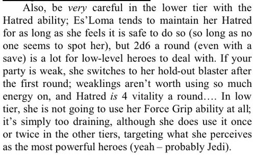
- **No single roster character (rules/setting/general)** — entry/section: The Dark Force Witch is quite formidable: "This fight is not a guaranteed win for the heroes, by any stretch of the imagination. The Dark Force Witch is quite formidable, especially if the heroes can't find her. The dark Jedi isn't bad, either, and while the rest of the goons present are basically cannon fodder (except for Malyas, and then mainly in upper tier), the numbers can be problematic." Source: *209 - Coruscani Dawn* (SWRPG d20 Revised Core), p.17
  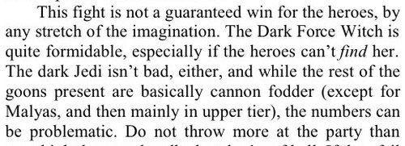

## p.18 (scan page 18)

Page contents: 923 words, 27 paragraphs | headings/entries: Encounter 7: To the Temple; If the heroes were all beaten; Question: What were we hauling?; Coruscani Dawn; Page 18

- **No single roster character (rules/setting/general)** — entry/section: Bleth Fahr (character): "Bleth Fahr talks a big game, but he is only tainted, and is not wholly evil. He believes that others can be brought to the side of the Believers, and as one who was once a Jedi, he knows the leverage that mercy can give." Source: *209 - Coruscani Dawn* (SWRPG d20 Revised Core), p.18
  
- **No single roster character (rules/setting/general)** — entry/section: Lanius Qel-Bertuk: "this is Master Windu.": ""My friends, this is Master Windu."" Source: *209 - Coruscani Dawn* (SWRPG d20 Revised Core), p.18
  
- **Mace Windu** — entry/section: Mace Windu: "You've done well, to get it here.": ""You've done well, to get it here." He looks up at you. "I suppose you want to know..."" Source: *209 - Coruscani Dawn* (SWRPG d20 Revised Core), p.18
  
- **Mace Windu** — entry/section: Meeting Master Windu: "The other individual is seated, legs crossed, arms folded on his chest. He stands as you enter, and you can feel the strength of the Force in him as he runs a hand over his dark, bald head." Source: *209 - Coruscani Dawn* (SWRPG d20 Revised Core), p.18
  

## p.16–18 (scan page 16)

Page contents: Enc 6: the Believers' hideout; Es'Loma, Malyas, Bleth Fahr (hand-read)

## p.19 (scan page 19)

Page contents: 857 words, 25 paragraphs | headings/entries: Question: Were the thieves caught?; Question: Worthy? But, we lost!; Coruscani Dawn; Page 19

- **Mace Windu** — entry/section: Mace Windu: Conkesta (after Celebration II): "You were carrying a piece of Conkesta. From what I've been told, this was a powerful city in your system that was deeply imbued with the dark side of the Force. Every piece of it is critical to our understanding of what was actually accomplished on Conkesta, so don't feel as though you didn't have an important package to deliver. You simply didn't have the Sith artifact. Everything that has been brought to Coruscant is essential for the Jedi to continue to do research to better understand the power of the dark side." Source: *209 - Coruscani Dawn* (SWRPG d20 Revised Core), p.19
  
- **Mace Windu** — entry/section: Mace Windu: "Thankfully, it wasn't the Pulas.": ""Thankfully, it wasn't the Pulas. The artifact arrived safely. The box that was stolen contained a piece of Conkesta. We're hopeful that the individuals who stole it will not be able to learn the secrets that went into the construction of that city. The ability to imbue such a large structure with the dark side of the Force is not something the Order can take lightly. Hopefully, the other pieces of it that made it to us successfully will allow us to counteract such effects in the future."" Source: *209 - Coruscani Dawn* (SWRPG d20 Revised Core), p.19
  
- **Mace Windu** — entry/section: Mace Windu: "the temptation of the dark side": "That is the temptation of the dark side. What you had was powerful with the dark side of the Force, and there is always temptation that goes along with power." Source: *209 - Coruscani Dawn* (SWRPG d20 Revised Core), p.19
  
- **Mace Windu** — entry/section: Mace Windu: "Not yet.": "Not yet. The Undercity is not a place Jedi travel lightly. There are many down there who wish us ill, to say the least. We have individuals searching, though." Source: *209 - Coruscani Dawn* (SWRPG d20 Revised Core), p.19
  
- **Mace Windu** — entry/section: Mace Windu: "more than worthy": "Absolutely not. You proved yourselves more than worthy of the task you were given." Source: *209 - Coruscani Dawn* (SWRPG d20 Revised Core), p.19
  
- **Mace Windu** — entry/section: Mace Windu: "You saved lives": "But you accomplished your core task, and delivered the package you were given. You saved lives in the process." Source: *209 - Coruscani Dawn* (SWRPG d20 Revised Core), p.19
  
- **Mace Windu** — entry/section: Mace Windu: "I trust the judgment of Master Lanius.": "I trust the judgment of Master Lanius. He has seen the potential for greatness in many of the heroes of Cularin. You've done nothing to prove him wrong." Source: *209 - Coruscani Dawn* (SWRPG d20 Revised Core), p.19
  
- **Mace Windu** — entry/section: Mace Windu's practice lightsaber: "he imbued the crystals, after all, and he can feel the presence of his creation. He thanks the heroes for retrieving it, explaining that it was a lightsaber he constructed years ago, for practice purposes. It was loaned to a Padawan, who was killed while on an assignment with her Master (not Mace) in the Outer Rim." Source: *209 - Coruscani Dawn* (SWRPG d20 Revised Core), p.19
  
- **Mace Windu** — entry/section: Mace Windu: "it will not be forgotten": ""My friends, I thank you, and the Jedi Order thanks you. You have done a great service for the galaxy, and it will not be forgotten. May the Force be with you all."" Source: *209 - Coruscani Dawn* (SWRPG d20 Revised Core), p.19
  
- **Mace Windu** — entry/section: Mace Windu: "Thankfully, it wasn't the Pulas.": "Master Windu sighs. "Thankfully, it wasn't the Pulas. The artifact arrived safely. The box that was stolen contained a piece of Conkesta. We're hopeful that the individuals who stole it will not be able to learn the secrets that went into the construction of that city. The ability to imbue such a large structure with the dark side of the Force is not something the Order can take lightly. Hopefully, the other pieces of it that made it to us successfully will allow us to counteract such effects in the future."" Source: *209 - Coruscani Dawn* (SWRPG d20 Revised Core), p.19
  
- **Mace Windu** — entry/section: Mace Windu feels his own lightsaber: "If the heroes killed Bleth Fahr, his lightsaber was brought back. If the heroes attempt to hide it, Mace asks for it back; he imbued the crystals, after all, and he can feel the presence of his creation. He thanks the heroes for retrieving it, explaining that it was a lightsaber he constructed years ago, for practice purposes. It was loaned to a Padawan, who was killed while on an assignment with her Master (not Mace) in the Outer Rim. The lightsaber was taken, and has apparently been floating through the hands of various unpleasant individuals ever since." Source: *209 - Coruscani Dawn* (SWRPG d20 Revised Core), p.19
  

## p.20 (scan page 20)

Page contents: 854 words, 28 paragraphs | headings/entries: Question: What were we hauling?; Question: Were the thieves caught?; Coruscani Dawn; Page 20

- **Mace Windu** — entry/section: Mace Windu: "I never thought I would see this lightsaber again.": ""I never thought I would see this lightsaber again." He ignites it, and the violet blade springs to life. He flips a switch, and the blade disappears. "I no longer have any use for it, though. I have made another. Would one of you like to wield it?"" Source: *209 - Coruscani Dawn* (SWRPG d20 Revised Core), p.20
  
- **Mace Windu**: "It was loaned to a Padawan, who was killed while on an assignment with her Master (not Mace) in the Outer Rim." Source: *209 - Coruscani Dawn* (SWRPG d20 Revised Core), p.20
  

## p.21 (scan page 21)

Page contents: 932 words, 19 paragraphs | headings/entries: After Celebration II; Conclusion; Coruscani Dawn; Page 21

- **Mace Windu** — entry/section: Mace Windu: "is mine, and is special to me.": ""I prefer not to deny heroes the spoils of victory, but this lightsaber," he hefts the lightsaber you retrieved from the dark Jedi, "is mine, and is special to me. "This one, though," he holds up the saber with the case that looks like black glass, "was crafted by a master of the lightsaber here on Coruscant. If you would accept it, I would offer it to you — as thanks for your heroism."" Source: *209 - Coruscani Dawn* (SWRPG d20 Revised Core), p.21
  
- **No single roster character (rules/setting/general)** — entry/section: Lanius Qel-Bertuk: "You did well.": ""You did well." He turns and looks out the window. "You should take some time to enjoy Coruscant. It's a remarkable place."" Source: *209 - Coruscani Dawn* (SWRPG d20 Revised Core), p.21
  
- **Mace Windu** — entry/section: Wielding a lightsaber created by Mace Windu: "Feel free to warn players before having Master Windu berate them, but this is a serious responsibility—wielding a lightsaber created by a Jedi like Master Windu is not something to be done lightly, and it should not be decided randomly." Source: *209 - Coruscani Dawn* (SWRPG d20 Revised Core), p.21
  

## p.18–21 (scan page 18)

Page contents: Enc 7: Jedi Temple with Mace Windu; lightsaber; conclusion (hand-read)

## p.22 (scan page 22)

Page contents: 757 words, 21 paragraphs | headings/entries: The End; Experience Point Summary; Adventure Experience Award:; Loot Summary; Various blasters, knives, and so forth; Coruscani Dawn; Page 22

- **No single roster character (rules/setting/general)** — entry/section: Lightsaber constructed on Coruscant (cert): "This mastercraft lightsaber was constructed by artisans on Coruscant, and features a casing fashioned from what looks like black glass, with the components of the saber visible through the case. The blade of the saber is brilliant blue. The lightsaber provides a +2 equipment bonus to all damage rolls (but not to-hit rolls) made with the weapon." Source: *209 - Coruscani Dawn* (SWRPG d20 Revised Core), p.22
  

## p.23 (scan page 23)

Page contents: 733 words, 8 paragraphs | headings/entries: Coruscani Dawn; Page 23

- **Mace Windu** — entry/section: Lightsaber constructed by Mace Windu (cert): "The hero named above was given a lightsaber constructed by Mace Windu as thanks for delivering the Pulas to Coruscant." Source: *209 - Coruscani Dawn* (SWRPG d20 Revised Core), p.23
  
- **No single roster character (rules/setting/general)** — entry/section: Forbidden Knowledge (cert): "By virtue of extended exposure to the Pulas, an ancient artifact of the Sith, the hero named above has gained one rank in Knowledge (Sith Lore). This is NOT a skill that is typically available to heroes in Living Force, and it does not enable the hero to teach others about Sith Lore." Source: *209 - Coruscani Dawn* (SWRPG d20 Revised Core), p.23
  
- **Mace Windu** — entry/section: Lightsaber constructed by Mace Windu (cert): "Lightsaber constructed by Mace Windu (given only to a Jedi hero): The hero named above was given a lightsaber constructed by Mace Windu as thanks for delivering the Pulas to Coruscant." Source: *209 - Coruscani Dawn* (SWRPG d20 Revised Core), p.23
  
- **No single roster character (rules/setting/general)** — entry/section: Forbidden Knowledge cert: "Forbidden Knowledge (one per hero): By virtue of extended exposure to the Pulas, an ancient artifact of the Sith, the hero named above has gained one rank in Knowledge (Sith Lore). This is NOT a skill that is typically available to heroes in Living Force, and it does not enable the hero to teach others about Sith Lore." Source: *209 - Coruscani Dawn* (SWRPG d20 Revised Core), p.23
  

## p.18–23 (scan page 18)

Page contents: Enc 7: Mace Windu at the Temple; conclusion; XP; loot certs (hand-read)

## p.24 (scan page 24)

Page contents: 551 words, 31 paragraphs | headings/entries: Lower Tier; Middle Tier; Coruscani Dawn Page 24

- **No single roster character (rules/setting/general)** — entry/section: Various Thug 2 (feats): "Feats: Toughness, Simple Weapons, Blaster Pistols, Light Armor." Source: *209 - Coruscani Dawn* (SWRPG d20 Revised Core), p.24
  

### Stat block notes (game mechanics, not feats)

- Es'Loma (three tiers): Es'Loma, Dark Side Tarasin Female Force Adept 3/Dark Force Witch 2 (low/middle tiers; VP 15 / 25): Force Grip +11, Fear +13, Move Object +10, Drain Knowledge +9; Force Feats: Alter, Sense, Hatred. Upper tier: Force Adept 3/Dark Force Witch 6; VP/WP 54/10; Force Grip +19, Fear +16, Move Object +12; Force Feats: Alter, Sense, Hatred, Control, Summon Storm; DSP 15. (Source: *209 - Coruscani Dawn* (SWRPG d20 Revised Core), p.24)
- Bleth Fahr (three tiers): Bleth Fahr, Tainted Male Omwati Jedi Guardian 2 / 5 / 8; VP/WP 18/10, 35/10, 66/10; upper tier Atk +12/+7 melee (3d8, lightsaber), Def 21 (25 with lightsaber ignited); Battlemind +10, Force Push +11, Fear +11; Force Feats: Control, Alter, Sense, Lightsaber Defense, Knight Defense; equipment: stolen lightsaber (created by Mace Windu). (Source: *209 - Coruscani Dawn* (SWRPG d20 Revised Core), p.24)

## p.25 (scan page 25)

Page contents: 653 words, 29 paragraphs | headings/entries: Upper Tier; Coruscani Dawn Page 25

## p.26 (scan page 26)

Page contents: 110 words, 8 paragraphs | headings/entries: Coruscani Dawn Page 26

## p.27 (scan page 27)

Page contents: 0 words, 0 paragraphs | headings/entries: 

## p.28 (scan page 28)

Page contents: 16 words, 3 paragraphs | headings/entries: S$ =Secret Door; Coruscani Dawn Page 28

## p.29 (scan page 29)

Page contents: 103 words, 9 paragraphs | headings/entries: Critical Event Summary Coruscani Dawn; Yes No 2. Did Es'Loma escape?; Yes No 3. Did Bleth Fahr escape?; Yes No; Coruscani Dawn Page 29

## p.22–29 (scan page 22)

Page contents: XP; loot certs; DM Aid 1 stats; maps; critical event summary (hand-read)

## p.24–29 (scan page 24)

Page contents: DM Aid 1 stat blocks (thug headers from the image); chase map; fight map; critical event summary (hand-read)

