# Owner Material 037 — Star Wars D20 Drive folder (Core, Revised Core and Saga Edition): Living Force Campaign/Adventures/Among the Stars/Year 2/210 - Shadows in Green.pdf [Star Wars Roleplaying Game Revised Core (d20, 2002)]

- **Source:** Wizards of the Coast Star Wars Roleplaying Game books, web enhancements, Living Force campaign modules and articles (2000–2010), from the owner's "Star Wars D20" Drive folder (only the three edition subfolders; "General" was not read, as instructed). Secondary source (licensed Legends reference). Scan OCR'd on the box; the scan stays box-only and is **not** published.
- **Method:** every scanned page was OCR'd and machine-screened sentence by sentence for power-relevant statements (fights, kills, defeats, Force feats, rankings, superweapons) that name a character on our roster; each kept sentence is quoted verbatim from the OCR text and has a crop of the printed passage directly under it. Pages with nothing power-relevant are still listed with what is on them.
- **Citation:** "*210 - Shadows in Green* (SWRPG d20 Revised Core), p.X" by printed page ("scan p.X" where no printed number applies). **Weight:** Licensed RPG material: a secondary source. Narrative text sums up Legends lore; game statistics are rules for players, not canon power levels, and rank lowest.

## p.1 (scan page 1)

Page contents: 137 words, 6 paragraphs | headings/entries: Shadows In Green; A One-Round Living Force Live Action Event

## p.2 (scan page 2)

Page contents: 928 words, 28 paragraphs | headings/entries: Hero Earnings; Issuing Force and Dark Side Points; General Notes to the GM; Shadows in Green; Page 2

## p.3 (scan page 3)

Page contents: 843 words, 25 paragraphs | headings/entries: The Story; The Details; The opening announcement for the interactive:; Shadows in Green; Page 3

- **No single roster character (rules/setting/general)** — entry/section: Opening announcement: "Darkness has recently returned to Cularin. It is rumored that something in the Sith fortress on Almas has begun to stir. Everyone — including the Jedi — is quite nervous. An Ithorian herdship — the Bazaar — has come to the system, and a time of celebration begins. A visit by one of these massive ships is rare indeed. The citizens of Cularin have something wonderful to distract them. However, the darkness is always there, waiting ..." Source: *210 - Shadows in Green* (SWRPG d20 Revised Core), p.3
  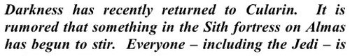
- **No single roster character (rules/setting/general)** — entry/section: Rumor: the Sith: "There are Sith in the Cularin system again. Who knows how many? Yeah, sure there are supposed to be no more than two. But they're Sith, right? They probably lie about that!" Source: *210 - Shadows in Green* (SWRPG d20 Revised Core), p.3
  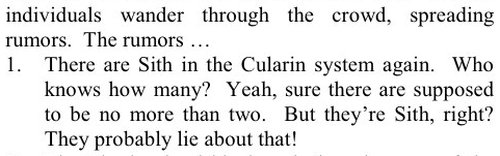
- **No single roster character (rules/setting/general)** — entry/section: Osten survives the ambush: "One thermal detonator and three fragmentation grenades explode around him, but Osten survives and escapes the ambush. He flees the scene, closely followed by the mercs." Source: *210 - Shadows in Green* (SWRPG d20 Revised Core), p.3
  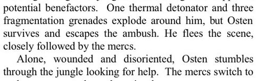
- **No single roster character (rules/setting/general)** — entry/section: Opening announcement: "Darkness has recently returned to Cularin. It is rumored that something in the Sith fortress on Almas has begun to stir. Everyone — including the Jedi — is quite nervous." Source: *210 - Shadows in Green* (SWRPG d20 Revised Core), p.3
  
- **No single roster character (rules/setting/general)** — entry/section: Rumor: an army of Jedi on the herdship: "The Ithorian herdship is only here because of the recent rumors of dark happenings on Almas. There is an army of Jedi hidden on the ship, ready to invade Almas." Source: *210 - Shadows in Green* (SWRPG d20 Revised Core), p.3
  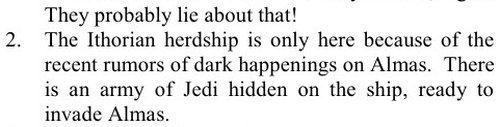

## p.1–3 (scan page 1)

Page contents: Title; boilerplate; FP/DSP; GM notes; the story; opening announcement (hand-read)

## p.4 (scan page 4)

Page contents: 857 words, 23 paragraphs | headings/entries: Shadows in Green; Page 4

- **No single roster character (rules/setting/general)** — entry/section: Hril Bast: the award announcement: ""And here is our victor. The winner of the first ever Bazaar Star Challenge — sponsored by the generous Metatheran Cartel - is <insert winning character's name> of <home planet/system>. Our first place pilot gets ..."" Source: *210 - Shadows in Green* (SWRPG d20 Revised Core), p.4
  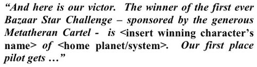
- **No single roster character (rules/setting/general)** — entry/section: Wounded messenger: ""Osten ... ambush ... in danger ..."" Source: *210 - Shadows in Green* (SWRPG d20 Revised Core), p.4
  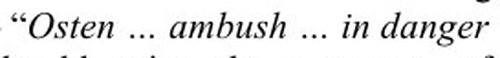
- **No single roster character (rules/setting/general)** — entry/section: Two thermal detonators: "At this point, a tremendous explosion rips through Tathin's medical clinic. Being one of the village's only permanent structures, the exploding building creates a lot of shrapnel. The building's only occupants at the time are the doctor (an old Ithorian) and two medical droids, who are all now dead or dismantled. (Two thermal detonators will do that ...)" Source: *210 - Shadows in Green* (SWRPG d20 Revised Core), p.4
  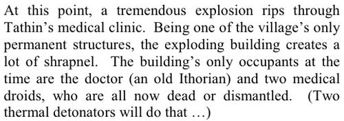

## p.3–4 (scan page 3)

Page contents: Podrace heats; rumors; NPCs; the clinic bombing; the wounded messenger (hand-read)

## p.1–4 (scan page 1)

Page contents: Title; boilerplate; FP/DSP; GM notes; the story; announcement; heats; rumors; NPCs; clinic blast; Osten's warning (hand-read)

## p.5 (scan page 5)

Page contents: 823 words, 23 paragraphs | headings/entries: Scene 1:_The Ithorian Herdship Bazaar; Other tidbits that are floating around:; Scene 2: Vanster Enan's; Shadows in Green; Page 5

- **No single roster character (rules/setting/general)** — entry/section: Xav Verivax: "It's possible he's just nuts.": "He seems mostly sober, but has no recollection of the heroes whatsoever, and is very suspicious of them if they persist in bothering him. He's here to have fun, after all. Of course, Xav is more than willing to strike a conversation with a lovely female hero (Human or Twi'lek). Nothing they do allows him to remember them. As near as they can tell (via See Force), he is not under any kind of Force effect, though he is getting drunk. It's possible he's just nuts." Source: *210 - Shadows in Green* (SWRPG d20 Revised Core), p.5
  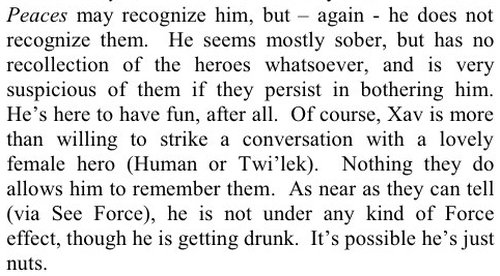
- **No single roster character (rules/setting/general)** — entry/section: Tikko won't challenge Force users: "He does not challenge anyone who appears to use the Force, as they are notoriously untrustworthy." Source: *210 - Shadows in Green* (SWRPG d20 Revised Core), p.5
  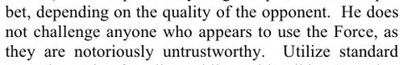

## p.6 (scan page 6)

Page contents: 810 words, 25 paragraphs | headings/entries: Scene 3: Cularin Militia Recruiting Station; Scene 5: Lony Hertz's Force Adept Club; Shadows in Green; Page 6

- **No single roster character (rules/setting/general)** — entry/section: Lony Hertz's Force Adept club: "Lony is the individual who has taken up the daunting task of helping young Force Adepts find suitable mentors. She finds promising individuals, and does her best to pair them up with adventuring Force Adepts so that they can learn what it means to wield the Force without being a Jedi." Source: *210 - Shadows in Green* (SWRPG d20 Revised Core), p.6
  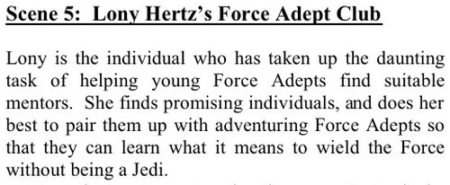

## p.7 (scan page 7)

Page contents: 19 words, 2 paragraphs | headings/entries: Shadows in Green Page 7

## p.5–7 (scan page 5)

Page contents: Scenes 1-7: Bazaar; Vanster Enan's (Tikko); militia station; Jedi Enclave; Lony Hertz; droids; Nenmo (p7 checked in the image) (hand-read)

## p.8 (scan page 8)

Page contents: 848 words, 28 paragraphs | headings/entries: Mini-Mission; The Conclusion; Shadows in Green; Page 8

- **No single roster character (rules/setting/general)** — entry/section: Dantin Vellos's mercs: "The mercs will fight until they have lost half of their number or their leader — Dantin Vellos — goes down. At this point, they surrender." Source: *210 - Shadows in Green* (SWRPG d20 Revised Core), p.8
  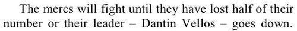
- **No single roster character (rules/setting/general)** — entry/section: Osten survived by the Maker's own luck: "Now to follow Osten and his ambushers. Osten took off as best as possible after the ambush. By the Maker's own luck, he survived, but barely. He is in bad shape and trying to get away from the killers." Source: *210 - Shadows in Green* (SWRPG d20 Revised Core), p.8
  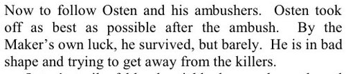
- **No single roster character (rules/setting/general)** — entry/section: The mercs toy with Osten: "Osten has finally been surrounded by the hired mercs. He is standing in a shallow stream, fighting them off as best as possible. The mercs are toying with him, taunting as they close in." Source: *210 - Shadows in Green* (SWRPG d20 Revised Core), p.8
  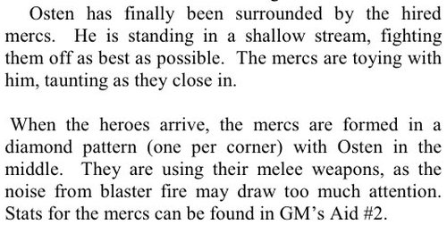

## p.9 (scan page 9)

Page contents: 682 words, 24 paragraphs | headings/entries: Loot Summary; Shadows in Green; Page 9

- **No single roster character (rules/setting/general)** — entry/section: Osten Dal'Nay: "Friends of Cularin.": ""Friends of Cularin. I stand here today addressing you because of the actions of some brave individuals. These individuals — heroes — let's call them what they are -, represent the best of this system. Heroes who put the safety of others before their own. For that, I can never thank them enough. "And because of beings like this, I know the militia for our wonderful Cularin will grow and prosper. Thanks to you, we truly have a chance ..."" Source: *210 - Shadows in Green* (SWRPG d20 Revised Core), p.9
  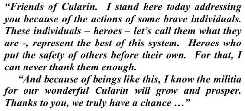
- **No single roster character (rules/setting/general)** — entry/section: Osten Dal'Nay: "a blossoming navy": ""Today is indeed a wonderful day for our militia, and our system. Because of the concern of an anonymous citizen, the Cularin Miltia has a blossoming navy."" Source: *210 - Shadows in Green* (SWRPG d20 Revised Core), p.9
  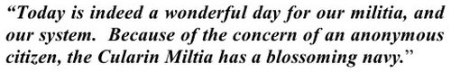
- **No single roster character (rules/setting/general)** — entry/section: Osten Dal'Nay: "the gracious gift": ""If we can see outside the Bazaar, please. Gentlebeings, what you see before you is the gracious gift of one of our fine citizens."" Source: *210 - Shadows in Green* (SWRPG d20 Revised Core), p.9
  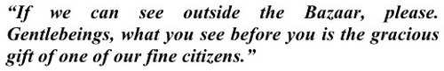
- **No single roster character (rules/setting/general)** — entry/section: Osten Dal'Nay: "I have a lot of work ahead of me.": ""If you will excuse me, I have a lot of work ahead of me. Thank you."" Source: *210 - Shadows in Green* (SWRPG d20 Revised Core), p.9
  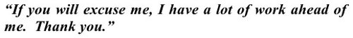
- **No single roster character (rules/setting/general)** — entry/section: Silorna Force Crystal (cert): "This small crystal is of the purest green color and is rough in shape. It is a rare find because it helps a being feel the flow of life around him or her. The Silorna Crystal grants a +2 Force bonus to a See Force skill check. However, because this crystal is strong in the Force, the bearer is also easier to detect." Source: *210 - Shadows in Green* (SWRPG d20 Revised Core), p.9
  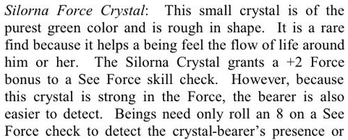
- **No single roster character (rules/setting/general)** — entry/section: The anonymous gift: a blossoming navy: "Outside in a slow approach towards Cularin, 6 brand new Z-95 Headhunters and a single, unique fighter, fly in a "V" formation. The lead craft is a Naboo NX Police Cruiser. It resembles the N-1 except a third engine is located on the tail and is is not as fast. All seven fighters have an unmarred green and black paint scheme. Just behind them is a CEC space cruiser (the same ship used by Qui-Gon and Obi-Wan at the beginning of The Phantom Menace) — wearing the same colors." Source: *210 - Shadows in Green* (SWRPG d20 Revised Core), p.9
  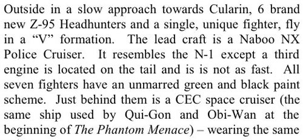
- **No single roster character (rules/setting/general)** — entry/section: Silorna Force Crystal: "Silorna Force Crystal: This small crystal is of the purest green color and is rough in shape. It is a rare find because it helps a being feel the flow of life around him or her. The Silorna Crystal grants a +2 Force bonus to a See Force skill check. However, because this crystal is strong in the Force, the bearer is also easier to detect. Beings need only roll an 8 on a See Force check to detect the crystal-bearer's presence or that they are indeed a Force user." Source: *210 - Shadows in Green* (SWRPG d20 Revised Core), p.9
  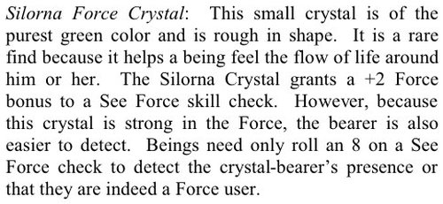

## p.8–9 (scan page 8)

Page contents: Mini-mission: the ambush site; the botanists; the mercenaries; conclusion with Osten's speech (hand-read)

## p.10 (scan page 10)

Page contents: 224 words, 8 paragraphs | headings/entries: Shadows in Green; Page 10

## p.9–10 (scan page 9)

Page contents: XP; loot certs; the Jin-Kam podracer (hand-read)

## p.8–10 (scan page 8)

Page contents: Mini-mission: ambush site; Osten's trail; the mercs; conclusion; Osten's speech; XP; loot; podracer contract (hand-read)

## p.11 (scan page 11)

Page contents: 164 words, 6 paragraphs | headings/entries: Appendix 1: Thurm Loogg's Address; Shadows in Green Page 11

- **No single roster character (rules/setting/general)** — entry/section: Thurm Loogg's address: "Friends, what a wonderful time this is! A truly momentous event — once in a lifetime, in fact — has favored our magnificent system. A famed Ithorian herdship has graced our delightful system with her presence." Source: *210 - Shadows in Green* (SWRPG d20 Revised Core), p.11
  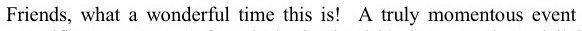
- **No single roster character (rules/setting/general)** — entry/section: Thurm Loogg: the heroes of Cularin: "The heroes of Cularin have struggled mightily recently, against great odds. Their bravery and persistence are without parallel, and withou them Cularin would be a much different place." Source: *210 - Shadows in Green* (SWRPG d20 Revised Core), p.11
  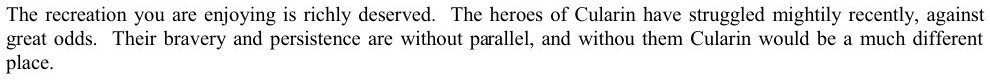
- **No single roster character (rules/setting/general)** — entry/section: Thurm Loogg: "the Cartel LOVES you!": "Enjoy yourselves, my fellow citizens! Enjoy what the Bazaar has to offer! Remember, the Cartel LOVES you!" Source: *210 - Shadows in Green* (SWRPG d20 Revised Core), p.11
  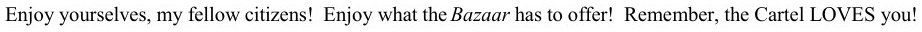
- **No single roster character (rules/setting/general)** — entry/section: Thurm Loogg on the heroes of Cularin: "The recreation you are enjoying is richly deserved. The heroes of Cularin have struggled mightily recently, against great odds. Their bravery and persistence are without parallel, and withou them Cularin would be a much different place." Source: *210 - Shadows in Green* (SWRPG d20 Revised Core), p.11
  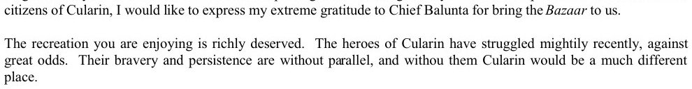

## p.12 (scan page 12)

Page contents: 380 words, 3 paragraphs | headings/entries: Appendix 2: Living Force Sabacc Rules; Shadows in Green Page 12

## p.13 (scan page 13)

Page contents: 385 words, 14 paragraphs | headings/entries: Appendix 3: Metatheran Cartel's Bazaar Star Challenge; Shadows in Green Page 13

## p.14 (scan page 14)

Page contents: 403 words, 25 paragraphs | headings/entries: Appendix 4: Podracing Rules; Zs; Shadows in Green; Page 14

## p.15 (scan page 15)

Page contents: 68 words, 33 paragraphs | headings/entries: Appendix 5: Pod Racing Heats; HEAT ONE; Player Name; Character Name; Class(es); Level(s); DI Nn] &] Go] dole; HEAT TWO; Player Name; Character Name; Class(es); Level(s); DI Nn] &] Go] dole; HEAT THREE; Player Name; Character Name; Class(es); Level(s); Din] Blwlrmo]e; HEAT FOUR; Player Name; Character Name; Class(es); Level(s); Din] Blwlrmo]e; HEAT FIVE; Player Name; Character Name; Class(es); Level(s); WM] &] Go] do]; Shadows in Green; Page 15

## p.16 (scan page 16)

Page contents: 65 words, 33 paragraphs | headings/entries: Appendix 5: Pod Racing Heats; HEAT SIX; Player Name; Character Name; Class(es); Level(s); DI Nn] &] Go] dole; HEAT SEVEN; Player Name; Character Name; Class(es); Level(s); Din] Blwlrmo]e; HEAT EIGHT; Player Name; Character Name; Class(es); Level(s); Din] Blwlrmo]e; HEAT NINE; Player Name; Character Name; Class(es); Level(s); Din] Blwlrmo]e; HEAT TEN; Player Name; Character Name; Class(es); Level(s); WM] &] Go] do]; Shadows in Green; Page 16

## p.17 (scan page 17)

Page contents: 194 words, 47 paragraphs | headings/entries: Podracing Stat Sheet (one per player); Appendix 6; INITIATIVE; PILOT DATA; Racer Name: Initiative:; ACCELERATE; Adds to Accelerate Maneuver; Repair Skill: Vitality Points:; Wound Points:; Pot Shill + Podiausr Accelevation; DECELERATE; MANEUVERS; Attack Target Against Pilot Against Vehicle; Accelerate; Bump Target Opposed Pilot Checks; Decelerate; REGAIN CONTROL; Ram Target Pilot Check against Target's Defense; Pilot Shill + Podracer Traction:; REPAIR; Regain Control Regain Control Check; Repair Podracer Repair Check; Pilot Repair + Podracer Durabiiny; OUT OF CONTROL; OQOQ000000 OQOOQO00000000000; OO000000000000; OO0O00CO0000000000; Speed macitier ); DAMAGE TRACK; QO00000; Damaged (—5 modifier); Crippled (-10 modifier); HIGH DANGER CRITICAL; ENGINE TEMPERATURE; Modifier e 2 4 8; Damege age Daag 208 1D6 2D8; FINISH LINE; Page 17; Shadows in Green

## p.18 (scan page 18)

Page contents: 271 words, 20 paragraphs | headings/entries: Appendix 7: Nenmo's Curios Store Stock; Darkvision Goggles; Silorna Force Crystal; Katarn Tooth Necklace Cerean Puzzle Cube; Wroshyr Tree Sappling; Shadows in Green; Page 18

- **No single roster character (rules/setting/general)** — entry/section: Jedi Master Holo Pic (Nenmo's stock): "Jedi Master Holo Pic (A bootleg holo of Yoda and Mace Windu with a spot for another being to be inserted — NOT to be sold to Jedi!)" Source: *210 - Shadows in Green* (SWRPG d20 Revised Core), p.18
  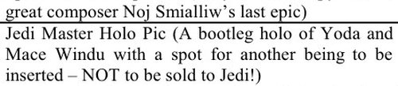

## p.11–18 (scan page 11)

Page contents: Appendices: Thurm Loogg's address; sabacc rules; course; podracing rules; heat sheets and stat sheet (blank forms); Nenmo's stock (hand-read)

## p.19 (scan page 19)

Page contents: 505 words, 27 paragraphs | headings/entries: GM Aid #1: Pod racers; Pod racer 1:; Pod racer 2:; Pod racer 3:; Pod racer 4:; Pod racer 5:; Pod racer 6:; Shadows in Green Page 19

## p.20 (scan page 20)

Page contents: 666 words, 24 paragraphs | headings/entries: GM Aid #2: Mercenary NPCs; Shadows in Green Page 20

## p.21 (scan page 21)

Page contents: 613 words, 23 paragraphs | headings/entries: Shadows in Green Page 21

## p.22 (scan page 22)

Page contents: 130 words, 2 paragraphs | headings/entries: Shadows in Green Page 22

## p.23 (scan page 23)

Page contents: 587 words, 16 paragraphs | headings/entries: GM Aid #3 — Non-Combat NPCs; Osten Dal'Nay; Shadows in Green Page 23

- **No single roster character (rules/setting/general)** — entry/section: Belebeau Enan: "He's almost impossible to anger and responds to most situations with sly humor and backwoods wisdom." Source: *210 - Shadows in Green* (SWRPG d20 Revised Core), p.23
  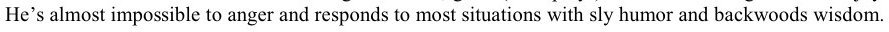

## p.24 (scan page 24)

Page contents: 765 words, 11 paragraphs | headings/entries: GM Aid #3 — Non-Combat NPCs; Shadows in Green Page 24

- **No single roster character (rules/setting/general)** — entry/section: Seenlu Kir: "Seenlu, a Human female, trained at the Jedi temple on Coruscant, and then trained as a Consular. Three standard years after becoming a Jedi knight, she chose to join the academy on Almas. She has trained students at all levels of Force training." Source: *210 - Shadows in Green* (SWRPG d20 Revised Core), p.24
  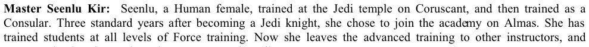
- **No single roster character (rules/setting/general)** — entry/section: Seenlu Kir: her burns: "Gloves conceal burns on her hands that she refuses to have treated in bacta; they do not pain her, but they remind her of a failure in her past that she does not talk about." Source: *210 - Shadows in Green* (SWRPG d20 Revised Core), p.24
  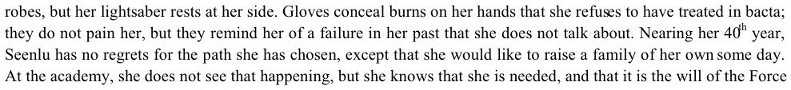
- **No single roster character (rules/setting/general)** — entry/section: Thurm Loogg: "the Cartel LOOOOOOOOVES you!": ""Remember," he always says, "the Cartel LOOOOOOOOVES you!"" Source: *210 - Shadows in Green* (SWRPG d20 Revised Core), p.24
  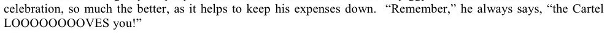
- **No single roster character (rules/setting/general)** — entry/section: Xav Verivax: "This attitude can be annoying, but no one has successfully challenged Xav and lived, so people put up with him." Source: *210 - Shadows in Green* (SWRPG d20 Revised Core), p.24
  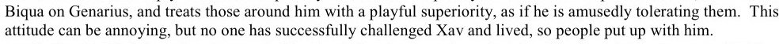
- **No single roster character (rules/setting/general)** — entry/section: Xav Verivax: "debonair surety": "Tall, with fair hair and well-tanned skin, Xav is handsome and carries himself with a debonair surety. Nothing ever seems to surprise or upset him." Source: *210 - Shadows in Green* (SWRPG d20 Revised Core), p.24
  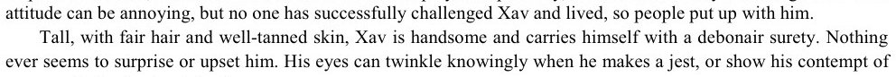
- **No single roster character (rules/setting/general)** — entry/section: Master Seenlu Kir: "Seenlu, a Human female, trained at the Jedi temple on Coruscant, and then trained as a Consular. Three standard years after becoming a Jedi knight, she chose to join the academy on Almas. She has trained students at all levels of Force training. Now she leaves the advanced training to other instructors, and oversees the dormitory where the youngest students live." Source: *210 - Shadows in Green* (SWRPG d20 Revised Core), p.24
  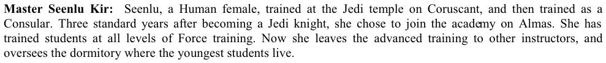
- **No single roster character (rules/setting/general)** — entry/section: Seenlu Kir's burns: "Gloves conceal burns on her hands that she refuses to have treated in bacta; they do not pain her, but they remind her of a failure in her past that she does not talk about. Nearing her 40th year, Seenlu has no regrets for the path she has chosen, except that she would like to raise a family of her own some day. At the academy, she does not see that happening, but she knows that she is needed, and that it is the will of the Force that she be where she is, so she stays." Source: *210 - Shadows in Green* (SWRPG d20 Revised Core), p.24
  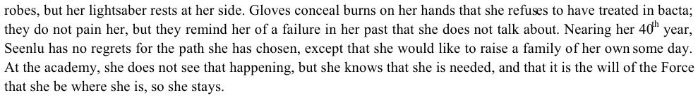
- **No single roster character (rules/setting/general)** — entry/section: Xav Verivax: no one has challenged him and lived: "He is seen frequently on Cularin in the platform cities, or in Tolea Biqua on Genarius, and treats those around him with a playful superiority, as if he is amusedly tolerating them. This attitude can be annoying, but no one has successfully challenged Xav and lived, so people put up with him." Source: *210 - Shadows in Green* (SWRPG d20 Revised Core), p.24
  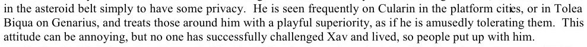
- **No single roster character (rules/setting/general)** — entry/section: Xav Verivax: nothing surprises him: "Tall, with fair hair and well-tanned skin, Xav is handsome and carries himself with a debonair surety. Nothing ever seems to surprise or upset him. His eyes can twinkle knowingly when he makes a jest, or show his contempt of someone trying too hard to please." Source: *210 - Shadows in Green* (SWRPG d20 Revised Core), p.24
  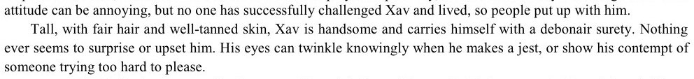

## p.25 (scan page 25)

Page contents: 70 words, 6 paragraphs | headings/entries: Critical Event Summary; Shadows in Green Page 25

## p.19–25 (scan page 19)

Page contents: GM Aids: podracers; mercenary stats (3 tiers); non-combat NPCs; critical event summary (hand-read)

