# Owner Material 037 — Star Wars D20 Drive folder (Core, Revised Core and Saga Edition): Living Force Campaign/Adventures/Among the Stars/Year 2/211 - Below The Belt - Philanthropy.pdf [Star Wars Roleplaying Game Revised Core (d20, 2002)]

- **Source:** Wizards of the Coast Star Wars Roleplaying Game books, web enhancements, Living Force campaign modules and articles (2000–2010), from the owner's "Star Wars D20" Drive folder (only the three edition subfolders; "General" was not read, as instructed). Secondary source (licensed Legends reference). Scan OCR'd on the box; the scan stays box-only and is **not** published.
- **Method:** every scanned page was OCR'd and machine-screened sentence by sentence for power-relevant statements (fights, kills, defeats, Force feats, rankings, superweapons) that name a character on our roster; each kept sentence is quoted verbatim from the OCR text and has a crop of the printed passage directly under it. Pages with nothing power-relevant are still listed with what is on them.
- **Citation:** "*211 - Below The Belt - Philanthropy* (SWRPG d20 Revised Core), p.X" by printed page ("scan p.X" where no printed number applies). **Weight:** Licensed RPG material: a secondary source. Narrative text sums up Legends lore; game statistics are rules for players, not canon power levels, and rank lowest.

## p.1 (scan page 1)

Page contents: 114 words, 5 paragraphs | headings/entries: Philanthropy

## p.2 (scan page 2)

Page contents: 844 words, 23 paragraphs | headings/entries: Hero Earnings; Issuing Force and Dark Side Points; Philanthropy; Page 2

## p.3 (scan page 3)

Page contents: 905 words, 19 paragraphs | headings/entries: General Notes to the GM; GM Overview; Philanthropy; Page 3

- **No single roster character (rules/setting/general)** — entry/section: The sibilaari: combat not advisable: "A survivor of this place, an alien creature called a Sibilaari, has awoken from stasis and is exploring what is left of its home. When it finds the heroes in a room surround by long dead members of its race, its reactions will be determined by how respectful they are being to the corpses and how they react to it, should it be seen. Quite capable of defending itself, combat with the Sibilaari is not advisable." Source: *211 - Below The Belt - Philanthropy* (SWRPG d20 Revised Core), p.3
  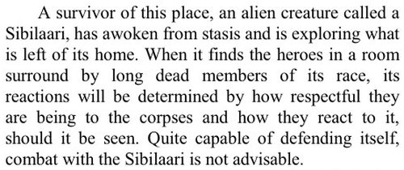

## p.4 (scan page 4)

Page contents: 910 words, 22 paragraphs | headings/entries: Encounter 1:; Encounter 2:; Encounter 3:; Philanthropy; Page 4

- **No single roster character (rules/setting/general)** — entry/section: A swansong from the dying node: "The sound of the ship's engines is more than the complex can take and as they fly away from the asteroid, it implodes with a flash of light and pulse of pure energy. As the pulse passed over the ship, it chimes a single, sorrowful note for all the heroes to hear; a swansong from the dying node." Source: *211 - Below The Belt - Philanthropy* (SWRPG d20 Revised Core), p.4
  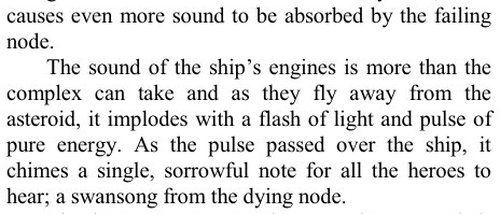

## p.5 (scan page 5)

Page contents: 852 words, 21 paragraphs | headings/entries: Encounter 4:; Encounter 5:; Encounter 6:; Encounter 7:; Encounter 8:; Philanthropy; Page 5

## p.6 (scan page 6)

Page contents: 786 words, 24 paragraphs | headings/entries: Conclusion:; Opening Crawl:; Encounter 1: Out of the Starting Gate; Philanthropy; Page 6

- **No single roster character (rules/setting/general)** — entry/section: Opening crawl: "Past the world of Cularin, closer to the edge of the system, a ring of asteroids drift in the quiet void of space. For years, these silent stones have been a bane and a blessing; a bane for those wishing to travel the system, and a blessing for those who control them - the Smuggler's Confederation." Source: *211 - Below The Belt - Philanthropy* (SWRPG d20 Revised Core), p.6
  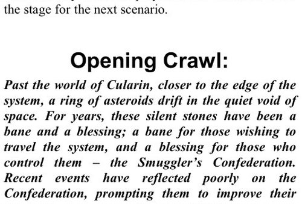
- **No single roster character (rules/setting/general)** — entry/section: Nirama: "a proposition": ""Good of you to come. I have a proposition for you all -- one I think you may find very interesting."" Source: *211 - Below The Belt - Philanthropy* (SWRPG d20 Revised Core), p.6
  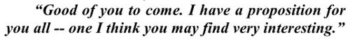
- **No single roster character (rules/setting/general)** — entry/section: Judges: the Sibilaari is very dangerous: "Important Note to Judges: The Sibilaari is a very dangerous creature and combat with it is not advised. If the heroes insist of fighting it after it is clearly trying to flee, let them. It is possible to slay the Sibilaari, but doing so will likely earn the killer(s) a Dark Side Point for the murder. Adjudicate carefully." Source: *211 - Below The Belt - Philanthropy* (SWRPG d20 Revised Core), p.6
  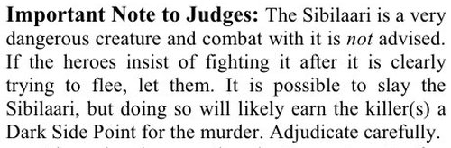

## p.1–6 (scan page 1)

Page contents: Title; scoring; earnings; FP/DSP; GM notes; overview; encounter summaries; conclusion; judges' notes; opening crawl (hand-read)

## p.7 (scan page 7)

Page contents: 882 words, 19 paragraphs | headings/entries: Philanthropy; Page 7

- **No single roster character (rules/setting/general)** — entry/section: Nirama: his fee: "To those who do not owe him anything, he offers either 1,500 (this is as high as he is willing to go) credits each or a future favor "as valuable as whatever you bring back"." Source: *211 - Below The Belt - Philanthropy* (SWRPG d20 Revised Core), p.7
  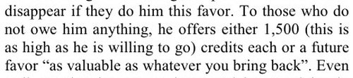
- **No single roster character (rules/setting/general)** — entry/section: Teeloo: "I can't die yet": ""No worrying needed here!" The voice of your Rodian pilot Teeloo is practically bubbling with enthusiasm. "I can't die yet; Lord Nirama hasn't released me from my contract!"" Source: *211 - Below The Belt - Philanthropy* (SWRPG d20 Revised Core), p.7
  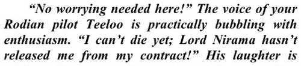
- **No single roster character (rules/setting/general)** — entry/section: Teeloo: his cooking: "Teeloo offers to cook the heroes a fantastic victory feast—those who know him undoubtedly remember that Teeloo is an abysmally bad cook." Source: *211 - Below The Belt - Philanthropy* (SWRPG d20 Revised Core), p.7
  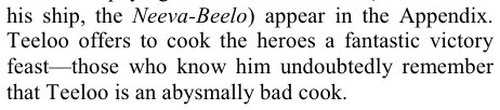
- **No single roster character (rules/setting/general)** — entry/section: Teeloo can't die yet: ""No worrying needed here!" The voice of your Rodian pilot Teeloo is practically bubbling with enthusiasm. "I can't die yet; Lord Nirama hasn't released me from my contract!" His laughter is oddly catching amid the occasional bursts of final flame." Source: *211 - Below The Belt - Philanthropy* (SWRPG d20 Revised Core), p.7
  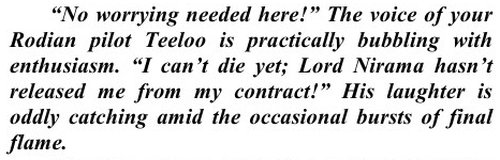

## p.8 (scan page 8)

Page contents: 883 words, 27 paragraphs | headings/entries: Assuming the signal is brought in clearly:; Philanthropy; Page 8

- **No single roster character (rules/setting/general)** — entry/section: GM: "You have eight minutes.": ""You have eight minutes. What do you do?"" Source: *211 - Below The Belt - Philanthropy* (SWRPG d20 Revised Core), p.8
  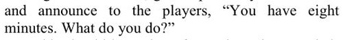
- **No single roster character (rules/setting/general)** — entry/section: Teeloo and the Force: "It takes serious use of Diplomacy or bribes (1000 credits or more) to change his mind. The Force is seen as very intrusive and unwelcome by some people, Teeloo included." Source: *211 - Below The Belt - Philanthropy* (SWRPG d20 Revised Core), p.8
  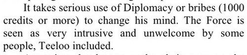

## p.9 (scan page 9)

Page contents: 841 words, 27 paragraphs | headings/entries: Encounter 3: The Black Eye Opens; Philanthropy; Page 9

- **No single roster character (rules/setting/general)** — entry/section: Herren: the invisible ship: ""<cough> I was checking the output on the... <cough> ...engines when I saw... <cough>... a shape on the aft sensors. It was... <cough>... there and then gone again. I ain't never seen nothin' like it... <wheeze> ...in my life. It was like it was invisible or something!"" Source: *211 - Below The Belt - Philanthropy* (SWRPG d20 Revised Core), p.9
  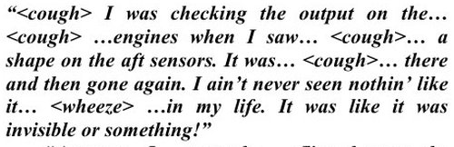
- **No single roster character (rules/setting/general)** — entry/section: Herren: "like a Naboo night pearl": ""Anyways, I... <cough> ...flipped open the blast plating on the main housing to... <cough, hack> ...get a better look. All I saw was space fer a second, then I... <wheeze> ...saw this ship just appear behind us! I guess it was a ship... It was all this silvery black, like a Naboo night pearl."" Source: *211 - Below The Belt - Philanthropy* (SWRPG d20 Revised Core), p.9
  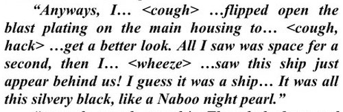
- **No single roster character (rules/setting/general)** — entry/section: Herren: ion cannons: ""<cough, cough, cough!> The whole front end of the thing was covered in gun ports. Big, wide flat ports! I tried to reach my comm, but... <cough> .. they all went white. Ion cannons, point blank."" Source: *211 - Below The Belt - Philanthropy* (SWRPG d20 Revised Core), p.9
  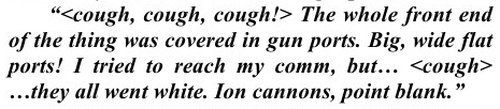
- **No single roster character (rules/setting/general)** — entry/section: Herren: "I owe you": ""I am... <cough> ...lucky to be alive. I owe you. <cough> I owe you..."" Source: *211 - Below The Belt - Philanthropy* (SWRPG d20 Revised Core), p.9
  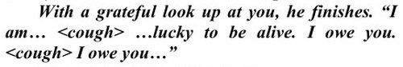
- **No single roster character (rules/setting/general)** — entry/section: Herren on the cloaked ship: ""<cough> I was checking the output on the... <cough> ...engines when I saw... <cough>... a shape on the aft sensors. It was... <cough>... there and then gone again. I ain't never seen nothin' like it... <wheeze> ...in my life. It was like it was invisible or something!"
"Anyways, I... <cough> ...flipped open the blast plating on the main housing to... <cough, hack> ...get a better look. All I saw was space fer a second, then I... <wheeze> ...saw this ship just appear behind us! I guess it was a ship... It was all this silvery black, like a Naboo night pearl."
"<cough, cough, cough!> The whole front end of the thing was covered in gun ports. Big, wide flat ports! I tried to reach my comm, but... <cough> .. they all went white. Ion cannons, point blank."" Source: *211 - Below The Belt - Philanthropy* (SWRPG d20 Revised Core), p.9
  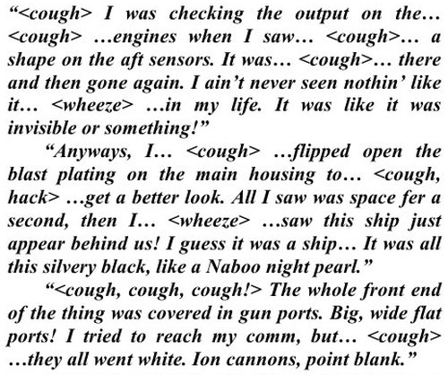

## p.6–9 (scan page 6)

Page contents: E1 the Rock Rush and Nirama's offer (Teeloo); E2 rescuing the Daring's crew; Herren's account of the cloaked ion-cannon ship (hand-read)

## p.10 (scan page 10)

Page contents: 861 words, 26 paragraphs | headings/entries: The proximity sensor on your navigational; Philanthropy; Page 10

- **No single roster character (rules/setting/general)** — entry/section: Claim jumpers on the comm: ""Get off my asteroid!" crackles over your communicator. "I do not see your name on it, Human," answers the calm voice of a Cerean pilot. "Then let me mark it for you, coney!"" Source: *211 - Below The Belt - Philanthropy* (SWRPG d20 Revised Core), p.10
  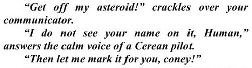
- **No single roster character (rules/setting/general)** — entry/section: Claim jumping in the Rock Rush: ""Get off my asteroid!" crackles over your communicator.
"I do not see your name on it, Human," answers the calm voice of a Cerean pilot.
"Then let me mark it for you, coney!"
More laser fire glimmers in the night as both comms go silent..." Source: *211 - Below The Belt - Philanthropy* (SWRPG d20 Revised Core), p.10
  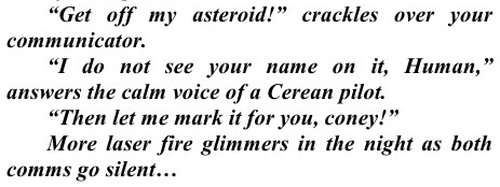

## p.11 (scan page 11)

Page contents: 809 words, 26 paragraphs | headings/entries: Encounter 4: Silence of the Grave; Philanthropy; Page 11

## p.12 (scan page 12)

Page contents: 832 words, 28 paragraphs | headings/entries: Encounter 5: The Chamber of Sleep; Philanthropy; Page 12

## p.13 (scan page 13)

Page contents: 859 words, 23 paragraphs | headings/entries: If the heroes clean the three crystals:; Philanthropy; Page 13

- **No single roster character (rules/setting/general)** — entry/section: Force echo of the dead: "What happened here was sudden and violent. A darkness lingers here, though death has long since passed. Shadows are all that remain now." Source: *211 - Below The Belt - Philanthropy* (SWRPG d20 Revised Core), p.13
  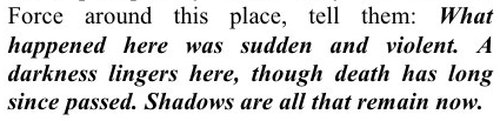
- **No single roster character (rules/setting/general)** — entry/section: See Force on the dead Sibilaari: "A lingering echo in the Force around these creatures could indicate that they communicated through telepathy. The resonation of their thoughts still clings to them, even in death. If this prompts any heroes to try and sense the Force around this place, tell them: What happened here was sudden and violent. A darkness lingers here, though death has long since passed. Shadows are all that remain now." Source: *211 - Below The Belt - Philanthropy* (SWRPG d20 Revised Core), p.13
  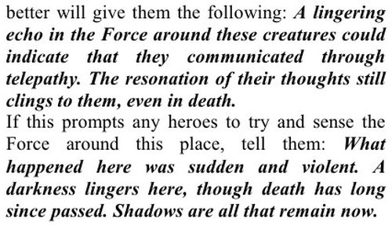
- **No single roster character (rules/setting/general)** — entry/section: The sibilaari watches, detectable only by the Force: "It first finds the heroes when they enter this chamber. Safely phased into the walls, it can watch them without fear of being detected...by anything but the Force. If any hero tries to See Force specifically to detect life while here, the sibilaari can be found. It instantly senses the use of the Force and goes back into the solid stone of the asteroid to hide." Source: *211 - Below The Belt - Philanthropy* (SWRPG d20 Revised Core), p.13
  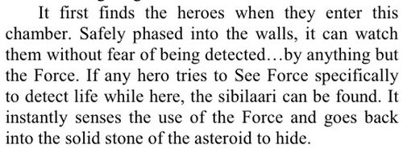

## p.14 (scan page 14)

Page contents: 855 words, 25 paragraphs | headings/entries: Encounter 6: Deafening Echoes; Philanthropy; Page 14

- **No single roster character (rules/setting/general)** — entry/section: Sibilaari: telepathic contact: "the sibilaari lingers long enough to touch each of their minds and send the concepts of "curiosity" and "long sleep" and "trembling stone"." Source: *211 - Below The Belt - Philanthropy* (SWRPG d20 Revised Core), p.14
  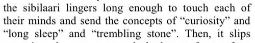
- **No single roster character (rules/setting/general)** — entry/section: The sibilaari may annihilate the group: "Of course, if the heroes attack the bizarre blackskinned alien, it defends itself. Violence it understands, since it was originally one of the three protectors of this place (and the only one to survive the centuries in deep sleep). Before it actually kills a hero, it tries to retreat and hide. If the heroes pursue it after that, it attacks without mercy (and may well annihilate the entire group, as it hunts down any hero that actively attacked it)." Source: *211 - Below The Belt - Philanthropy* (SWRPG d20 Revised Core), p.14
  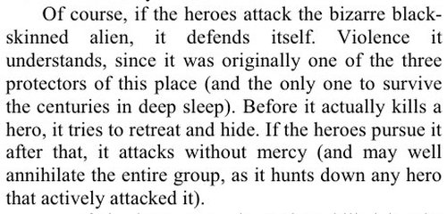
- **No single roster character (rules/setting/general)** — entry/section: The core's shards: 20d6 a round: "If a hero insists on trying to force his or her way to the core, assume it takes one full move action to reach the core with a total combined damage of 20d6 points each round. Even if the hero survives getting to the core, he or she takes the same damage getting back out." Source: *211 - Below The Belt - Philanthropy* (SWRPG d20 Revised Core), p.14
  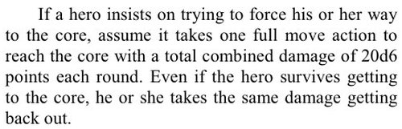

## p.9–14 (scan page 9)

Page contents: E3 the Black Eye; E4 silence; E5 the chamber of sleep and the sibilaari (hand-read)

## p.15 (scan page 15)

Page contents: 775 words, 29 paragraphs | headings/entries: Encounter 7: A Shot in the Dark; Blasters!; Combat Information:; First, a look at the opposition:; Tier 1; Skills: Intimidate +2, Spot +1, Hide +3; Feats: Toughness, Weapon (simple), Weapon; Dorel-Kan: Human Scoundrel 6; Init +6; Defense; Philanthropy; Page 15

## p.9–15 (scan page 9)

Page contents: E3 the Black Eye; E4 Silence of the Grave; E5 Chamber of Sleep and the sibilaari; E6 the songsteel core (hand-read)

## p.16 (scan page 16)

Page contents: 859 words, 31 paragraphs | headings/entries: Skills: Profession (Pirate Leader) +5, Intimidate; Tier 2; Skills: Intimidate +4, Spot +3, Hide +5; Feats: Toughness, Weapon (simple), Weapon; Skills: Profession (Pirate Leader) +5, Intimidate; Philanthropy; Page 16

- **No single roster character (rules/setting/general)** — entry/section: Dorel-Kan: "Dorel-Kan is fast becoming a high-ranking member of the Cularin Pirates. His drive to succeed, ambitious desires, and his willingness to do whatever it takes to further the pirates' goals have made him an invaluable leader in just a few short years. He regrets only one thing: that his brother Vel (from Oblivion's Kiss, a prior scenario) isn't here to stand beside him as his first mate." Source: *211 - Below The Belt - Philanthropy* (SWRPG d20 Revised Core), p.16
  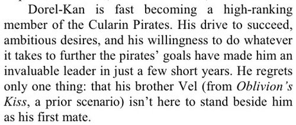
- **No single roster character (rules/setting/general)** — entry/section: Dorel-Kan: his brother Vel: "He doesn't really hold any animosity toward Vel for what he sees as his brother's lack of courage. Vel is one of only two people he cares about at all, and he is sure he'll be able to get Vel to join him once the power of the Pirates is seen throughout the Cularin system." Source: *211 - Below The Belt - Philanthropy* (SWRPG d20 Revised Core), p.16
  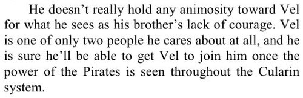
- **No single roster character (rules/setting/general)** — entry/section: Reeayah: "The other person Dorel cares about, Reeayah is a Twi'lek female with connections to a circle of Dark Side Twi'lek witches on her homeworld. Not wishing to be a slave like so many of her race, she fell in with the witches and learned to harness the darkness and rage in her heart." Source: *211 - Below The Belt - Philanthropy* (SWRPG d20 Revised Core), p.16
  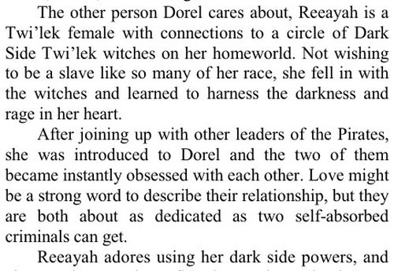
- **No single roster character (rules/setting/general)** — entry/section: Reeayah and Dorel: "After joining up with other leaders of the Pirates, she was introduced to Dorel and the two of them became instantly obsessed with each other. Love might be a strong word to describe their relationship, but they are both about as dedicated as two self-absorbed criminals can get." Source: *211 - Below The Belt - Philanthropy* (SWRPG d20 Revised Core), p.16
  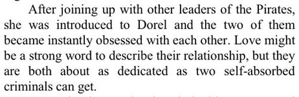
- **No single roster character (rules/setting/general)** — entry/section: Reeayah: "more bloodthirsty than Dorel": "Reeayah adores using her dark side powers, and always chooses them first in combat. She has no compunctions at all about killing and is, in truth, more bloodthirsty than Dorel." Source: *211 - Below The Belt - Philanthropy* (SWRPG d20 Revised Core), p.16
  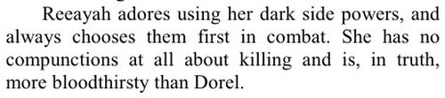

## p.17 (scan page 17)

Page contents: 822 words, 32 paragraphs | headings/entries: U5:; Tier 3; Skills: Intimidate +5, Spot +4, Hide +6; Feats: Toughness x 2, Weapon (simple),; Weapon (blaster pistols), Armor (light); Skills: Profession (Pirate Leader) +5, Intimidate; Philanthropy; Page 17

## p.18 (scan page 18)

Page contents: 887 words, 30 paragraphs | headings/entries: Lastly, a look at this combat's strategy:; Philanthropy; Page 18

- **No single roster character (rules/setting/general)** — entry/section: All blasters set to kill: "Oh, and just in case it isn't clear yet; all blasters are set to kill." Source: *211 - Below The Belt - Philanthropy* (SWRPG d20 Revised Core), p.18
  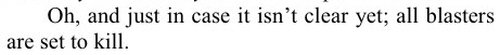
- **No single roster character (rules/setting/general)** — entry/section: Dorel knows a bit about Jedi: "Dorel knows a bit about Jedi and any one of them that appears flat-footed is his target, preferably one without an ignited lightsaber." Source: *211 - Below The Belt - Philanthropy* (SWRPG d20 Revised Core), p.18
  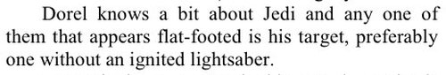
- **No single roster character (rules/setting/general)** — entry/section: Reeayah's Force Grip: "Reeayah begins Force Grip. This can be lethal as it does not require an attack roll and it can easily go straight to wounds if the victim fails a Will save." Source: *211 - Below The Belt - Philanthropy* (SWRPG d20 Revised Core), p.18
  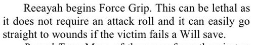
- **No single roster character (rules/setting/general)** — entry/section: The sibilaari to the rescue: "This occupies her and Dorel, who immediately turns his blaster on the terrifying black alien. After a full round of this, Reeayah successfully Force Pushes the sibilaari away and flees. This breaks the pirate's morale and they flee." Source: *211 - Below The Belt - Philanthropy* (SWRPG d20 Revised Core), p.18
  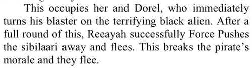

## p.19 (scan page 19)

Page contents: 873 words, 28 paragraphs | headings/entries: Philanthropy; Page 19

- **No single roster character (rules/setting/general)** — entry/section: Reeayah Force Pushes the pirates aside: "Let the heroes dive for cover or do whatever they wish for a single round. The pirates all try to board their ship in a mad dash. Reeayah Force Pushes them all out of the way as she and Dorel get aboard just before the plates hit. The sudden desperate bailout makes Dorel drop his beloved custom blaster, which spirals across the landing bay toward the heroes' ship." Source: *211 - Below The Belt - Philanthropy* (SWRPG d20 Revised Core), p.19
  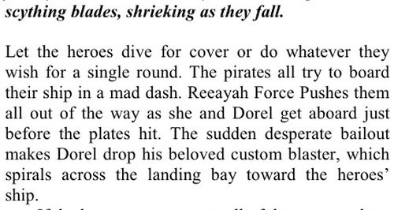

## p.20 (scan page 20)

Page contents: 779 words, 27 paragraphs | headings/entries: Conclusion; Here Ends Philanthropy; Experience Point Summary; Philanthropy; Page 20

- **No single roster character (rules/setting/general)** — entry/section: The swansong: "Then, as the light passes you, every metal surface on your vessel begins to vibrate at the same time. In the space of a heartbeat, a single ringing chime surrounds you and fades away; one sweet, perfect note that fades as the wall of light dissipates into nothingness..." Source: *211 - Below The Belt - Philanthropy* (SWRPG d20 Revised Core), p.20
  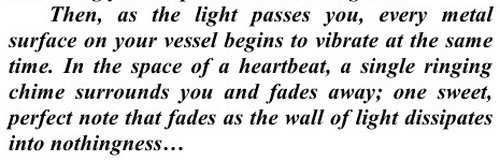
- **No single roster character (rules/setting/general)** — entry/section: Nirama's attention: "The weight of his attention feels as heavy as the silence of that strange complex, and almost as impenetrable." Source: *211 - Below The Belt - Philanthropy* (SWRPG d20 Revised Core), p.20
  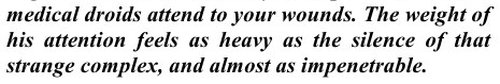

## p.14–20 (scan page 14)

Page contents: E6 the core; E7 the pirate ambush (stats/tactics; thug lines read in images); E8 escape (hand-read)

## p.21 (scan page 21)

Page contents: 527 words, 17 paragraphs | headings/entries: Adventure Experience Award:; Loot Summary; Philanthropy; Page 21

- **No single roster character (rules/setting/general)** — entry/section: Dorel-Kan's Heavy Blaster (cert): "This heavy blaster has been custom fitted with black rancor bone handles and bright silver vents. The name "Dorel-Kan" is imprinted on the underside and the barrel has 19 small notches along it." Source: *211 - Below The Belt - Philanthropy* (SWRPG d20 Revised Core), p.21
  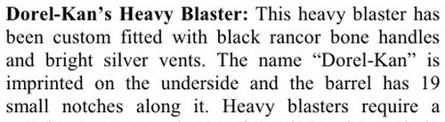
- **No single roster character (rules/setting/general)** — entry/section: Songsteel Shard (cert): "This strange piece of silvery-gray metal always rings softly, like a continuously echoing tuning fork." Source: *211 - Below The Belt - Philanthropy* (SWRPG d20 Revised Core), p.21
  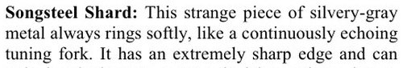
- **No single roster character (rules/setting/general)** — entry/section: Dorel-Kan's Heavy Blaster: "Dorel-Kan's Heavy Blaster: This heavy blaster has been custom fitted with black rancor bone handles and bright silver vents. The name "Dorel-Kan" is imprinted on the underside and the barrel has 19 small notches along it. Heavy blasters require a permit to own and use throughout the Cularin System." Source: *211 - Below The Belt - Philanthropy* (SWRPG d20 Revised Core), p.21
  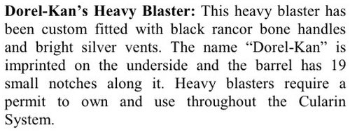
- **No single roster character (rules/setting/general)** — entry/section: Songsteel Shard: "Songsteel Shard: This strange piece of silvery-gray metal always rings softly, like a continuously echoing tuning fork. It has an extremely sharp edge and can only barely be cut or reworked by tools or lasers. Enough modifications can be made to turn it into an extremely effective weapon for a cost of 1,000 credits (a hero with Craft: Exotic Weapon - Sword can do so for only 500 credits in shop fees and materials). The resulting songsteel sword has all the same statistics as a vibroblade (Dmg 2d6/Crit 20/x2, slashing), but is considered nonpowered." Source: *211 - Below The Belt - Philanthropy* (SWRPG d20 Revised Core), p.21
  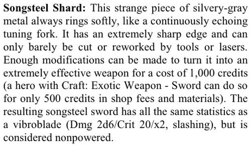

## p.20–21 (scan page 20)

Page contents: Conclusion; XP; loot certs (hand-read)

## p.15–21 (scan page 15)

Page contents: E7 pirate ambush (Dorel-Kan, Reeayah, 3 tiers, tactics; p15 stat-line headers checked in the image); E8 escape; conclusion; XP; loot certs (hand-read)

## p.22 (scan page 22)

Page contents: 8 words, 2 paragraphs | headings/entries: GM Aid #1: Asteroid Map; Philanthropy Page 22

## p.23 (scan page 23)

Page contents: 22 words, 7 paragraphs | headings/entries: GM Aid #2: Pirate Ambush!; Pirate Reeayah Dorel-Kan Sibilaari (if involved); Doorway; D <—_—_______>; Philanthropy Page 23

## p.24 (scan page 24)

Page contents: 211 words, 7 paragraphs | headings/entries: Appendix A: Important Non -Player Characters; Philanthropy Page 24

## p.25 (scan page 25)

Page contents: 628 words, 12 paragraphs | headings/entries: Appendix B: New Alien Race [Sibilaari]; Explanation of Special Qualities:; Philanthropy Page 25

- **No single roster character (rules/setting/general)** — entry/section: Sibilaari (species): "Sibilaari come from a distant planet near the Senex-Juvex sectors. Their natural ability with the Force allowed them to foresee a coming disaster that would destroy their world." Source: *211 - Below The Belt - Philanthropy* (SWRPG d20 Revised Core), p.25
  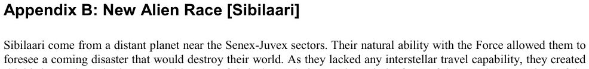
- **No single roster character (rules/setting/general)** — entry/section: Sibilaari guardian: "The guardian is alone, confused, and mourning the loss of its people after so long an enforced sleep. It is not naturally hostile but it will defend itself if pressed." Source: *211 - Below The Belt - Philanthropy* (SWRPG d20 Revised Core), p.25
  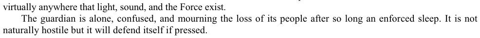
- **No single roster character (rules/setting/general)** — entry/section: The Sibilaari: origin: "Sibilaari come from a distant planet near the Senex-Juvex sectors. Their natural ability with the Force allowed them to foresee a coming disaster that would destroy their world. As they lacked any interstellar travel capability, they created shielded complexes in the most stable parts of their doomed planet. Through the force of the cataclysm, sections of the surviving land mass were flung through space, drifting through the galaxy with comatose members of the Sibilaari race safely shielded within." Source: *211 - Below The Belt - Philanthropy* (SWRPG d20 Revised Core), p.25
  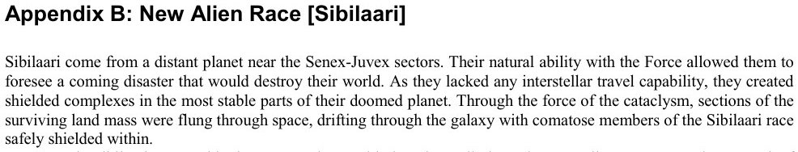
- **No single roster character (rules/setting/general)** — entry/section: The Sibilaari metabolize sound, light and the Force: "The immediate area of space around a sibilaari is utterly silent, as it body metabolizes sound to generate motive energy. This absorption also functions on light to a limited degree and even makes the sibilaari sensitive to emanations of the Force. This odd metabolism allows for the sibilaari's special abilities and also allows them to exist virtually anywhere that light, sound, and the Force exist." Source: *211 - Below The Belt - Philanthropy* (SWRPG d20 Revised Core), p.25
  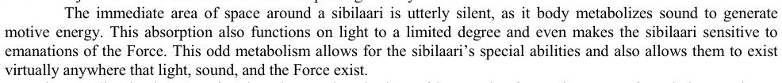
- **No single roster character (rules/setting/general)** — entry/section: Sibilaari phasing: immune to physical attack: "Phasing: For an expenditure of 5 vitality, a sibilaari can make its body shift "out of phase" with normal space. This power lasts until the sibilaari wishes to interact with solid objects or use any other special quality other than its natural stealth or darkvision. While "phased", a sibilaari can move through solid objects, is immune to any physical attack (though lightsabers and other energy attacks are still effective), and is transparent enough to be considered three-quarters concealed (30% miss chance)." Source: *211 - Below The Belt - Philanthropy* (SWRPG d20 Revised Core), p.25
  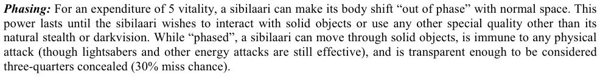
- **No single roster character (rules/setting/general)** — entry/section: Sibilaari Dissipate Energy and Energy Lance: "Dissipate Energy: This functions just like the Force feat of the same name, save that it exists as a constant defense and only costs 2 vitality per use. When this power successfully defends the sibilaari, the attack dissipates into a glowing spray of light motes.
Energy Lance: Once per round, a sibilaari can focus some of its internal energy into a beam of energy. The beam is directed as a ranged attack and does 3d6 damage, just like a blaster pistol, except that it travels 30 meters and fades out, making a separate attack roll on every being occupying a 2 meter hex in its line of effect. This energy can be dissipated, deflected, or otherwise countered in exactly the same way as a blaster can." Source: *211 - Below The Belt - Philanthropy* (SWRPG d20 Revised Core), p.25
  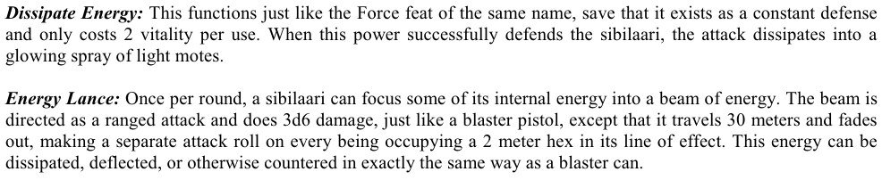

## p.26 (scan page 26)

Page contents: 132 words, 11 paragraphs | headings/entries: Critical Event Summary Below the Belt: Philanthropy; Yes No; Philanthropy Page 26

## p.22–26 (scan page 22)

Page contents: GM Aid maps (image-only, checked); App A Teeloo and the Neeva-Beelo; App B the Sibilaari; critical event summary (hand-read)

