# Owner Material 037 — Star Wars D20 Drive folder (Core, Revised Core and Saga Edition): Living Force Campaign/Adventures/Among the Stars/Year 2/212 - Below The Belt - Philosophy.pdf [Star Wars Roleplaying Game Revised Core (d20, 2002)]

- **Source:** Wizards of the Coast Star Wars Roleplaying Game books, web enhancements, Living Force campaign modules and articles (2000–2010), from the owner's "Star Wars D20" Drive folder (only the three edition subfolders; "General" was not read, as instructed). Secondary source (licensed Legends reference). Scan OCR'd on the box; the scan stays box-only and is **not** published.
- **Method:** every scanned page was OCR'd and machine-screened sentence by sentence for power-relevant statements (fights, kills, defeats, Force feats, rankings, superweapons) that name a character on our roster; each kept sentence is quoted verbatim from the OCR text and has a crop of the printed passage directly under it. Pages with nothing power-relevant are still listed with what is on them.
- **Citation:** "*212 - Below The Belt - Philosophy* (SWRPG d20 Revised Core), p.X" by printed page ("scan p.X" where no printed number applies). **Weight:** Licensed RPG material: a secondary source. Narrative text sums up Legends lore; game statistics are rules for players, not canon power levels, and rank lowest.

## p.1 (scan page 1)

Page contents: 151 words, 5 paragraphs | headings/entries: Philosophy; By August Hahn

## p.2 (scan page 2)

Page contents: 895 words, 22 paragraphs | headings/entries: Hero Earnings; Issuing Force and Dark Side Points; Philosophy; Page 2

## p.3 (scan page 3)

Page contents: 945 words, 22 paragraphs | headings/entries: General Notes to the GM; GM Overview; Philosophy; Page 3

- **No single roster character (rules/setting/general)** — entry/section: Overview: Almas and the Sith: "At least, this one was uninhabited. The planet Almas did not always house an academy for the Jedi. Once, it was overshadowed by a dark order known as the Sith. The temple they built on Almas still radiates the foulness of the Dark Side of the Force; the same power that let these Sith crush this system in their iron grip until they were driven out and purged.
The Dark Side does not limit itself to one system, nor is it banished as easily as its mortal pawns. The darkness of rage, anger, and fear spreads much wider than the reach of any dictator. As the battles raged over Almas, the Dark Side reacted by calling out to something akin to itself; something dark, something in the shadows.
Drawn to the conflict and the power of the Force, this Shadow traveled the vast distances of deep space to come to the Cularin system. Unfortunately, the journey took so long that the war that spawned such hatred and darkness was over before the Shadow creature could arrive." Source: *212 - Below The Belt - Philosophy* (SWRPG d20 Revised Core), p.3
  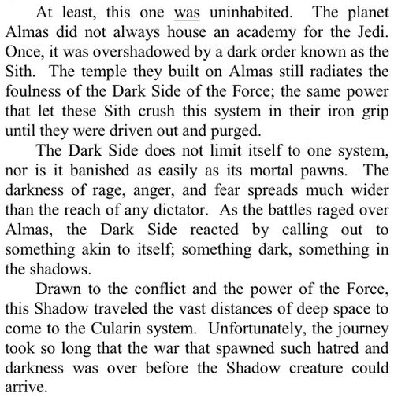
- **No single roster character (rules/setting/general)** — entry/section: Overview: the Academy's light wanes the Shadow's evil: "The first is the Jedi Academy on Almas. It has been a beacon of the Force for some time now; a beacon that even the Shadow can feel in its deep slumber. Though the Shadow is a creature of great darkness, it has begun to feel the pull of the light side of the Force. Some of its great evil has waned and while it is still deeply tainted, it is not the horror it once was. This change began to rouse the Shadow." Source: *212 - Below The Belt - Philosophy* (SWRPG d20 Revised Core), p.3
  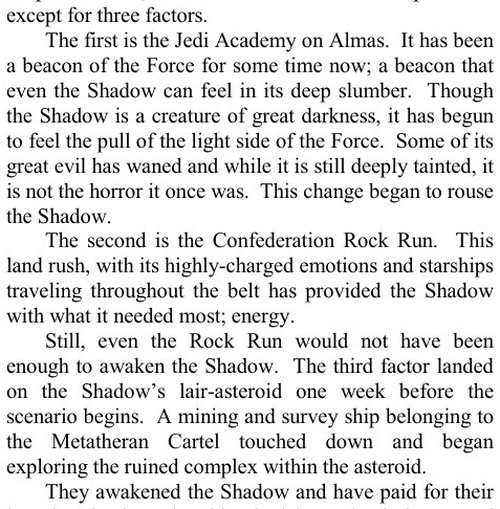

## p.4 (scan page 4)

Page contents: 893 words, 29 paragraphs | headings/entries: Encounter 1:; Encounter 2:; Encounter 3:; Encounter 4:; Philosophy; Page 4

- **No single roster character (rules/setting/general)** — entry/section: Overview: no longer truly evil: "The Shadow is no longer truly evil, but it is trapped and is willing do whatever it must to break free. If that means the flying boxes of metal that keep flying past its lair must be drained dry and sent smashing into unforgiving rocks, so be it..." Source: *212 - Below The Belt - Philosophy* (SWRPG d20 Revised Core), p.4
  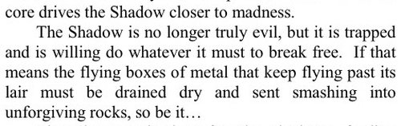

## p.5 (scan page 5)

Page contents: 890 words, 26 paragraphs | headings/entries: Encounter 5:; Encounter 6:; Conclusion:; A Note of Caution; Philosophy; Page 5

## p.1–5 (scan page 1)

Page contents: Title; scoring; earnings; FP/DSP issuing; GM overview of the Shadow, Almas, the Rock Run and the Cartel; encounter summaries; judges' note (hand-read)

## p.6 (scan page 6)

Page contents: 799 words, 23 paragraphs | headings/entries: Opening Crawl; Encounter 1: Surrounded By Shadows; Philosophy; Page 6

## p.7 (scan page 7)

Page contents: 839 words, 28 paragraphs | headings/entries: Encounter 2: The Shadows Within; Philosophy; Page 7

## p.8 (scan page 8)

Page contents: 849 words, 22 paragraphs | headings/entries: Encounter 3: Shadows of the Soul; Philosophy; Page 8

## p.9 (scan page 9)

Page contents: 883 words, 23 paragraphs | headings/entries: Philosophy; Page 9

## p.10 (scan page 10)

Page contents: 834 words, 27 paragraphs | headings/entries: Encounter 4: A Shadow's Welcome; Philosophy; Page 10

- **No single roster character (rules/setting/general)** — entry/section: 3-C: Cold Comfort: "Some say the universe rewards people with exactly what they deserve. The righteous are rewarded, the wronged are avenged, and the terrible are given terror themselves.
As the darkness of your own lives comes crashing up through you in the form of an unforgiving death among the stars, you have only the emptiness of your merciless, brutal lives to bear witness to your demise.
You die as you lived -- cold and alone." Source: *212 - Below The Belt - Philosophy* (SWRPG d20 Revised Core), p.10
  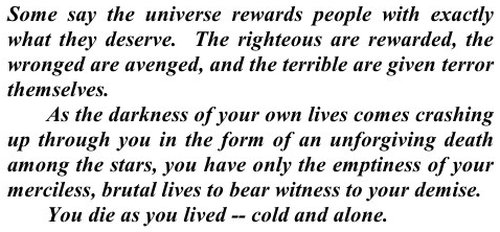

## p.11 (scan page 11)

Page contents: 843 words, 25 paragraphs | headings/entries: Philosophy; Page 11

## p.6–11 (scan page 6)

Page contents: Opening crawl; E1 Surrounded By Shadows; E2 The Shadows Within; E3 3-A/3-B/3-C endings; E4 A Shadow's Welcome (hand-read)

## p.12 (scan page 12)

Page contents: 941 words, 21 paragraphs | headings/entries: Avoid repetition. If you have already described; Philosophy; Page 12

## p.13 (scan page 13)

Page contents: 909 words, 24 paragraphs | headings/entries: Philosophy; Page 13

- **No single roster character (rules/setting/general)** — entry/section: E5 sending: Anger: "Anger: The Shadow being is born of the Dark Side of the Force, but it has drifted far enough away from its origins that anger and hatred are no longer innate parts of it. It remembers knowing them though, and wishes to understand them again." Source: *212 - Below The Belt - Philosophy* (SWRPG d20 Revised Core), p.13
  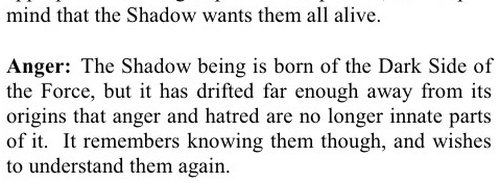

## p.14 (scan page 14)

Page contents: 883 words, 23 paragraphs | headings/entries: Philosophy; Page 14

- **No single roster character (rules/setting/general)** — entry/section: E5 sending: The Force: "The Force: The Shadow may be a living aspect of the Dark Side of the force, but its distance from that malevolent energy has rendered it somewhat ignorant of the Force's nature. It feels a deep and abiding need to learn more about it." Source: *212 - Below The Belt - Philosophy* (SWRPG d20 Revised Core), p.14
  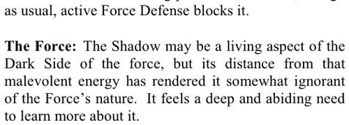

## p.15 (scan page 15)

Page contents: 863 words, 24 paragraphs | headings/entries: Encounter 6: A Web of Shadows; Philosophy; Page 15

## p.16 (scan page 16)

Page contents: 959 words, 18 paragraphs | headings/entries: Philosophy; Page 16

- **No single roster character (rules/setting/general)** — entry/section: E6: the Vision: "Force-sensitive heroes get an even clearer vision. They see the Shadow for what it really is, a sentient being of pure energy. It calls out to them in their own voices, saying, "Free... Freedom... Destroy..." Of course, the hero might misinterpret the word "Destroy" as a threat, but the Shadow does not really understand communication yet." Source: *212 - Below The Belt - Philosophy* (SWRPG d20 Revised Core), p.16
  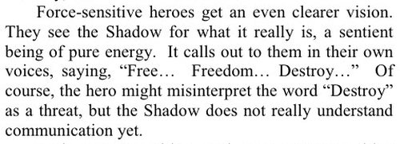
- **No single roster character (rules/setting/general)** — entry/section: E6: if attacked: "If the Shadow is attacked, it reacts with confusion for one round (it does nothing, essentially), defends itself for three rounds (uses defensive Force powers and resends the vision to all non-DSP heroes each round), and finally attacks on the fifth round. It does not want to hurt the heroes, but it will if it must." Source: *212 - Below The Belt - Philosophy* (SWRPG d20 Revised Core), p.16
  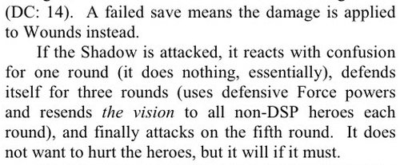
- **No single roster character (rules/setting/general)** — entry/section: Dark Aura: "Dark Aura: This ability has a range of 100 kilometers and allows the Shadow alien to use any of its mind-affecting Force powers within that distance without expending Vitality points or allowing the target a saving throw. The aura manifests as an intense shadow lingering over any solid surface within the radius. This field also obscures the Shadow alien from Farseeing, adding +10 to the DC." Source: *212 - Below The Belt - Philosophy* (SWRPG d20 Revised Core), p.16
  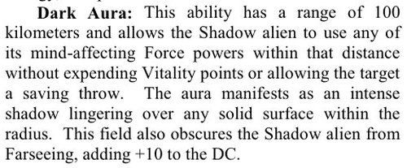

## p.17 (scan page 17)

Page contents: 859 words, 23 paragraphs | headings/entries: Philosophy; Page 17

- **No single roster character (rules/setting/general)** — entry/section: Control Energy: "Control Energy: When activated, this power has a range equal to 1 kilometer times number of rounds the user concentrates and has no upper range limit. Any source of energy within this power's range can be turned off or on, controlling the devices they are attached to as free actions or drained to provide sustenance as the user sees fit. Power sources can be affected individually without affecting others in range and any number of sources can be manipulated or drained at once." Source: *212 - Below The Belt - Philosophy* (SWRPG d20 Revised Core), p.17
  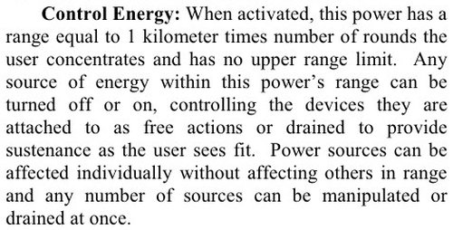
- **No single roster character (rules/setting/general)** — entry/section: 6-B: the Shadow's gift: "The Shadow has given each of the heroes the only reward it can offer for its freedom. Its power over the Force is still tenuous, but its long captivity has made it expert at manipulating raw energy. Each hero receives a Force point as the Shadow suffuses him or her on its way out. Alternately, at your discretion, the Shadow takes a Dark Side Point from one or more of the heroes provided they have been trying to atone and took steps to role-play this fact during the scenario." Source: *212 - Below The Belt - Philosophy* (SWRPG d20 Revised Core), p.17
  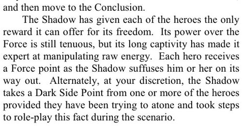

## p.18 (scan page 18)

Page contents: 672 words, 28 paragraphs | headings/entries: Conclusion; Here Ends Philosophy; Experience Point Summary; Adventure Experience Award:; Loot Summary; Philosophy; Page 18

- **No single roster character (rules/setting/general)** — entry/section: Conclusion: the Cartel's message: "You have one last surprise waiting for you when you get back to Cularin. Each of you has a message waiting for you when you arrive home. "We are grateful for your help. Consider this a gift," is all the recording says in a flat, mechanical tone." Source: *212 - Below The Belt - Philosophy* (SWRPG d20 Revised Core), p.18
  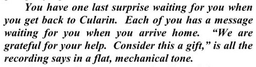

## p.11–18 (scan page 11)

Page contents: E5 the Shadow's emotional sendings and shadow-double fight; E6 the Shadow's chamber, Vision, stat block, 6-A/6-B; conclusion; XP; loot (hand-read)

## p.19 (scan page 19)

Page contents: 499 words, 10 paragraphs | headings/entries: Player Handout 1: The Shadow Nightmare; Philosophy Page 19

- **No single roster character (rules/setting/general)** — entry/section: Player Handout 1: The Shadow Nightmare (ending): "A mind teeters on the brink of an abyss. One side plummets into the growing darkness; the other side beckons a new beginning and the promise of something beyond the cycle of rage. As the moments pass, the darkness seems brighter than the light, and the promises grow too quiet to hear. Perhaps they are merely lies, deceptions of a desperate need.
A mind teeters on the abyss. Is it yours?" Source: *212 - Below The Belt - Philosophy* (SWRPG d20 Revised Core), p.19
  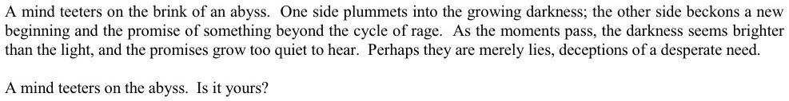

## p.20 (scan page 20)

Page contents: 72 words, 11 paragraphs | headings/entries: Hero Name:; Class(es) / Level(s):; Loves and/or Desires:; Fears and/or Phobias:; Philosophy Page 20

## p.21 (scan page 21)

Page contents: 95 words, 25 paragraphs | headings/entries: Hero Name; Init Mod Def; VP/WP; Species Gender Class(es) LvI(s); DEX WIS; CON CHA; Player Name RPGA# Hero Name; Init Mod Def; VP/WP; Species Gender Class(es) LvI(s); DEX WIS; CON CHA; Player Name RPGA# Hero Name; Init Mod Def; VP/WP; Species Gender Class(es) LvI(s); DEX WIS; CON CHA; Player Name RPGA#; Philosophy; Page 21

## p.22 (scan page 22)

Page contents: 158 words, 6 paragraphs | headings/entries: Philosophy Page 22

## p.19–22 (scan page 19)

Page contents: Player Handout 1 The Shadow Nightmare; blank questionnaire and record cards; critical event summary (hand-read)

