# Owner Material 037 — Star Wars D20 Drive folder (Core, Revised Core and Saga Edition): Living Force Campaign/Adventures/Among the Stars/Year 2/213 - Below The Belt - Philology.pdf [Star Wars Roleplaying Game Revised Core (d20, 2002)]

- **Source:** Wizards of the Coast Star Wars Roleplaying Game books, web enhancements, Living Force campaign modules and articles (2000–2010), from the owner's "Star Wars D20" Drive folder (only the three edition subfolders; "General" was not read, as instructed). Secondary source (licensed Legends reference). Scan OCR'd on the box; the scan stays box-only and is **not** published.
- **Method:** every scanned page was OCR'd and machine-screened sentence by sentence for power-relevant statements (fights, kills, defeats, Force feats, rankings, superweapons) that name a character on our roster; each kept sentence is quoted verbatim from the OCR text and has a crop of the printed passage directly under it. Pages with nothing power-relevant are still listed with what is on them.
- **Citation:** "*213 - Below The Belt - Philology* (SWRPG d20 Revised Core), p.X" by printed page ("scan p.X" where no printed number applies). **Weight:** Licensed RPG material: a secondary source. Narrative text sums up Legends lore; game statistics are rules for players, not canon power levels, and rank lowest.

## p.1 (scan page 1)

Page contents: 211 words, 7 paragraphs | headings/entries: Philology; Edited by Jae Walker

## p.2 (scan page 2)

Page contents: 892 words, 19 paragraphs | headings/entries: Hero Earnings; Issuing Force and Dark Side Points; Philology; Page 2

## p.3 (scan page 3)

Page contents: 926 words, 19 paragraphs | headings/entries: General Notes to the GM; GM Overview; Philology; Page 3

## p.4 (scan page 4)

Page contents: 913 words, 22 paragraphs | headings/entries: Encounter 1: Conspirators; Encounter 2: Instigators; Encounter 3: Defenders; Encounter 4: Seekers; Encounter 5: Finders; Encounter 6: Pursuers; Encounter 7: Peace-keepers; Philology; Page 4

- **No single roster character (rules/setting/general)** — entry/section: Overview: the darkstaff: "Unfortunately for Len, his research is flawed. His translations of dead languages from deep within the Belt contained errors, and his interpretation of the translations have left out several key points. For instance, the item he seeks — its name translates loosely as darkstaff — has nothing at all to do with affecting minds, and everything to do with warping and destroying them. This might not change Len's approach to the search, but it might make him less likely to take the darkstaff out of I-9. It is only the last vestiges of order, the heart of a species the darkstaff's power helped destroy millenia ago, that have kept it from lashing out at the galaxy.
The darkstaff is not an artifact of the Force. It was created to feed off the Force, and once it is out of its containment, it is one of the most dangerous and unpredictable objects in the galaxy." Source: *213 - Below The Belt - Philology* (SWRPG d20 Revised Core), p.4
  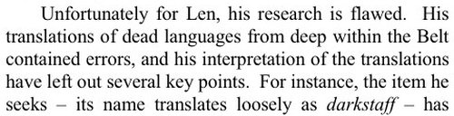
- **No single roster character (rules/setting/general)** — entry/section: Encounter 6 summary: the Sith fortress strikes: "The dark side tried to destroy the darkstaff before, and was kept at bay. However, it never had a weapon the magnitude of a Sith fortress to do its dirty work before. When Len's ship comes in range, the Sith fortress lashes out with a burst of dark side energy that removes Len Markus and the darkstaff from Cularin — and removes Cularin from the galaxy." Source: *213 - Below The Belt - Philology* (SWRPG d20 Revised Core), p.4
  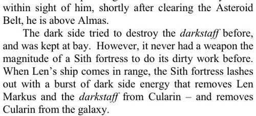

## p.5 (scan page 5)

Page contents: 913 words, 16 paragraphs | headings/entries: Opening Crawl; Encounter 1: Conspirators; Philology; Page 5

## p.1–5 (scan page 1)

Page contents: Title; boilerplate; FP/DSP; GM overview of Len Markus and the darkstaff; encounter summaries; judges' note; opening crawl; E1 Conspirators (hand-read)

## p.6 (scan page 6)

Page contents: 902 words, 28 paragraphs | headings/entries: Philology; Page 6

- **No single roster character (rules/setting/general)** — entry/section: Nirama on Len: "Is it possible he's betrayed you? Anything is possible. I would prefer not to believe that. If you find evidence that he has... do not get too close to him. He is a very, very dangerous man.
What kind of ship does he have? What's its name? Len has a custom designed ship — matte black and all sharp points and angles. Starfighter sized — it's fast and deadly, not unlike its owner." Source: *213 - Below The Belt - Philology* (SWRPG d20 Revised Core), p.6
  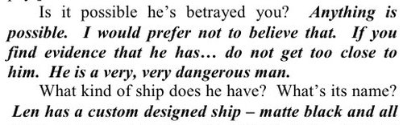

## p.7 (scan page 7)

Page contents: 772 words, 22 paragraphs | headings/entries: Information Gained; Encounter 2: Instigators; Philology; Page 7

- **No single roster character (rules/setting/general)** — entry/section: Len's datapad: ""Whoever possesses this item — this 'darkstaff' — can, I believe, control the thoughts and actions of any living creature."" Source: *213 - Below The Belt - Philology* (SWRPG d20 Revised Core), p.7
  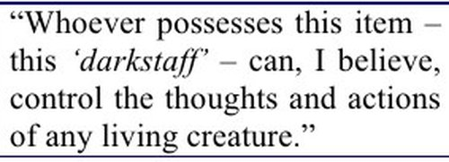

## p.8 (scan page 8)

Page contents: 866 words, 21 paragraphs | headings/entries: Effect; Philology; Page 8

## p.9 (scan page 9)

Page contents: 906 words, 20 paragraphs | headings/entries: Tactics, Middle Tier (Average Level 4-6); Tactics, Upper Tier (Average Level 7-9); Encounter 3: Defenders; Philology; Page 9

## p.10 (scan page 10)

Page contents: 891 words, 23 paragraphs | headings/entries: Philology; Page 10

## p.11 (scan page 11)

Page contents: 847 words, 25 paragraphs | headings/entries: Encounter 4: Seekers; Philology; Page 11

- **No single roster character (rules/setting/general)** — entry/section: E4: the room of six shadows: "In your head, in your native tongue, you hear ten words: "Life to death. Death to life. All else to madness." Then the shadows on the far wall shift, moving one atop the other, until they settle into place once more." Source: *213 - Below The Belt - Philology* (SWRPG d20 Revised Core), p.11
  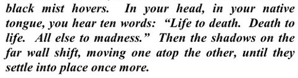

## p.6–11 (scan page 6)

Page contents: Nirama Q&A; Len's datapad; E2 Instigators (insane pirates, Force flux on I-9); E3 Defenders (shadow lurkers) (hand-read)

## p.12 (scan page 12)

Page contents: 893 words, 24 paragraphs | headings/entries: Encounter 5: Finders; Philology; Page 12

## p.13 (scan page 13)

Page contents: 980 words, 17 paragraphs | headings/entries: Lower Tier; Philology; Page 13

- **No single roster character (rules/setting/general)** — entry/section: E5: the Force-dead room: "This is the point where Force-sensitive heroes may blow a gasket, as they realize that they can no longer feel the Force. This room was designed by the darkstaff to protect itself, and no Force powers or abilities work here. This means, among other things... lightsabers that were lit suddenly shut off, and no lightsaber can be ignited here; no Force skills or feats can be used; and Force points cannot be spent.
It is, perhaps, the worst feeling a Force-sensitive hero can imagine. It's like being dead inside." Source: *213 - Below The Belt - Philology* (SWRPG d20 Revised Core), p.13
  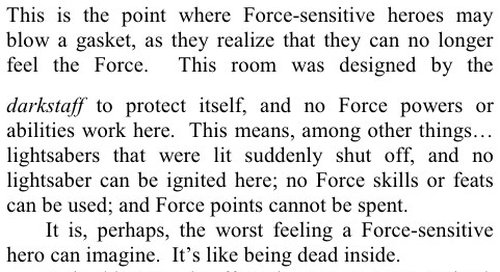

## p.14 (scan page 14)

Page contents: 899 words, 24 paragraphs | headings/entries: Encounter 6: Pursuers; Philology; Page 14

- **No single roster character (rules/setting/general)** — entry/section: E5: Len's holo: "The man blinks. "You're not my people. That makes you even more expendable. I imagine you're here because of Nirama. Shame you won't be able to bring back his pet human, isn't it?"" Source: *213 - Below The Belt - Philology* (SWRPG d20 Revised Core), p.14
  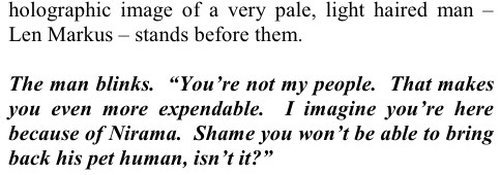
- **No single roster character (rules/setting/general)** — entry/section: E5: Len uses the Force?: ""Blasted creatures." He slams a hand down on the control panel of his ship, then closes his eyes and concentrates. The engines whir to life as a twisted grin spreads over his colorless lips, then the ship begins to move and the projection ends.
Yes. That did look like Len might have been using the Force, if anyone asks. No one has ever heard of him being Force-sensitive, though, and it's hard to say what, exactly, he might have been doing..." Source: *213 - Below The Belt - Philology* (SWRPG d20 Revised Core), p.14
  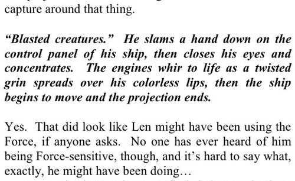

## p.15 (scan page 15)

Page contents: 1051 words, 19 paragraphs | headings/entries: Philology; Page 15

- **No single roster character (rules/setting/general)** — entry/section: E6: the global Force Lightning: "Your lasers slam into the rear of the smaller ship, and as they do, your ship begins to shudder. Silver-black lightning fills the sky of Almas, far below, and then shimmers out in an enormous silvery web that encircles the globe, crackling and dancing. The lightning pulls together in a ball of brilliant energy and shoots straight up, a bolt kilometers wide, and SLAMS into Len's ship!" Source: *213 - Below The Belt - Philology* (SWRPG d20 Revised Core), p.15
  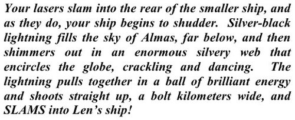

## p.16 (scan page 16)

Page contents: 904 words, 21 paragraphs | headings/entries: Encounter 7: Peace-keepers; Shooting at Debris (Optional); Calming the Throng (Optional); Searching the Area; Talking to the Jedi; Philology; Page 16

- **No single roster character (rules/setting/general)** — entry/section: E6: the Sith fortress's Force Lightning: "Any Force-sensitive hero (particularly one with the Sense feat) knows immediately that this is an incredibly strong burst of dark side energy, Force Lightning on a global scale that must have been powered, somehow, by the Sith fortress on Almas. Even non-Force-sensitive heroes get chills from the lightning." Source: *213 - Below The Belt - Philology* (SWRPG d20 Revised Core), p.16
  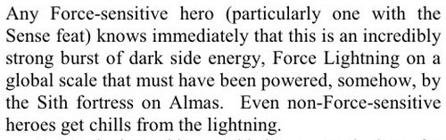
- **No single roster character (rules/setting/general)** — entry/section: E7: Cularin removed from the galaxy: "What the heroes could not know — because it felt to them as though no time passed at all — was that when the huge Force Lightning arced up from Almas, the release of dark side energy was great enough that it removed Cularin from the galaxy entirely. For a decade, only empty space occupied the area that had been the Cularin system. Planets, moons, suns, asteroids — everything simply disappeared." Source: *213 - Below The Belt - Philology* (SWRPG d20 Revised Core), p.16
  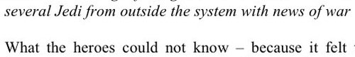
- **No single roster character (rules/setting/general)** — entry/section: E7: Master Lanius's farseeing: "He does not know what happened; he was in meditation, then he felt an enormous surge of power from the far side of the planet, then the air around him came alive. He attempted to use farseeing and the result, in his words, "It... was... was like seeing everything at once. Past, present, and future, all forced into a space smaller than the head of a pin. I nearly lost consciousness."" Source: *213 - Below The Belt - Philology* (SWRPG d20 Revised Core), p.16
  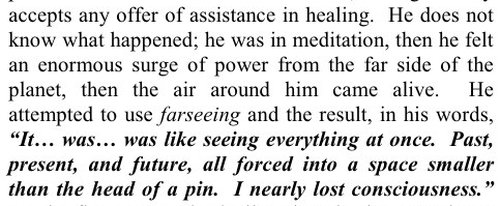

## p.11–16 (scan page 11)

Page contents: E4 Seekers (room of six shadows); E5 Finders (dark side corridor, Force-dead room, skeletal guardians, Len's holo); E6 Pursuers (global Force Lightning destroys Len's ship) (hand-read)

## p.17 (scan page 17)

Page contents: 836 words, 24 paragraphs | headings/entries: What Nirama knows:; Conclusion; Philology; Page 17

- **Yoda** — entry/section: Master Devan: the surge and Master Yoda: ""For ten years, the Jedi and a team of scientists have worked to find Cularin. There was no death that we detected, just a surge of dark side energy strong enough that it nearly hospitalized Master Yoda. He saw that the people of Cularin survived, but were no longer in the galaxy. Not as we knew it." Source: *213 - Below The Belt - Philology* (SWRPG d20 Revised Core), p.17
  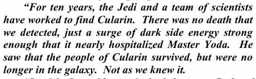
- **No single roster character (rules/setting/general)** — entry/section: Master Devan: Jedi Masters to the Army of the Republic: ""We have need of Jedi, to aid in the conflict. Many of you will remain here, to train the next generation of Jedi Knights. But we will be taking all but two Jedi Masters from Cularin, and giving them rank in the Army of the Republic by order of the Supreme Chancellor. Master Lanius and Master Kirlocca will oversee the Jedi Knights who do most of the training, here; all other Jedi Masters must do their duty to the Order, and to the Republic we serve."" Source: *213 - Below The Belt - Philology* (SWRPG d20 Revised Core), p.17
  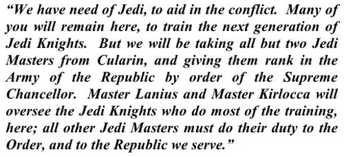

## p.18 (scan page 18)

Page contents: 569 words, 29 paragraphs | headings/entries: Happy conversion!; Here Ends, "Philology"; Experience Point Summary; Adventure Experience Award:; Loot Summary; From Nirama; From the Jedi; Philology; Page 18

## p.19 (scan page 19)

Page contents: 122 words, 9 paragraphs | headings/entries: Philology Page 19

## p.20 (scan page 20)

Page contents: 212 words, 7 paragraphs | headings/entries: Appendix A: Important Non-Player Characters; Philology Page 20

## p.21 (scan page 21)

Page contents: 522 words, 17 paragraphs | headings/entries: Philology Page 21

## p.22 (scan page 22)

Page contents: 807 words, 29 paragraphs | headings/entries: Philology; Page 22

## p.23 (scan page 23)

Page contents: 121 words, 7 paragraphs | headings/entries: Critical Event Summary; Philology; Philology Page 23

## p.16–23 (scan page 16)

Page contents: E7 Peace-keepers (Lanius, Nirama, Master Devan; Cularin lost ten years; Clone Wars); conclusion; XP; loot; handout; Teeloo; pirate stats; While You Were Out table; critical event summary (hand-read)

