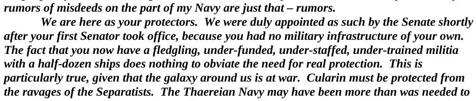
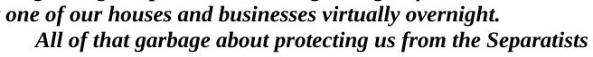
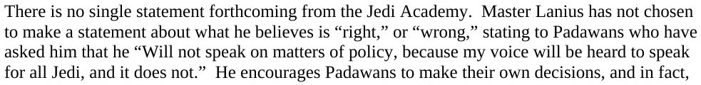
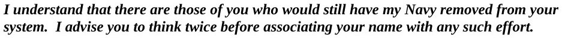

# Owner Material 037 — Star Wars D20 Drive folder (Core, Revised Core and Saga Edition): Living Force Campaign/Adventures/Among the Stars/Year 2/214 - Below The Belt - Here and Thaere.pdf [Star Wars Roleplaying Game Revised Core (d20, 2002)]

- **Source:** Wizards of the Coast Star Wars Roleplaying Game books, web enhancements, Living Force campaign modules and articles (2000–2010), from the owner's "Star Wars D20" Drive folder (only the three edition subfolders; "General" was not read, as instructed). Secondary source (licensed Legends reference). Scan OCR'd on the box; the scan stays box-only and is **not** published.
- **Method:** every scanned page was OCR'd and machine-screened sentence by sentence for power-relevant statements (fights, kills, defeats, Force feats, rankings, superweapons) that name a character on our roster; each kept sentence is quoted verbatim from the OCR text and has a crop of the printed passage directly under it. Pages with nothing power-relevant are still listed with what is on them.
- **Citation:** "*214 - Below The Belt - Here and Thaere* (SWRPG d20 Revised Core), p.X" by printed page ("scan p.X" where no printed number applies). **Weight:** Licensed RPG material: a secondary source. Narrative text sums up Legends lore; game statistics are rules for players, not canon power levels, and rank lowest.

## scan p.1 (scan page 1)

Page contents: 146 words, 3 paragraphs | headings/entries: 

## scan p.2 (scan page 2)

Page contents: 533 words, 10 paragraphs | headings/entries: Admiral Jir Tramsig

- **No single roster character (rules/setting/general)** — entry/section: Admiral Jir Tramsig's speech (excerpt): "We are here as your protectors. We were duly appointed as such by the Senate shortly after your first Senator took office, because you had no military infrastructure of your own. The fact that you now have a fledgling, under-funded, under-staffed, under-trained militia with a half-dozen ships does nothing to obviate the need for real protection. This is particularly true, given that the galaxy around us is at war. Cularin must be protected from the ravages of the Separatists." Source: *214 - Below The Belt - Here and Thaere* (SWRPG d20 Revised Core), scan p.2
  

## scan p.3 (scan page 3)

Page contents: 486 words, 10 paragraphs | headings/entries: Osten Dal' Nay (Derrel Weaver); Is this on yet? It is? Oh!

- **No single roster character (rules/setting/general)** — entry/section: Osten Dal'Nay: more Jedi in Cularin than anywhere: "All of that garbage about protecting us from the Separatists — that's the funniest thing I've ever heard. There are more Jedi in Cularin than in any one location in the galaxy right now. The Separatists would be idiots to come here." Source: *214 - Below The Belt - Here and Thaere* (SWRPG d20 Revised Core), scan p.3
  

## scan p.4 (scan page 4)

Page contents: 363 words, 8 paragraphs | headings/entries: Thurm Loogg (August Hahn)

## scan p.5 (scan page 5)

Page contents: 316 words, 7 paragraphs | headings/entries: Nadin Paal

## scan p.1–5 (scan page 1)

Page contents: Overview; Admiral Tramsig's speech; Osten Dal'Nay's speech; Thurm Loogg's speech; Nadin Paal for Nirama (hand-read)

## scan p.6 (scan page 6)

Page contents: 291 words, 7 paragraphs | headings/entries: The Jedi Position; Jedi Position 1; Jedi Position 2

- **No single roster character (rules/setting/general)** — entry/section: Master Lanius on policy: "Master Lanius has not chosen to make a statement about what he believes is "right," or "wrong," stating to Padawans who have asked him that he "Will not speak on matters of policy, because my voice will be heard to speak for all Jedi, and it does not."" Source: *214 - Below The Belt - Here and Thaere* (SWRPG d20 Revised Core), scan p.6
  

## scan p.7 (scan page 7)

Page contents: 172 words, 12 paragraphs | headings/entries: Common Opinion

## scan p.8 (scan page 8)

Page contents: 85 words, 3 paragraphs | headings/entries: Political Opinion

## scan p.9 (scan page 9)

Page contents: 147 words, 4 paragraphs | headings/entries: Wrap-Up

- **No single roster character (rules/setting/general)** — entry/section: Tramsig's final transmission: "I understand that there are those of you who would still have my Navy removed from your system. I advise you to think twice before associating your name with any such effort." Source: *214 - Below The Belt - Here and Thaere* (SWRPG d20 Revised Core), scan p.9
  

## scan p.6–9 (scan page 6)

Page contents: Jedi position; common opinion; political opinion; wrap-up (hand-read)

