# Owner Material 037 — Star Wars D20 Drive folder (Core, Revised Core and Saga Edition): Living Force Campaign/Adventures/Among the Stars/Year 2/215 - Looking In - Outward Bound.pdf [Star Wars Roleplaying Game Revised Core (d20, 2002)]

- **Source:** Wizards of the Coast Star Wars Roleplaying Game books, web enhancements, Living Force campaign modules and articles (2000–2010), from the owner's "Star Wars D20" Drive folder (only the three edition subfolders; "General" was not read, as instructed). Secondary source (licensed Legends reference). Scan OCR'd on the box; the scan stays box-only and is **not** published.
- **Method:** every scanned page was OCR'd and machine-screened sentence by sentence for power-relevant statements (fights, kills, defeats, Force feats, rankings, superweapons) that name a character on our roster; each kept sentence is quoted verbatim from the OCR text and has a crop of the printed passage directly under it. Pages with nothing power-relevant are still listed with what is on them.
- **Citation:** "*215 - Looking In - Outward Bound* (SWRPG d20 Revised Core), p.X" by printed page ("scan p.X" where no printed number applies). **Weight:** Licensed RPG material: a secondary source. Narrative text sums up Legends lore; game statistics are rules for players, not canon power levels, and rank lowest.

## p.1 (scan page 1)

Page contents: 156 words, 8 paragraphs | headings/entries: Outward Bound; Edited by Jae Walker

## p.2 (scan page 2)

Page contents: 919 words, 26 paragraphs | headings/entries: Issuing Force and Dark Side Points; Outward Bound; Page 2

## p.3 (scan page 3)

Page contents: 877 words, 19 paragraphs | headings/entries: General Notes to the GM; GM Overview; Outward Bound; Page 3

## p.4 (scan page 4)

Page contents: 773 words, 28 paragraphs | headings/entries: Encounter 1: Renna and an Offer; Encounter 2: Thaereian Inspection; Encounter 3: Welcome to Druckenwell; Encounter 4: Jedi Knights and Clone Troopers; Encounter 5: Dropping Off the Goods; Important Notes to Judges:; Opening Crawl; Outward Bound; Page 4

- **No single roster character (rules/setting/general)** — entry/section: Opening crawl: "Cularin has returned. It has been almost 10 years since the system disappeared from the Galaxy, and in that time, much has changed.
The Galaxy is a different place now. The Clone Wars have begun ... wars unlike anything seen in the Republic in millennia." Source: *215 - Looking In - Outward Bound* (SWRPG d20 Revised Core), p.4
  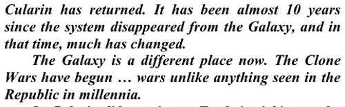

## p.5 (scan page 5)

Page contents: 859 words, 19 paragraphs | headings/entries: Encounter 1: Renna and an Offer; Outward Bound; Page 5

## p.1–5 (scan page 1)

Page contents: Title; boilerplate; GM overview (Clone Wars begun; First Light betrayal; Separatist bomb plot on Druckenwell); encounter summaries; opening crawl; E1 Renna (hand-read)

## p.6 (scan page 6)

Page contents: 881 words, 24 paragraphs | headings/entries: Renna has the following information:; Outward Bound; Page 6

## p.7 (scan page 7)

Page contents: 875 words, 21 paragraphs | headings/entries: Encounter 2: Thaereian Inspection; Outward Bound; Page 7

- **Darth Vader (Anakin Skywalker); Leia Organa Solo**: "A lot of clanking can be heard then as the docking tube is extended and attaches (think of the sounds heard as Vader's star destroyer docked with Leia's corvette in Star Wars: A New Hope)." Source: *215 - Looking In - Outward Bound* (SWRPG d20 Revised Core), p.7
  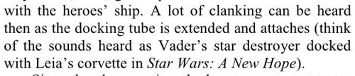

## p.8 (scan page 8)

Page contents: 917 words, 23 paragraphs | headings/entries: What are you carrying?; Who are you working for?; Outward Bound; Page 8

## p.9 (scan page 9)

Page contents: 777 words, 26 paragraphs | headings/entries: Encounter 3: Welcome to Druckenwell; Or, if the pilot failed the check:; Outward Bound; Page 9

## p.10 (scan page 10)

Page contents: 825 words, 20 paragraphs | headings/entries: Encounter 4: Jedi Knights and Clone Troopers; Outward Bound; Page 10

## p.11 (scan page 11)

Page contents: 901 words, 35 paragraphs | headings/entries: Outward Bound; Page 11

- **No single roster character (rules/setting/general)** — entry/section: E4: the clone trooper sergeant: ""You will come with us." The voice is emotionless, mechanized and a little chilling. "Leave all weapons aboard your ship. The Jedi may keep their lightsabers."" Source: *215 - Looking In - Outward Bound* (SWRPG d20 Revised Core), p.11
  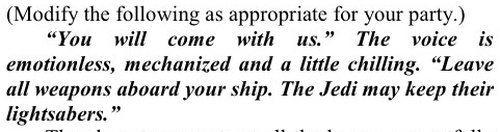
- **No single roster character (rules/setting/general)** — entry/section: E4: Renij Jaa: "Renij Jaa is the chief coordinator for the Republic forces here, and this irritates him. He is a Jedi, a protector of the Republic, and he wishes to be out there doing so, not stuck here. He is struggling to master his impatience and frustration, but his ill mood makes him abrupt and so he is to the point during the interview." Source: *215 - Looking In - Outward Bound* (SWRPG d20 Revised Core), p.11
  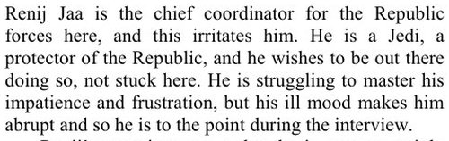

## p.6–11 (scan page 6)

Page contents: Renna Q&A; E2 Thaereian customs inspection and tracking beacon; E3 the Druckenwell chase; E4 the Republic station New Dawn, clone troopers and Jedi Knight Renij Jaa (hand-read)

## p.12 (scan page 12)

Page contents: 829 words, 21 paragraphs | headings/entries: Encounter 5: Dropping Off the Goods; Options for dealing with the Brotherhood:; Outward Bound; Page 12

## p.13 (scan page 13)

Page contents: 857 words, 23 paragraphs | headings/entries: What does the Brotherhood know?; Well, what to do now?; Encounter 6: Searching for a Needle; Outward Bound; Page 13

## p.14 (scan page 14)

Page contents: 886 words, 25 paragraphs | headings/entries: Outward Bound; Page 14

- **No single roster character (rules/setting/general)** — entry/section: E6: Fenix's tip: "Hah— that caught ya, did it? I'm guessin', from your reaction, that you'd just as soon not see a buncha them Republic soldiers die? My sources say that they've got 'em a ship, packed it with explosives & programmed a droid to ram it into one o' them big Acclamator-class ships." Source: *215 - Looking In - Outward Bound* (SWRPG d20 Revised Core), p.14
  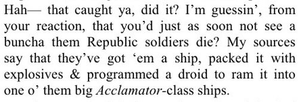

## p.15 (scan page 15)

Page contents: 981 words, 16 paragraphs | headings/entries: Contacting the Republic forces; Searching the rest of the ship; Conclusion; Outward Bound; Page 15

- **No single roster character (rules/setting/general)** — entry/section: E7: the bomb ship: "possible space in the initial cargo bay is crammed with explosives. These are not loose explosives that the party can collect for future use— they're packed and wired into the ship. Essentially, the entire ship is a bomb." Source: *215 - Looking In - Outward Bound* (SWRPG d20 Revised Core), p.15
  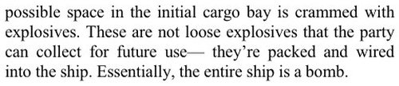

## p.16 (scan page 16)

Page contents: 714 words, 29 paragraphs | headings/entries: Here Ends Outward Bound; Experience Point Summary; Adventure Experience Award:; Loot Summary; Encounter 1: Renna and an Offer; Encounter 5: Dropping Off the Goods; Conclusion:; Outward Bound; Page 16

## p.17 (scan page 17)

Page contents: 151 words, 4 paragraphs | headings/entries: Outward Bound; Page 17

## p.12–17 (scan page 12)

Page contents: E5 the Brotherhood ambush; E6 the infochant Fenix; E7 the First Light bomb ship; conclusion; XP; loot (hand-read)

## p.18 (scan page 18)

Page contents: 363 words, 8 paragraphs | headings/entries: Player Handout 1: The Galaxy Today; Outward Bound Page 18

- **Count Dooku** — entry/section: Player Handout 1: the Separatists: "A faction, composed of individuals, organizations, planets and system, has come in to existence. Known as the Separatists, they feel the Republic government has become too efficient to function properly. Led by an ex-Jedi Master, Count Dooku, the Separatists have managed to sow chaos in the Republic. The Techno Union, Trade Federation, Intergalactic Banking Clan, Commerce Guild and Corporate Alliance are all major players among the Separatists." Source: *215 - Looking In - Outward Bound* (SWRPG d20 Revised Core), p.18
  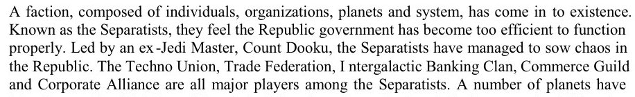
- **Yoda; Mace Windu** — entry/section: Player Handout 1: Geonosis: "An assassination attempt on Senator Amidala began a chain of events that ultimately led to the first battle of the Clone Wars, on Geonosis. Republic forces, led by members of the Jedi Council including Masters Yoda and Mace Windu, defeated the droid armies of the Separatists and sent them retreating from the planet." Source: *215 - Looking In - Outward Bound* (SWRPG d20 Revised Core), p.18
  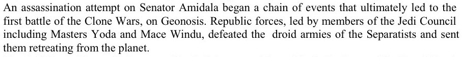
- **No single roster character (rules/setting/general)** — entry/section: Player Handout 1: the Jedi called to war: "The Jedi Council has called many of the Jedi to serve with, and lead, the Army of the Republic. A number of systems have lost their resident Jedi Masters and Knights to the army. Cularin has seen most of her "Masters" be called away to service." Source: *215 - Looking In - Outward Bound* (SWRPG d20 Revised Core), p.18
  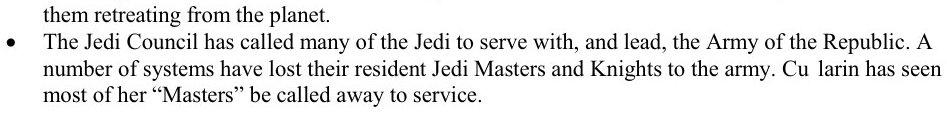

## p.19 (scan page 19)

Page contents: 552 words, 13 paragraphs | headings/entries: Player Handout 2: Why Am! on Cularin?; Outward Bound Page 19

- **No single roster character (rules/setting/general)** — entry/section: Player Handout 2: Force Adepts: "Force Adepts: Cularin is very strong in the Force. Maybe it's the bountiful life on the planet that causes this or maybe it's something else, but you feel very much at ease here." Source: *215 - Looking In - Outward Bound* (SWRPG d20 Revised Core), p.19
  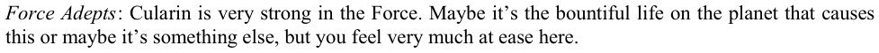

## p.20 (scan page 20)

Page contents: 11 words, 2 paragraphs | headings/entries: Player Handout 3— Renna's Transport Service Logo; Outward Bound Page 20

## p.21 (scan page 21)

Page contents: 349 words, 10 paragraphs | headings/entries: Player Handout 4: The Second Breath; Outward Bound Page 21

## p.22 (scan page 22)

Page contents: 676 words, 22 paragraphs | headings/entries: GM Aid #1: NPCs; Encounter 1: Renna and an Offer; Outward Bound Page 22

## p.23 (scan page 23)

Page contents: 653 words, 22 paragraphs | headings/entries: Outward Bound Page 23

- **No single roster character (rules/setting/general)** — entry/section: Clone troopers stat block: "Clone troopers: Human Male Thug 6; IM +1; Def 13 (+2 class, +1 Dex); Spd 8m; VP/WP -/12; Atk +7/+2 melee (1d3, unarmed) or +7/+2 ranged (3d8 or DC 18 stun, crit 19-20, blaster rifle); SQ DR 5 (armor), Immunities (cannot be bribed, blackmailed, or seduced); SV Fort +6, Ref +3, Will +1; SZ M; Rep +1; Str 12, Dex 13, Con 12, Int 10, Wis 8, Cha 9." Source: *215 - Looking In - Outward Bound* (SWRPG d20 Revised Core), p.23
  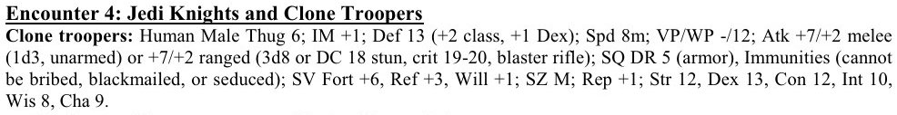

## p.24 (scan page 24)

Page contents: 655 words, 23 paragraphs | headings/entries: Encounter 5: Dropping off the Goods; Equipment: Jumpsuit, blaster pistol, datapad, comlink, vibrodagger; Equipment: Jumpsuit, blaster pistol, datapad, comlink, vibrodagger; Equipment: Jumpsuit, blaster pistol, datapad, comlink, vibrodagger; Outward Bound Page 24

## p.25 (scan page 25)

Page contents: 643 words, 24 paragraphs | headings/entries: Encounter 7: To Strike Where Least Expected; Outward Bound Page 25

## p.26 (scan page 26)

Page contents: 595 words, 23 paragraphs | headings/entries: Outward Bound Page 26

## p.27 (scan page 27)

Page contents: 25 words, 5 paragraphs | headings/entries: GM Map#1— Dropping off the Goods; Ground Entrance; Sky Gate (to Top Platform); Outward Bound Page 27

## p.28 (scan page 28)

Page contents: 10 words, 2 paragraphs | headings/entries: GM Map#2— Dropping off the Goods; Outward Bound Page 28

## p.29 (scan page 29)

Page contents: 168 words, 9 paragraphs | headings/entries: Critical Event Summary Outward Bound; Outward Bound Page 29

## p.18–29 (scan page 18)

Page contents: Player handouts (The Galaxy Today; Why Am I on Cularin?; RTS logo; Second Breath); GM Aid NPC stat blocks; maps; critical event summary (hand-read)

