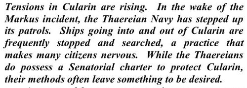
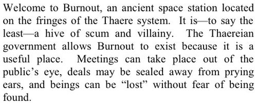
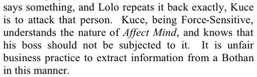
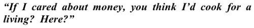
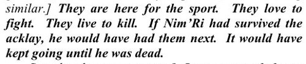
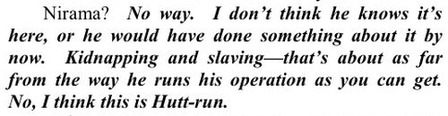
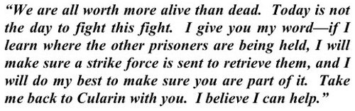
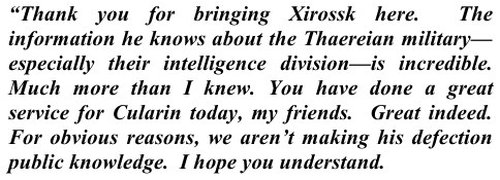
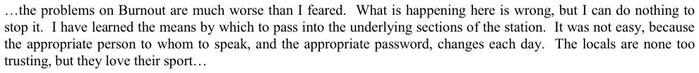

# Owner Material 037 — Star Wars D20 Drive folder (Core, Revised Core and Saga Edition): Living Force Campaign/Adventures/Among the Stars/Year 2/216 - Looking In - The Air Up Thaere.pdf [Star Wars Roleplaying Game Revised Core (d20, 2002)]

- **Source:** Wizards of the Coast Star Wars Roleplaying Game books, web enhancements, Living Force campaign modules and articles (2000–2010), from the owner's "Star Wars D20" Drive folder (only the three edition subfolders; "General" was not read, as instructed). Secondary source (licensed Legends reference). Scan OCR'd on the box; the scan stays box-only and is **not** published.
- **Method:** every scanned page was OCR'd and machine-screened sentence by sentence for power-relevant statements (fights, kills, defeats, Force feats, rankings, superweapons) that name a character on our roster; each kept sentence is quoted verbatim from the OCR text and has a crop of the printed passage directly under it. Pages with nothing power-relevant are still listed with what is on them.
- **Citation:** "*216 - Looking In - The Air Up Thaere* (SWRPG d20 Revised Core), p.X" by printed page ("scan p.X" where no printed number applies). **Weight:** Licensed RPG material: a secondary source. Narrative text sums up Legends lore; game statistics are rules for players, not canon power levels, and rank lowest.

## p.1 (scan page 1)

Page contents: 134 words, 5 paragraphs | headings/entries: The Air Up Thaere

## p.2 (scan page 2)

Page contents: 893 words, 18 paragraphs | headings/entries: Hero Earnings; Issuing Force and Dark Side Points; The Air Up Thaere; Page 2

## p.3 (scan page 3)

Page contents: 918 words, 21 paragraphs | headings/entries: General Notes to the GM; GM Overview; Encounter 1: Welcome Home (Cafetorium); The Air Up Thaere; Page 3

## p.4 (scan page 4)

Page contents: 764 words, 25 paragraphs | headings/entries: Encounter 2: Cubicle of Sorrow; Encounter 3: Enter Chef-Man; Encounter 4: Battery Central; Encounter 5: Central Battery; Encounter 6: Disposable Heroes; Encounter 7: Metal Militia; Important Note:; Opening Crawl; Encounter 1: Welcome Home (Cafetorium); The Air Up Thaere; Page 4

- **No single roster character (rules/setting/general)** — entry/section: Opening crawl: "Tensions in Cularin are rising. In the wake of the Markus incident, the Thaereian Navy has stepped up its patrols. Ships going into and out of Cularin are frequently stopped and searched, a practice that makes many citizens nervous. While the Thaereians do possess a Senatorial charter to protect Cularin, their methods often leave something to be desired." Source: *216 - Looking In - The Air Up Thaere* (SWRPG d20 Revised Core), p.4
  
- **No single roster character (rules/setting/general)** — entry/section: E1: Burnout: "Welcome to Burnout, an ancient space station located on the fringes of the Thaere system. It is—to say the least—a hive of scum and villainy. The Thaereian government allows Burnout to exist because it is a useful place. Meetings can take place out of the public's eye, deals may be sealed away from prying ears, and beings can be "lost" without fear of being found." Source: *216 - Looking In - The Air Up Thaere* (SWRPG d20 Revised Core), p.4
  

## p.1–4 (scan page 1)

Page contents: Title; boilerplate; GM overview (Xirossk sabotages the heroes' ship to lead them to Burnout's illegal gladiator arena); encounter summaries; opening crawl (hand-read)

## p.5 (scan page 5)

Page contents: 881 words, 23 paragraphs | headings/entries: Working the Crowd; The Air Up Thaere; Page 5

## p.6 (scan page 6)

Page contents: 716 words, 23 paragraphs | headings/entries: Finding Out About Xirossk; And what is behind the doors?; Encounter 2: Cubicle of Sorrow; The Air Up Thaere; Page 6

## p.7 (scan page 7)

Page contents: 832 words, 30 paragraphs | headings/entries: Talking to Lolo and Kuce; The Air Up Thaere; Page 7

## p.8 (scan page 8)

Page contents: 921 words, 15 paragraphs | headings/entries: Fighting with Lolo and Kuce; The Air Up Thaere; Page 8

- **No single roster character (rules/setting/general)** — entry/section: E2: Kuce and the Force: "Kuce, being Force-Sensitive, understands the nature of Affect Mind, and knows that his boss should not be subjected to it. It is unfair business practice to extract information from a Bothan in this manner." Source: *216 - Looking In - The Air Up Thaere* (SWRPG d20 Revised Core), p.8
  

## p.9 (scan page 9)

Page contents: 862 words, 23 paragraphs | headings/entries: Encounter 3: Enter Chef-Man; The Air Up Thaere; Page 9

- **No single roster character (rules/setting/general)** — entry/section: E3: Pappi: ""If I cared about money, you think I'd cook for a living? Here?"" Source: *216 - Looking In - The Air Up Thaere* (SWRPG d20 Revised Core), p.9
  

## p.10 (scan page 10)

Page contents: 874 words, 21 paragraphs | headings/entries: Encounter 4: Battery Central; The Air Up Thaere; Page 10

## p.11 (scan page 11)

Page contents: 914 words, 20 paragraphs | headings/entries: Encounter 5: Central Battery; Mid Tier (Levels 4 to 6); The Air Up Thaere; Page 11

## p.4–11 (scan page 4)

Page contents: E1 the Cafetorium chase; E2 Lolo and Kuce in the cube field; E3 Pappi the chef; E4 Amick Mudd and the passcode (hand-read)

## p.12 (scan page 12)

Page contents: 823 words, 22 paragraphs | headings/entries: Upper Tier (Levels 7 to 9); High Tier (Levels 10 to 12); Encounter 6: Disposable Heroes; Behind you, someone sighs. tried."; The Air Up Thaere; Page 12

## p.13 (scan page 13)

Page contents: 975 words, 24 paragraphs | headings/entries: Thaereian Intelligence.]; The Air Up Thaere; Page 13

- **No single roster character (rules/setting/general)** — entry/section: E6: Xirossk on the Kalmec: "They are here for the sport. They love to fight. They live to kill. If Nim'Ri had survived the acklay, he would have had them next. It would have kept going until he was dead." Source: *216 - Looking In - The Air Up Thaere* (SWRPG d20 Revised Core), p.13
  

## p.14 (scan page 14)

Page contents: 870 words, 28 paragraphs | headings/entries: If they; Encounter 7: Metal Militia; Escaping Burnout; The Air Up Thaere; Page 14

- **No single roster character (rules/setting/general)** — entry/section: E6: Xirossk on Nirama: "Nirama? No way. I don't think he knows it's here, or he would have done something about it by now. Kidnapping and slaving—that's about as far from the way he runs his operation as you can get. No, I think this is Hutt-run." Source: *216 - Looking In - The Air Up Thaere* (SWRPG d20 Revised Core), p.14
  
- **No single roster character (rules/setting/general)** — entry/section: E6: Xirossk's plea: ""We are all worth more alive than dead. Today is not the day to fight this fight. I give you my word—if I learn where the other prisoners are being held, I will make sure a strike force is sent to retrieve them, and I will do my best to make sure you are part of it. Take me back to Cularin with you. I believe I can help."" Source: *216 - Looking In - The Air Up Thaere* (SWRPG d20 Revised Core), p.14
  

## p.15 (scan page 15)

Page contents: 896 words, 22 paragraphs | headings/entries: Conclusion; The Air Up Thaere; Page 15

- **No single roster character (rules/setting/general)** — entry/section: Conclusion: Osten Dal'Nay: ""Thank you for bringing Xirossk here. The information he knows about the Thaereian military— especially their intelligence division—is incredible. Much more than I knew. You have done a great service for Cularin today, my friends. Great indeed. For obvious reasons, we aren't making his defection public knowledge. I hope you understand." Source: *216 - Looking In - The Air Up Thaere* (SWRPG d20 Revised Core), p.15
  

## p.16 (scan page 16)

Page contents: 673 words, 22 paragraphs | headings/entries: Here Ends The Air Up Thaere; Experience Point Summary; Adventure Experience Award:; Loot Summary; Encounter 6:; Conclusion:; The Air Up Thaere; Page 16

## p.11–16 (scan page 11)

Page contents: E5 the Wookiee arena fighters on the catwalks; E6 Nim'Ri's death and Xirossk's defection; E7 escape from Burnout; conclusion with Osten Dal'Nay; XP; loot (hand-read)

## p.17 (scan page 17)

Page contents: 109 words, 5 paragraphs | headings/entries: Player Handout 1: Xirossk's Datachips; The Air Up Thaere Page 17

- **No single roster character (rules/setting/general)** — entry/section: Player Handout 1: Xirossk's datachips: "...the problems on Burnout are much worse than I feared. What is happening here is wrong, but I can do nothing to stop it. I have learned the means by which to pass into the underlying sections of the station. It was not easy, because the appropriate person to whom to speak, and the appropriate password, changes each day. The locals are none too trusting, but they love their sport..." Source: *216 - Looking In - The Air Up Thaere* (SWRPG d20 Revised Core), p.17
  

## p.18 (scan page 18)

Page contents: 641 words, 25 paragraphs | headings/entries: GM Aid #1: NPC Stats; Encounter 1: Welcome Home (Cafetorium); The Air Up Thaere Page 18

## p.19 (scan page 19)

Page contents: 614 words, 25 paragraphs | headings/entries: Encounter 3: Enter Chef-Man; The Air Up Thaere Page 19

## p.20 (scan page 20)

Page contents: 277 words, 12 paragraphs | headings/entries: The Air Up Thaere Page 20

## p.21 (scan page 21)

Page contents: 115 words, 6 paragraphs | headings/entries: Critical Event Summary The Air Up Thaere; Yes No; The Air Up Thaere Page 21

## p.17–21 (scan page 17)

Page contents: Player handout (Xirossk's datachips); GM Aid NPC stat blocks; critical event summary (hand-read)

