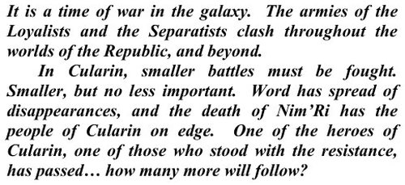
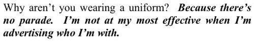
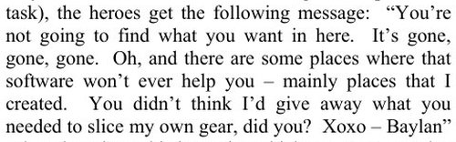
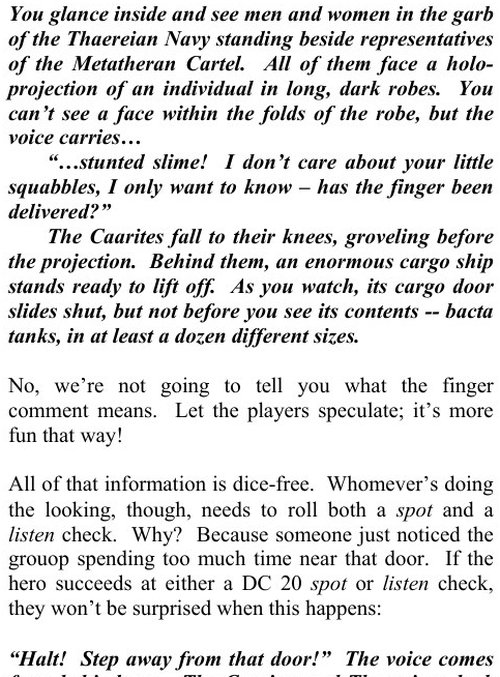
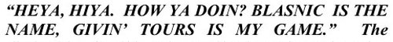
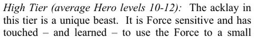
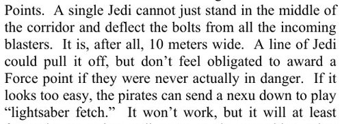
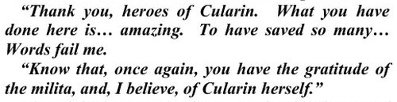
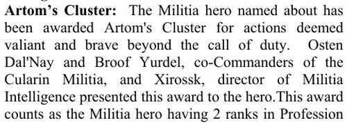
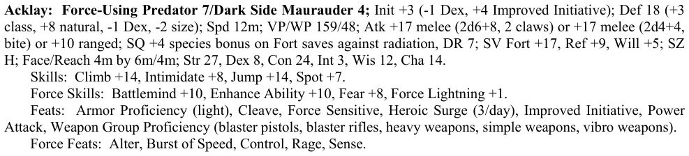

# Owner Material 037 — Star Wars D20 Drive folder (Core, Revised Core and Saga Edition): Living Force Campaign/Adventures/Among the Stars/Year 2/217 - Looking In - Memories.pdf [Star Wars Roleplaying Game Revised Core (d20, 2002)]

- **Source:** Wizards of the Coast Star Wars Roleplaying Game books, web enhancements, Living Force campaign modules and articles (2000–2010), from the owner's "Star Wars D20" Drive folder (only the three edition subfolders; "General" was not read, as instructed). Secondary source (licensed Legends reference). Scan OCR'd on the box; the scan stays box-only and is **not** published.
- **Method:** every scanned page was OCR'd and machine-screened sentence by sentence for power-relevant statements (fights, kills, defeats, Force feats, rankings, superweapons) that name a character on our roster; each kept sentence is quoted verbatim from the OCR text and has a crop of the printed passage directly under it. Pages with nothing power-relevant are still listed with what is on them.
- **Citation:** "*217 - Looking In - Memories* (SWRPG d20 Revised Core), p.X" by printed page ("scan p.X" where no printed number applies). **Weight:** Licensed RPG material: a secondary source. Narrative text sums up Legends lore; game statistics are rules for players, not canon power levels, and rank lowest.

## p.1 (scan page 1)

Page contents: 124 words, 5 paragraphs | headings/entries: Memories

## p.2 (scan page 2)

Page contents: 906 words, 18 paragraphs | headings/entries: Memories; Issuing Force and Dark Side Points; Page 2

## p.3 (scan page 3)

Page contents: 898 words, 19 paragraphs | headings/entries: General Notes to the GM; Memories; GM Overview; Encounter 1: Duty Calls; Encounter 2: Horizon; Page 3

## p.4 (scan page 4)

Page contents: 772 words, 24 paragraphs | headings/entries: Encounter 3: Meeting of the Minds; Encounter 4: Extraction; Encounter 5: Burnout; Encounter 7: _...and Beyond; Memories; Opening Crawl; Encounter 1: Duty Calls; Page 4

- **No single roster character (rules/setting/general)** — entry/section: Opening crawl: "It is a time of war in the galaxy. The armies of the Loyalists and the Separatists clash throughout the worlds of the Republic, and beyond.
In Cularin, smaller battles must be fought. Smaller, but no less important. Word has spread of disappearances, and the death of Nim'Ri has the people of Cularin on edge. One of the heroes of Cularin, one of those who stood with the resistance, has passed... how many more will follow?" Source: *217 - Looking In - Memories* (SWRPG d20 Revised Core), p.4
  

## p.1–4 (scan page 1)

Page contents: Title; boilerplate; GM overview (rescue of abducted Cularin citizens from T-4 and Burnout); encounter summaries; opening crawl (hand-read)

## p.5 (scan page 5)

Page contents: 890 words, 20 paragraphs | headings/entries: Memories; Page 5

## p.6 (scan page 6)

Page contents: 825 words, 23 paragraphs | headings/entries: Memories; Page 6

- **No single roster character (rules/setting/general)** — entry/section: E1: Xirossk on uniforms: "Why aren't you wearing a uniform? Because there's no parade. I'm not at my most effective when I'm advertising who I'm with." Source: *217 - Looking In - Memories* (SWRPG d20 Revised Core), p.6
  

## p.7 (scan page 7)

Page contents: 889 words, 18 paragraphs | headings/entries: Memories; Encounter 2: Horizon; Page 7

- **No single roster character (rules/setting/general)** — entry/section: E1: Baylan's message (Computer Use 55): ""You're not going to find what you want in here. It's gone, gone, gone. Oh, and there are some places where that software won't ever help you — mainly places that I created. You didn't think I'd give away what you needed to slice my own gear, did you? Xoxo — Baylan"" Source: *217 - Looking In - Memories* (SWRPG d20 Revised Core), p.7
  

## p.8 (scan page 8)

Page contents: 992 words, 16 paragraphs | headings/entries: Memories; Page 8

## p.9 (scan page 9)

Page contents: 801 words, 20 paragraphs | headings/entries: Encounter 3: Meeting of the Minds; Memories; Page 9

## p.10 (scan page 10)

Page contents: 885 words, 21 paragraphs | headings/entries: Encounter 4: Extraction; Memories; Talking Their Way Out; Opening Fire Immediately; Page 10

- **No single roster character (rules/setting/general)** — entry/section: E3: the hooded holoprojection: "You glance inside and see men and women in the garb of the Thaereian Navy standing beside representatives of the Metatheran Cartel. All of them face a holoprojection of an individual in long, dark robes. You can't see a face within the folds of the robe, but the voice carries...
"... stunted slime! I don't care about your little squabbles, I only want to know — has the finger been delivered?"
The Caarites fall to their knees, groveling before the projection. Behind them, an enormous cargo ship stands ready to lift off: As you watch, its cargo door slides shut, but not before you see its contents -- bacta tanks, in at least a dozen different sizes.
No, we're not going to tell you what the finger comment means. Let the players speculate; it's more fun that way!" Source: *217 - Looking In - Memories* (SWRPG d20 Revised Core), p.10
  

## p.4–10 (scan page 4)

Page contents: E1 Osten Dal'Nay and Xirossk brief the heroes; Baylan's messages; E2 infiltration of T-4; E3 the Cartel/Thaereian Navy meeting with a hooded holoprojection and bacta tanks (hand-read)

## p.11 (scan page 11)

Page contents: 940 words, 21 paragraphs | headings/entries: Memories; Encounter 5: Burnout; Page 11

## p.12 (scan page 12)

Page contents: 863 words, 24 paragraphs | headings/entries: Memories; Page 12

- **No single roster character (rules/setting/general)** — entry/section: E5: Blasnic: ""HEYA, HIYA. HOW YA DOIN? BLASNIC IS THE NAME, GIVIN' TOURS IS MY GAME."" Source: *217 - Looking In - Memories* (SWRPG d20 Revised Core), p.12
  

## p.13 (scan page 13)

Page contents: 824 words, 28 paragraphs | headings/entries: Memories; Page 13

## p.14 (scan page 14)

Page contents: 852 words, 24 paragraphs | headings/entries: Memories; Talking with the prisoners:; Page 14

- **No single roster character (rules/setting/general)** — entry/section: E6: the high-tier acklay: "The acklay in this tier is a unique beast. It is Force sensitive and has touched — and learned — to use the Force to a small extent. As the blast door rises, the acklay takes 10 on its Enhance Ability skill and gains a +4 Force bonus to its Strength (27 becomes 31). Once in the arena, the beast just wants to kill. It is cunning and fights beings that attack it first. (Note: the acklay's Force Lightning manifests as a blast of lightning from its mouth, not claws.)" Source: *217 - Looking In - Memories* (SWRPG d20 Revised Core), p.14
  

## p.15 (scan page 15)

Page contents: 865 words, 28 paragraphs | headings/entries: Encounter 7: ...and Beyond; Memories; Page 15

## p.16 (scan page 16)

Page contents: 943 words, 20 paragraphs | headings/entries: Going through Burnout; Calling the Ship/Exit Through the Airlock; Memories; Conclusion; Page 16

- **No single roster character (rules/setting/general)** — entry/section: E7: heroism and Force Points: "A single Jedi cannot just stand in the middle of the corridor and deflect the bolts from all the incoming blasters. It is, after all, 10 meters wide. A line of Jedi could pull it off, but don't feel obligated to award a Force point if they were never actually in danger. If it looks too easy, the pirates can send a nexu down to play "lightsaber fetch."" Source: *217 - Looking In - Memories* (SWRPG d20 Revised Core), p.16
  

## p.17 (scan page 17)

Page contents: 684 words, 26 paragraphs | headings/entries: Here Ends "Memories"; Memories; Experience Point Summary; Adventure Experience Award:; Page 17

- **No single roster character (rules/setting/general)** — entry/section: Conclusion: Osten Dal'Nay: ""Thank you, heroes of Cularin. What you have done here is... amazing. To have saved so many... Words fail me.
"Know that, once again, you have the gratitude of the milita, and, I believe, of Cularin herself."" Source: *217 - Looking In - Memories* (SWRPG d20 Revised Core), p.17
  

## p.18 (scan page 18)

Page contents: 798 words, 21 paragraphs | headings/entries: Loot Summary; Encounter 1:; O0; Memories; Encounter 4:; Encounter 7:; Conclusion:; Page 18

- **No single roster character (rules/setting/general)** — entry/section: Artom's Cluster: "Artom's Cluster: The Militia hero named about has been awarded Artom's Cluster for actions deemed valiant and brave beyond the call of duty. Osten Dal'Nay and Broof Yurdel, co-Commanders of the Cularin Militia, and Xirossk, director of Militia Intelligence presented this award to the hero." Source: *217 - Looking In - Memories* (SWRPG d20 Revised Core), p.18
  

## p.10–18 (scan page 10)

Page contents: E4 extraction from T-4 (Bellus Tan); E5 back to Burnout (Aren D'skaun, Blasnic); E6 the arena (massiffs, acklay); E7 the beast pens and airlock escape; conclusion on Dorumaa; XP; loot (hand-read)

## p.19 (scan page 19)

Page contents: 118 words, 30 paragraphs | headings/entries: Hero Name; Init Mod Dex; VP/WP Def; Species Gender; Class(es) Lvi(s); Player Name RPGA#; Hero Name; Init Mod Dex; VP/WP Def; Species Gender; Class(es) Lvi(s); Player Name RPGA#; Hero Name; Init Mod Dex; VP/WP Def; Species Gender; Class(es) LvI(s); Player Name RPGA#; Memories; Page 19

## p.20 (scan page 20)

Page contents: 587 words, 26 paragraphs | headings/entries: GM Aid #1: NPC Stats; Memories Page 20

## p.21 (scan page 21)

Page contents: 580 words, 22 paragraphs | headings/entries: Memories Page 21

## p.22 (scan page 22)

Page contents: 662 words, 24 paragraphs | headings/entries: Memories Page 22

- **No single roster character (rules/setting/general)** — entry/section: Acklay (high tier) stat block: "Acklay: Force-Using Predator 7/Dark Side Maurauder 4; Init +3 (-1 Dex, +4 Improved Initiative); Def 18 (+3 class, +8 natural, -1 Dex, -2 size); Spd 12m; VP/WP 159/48; Atk +17 melee (2d6+8, 2 claws) or +17 melee (2d4+4, bite) or +10 ranged; SQ +4 species bonus on Fort saves against radiation, DR 7; SV Fort +17, Ref +9, Will +5; SZ H; Face/Reach 4m by 6m/4m; Str 27, Dex 8, Con 24, Int 3, Wis 12, Cha 14.
Force Skills: Battlemind +10, Enhance Ability +10, Fear +8, Force Lightning +1.
Force Feats: Alter, Burst of Speed, Control, Rage, Sense." Source: *217 - Looking In - Memories* (SWRPG d20 Revised Core), p.22
  

## p.23 (scan page 23)

Page contents: 284 words, 11 paragraphs | headings/entries: High Tier (average Hero levels 10-12); Memories Page 23

## p.24 (scan page 24)

Page contents: 164 words, 5 paragraphs | headings/entries: Memories Page 24

## p.19–24 (scan page 19)

Page contents: Hero reference cards; GM Aid NPC stat blocks; critical event summary (hand-read)

