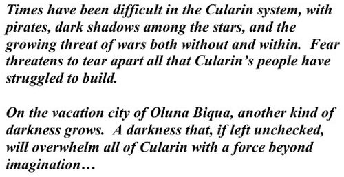
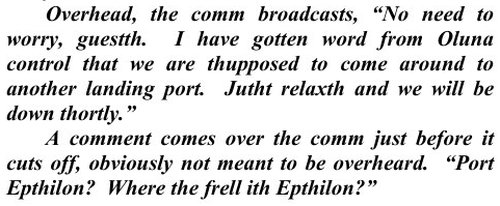
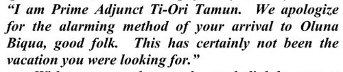
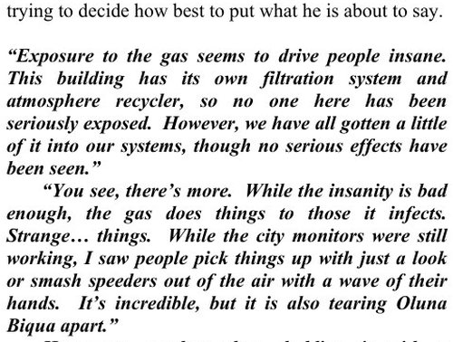
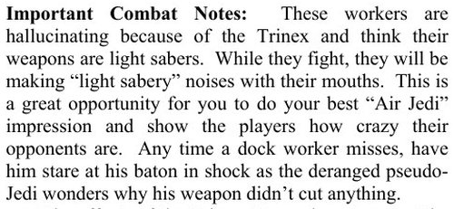
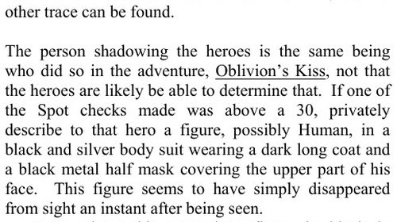
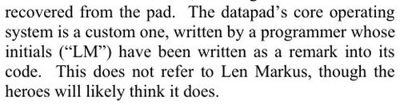
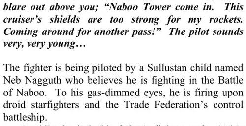
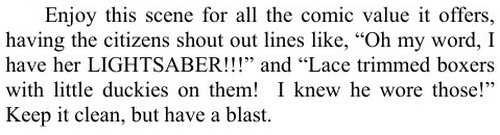
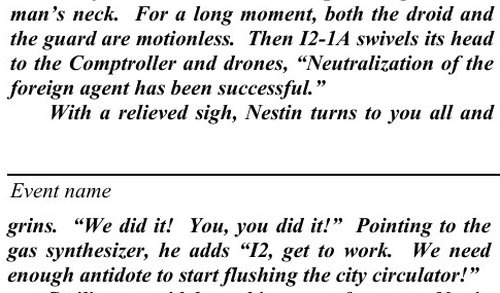

# Owner Material 037 — Star Wars D20 Drive folder (Core, Revised Core and Saga Edition): Living Force Campaign/Adventures/Among the Stars/Year 2/218 - No Place Like Home.pdf [Star Wars Roleplaying Game Revised Core (d20, 2002)]

- **Source:** Wizards of the Coast Star Wars Roleplaying Game books, web enhancements, Living Force campaign modules and articles (2000–2010), from the owner's "Star Wars D20" Drive folder (only the three edition subfolders; "General" was not read, as instructed). Secondary source (licensed Legends reference). Scan OCR'd on the box; the scan stays box-only and is **not** published.
- **Method:** every scanned page was OCR'd and machine-screened sentence by sentence for power-relevant statements (fights, kills, defeats, Force feats, rankings, superweapons) that name a character on our roster; each kept sentence is quoted verbatim from the OCR text and has a crop of the printed passage directly under it. Pages with nothing power-relevant are still listed with what is on them.
- **Citation:** "*218 - No Place Like Home* (SWRPG d20 Revised Core), p.X" by printed page ("scan p.X" where no printed number applies). **Weight:** Licensed RPG material: a secondary source. Narrative text sums up Legends lore; game statistics are rules for players, not canon power levels, and rank lowest.

## p.1 (scan page 1)

Page contents: 103 words, 5 paragraphs | headings/entries: No Place Like Home; A One-Round LIVING FORCE Tournament

## p.2 (scan page 2)

Page contents: 921 words, 22 paragraphs | headings/entries: Event name; Issuing Force and Dark Side Points; Page 2

## p.3 (scan page 3)

Page contents: 893 words, 19 paragraphs | headings/entries: General Notes to the GM; Event name; GM Overview; Page 3

## p.4 (scan page 4)

Page contents: 826 words, 25 paragraphs | headings/entries: Encounter 1:; Event name; Encounter 3:; Encounter 4:; Encounter 5:; Encounter 6:; Page 4

## p.5 (scan page 5)

Page contents: 781 words, 23 paragraphs | headings/entries: Encounter 7:; Opening Crawl; Encounter 1: Suspicious Arrival; Event name; Page 5

- **No single roster character (rules/setting/general)** — entry/section: Opening crawl: "Times have been difficult in the Cularin system, with pirates, dark shadows among the stars, and the growing threat of wars both without and within. Fear threatens to tear apart all that Cularin's people have struggled to build.
On the vacation city of Oluna Biqua, another kind of darkness grows. A darkness that, if left unchecked, will overwhelm all of Cularin with a force beyond imagination..." Source: *218 - No Place Like Home* (SWRPG d20 Revised Core), p.5
  
- **No single roster character (rules/setting/general)** — entry/section: Dellko over the comm: ""No need to worry, guestth. I have gotten word from Oluna control that we are thupposed to come around to another landing port. Jutht relaxth and we will be down thortly."
A comment comes over the comm just before it cuts off, obviously not meant to be overheard. "Port Epthilon? Where the frell ith Epthilon?"" Source: *218 - No Place Like Home* (SWRPG d20 Revised Core), p.5
  

## p.1–5 (scan page 1)

Page contents: Title; boilerplate; GM overview of the Trinex-M gas (Cartel freighter Porthoy, altered by the Darkstaff's lightning) loose on Oluna Biqua; encounter summaries; opening crawl (hand-read)

## p.6 (scan page 6)

Page contents: 889 words, 23 paragraphs | headings/entries: Event name; As Ti-Ori Tamun approaches the Headliner:; Page 6

- **No single roster character (rules/setting/general)** — entry/section: Ti-Ori Tamun greets the heroes: ""I am Prime Adjunct Ti-Ori Tamun. We apologize for the alarming method of your arrival to Oluna Biqua, good folk. This has certainly not been the vacation you were looking for."" Source: *218 - No Place Like Home* (SWRPG d20 Revised Core), p.6
  

## p.7 (scan page 7)

Page contents: 776 words, 30 paragraphs | headings/entries: Encounter 2:; A Plea for Aid, or 'Some Vacation...'; Event name; Page 7

## p.8 (scan page 8)

Page contents: 911 words, 26 paragraphs | headings/entries: Event name; Page 8

- **No single roster character (rules/setting/general)** — entry/section: Nestin Thokor on the gas: ""Exposure to the gas seems to drive people insane. This building has its own filtration system and atmosphere recycler, so no one here has been seriously exposed. However, we have all gotten a little of it into our systems, though no serious effects have been seen."
"You see, there's more. While the insanity is bad enough, the gas does things to those it infects. Strange... things. While the city monitors were still working, I saw people pick things up with just a look or smash speeders out of the air with a wave of their hands. It's incredible, but it is also tearing Oluna Biqua apart."" Source: *218 - No Place Like Home* (SWRPG d20 Revised Core), p.8
  

## p.9 (scan page 9)

Page contents: 868 words, 24 paragraphs | headings/entries: Encounter 3: An Elusive Hunt; Event name; Page 9

- **No single roster character (rules/setting/general)** — entry/section: Dockworkers who think they are Jedi: "These workers are hallucinating because of the Trinex and think their weapons are light sabers. While they fight, they will be making "light sabery" noises with their mouths. This is a great opportunity for you to do your best "Air Jedi" impression and show the players how crazy their opponents are. Any time a dock worker misses, have him stare at his baton in shock as the deranged pseudo- Jedi wonders why his weapon didn't cut anything." Source: *218 - No Place Like Home* (SWRPG d20 Revised Core), p.9
  

## p.10 (scan page 10)

Page contents: 743 words, 33 paragraphs | headings/entries: Tier One:; Equipment: Stun batons, workman's uniform; Tier Two:; Equipment: Stun baton, workman's uniform; Tier Three:; Equipment: Stun baton, workman's uniform; Event name; Encounter 4: Chasing the Last Canister; Page 10

## p.11 (scan page 11)

Page contents: 880 words, 23 paragraphs | headings/entries: Event name; Page 11

## p.12 (scan page 12)

Page contents: 862 words, 26 paragraphs | headings/entries: Encounter 5: Anarchy in the Streets; Event name; Encounter 5-A: Rambles of the Lost; Page 12

- **No single roster character (rules/setting/general)** — entry/section: Oblivion's Kiss: "The person shadowing the heroes is the same being who did so in the adventure, Oblivion's Kiss, not that the heroes are likely be able to determine that. If one of the Spot checks made was above a 30, privately describe to that hero a figure, possibly Human, in a black and silver body suit wearing a dark long coat and a black metal half mask covering the upper part of his face. This figure seems to have simply disappeared from sight an instant after being seen." Source: *218 - No Place Like Home* (SWRPG d20 Revised Core), p.12
  
- **No single roster character (rules/setting/general)** — entry/section: The 'LM' datapad: "The datapad's core operating system is a custom one, written by a programmer whose initials ("LM") have been written as a remark into its code. This does not refer to Len Markus, though the heroes will likely think it does." Source: *218 - No Place Like Home* (SWRPG d20 Revised Core), p.12
  

## p.13 (scan page 13)

Page contents: 857 words, 25 paragraphs | headings/entries: Encounter 5-B: Riding the Lightning; Encounter 5-C: Lights in the Darkness; Event name; Page 13

- **No single roster character (rules/setting/general)** — entry/section: Neb Nagguth: ""Naboo Tower come in. This cruiser's shields are too strong for my rockets. Coming around for another pass!" The pilot sounds very, very young...
The fighter is being piloted by a Sullustan child named Neb Nagguth who believes he is fighting in the Battle of Naboo. To his gas-dimmed eyes, he is firing upon droid starfighters and the Trade Federation's control battleship." Source: *218 - No Place Like Home* (SWRPG d20 Revised Core), p.13
  

## p.14 (scan page 14)

Page contents: 851 words, 23 paragraphs | headings/entries: Encounter 5-D: The Teeming Horde; Event name; Encounter 6: The Shining Spire; Page 14

- **No single roster character (rules/setting/general)** — entry/section: The Teeming Horde: "Enjoy this scene for all the comic value it offers, having the citizens shout out lines like, "Oh my word, I have her LIGHTSABER!!!" and "Lace trimmed boxers with little duckies on them! I knew he wore those!" Keep it clean, but have a blast." Source: *218 - No Place Like Home* (SWRPG d20 Revised Core), p.14
  

## p.5–14 (scan page 5)

Page contents: E1 arrival on the Headliner at Port Epsilon; E2 Comptroller Nestin Thokor asks for a gas sample; E3 Bay 18 and the 'Jedi' dockworkers; E4 Morth the Farseeing madman and the shadowing figure; E5 street madness (Ellor Koota, Miko, Neb Nagguth, the Teeming Horde) (hand-read)

## p.15 (scan page 15)

Page contents: 801 words, 31 paragraphs | headings/entries: Event name; Page 15

## p.16 (scan page 16)

Page contents: 784 words, 26 paragraphs | headings/entries: Tier One:; Event name; Tier Two:; Tier Three:; Page 16

## p.17 (scan page 17)

Page contents: 894 words, 23 paragraphs | headings/entries: Event name; Page 17

## p.18 (scan page 18)

Page contents: 745 words, 31 paragraphs | headings/entries: Watch character 'evil' actions; Encounter 7:; Event name; Conclusion; Here Ends, "No Place Like Home"; Experience Point Summary; Page 18

- **No single roster character (rules/setting/general)** — entry/section: I2-1A and Nestin: "Then I2-1A swivels its head to the Comptroller and drones, "Neutralization of the foreign agent has been successful."
With a relieved sigh, Nestin turns to you all and grins. "We did it! You, you did it!" Pointing to the gas synthesizer, he adds "I2, get to work. We need enough antidote to start flushing the city circulator!"" Source: *218 - No Place Like Home* (SWRPG d20 Revised Core), p.18
  

## p.19 (scan page 19)

Page contents: 279 words, 13 paragraphs | headings/entries: Adventure Experience Award:; Loot Summary; Event name; Page 19

## p.14–19 (scan page 14)

Page contents: E6 the main power complex, Caarite scientists and hired guns; E7 the cure; conclusion; XP and loot (hand-read)

## p.20 (scan page 20)

Page contents: 369 words, 10 paragraphs | headings/entries: Player Handout 1: Communiqué from Oluna Biqua; Hail and good day to you!; Thank you for your consideration,; Elkan Danneer, Oluna Biqua Tourism Department; Event name Page 20

## p.21 (scan page 21)

Page contents: 28 words, 8 paragraphs | headings/entries: Player Handout 2: Map of the Lab; Workbenches with Consoles _—Niitrogen; Canister " | Shelves; Sl; Event name Page 21

## p.22 (scan page 22)

Page contents: 600 words, 22 paragraphs | headings/entries: Appendix A: Important NPCs; Introduction: The Spaceport; Range Modifiers: PB+0, S+0, M/L n/a; Encounter 1: Suspicious Arrival; Event name Page 22

## p.23 (scan page 23)

Page contents: 617 words, 28 paragraphs | headings/entries: Feats: Ambidexterity, Surgery, Weapon Proficiency (blaster pistols); Encounter 3: An Elusive Hunt Tier One:; Equipment: Vibroblade, workman's uniform; Tier Two:; Equipment: Vibroblade, workman's uniform; Equipment: Vibroblade, workman's uniform; Event name Page 23

## p.24 (scan page 24)

Page contents: 590 words, 28 paragraphs | headings/entries: Equipment: Street clothes, reptile-hide sleeveless jacket; Skills: Climb +2, Intimidate +4, Tumble +5; Encounter 6: The Shining Spire; Tier One:; Event name Page 24

## p.25 (scan page 25)

Page contents: 530 words, 19 paragraphs | headings/entries: Tier Two:; Tier Three:; Event name Page 25

## p.26 (scan page 26)

Page contents: 489 words, 9 paragraphs | headings/entries: Appendix B: Exposure to the Trinex-M Gas; Event name Page 26

## p.27 (scan page 27)

Page contents: 153 words, 9 paragraphs | headings/entries: Critical Event Summary No Place Like Home; Yes No; Event name Page 27

## p.20–27 (scan page 20)

Page contents: Player handouts; Appendix A NPC stats; Appendix B Trinex-M exposure table; critical event summary (hand-read)

