# Owner Material 037 — Star Wars D20 Drive folder (Core, Revised Core and Saga Edition): Living Force Campaign/Adventures/Among the Stars/Year 3/301 - Forces of Cularin - Force Concession.pdf [Star Wars Roleplaying Game Revised Core (d20, 2002)]

- **Source:** Wizards of the Coast Star Wars Roleplaying Game books, web enhancements, Living Force campaign modules and articles (2000–2010), from the owner's "Star Wars D20" Drive folder (only the three edition subfolders; "General" was not read, as instructed). Secondary source (licensed Legends reference). Scan OCR'd on the box; the scan stays box-only and is **not** published.
- **Method:** every scanned page was OCR'd and machine-screened sentence by sentence for power-relevant statements (fights, kills, defeats, Force feats, rankings, superweapons) that name a character on our roster; each kept sentence is quoted verbatim from the OCR text and has a crop of the printed passage directly under it. Pages with nothing power-relevant are still listed with what is on them.
- **Citation:** "*301 - Forces of Cularin - Force Concession* (SWRPG d20 Revised Core), p.X" by printed page ("scan p.X" where no printed number applies). **Weight:** Licensed RPG material: a secondary source. Narrative text sums up Legends lore; game statistics are rules for players, not canon power levels, and rank lowest.

## p.1 (scan page 1)

Page contents: 144 words, 6 paragraphs | headings/entries: Force Concession; Edited by Jae Walker

## p.2 (scan page 2)

Page contents: 906 words, 18 paragraphs | headings/entries: Force Concession; Issuing Force and Dark Side Points; Page 2

## p.3 (scan page 3)

Page contents: 927 words, 17 paragraphs | headings/entries: General Notes to the GM; Force Concession; GM Overview; Encounter 1: Professional Help; Page 3

- **No single roster character (rules/setting/general)** — entry/section: GM overview: the t'salak: "Shortly after humans came to Cularin, a terrible creature threatened the Tarasin. It was quick, cunning and almost certainly a servant of the Dark Side. Its essence was hatred, a hatred that consumed the minds of those who came in contact with the creature. The Tarasin called it "the t'salak". Over the course of many battles -- and far too many losses -- the Tarasin realized that the creature could not be killed. After many days of meditation, one of the wisest of the Tarasin Mothers imbued a ceremonial clay urn with the positive energy of the Force to create a vessel to contain the demon." Source: *301 - Forces of Cularin - Force Concession* (SWRPG d20 Revised Core), p.3
  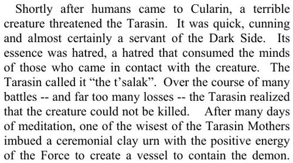
- **No single roster character (rules/setting/general)** — entry/section: GM overview: the intruder: "Elsewhere, someone watched. When all was quiet, the lone figure disembarked from a vehicle and opened the prison door. She stalked inside with quiet confidence, passing tests and challenges left by Tarasin long-dead. At the final obstacle, however, she was stymied, prevented by her ties to the Dark Side from achieving her ultimate goal. Fury consumed her, and she unleashed it upon the hapless building team." Source: *301 - Forces of Cularin - Force Concession* (SWRPG d20 Revised Core), p.3
  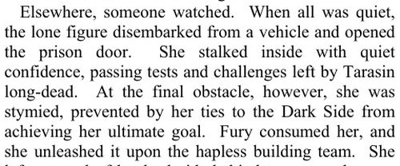

## p.4 (scan page 4)

Page contents: 771 words, 25 paragraphs | headings/entries: Encounter 3: The River Far Below; Encounter 4: Hokey Religions and Ancient Weapons; Force Concession; Encounter 6: Demon's Revenge; Conclusion; Important Note to Judges:; Opening Crawl; Encounter 1: Professional Help; Page 4

- **No single roster character (rules/setting/general)** — entry/section: Opening crawl: "While the raging conflict known as the Clone Wars burns its way across the Republic, the inhabitants of Cularin find comfort in the regularity of daily routine. Holonews reports of Clone Wars are certainly part of that routine, but not the central focus. As Cularin adjusts to a galaxy that left it behind, people again find time for leisure pursuits. News of construction of a galactic-quality racecourse in the jungle of Cularin suggests better times ahead, but in dark times, dark forces are everywhere..." Source: *301 - Forces of Cularin - Force Concession* (SWRPG d20 Revised Core), p.4
  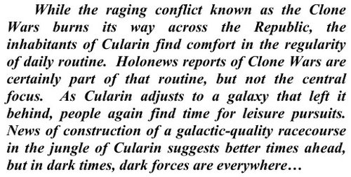

## p.1–4 (scan page 1)

Page contents: Title; boilerplate; GM overview of the t'salak and its Tarasin prison; encounter summaries; opening crawl (hand-read)

## p.5 (scan page 5)

Page contents: 876 words, 22 paragraphs | headings/entries: Force Concession; Page 5

- **No single roster character (rules/setting/general)** — entry/section: Thaedius Creed's recorded message: ""Greetings, <Hero's name>. I am Thaedius Creed, president of CreedCon. I am in need of someone with certain unique talents and you come highly recommended. I have a <dramatic pause> situation I would like to discuss with you. I will, of course, compensate you for your services should we come to an agreement."" Source: *301 - Forces of Cularin - Force Concession* (SWRPG d20 Revised Core), p.5
  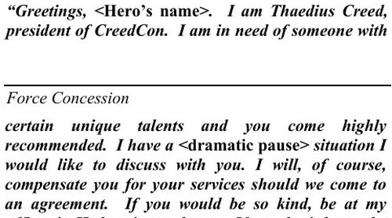

## p.6 (scan page 6)

Page contents: 831 words, 22 paragraphs | headings/entries: So... assuming the heroes accept his offer:; Force Concession; Page 6

## p.7 (scan page 7)

Page contents: 770 words, 24 paragraphs | headings/entries: Encounter 2:; Igniting the Interest of the Tarasin; Force Concession; She quickly spits out the following instructions:; Page 7

- **No single roster character (rules/setting/general)** — entry/section: Thaedius Creed: "Creed stands up again and shakes your hands again. "I thank you for your help. As the Jedi say, may the Force be with you."" Source: *301 - Forces of Cularin - Force Concession* (SWRPG d20 Revised Core), p.7
  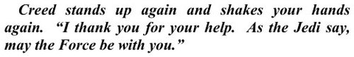

## p.8 (scan page 8)

Page contents: 874 words, 21 paragraphs | headings/entries: Force Concession; Page 8

- **No single roster character (rules/setting/general)** — entry/section: Morad'Ka on the 'Jedi' visitor: "Who could have done this? I do not know. Most likely is a Human Jedi who came to our irstat yesterday and asked me to accompany him to a cave. For the good of the system, he said, but something seemed very wrong about him. I refused his request. This did anger the Jedi very much. He stormed out of our village screaming curses on us.
What do you mean you didn't like the sense of him? He didn't seem entirely like he was supposed to. That's all I can say, I'm afraid. It was a wrongness that I felt more than saw." Source: *301 - Forces of Cularin - Force Concession* (SWRPG d20 Revised Core), p.8
  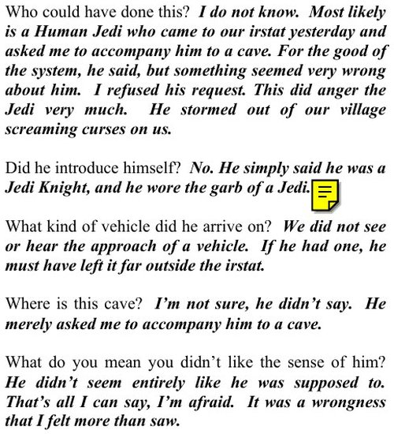

## p.9 (scan page 9)

Page contents: 844 words, 26 paragraphs | headings/entries: Force Concession; Page 9

- **No single roster character (rules/setting/general)** — entry/section: Morad'Ka's legend of the t'salak: ""I must speak this tale from the beginning. The t'salak was a terrible creature to the Tarasin of generations past. A demon. It was darker than night and moved like running water. It was evil given physical form. Whenever the beast touched a Tarasin, or anything else, the victim would turn against his brother to strike him down.
"Worst of all, we could not destroy it. Whenever it was defeated, the t'salak would return a time later. So, my mother's mother's mother's mother used the Force to prepare an urn to contain the t'salak. Soon, the creature was defeated again, and the urn was placed on the terrible mass of its body. The ooze shifted into the urn and it was trapped."" Source: *301 - Forces of Cularin - Force Concession* (SWRPG d20 Revised Core), p.9
  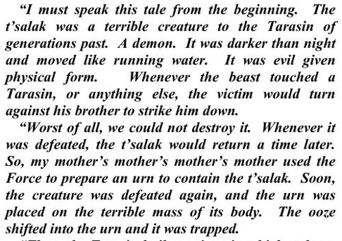
- **No single roster character (rules/setting/general)** — entry/section: Morad'Ka on the Force: "(If there are no Jedi or Force Adepts in the party) We have no one capable of wielding the Force. Ah, but you still feel the influence of the Force in your life. Sometimes you do things that you should not be able to, yes? That is the Force, brave one. It touches even the smallest of creatures." Source: *301 - Forces of Cularin - Force Concession* (SWRPG d20 Revised Core), p.9
  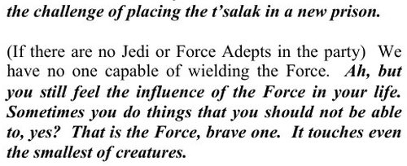

## p.10 (scan page 10)

Page contents: 885 words, 21 paragraphs | headings/entries: Encounter 3: The River Far Below; Force Concession; Page 10

## p.11 (scan page 11)

Page contents: 854 words, 21 paragraphs | headings/entries: Encounter 4:; Hokey Religions and Ancient Weapons; Force Concession; Page 11

## p.4–11 (scan page 4)

Page contents: E1 Thaedius Creed hires the heroes; E2 the burning Jaraana irstat and Mother Morad'Ka's legend of the t'salak; E3 the sabotaged repulsorsled and the empty camp (hand-read)

## p.12 (scan page 12)

Page contents: 798 words, 23 paragraphs | headings/entries: Encounter 4A:; First Test of Tarasin Generations-Past; Force Sensitive heroes get additional information:; Force Concession; Encounter 4B:; Second Test of Tarasin Generations-Past; Page 12

## p.13 (scan page 13)

Page contents: 851 words, 22 paragraphs | headings/entries: Encounter 4C:; Force Concession; Page 13

## p.14 (scan page 14)

Page contents: 828 words, 24 paragraphs | headings/entries: Force Concession; Encounter 6: Demon's Revenge; Page 14

- **No single roster character (rules/setting/general)** — entry/section: The root wall: "The only way to get them to part long enough for the heroes to pass is for a hero who has never earned a Dark Side Point to touch the wall. In this case, the wall parts, opening into a dark cavern. As long as the designated hero stands in the opening, anyone can pass.
Nothing else works to pass the wall, as our Dark Jedi discovered earlier." Source: *301 - Forces of Cularin - Force Concession* (SWRPG d20 Revised Core), p.14
  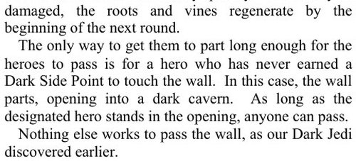

## p.15 (scan page 15)

Page contents: 794 words, 29 paragraphs | headings/entries: Conclusion; Force Concession; Here Ends "Force Concession"; Experience Point Summary; Page 15

- **No single roster character (rules/setting/general)** — entry/section: Conclusion: "The fates of the CreedCon workers and the identity of the visitor to the Jaraana irstat are unresolved, and the construction project is suspended until further notice. An enemy out of legend has been defeated, but the darkness remains, awaiting the unwary..." Source: *301 - Forces of Cularin - Force Concession* (SWRPG d20 Revised Core), p.15
  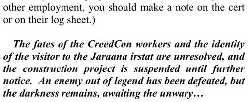

## p.16 (scan page 16)

Page contents: 332 words, 10 paragraphs | headings/entries: Total Possible Experience: 1,000 xp; Loot Summary; Encounter 1 500-600 credits per hero; Conclusion; Force Concession; Page 16

## p.11–16 (scan page 11)

Page contents: E4 the cavern tests of the Tarasin; E5 the t'salak; E6 Demon's Revenge; conclusion; XP; loot (hand-read)

## p.17 (scan page 17)

Page contents: 115 words, 11 paragraphs | headings/entries: Player Handout 1: Missing CreedCon Personnel; Workers:; Security Guards:; Force Concession; Page 17

## p.18 (scan page 18)

Page contents: 10 words, 3 paragraphs | headings/entries: Player Handout 2 — Jaraana Irstat; Page 18; Force Concession

## p.19 (scan page 19)

Page contents: 698 words, 31 paragraphs | headings/entries: Mir'Liss, Irstat-Kes of the Jaraana: Female; Force Concession; Low-Tier (average Hero levels 1-3); Page 19

## p.20 (scan page 20)

Page contents: 345 words, 17 paragraphs | headings/entries: Mid-Tier (average Hero levels 4-6); High-Tier (average Hero levels 7-9); Force Concession; Page 20

## p.21 (scan page 21)

Page contents: 695 words, 19 paragraphs | headings/entries: GM Aid #2: The T'salak; Base: 10; Force Concession Page 21

- **No single roster character (rules/setting/general)** — entry/section: GM Aid 2: the lone survivor: "A lone warrior, the only surviving member of the party, returned to his irstat that night with tales of a fierce enemy that seemed to blend in with the night. It was incredibly fast and seemed to warp their minds. When his fellow villagers asked him if the enemy had killed all of his allies, he replied "No... We did it ourselves. The creature made us all mad."" Source: *301 - Forces of Cularin - Force Concession* (SWRPG d20 Revised Core), p.21
  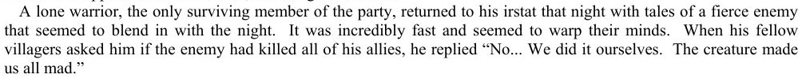

## p.22 (scan page 22)

Page contents: 136 words, 5 paragraphs | headings/entries: Critical Event Summary Force Concession; Force Concession Page 22

## p.17–22 (scan page 17)

Page contents: Player handouts; GM Aid 1 NPC stats; GM Aid 2 the t'salak; critical event summary (hand-read)

