# Owner Material 037 — Star Wars D20 Drive folder (Core, Revised Core and Saga Edition): Living Force Campaign/Adventures/Among the Stars/Year 3/302 - Forces of Cularin - Force Contention.pdf [Star Wars Roleplaying Game Revised Core (d20, 2002)]

- **Source:** Wizards of the Coast Star Wars Roleplaying Game books, web enhancements, Living Force campaign modules and articles (2000–2010), from the owner's "Star Wars D20" Drive folder (only the three edition subfolders; "General" was not read, as instructed). Secondary source (licensed Legends reference). Scan OCR'd on the box; the scan stays box-only and is **not** published.
- **Method:** every scanned page was OCR'd and machine-screened sentence by sentence for power-relevant statements (fights, kills, defeats, Force feats, rankings, superweapons) that name a character on our roster; each kept sentence is quoted verbatim from the OCR text and has a crop of the printed passage directly under it. Pages with nothing power-relevant are still listed with what is on them.
- **Citation:** "*302 - Forces of Cularin - Force Contention* (SWRPG d20 Revised Core), p.X" by printed page ("scan p.X" where no printed number applies). **Weight:** Licensed RPG material: a secondary source. Narrative text sums up Legends lore; game statistics are rules for players, not canon power levels, and rank lowest.

## p.1 (scan page 1)

Page contents: 155 words, 7 paragraphs | headings/entries: LFA302; Force Contention; Edited by Jae Walker

## p.2 (scan page 2)

Page contents: 886 words, 20 paragraphs | headings/entries: Force Contention; Hero Earnings; Issuing Force and Dark Side Points; Page 2

## p.3 (scan page 3)

Page contents: 939 words, 16 paragraphs | headings/entries: General Notes to the GM; Force Contention; GM Overview; Page 3

- **No single roster character (rules/setting/general)** — entry/section: GM overview: Nek Lawsirk: "Nek Lawsirk is a Zabrak Jedi living in Hedrett. A favored former student of Kirlocca's, when he graduated from the Almas Academy he elected to remain in Cularin to do what good he could in the name of the Jedi Order." Source: *302 - Forces of Cularin - Force Contention* (SWRPG d20 Revised Core), p.3
  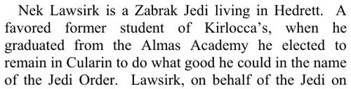
- **No single roster character (rules/setting/general)** — entry/section: GM overview: the ambush: "Following the woman's instructions, he found his way to an underground plant on Tilnes and to a large, open room with many vats. Blaster bolts streaked at him from the darkness and Nek's lightsaber sprang to life, deflecting them masterfully. Amid a shower of blaster bolts, Nek leaped onto a catwalk above him. Awaiting him was the black-clad woman, a metal cylinder in her hand. Another shaft of brilliance disarmed the startled Jedi. She pushed him off the catwalk, into one of the empty vats. Since then, the Dark Jedi has held him captive." Source: *302 - Forces of Cularin - Force Contention* (SWRPG d20 Revised Core), p.3
  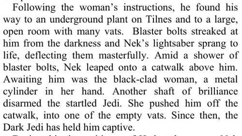

## p.4 (scan page 4)

Page contents: 852 words, 18 paragraphs | headings/entries: Encounter 2: Return to the Irstat; Encounter(s) 3: Show me the Jedi; Force Contention; Page 4

## p.5 (scan page 5)

Page contents: 806 words, 22 paragraphs | headings/entries: Encounter 6: Chemical Reaction; Conclusion; Force Contention; Important Notes to Judges:; Opening Crawl; Page 5

- **No single roster character (rules/setting/general)** — entry/section: Opening crawl: "In the Cularin system and everywhere else, the Jedi Knights have always been regarded as the guardians of peace and order in the galaxy. Now, however, dark rumors are spreading — tales of an order run mad with its own power and arrogance. It is incumbent upon the Jedi - and those who consider themselves their friends — to prove otherwise." Source: *302 - Forces of Cularin - Force Contention* (SWRPG d20 Revised Core), p.5
  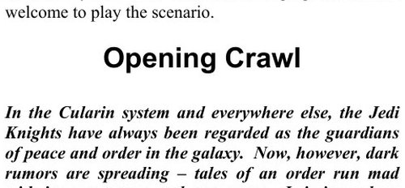

## p.1–5 (scan page 1)

Page contents: Title; boilerplate; GM overview of Nek Lawsirk's capture and impersonation; encounter summaries; opening crawl (hand-read)

## p.6 (scan page 6)

Page contents: 906 words, 22 paragraphs | headings/entries: Force Contention; Page 6

- **No single roster character (rules/setting/general)** — entry/section: Kirlocca on Nek Lawsirk: ""Nek Lawsirk was a student here at Almas before he passed his trials and became a Jedi Knight. He was one in whom I took much interest. If I were still taking on Padawan Learners, I would have been honored to have him as mine. He was — is — a good Jedi, which makes what I am about to show you even more disturbing."" Source: *302 - Forces of Cularin - Force Contention* (SWRPG d20 Revised Core), p.6
  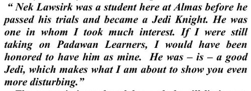
- **No single roster character (rules/setting/general)** — entry/section: The cantina holo: "When the image refocuses, it shows a figure in the brown, hooded robe of the Jedi, blue lightsaber blade flashing among the scattered patrons at an overturned table. He spins and whirls with consummate grace, taking an arm here, a leg there, and, finally, a head.
He tosses a handful of credit chips onto the floor amid the injured and dead, saying "Sorry about the mess. This should cover the cleanup."" Source: *302 - Forces of Cularin - Force Contention* (SWRPG d20 Revised Core), p.6
  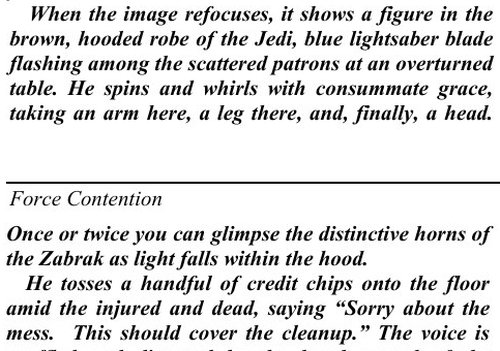

## p.7 (scan page 7)

Page contents: 810 words, 24 paragraphs | headings/entries: Force Contention; GM Notes on the Investigation and Clues; Encounter 2: Return to the Irstat; Page 7

- **No single roster character (rules/setting/general)** — entry/section: Kirlocca: "What should we do with Lawsirk when we find him? I do not wish believe that Nek has fallen beyond redemption. If he is under the influence of the t'salak, I hope that he can be saved. Do not sacrifice your own lives, but if you can bring him in alive it would be my preference." Source: *302 - Forces of Cularin - Force Contention* (SWRPG d20 Revised Core), p.7
  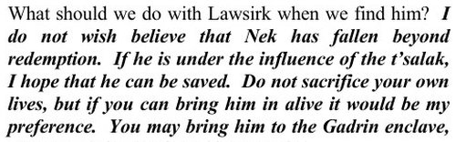
- **No single roster character (rules/setting/general)** — entry/section: Kirlocca on the t'salak: "What are the Jedi going to do with the t'salak? All those allied with the dark side are our enemies. We had planned to study this creature so that we would be better prepared to deal with the situation if more were to show up. It is likely that it would be destroyed after that, if we can find a way to do so. The t'salak is remarkably capable of staying alive." Source: *302 - Forces of Cularin - Force Contention* (SWRPG d20 Revised Core), p.7
  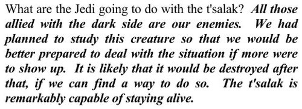
- **No single roster character (rules/setting/general)** — entry/section: Kirlocca: ""Thank you — you are performing a great service for the light. May the Force guide and protect you."" Source: *302 - Forces of Cularin - Force Contention* (SWRPG d20 Revised Core), p.7
  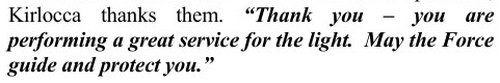

## p.8 (scan page 8)

Page contents: 871 words, 20 paragraphs | headings/entries: Force Contention; Encounter(s) 3: Show Me the Jedi; Encounter 3A: People Will Talk; Page 8

- **No single roster character (rules/setting/general)** — entry/section: Morad'Ka's warning: ""I have had terrible dreams since the t'salak came to us. In them, darkness spreads like a flood, till even the suns themselves are swallowed by it. Brother and sister take arms against each other until nothing remains but bood and despair. When I look upon you, I see the light that can illuminate that darkness. Be strong, choose well."" Source: *302 - Forces of Cularin - Force Contention* (SWRPG d20 Revised Core), p.8
  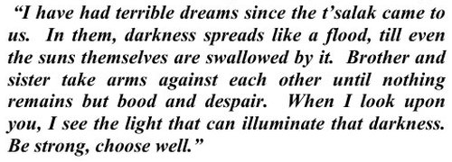

## p.9 (scan page 9)

Page contents: 731 words, 22 paragraphs | headings/entries: Encounter 3B:; Home is Where the Holovids Are; Force Contention; DC Result; Page 9

- **No single roster character (rules/setting/general)** — entry/section: Nek Lawsirk's journal: ""A strange communication from an old acquaintance promises more information. I am headed to the Groundport now to get a ticket on the shuttle for the meeting at TX-38. Given our past relationship, I am not sure how far I should trust this source. A little insurance would be good to leave behind; something to point in the right direction. I need to remember to return my rental holovid — I would hate for it to be the first one returned late." Source: *302 - Forces of Cularin - Force Contention* (SWRPG d20 Revised Core), p.9
  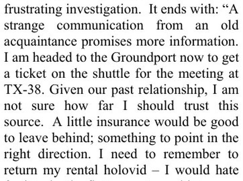

## p.10 (scan page 10)

Page contents: 811 words, 22 paragraphs | headings/entries: Encounter 3C: New Releases; Force Contention; Encounter 3D: Scum and Villainy; Page 10

- **No single roster character (rules/setting/general)** — entry/section: The Dark Jedi's holomessage: ""Hello, Nek. It's been a while, hasn't it? Longer for me than for you, of course. I heard you were looking into some... incidents... and I can lend a hand. For old times sake, and all... It's not something I can share over the holonet — too dangerous. If you hurry, you can catch the next shuttle to Tilnes. I'll meet you at the abandoned chemical plant at TX-38 and tell you what I've found. I guarantee you that you'll be amazed."" Source: *302 - Forces of Cularin - Force Contention* (SWRPG d20 Revised Core), p.10
  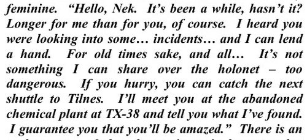

## p.11 (scan page 11)

Page contents: 900 words, 22 paragraphs | headings/entries: The Performers; Dara Gunto: Female Near-Human; Force Contention; Deam Schween: Male Rodian; The Masked Wookiee: Male Wookiee; Page 11

## p.12 (scan page 12)

Page contents: 967 words, 22 paragraphs | headings/entries: The Patrons; Force Contention; Yougga: Female Zabrak; Forg F'Lopo:; Page 12

## p.13 (scan page 13)

Page contents: 810 words, 24 paragraphs | headings/entries: The Survivors; Encounter 3E: Fly me to the Moon; Force Contention; Encounter 4:; Page 13

- **No single roster character (rules/setting/general)** — entry/section: Forg F'Lopo: "Was there anything unusual about him? He didn't seem quite right, I don't know... I guess he seemed kinda short for a Zabrak." Source: *302 - Forces of Cularin - Force Contention* (SWRPG d20 Revised Core), p.13
  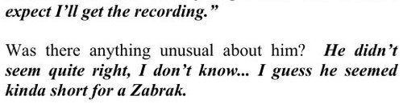

## p.5–13 (scan page 5)

Page contents: E1 Kirlocca's briefing; E2 Return to the Irstat; E3 investigation in Hedrett and Gadrin (apartment, Hedrett Holovid, The Chasm, Groundport) (hand-read)

## p.14 (scan page 14)

Page contents: 780 words, 29 paragraphs | headings/entries: Force Contention; Encounter 5: Chemical Reaction; Notes to the GM:; Map Descriptions; Not shown: Ventilation Shafts; Page 14

## p.15 (scan page 15)

Page contents: 891 words, 20 paragraphs | headings/entries: Force Contention; Page 15

## p.16 (scan page 16)

Page contents: 823 words, 27 paragraphs | headings/entries: Tier One:; Force Contention; Tier Three; The Survey Crew:; Aftermath:; If this is done:; Page 16

- **No single roster character (rules/setting/general)** — entry/section: Nek Lawsirk: "The rasp of ragged breathing draws your eyes to the shadows ahead. A dark-skinned Zabrak in tattered clothing steps out into the light, a metal cylinder in his hand. His eyes are feral and wild. The blue blade springs to life. With a howl of rage he charges as blaster fire rains down from the catwalks." Source: *302 - Forces of Cularin - Force Contention* (SWRPG d20 Revised Core), p.16
  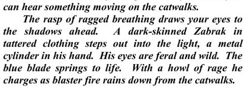
- **No single roster character (rules/setting/general)** — entry/section: Nek Lawsirk, Tier Three: "With his Force Mastery, Nek can attempt to use Enhance Ability or Force Strike as a free action. He attempts one of these, and then attacks with his lightsaber. He snarls and rolls his eyes as he fights, a man overcome with alien rage." Source: *302 - Forces of Cularin - Force Contention* (SWRPG d20 Revised Core), p.16
  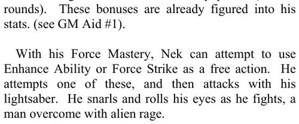

## p.17 (scan page 17)

Page contents: 774 words, 28 paragraphs | headings/entries: Conclusion; Master Kirlocca:; Force Contention; Here Ends "Force Concession"; Experience Point Summary; Adventure Experience: Roleplaying Experience:; Page 17

- **No single roster character (rules/setting/general)** — entry/section: Kirlocca on Raik Muun: ""You found Nek, rescued a number of innocents, and have uncovered the identity of the Dark Jedi. From what you tell me, I believe she is Raik Muun, a former student at the Academy. She had a great gift for manipulating the Force, but her control of her emotions and desires wasn't equal to the challenge of being a Jedi. She was obsessed with Nek, and determined to persuade him to have a deeper personal relationship with her. He denied her, and she did not take it well. I was forced to dismiss her from the Academy, and I would not be surprised to find she holds a grudge. I had believed that she left the system. Regardless, it seems she has returned, and with the purpose of destroying the reputation of the Jedi.
"That she has the t'salak, and has managed to cause it to reproduce is most distressing and it must be resolved. I'm sure that this matter is not at an end. May I ask that I be permitted to call on you when we track her down?"" Source: *302 - Forces of Cularin - Force Contention* (SWRPG d20 Revised Core), p.17
  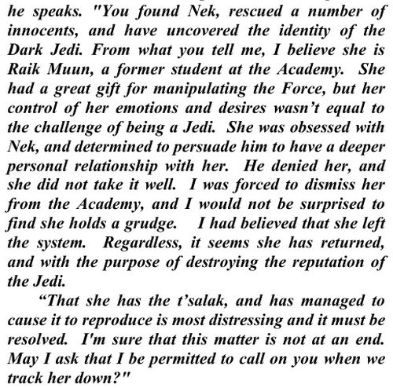

## p.18 (scan page 18)

Page contents: 490 words, 15 paragraphs | headings/entries: Total Possible Experience: 1,000 xp; Loot Summary; Encounter 6: Showdown; Conclusion; Force Contention; Page 18

## p.13–18 (scan page 13)

Page contents: E4 Su'ock Ytam on Tilnes; E5 the MephitaPharma plant; E6 Nek Lawsirk and the survey crew; conclusion; XP; loot (hand-read)

## p.19 (scan page 19)

Page contents: 749 words, 29 paragraphs | headings/entries: GM Aid 1: NPC Stats; Encounter 2: Return to the Irstat; Encounter 3C: Scum and Villany; Tiering:; Force Contention; Encounter 6: Showdown; All Tiers; Low Tier (average Hero levels 1-3); Page 19

## p.20 (scan page 20)

Page contents: 452 words, 22 paragraphs | headings/entries: Mid-Tier (average Hero levels 4-6); Equipment: Ragged clothing, lightsaber; High-Tier (average Hero levels 7-9); Force Contention; Equipment: Ragged clothing, lightsaber; Page 20

- **No single roster character (rules/setting/general)** — entry/section: Nek Lawsirk stat block (High Tier): "Nek Lawsirk: Male Zabrak Jedi Knight (jedi consular 7); Init +7(Dex, Improved Initiative); Defense 21(+6 class, +3 Dex, +2 Lightsaber defense); Spd 10m; VP/WP 68/14; Atk +12 melee (lightsaber, 3d8+4 damage, Crit 19-20) or +4 ranged (thrown lightsaber, 3d8 damage, Crit 19-20 ...he's not likely to do this); SV Fort +7, Ref +7, Will +7; SZ M; SQ Force Training x3, Deflect (defense+1, attack-4, extend damage and attack), Bonus feat, Increase lightsaber
Force Skills: Battlemind +5, Enhance Ability +8, Force Defense +6, Force Strike +8, Friendship +4, Heal Another +6, Telepathy +10, See Force +5.
Feats: Weapon Group Proficiency (simple weapons, blaster pistols), Exotic Weapon Proficiency: Lightsaber, Weapon Finesse: Lightsaber, Improved Initiative.
Force Feats: Force Sensitive, Sense, Alter, Control, Dissipate Energy, Lightsaber Defense, Force Mastery." Source: *302 - Forces of Cularin - Force Contention* (SWRPG d20 Revised Core), p.20
  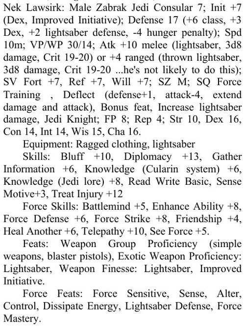

## p.21 (scan page 21)

Page contents: 441 words, 28 paragraphs | headings/entries: Item Encounter(s); The t'salak can be immobilized by cold; Force Contention; Page 21

## p.22 (scan page 22)

Page contents: 64 words, 7 paragraphs | headings/entries: Player Handout 1: The Chemical Plant; Force Contention Page 22

## p.23 (scan page 23)

Page contents: 154 words, 7 paragraphs | headings/entries: Critical Event Summary Force Contention; GM Name, RPGA#: GM Email Address:; Convention Name/Date; Force Contention Page 23

## p.19–23 (scan page 19)

Page contents: GM Aid 1 NPC stats; clue table; plant map; critical event summary (hand-read)

