# Owner Material 037 — Star Wars D20 Drive folder (Core, Revised Core and Saga Edition): Living Force Campaign/Adventures/Among the Stars/Year 3/303 - Forces of Cularin - Force Convention.pdf [Star Wars Roleplaying Game Revised Core (d20, 2002)]

- **Source:** Wizards of the Coast Star Wars Roleplaying Game books, web enhancements, Living Force campaign modules and articles (2000–2010), from the owner's "Star Wars D20" Drive folder (only the three edition subfolders; "General" was not read, as instructed). Secondary source (licensed Legends reference). Scan OCR'd on the box; the scan stays box-only and is **not** published.
- **Method:** every scanned page was OCR'd and machine-screened sentence by sentence for power-relevant statements (fights, kills, defeats, Force feats, rankings, superweapons) that name a character on our roster; each kept sentence is quoted verbatim from the OCR text and has a crop of the printed passage directly under it. Pages with nothing power-relevant are still listed with what is on them.
- **Citation:** "*303 - Forces of Cularin - Force Convention* (SWRPG d20 Revised Core), p.X" by printed page ("scan p.X" where no printed number applies). **Weight:** Licensed RPG material: a secondary source. Narrative text sums up Legends lore; game statistics are rules for players, not canon power levels, and rank lowest.

## p.1 (scan page 1)

Page contents: 145 words, 7 paragraphs | headings/entries: LFA303; Force Convention; Edited by Jae Walker

## p.2 (scan page 2)

Page contents: 906 words, 18 paragraphs | headings/entries: Force Convention; Issuing Force and Dark Side Points; Page 2

## p.3 (scan page 3)

Page contents: 927 words, 20 paragraphs | headings/entries: General Notes to the GM; Force Convention; GM Overview; Page 3

## p.4 (scan page 4)

Page contents: 852 words, 25 paragraphs | headings/entries: Force Convention; Encounter 1: Dead or Alive; Encounter 2: An Urgent Call; Encounter 3: Problems at the Door; Encounter 4: Going Up?; Encounter 5: Droids and Ships; Encounter 6: Battle Beneath the Stars; Encounter 7: Aggressive Negotiations; Page 4

- **No single roster character (rules/setting/general)** — entry/section: GM overview: the SBOV and the Jedi: "Though widely perceived as symbols of peace and order, the Jedi Knights have never been held in particularly high regard by SBOV. With their lethal lightsabers and mind-altering abilities, not to mention their policy of recruiting — some say enslaving -members shortly after birth, the Jedi order seems more like a state-sanctioned cult, and a dangerous one at that." Source: *303 - Forces of Cularin - Force Convention* (SWRPG d20 Revised Core), p.4
  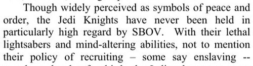
- **No single roster character (rules/setting/general)** — entry/section: GM overview: Raik Muun's plan: "Through her new position, Raik Muun managed to smuggle the t'salaks onto the ship. She plans to release them in the conference room so that the holonews can broadcast the carnage as the Jedi delegation slaughters the delegates. Nothing can stop her plan this time... as long as those heroes don't meddle again!" Source: *303 - Forces of Cularin - Force Convention* (SWRPG d20 Revised Core), p.4
  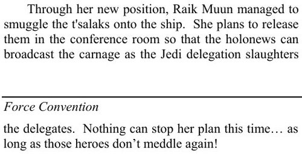

## p.5 (scan page 5)

Page contents: 833 words, 21 paragraphs | headings/entries: Opening Crawl; Encounter One: Dead or Alive; Force Convention; Page 5

- **No single roster character (rules/setting/general)** — entry/section: Note to judges on Raik Muun: "A word to the GM — this woman really needs to die. That is to say, it would be the most dramatically satisfying if Raik dies in her encounter with the heroes. Raik Muun is as irredeemably evil as Darth Maul — if the heroes don't kill her and she doesn't escape, try to arrange circumstances so that a droid or panel nearby explodes and kills her, or something else dramatically appropriate." Source: *303 - Forces of Cularin - Force Convention* (SWRPG d20 Revised Core), p.5
  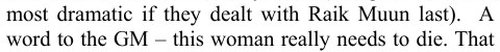
- **No single roster character (rules/setting/general)** — entry/section: Opening crawl: "In a time of war, some seek peace. An organization called Sentient Beings Opposing Violence has brought a peace conference to Cularin and invited the Jedi to address them. Now it appears the peace conference has gone horribly wrong. Cularin is faced with a terrible threat, one that requires heroes to face it ..." Source: *303 - Forces of Cularin - Force Convention* (SWRPG d20 Revised Core), p.5
  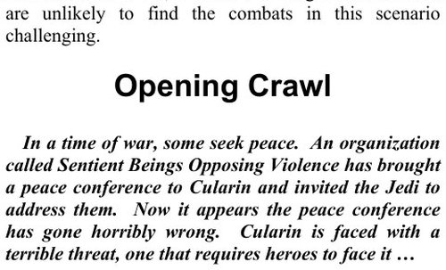

## p.1–5 (scan page 1)

Page contents: Title; boilerplate; GM overview of Raik Muun's plan against the SBOV conference aboard the Luxury; encounter summaries; opening crawl (hand-read)

## p.6 (scan page 6)

Page contents: 859 words, 23 paragraphs | headings/entries: A questioning session may go as follows:; Force Convention; Encounter Two: An Urgent Call; Page 6

- **No single roster character (rules/setting/general)** — entry/section: Coar Maw: "Who are you? Eat pudu.
Who do you work for? Eat pudu. Why did you attack us? Eat pudu. How much were you paid? Eat pudu." Source: *303 - Forces of Cularin - Force Convention* (SWRPG d20 Revised Core), p.6
  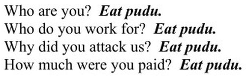
- **No single roster character (rules/setting/general)** — entry/section: Lanius Qel-Bertuk: ""Thank you for coming, my friends. I shall be brief: Forces in the system are conspiring against us. By 'us' I mean the Jedi, the residents of the system and yourselves. I believe that Raik Muun, the Dark Jedi who's been giving us so much trouble, is responsible."" Source: *303 - Forces of Cularin - Force Convention* (SWRPG d20 Revised Core), p.6
  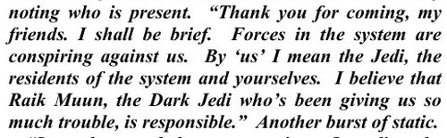

## p.7 (scan page 7)

Page contents: 812 words, 25 paragraphs | headings/entries: Force Convention; Page 7

- **No single roster character (rules/setting/general)** — entry/section: Lanius Qel-Bertuk on Kirlocca: ""I opted to send Master Kirlocca, our lightsaber instructor, and a Wookiee. I thought that my calm, logical friend would be the best representative for the Academy." Source: *303 - Forces of Cularin - Force Convention* (SWRPG d20 Revised Core), p.7
  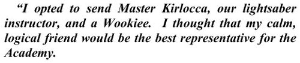
- **No single roster character (rules/setting/general)** — entry/section: Lanius Qel-Bertuk on the Unbelievers: "Hey, pal. We're doing you a favor here. The least you can do is tell us; it may have some bearing on our mission. (sigh) True enough. You may recoall the dark side sect known as the Unbelievers? They have been making trouble here on Almas and I am forced to take direct action to resolve it." Source: *303 - Forces of Cularin - Force Convention* (SWRPG d20 Revised Core), p.7
  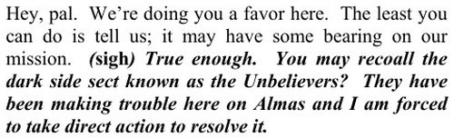
- **No single roster character (rules/setting/general)** — entry/section: Lanius Qel-Bertuk: "What does the Dark Jedi hope to gain from attacking the ship? Chaos. Bad publicity for the Jedi. The death of innocents, and blame that the order did not prevented them." Source: *303 - Forces of Cularin - Force Convention* (SWRPG d20 Revised Core), p.7
  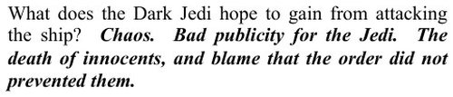

## p.8 (scan page 8)

Page contents: 834 words, 25 paragraphs | headings/entries: Encounter Three: Problems at the Door; Force Convention; Some guidelines for the exchange:; Page 8

## p.9 (scan page 9)

Page contents: 850 words, 23 paragraphs | headings/entries: Force Convention; Encounter Four: Going Up?; Page 9

## p.10 (scan page 10)

Page contents: 904 words, 32 paragraphs | headings/entries: Force Convention; DC 15; DC 15 Computer Use; Page 10

## p.11 (scan page 11)

Page contents: 875 words, 24 paragraphs | headings/entries: Force Convention; Encounter Five: Droids and Ships; Once they have opened the blast doors:; Page 11

## p.5–11 (scan page 5)

Page contents: E1 Coar Maw's ambush; E2 Lanius Qel-Bertuk's broken hologram; E3 the Thaereian escort and the Luxury opens fire; E4 boarding and slicing the Luxury (hand-read)

## p.12 (scan page 12)

Page contents: 807 words, 29 paragraphs | headings/entries: Low Tier (average Hero level 1-3): 3-5; Mid Tier (average Hero level 4-6): 5-7; High Tier (average Hero level 7-9): 8-10; Encounter Six: Battle Beneath the Stars; Force Convention; Read the following as the heroes enter:; Page 12

- **No single roster character (rules/setting/general)** — entry/section: Kirlocca and the Padawan: "In the middle of the room, two lightsabers flash. Master Kirlocca and another Jedi struggle against the t'salak onslaught. The pair dances around, back-toback. Their lightsabers swing furiously to keep the t'salaks back." Source: *303 - Forces of Cularin - Force Convention* (SWRPG d20 Revised Core), p.12
  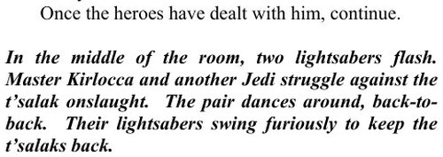

## p.13 (scan page 13)

Page contents: 897 words, 23 paragraphs | headings/entries: Below are some ideas:; Force Convention; Page 13

## p.14 (scan page 14)

Page contents: 877 words, 24 paragraphs | headings/entries: Encounter Seven: Aggressive Negotiations; Force Convention; Low Tier (average Hero level 1-3); Page 14

- **No single roster character (rules/setting/general)** — entry/section: Raik Muun on the bridge: "Before you is a dark figure, limned in red by the glow of Rennok's lava showing through the viewport. Her stark red hair contrasts with her blacker-than-night clothing. Green slitted eyes glare at you, rage boiling in them. She looks Human, yet not. The glow from her crimson-bladed lightsaber casts an eerie light around her." Source: *303 - Forces of Cularin - Force Convention* (SWRPG d20 Revised Core), p.14
  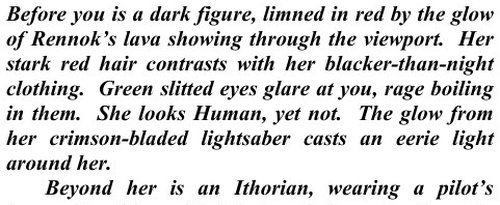
- **No single roster character (rules/setting/general)** — entry/section: Raik Muun's tactics: "Raik wants to stay in melee range and will close if the heroes do not. While she is angered by the heroes' interference, Raik does not fight recklessly. She is very much in control of herself and believes she can beat the heroes." Source: *303 - Forces of Cularin - Force Convention* (SWRPG d20 Revised Core), p.14
  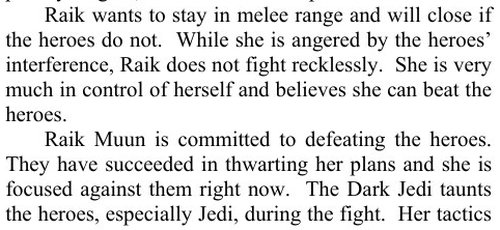

## p.15 (scan page 15)

Page contents: 923 words, 25 paragraphs | headings/entries: Mid Tier (average Hero level 4-6); High Tier_(average Hero level 7-9); Force Convention; Conclusion; Page 15

- **No single roster character (rules/setting/general)** — entry/section: High Tier tactics: "A worthy fight here. Raik cuts loose with her powers. Battlemind comes first. Then whatever is needed. Fear, Force Grip, and an untrained Force Lightning should make an appearance. (Force Lightning works well if the heroes are bunched together at some point.) Hatred is a good choice if a number of heroes get close to her." Source: *303 - Forces of Cularin - Force Convention* (SWRPG d20 Revised Core), p.15
  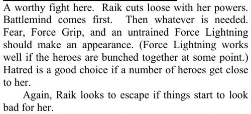
- **Darth Maul**: "Raik Muun is as irredeemably evil as Darth Maul — if the heroes don't kill her, try to arrange circumstances so that a droid or panel nearby explodes and kills her, or something dramatically appropriate." Source: *303 - Forces of Cularin - Force Convention* (SWRPG d20 Revised Core), p.15
  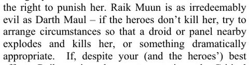

## p.16 (scan page 16)

Page contents: 690 words, 25 paragraphs | headings/entries: Here Ends, "Force Convention"; Experience Point Summary; Adventure Experience Award:; Loot Summary; Encounter One; Force Convention; Conclusion; Page 16

- **No single roster character (rules/setting/general)** — entry/section: Future Vision cert: "The hero named above accompanied Lanius to his private meditation chamber in the Almas Academy. Here, Lanius considered the hero's future and told the hero of the vision he received. This insight may help the character when the time comes. Essentially, due to the forewarning by Lanius, the hero may be able to avoid a grim fate by "choosing another path"." Source: *303 - Forces of Cularin - Force Convention* (SWRPG d20 Revised Core), p.16
  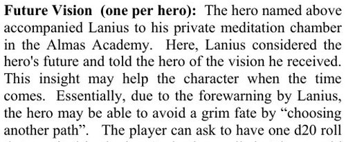

## p.11–16 (scan page 11)

Page contents: E5 engineering and the droids; E6 the conference-room battle and Kirlocca's death; E7 Raik Muun on the bridge; conclusion; XP; loot (hand-read)

## p.17 (scan page 17)

Page contents: 108 words, 5 paragraphs | headings/entries: Player Handout #1: The Balance; Force Convention Page 17

## p.18 (scan page 18)

Page contents: 29 words, 6 paragraphs | headings/entries: Page 18; Force Convention

## p.19 (scan page 19)

Page contents: 745 words, 24 paragraphs | headings/entries: GM Aid #1: NPC Stats; Encounter 1: Dead or Alive; Low Tier (average Hero level 1-3); Mid Tier (average Hero level 4-6); Force Convention; High Tier (average Hero level 7-9); Page 19

## p.20 (scan page 20)

Page contents: 655 words, 35 paragraphs | headings/entries: Encounter 6: Battle Beneath the Stars; Low Tier (average Hero level 1-3); Mid Tier (average Hero level 4-6); High Tier (Average Hero level 7-9); Force Convention; Page 20

## p.21 (scan page 21)

Page contents: 339 words, 11 paragraphs | headings/entries: Low Tier (average Hero level 1-3); High Tier (Average Hero level 7-9); Force Convention; Page 21

## p.22 (scan page 22)

Page contents: 695 words, 19 paragraphs | headings/entries: GM Aid #2: The T'salak; Base: 10; Force Convention Page 22

- **No single roster character (rules/setting/general)** — entry/section: GM Aid 2: the t'salak: "The t'salak appears as an oozing, black mound of darkness. It has no mouth, eyes or nose. It seems to be aware of its environment without the benefit of such sensory organs.
The t'salak is thought to be the only one of its kind. It is genderless and its method of reproduction, if any, is unknown." Source: *303 - Forces of Cularin - Force Convention* (SWRPG d20 Revised Core), p.22
  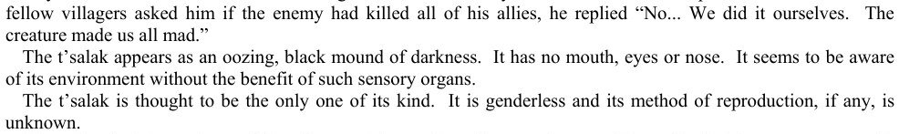

## p.23 (scan page 23)

Page contents: 109 words, 9 paragraphs | headings/entries: Critical Event Summary Force Convention; Yes No; Force Convention Page 23

## p.17–23 (scan page 17)

Page contents: The Balance; Luxury deck map; GM Aid 1 NPC stats; GM Aid 2 the t'salak; critical event summary (hand-read)

