# Owner Material 037 — Star Wars D20 Drive folder (Core, Revised Core and Saga Edition): Living Force Campaign/Adventures/Among the Stars/Year 3/303 - Forces of Cularin - Force Convergence.pdf [Star Wars Roleplaying Game Revised Core (d20, 2002)]

- **Source:** Wizards of the Coast Star Wars Roleplaying Game books, web enhancements, Living Force campaign modules and articles (2000–2010), from the owner's "Star Wars D20" Drive folder (only the three edition subfolders; "General" was not read, as instructed). Secondary source (licensed Legends reference). Scan OCR'd on the box; the scan stays box-only and is **not** published.
- **Method:** every scanned page was OCR'd and machine-screened sentence by sentence for power-relevant statements (fights, kills, defeats, Force feats, rankings, superweapons) that name a character on our roster; each kept sentence is quoted verbatim from the OCR text and has a crop of the printed passage directly under it. Pages with nothing power-relevant are still listed with what is on them.
- **Citation:** "*303 - Forces of Cularin - Force Convergence* (SWRPG d20 Revised Core), p.X" by printed page ("scan p.X" where no printed number applies). **Weight:** Licensed RPG material: a secondary source. Narrative text sums up Legends lore; game statistics are rules for players, not canon power levels, and rank lowest.

## scan p.1 (scan page 1)

Page contents: 249 words, 5 paragraphs | headings/entries: PRE-INTRODUCTION

## scan p.2 (scan page 2)

Page contents: 357 words, 6 paragraphs | headings/entries: Introduction: Barnab Chistor

- **No single roster character (rules/setting/general)** — entry/section: Barnab Chistor's address: "I want to thank you all for coming together today in Gadrin, to join in the celebration of a life that touched all of us. The passing of Master Kirlocca has shaken the system. Kirlocca was a powerful force for good, training countless Jedi in the timeless art of the lightsaber. Beyond that, though, he was a presence, a strong, quiet comfort, a symbol of the safety of our system. Nay, a symbol of the hope for safety in the galaxy as a whole, as we struggle through this awful war with the Separatists." Source: *303 - Forces of Cularin - Force Convergence* (SWRPG d20 Revised Core), scan p.2
  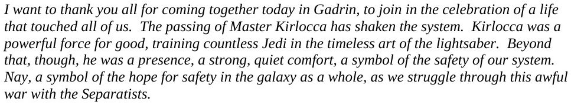
- **No single roster character (rules/setting/general)** — entry/section: Barnab Chistor's address: "I would love to claim him as a citizen of Cularin, but that would be too selfish. He was compassionate, and kind, and as good a Wookiee as I, at least, ever had the chance to meet. We are all diminished by the loss." Source: *303 - Forces of Cularin - Force Convergence* (SWRPG d20 Revised Core), scan p.2
  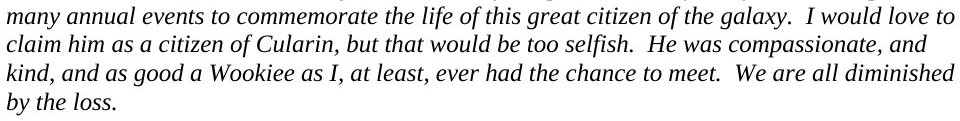

## scan p.3 (scan page 3)

Page contents: 269 words, 5 paragraphs | headings/entries: 

- **No single roster character (rules/setting/general)** — entry/section: Thurm Loogg's address: "Citizens of Cularin... The Cartel shares your sorrow on this day. We almost did not say anything at all, but that might have seemed callous, and the Cartel is not callous. Many things we have been called, but callous is not among them." Source: *303 - Forces of Cularin - Force Convergence* (SWRPG d20 Revised Core), scan p.3
  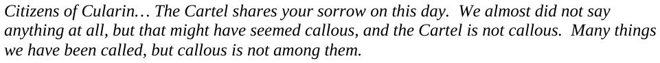
- **No single roster character (rules/setting/general)** — entry/section: GM note on the Cartel: "The Cartel isn't going to do anything obnoxious. They know that in this situation, simple is best. Speak briefly, sound sincere, and leave the people to their celebration. The Cartel has been "present" enough in the past that they will actually be more noticeable in their absence, and people will remember that they DIDN'T do anything obnoxious. Knowing when NOT to act is also good PR." Source: *303 - Forces of Cularin - Force Convergence* (SWRPG d20 Revised Core), scan p.3
  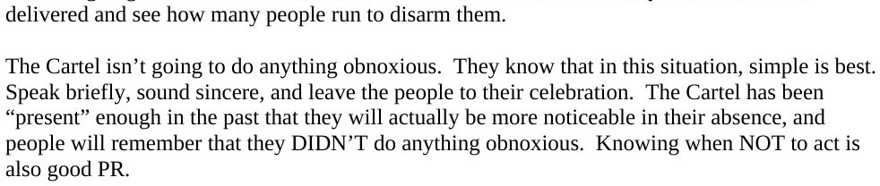

## scan p.4 (scan page 4)

Page contents: 258 words, 5 paragraphs | headings/entries: Master Lanius's address ~ 1 hour in

- **No single roster character (rules/setting/general)** — entry/section: Master Lanius's address: "There is no single story I would share with you. That's what I decided. Master Kirlocca died as he lived, doing what he believed was right. He touched many of our lives, and the galaxy is a better place for his having been in it." Source: *303 - Forces of Cularin - Force Convergence* (SWRPG d20 Revised Core), scan p.4
  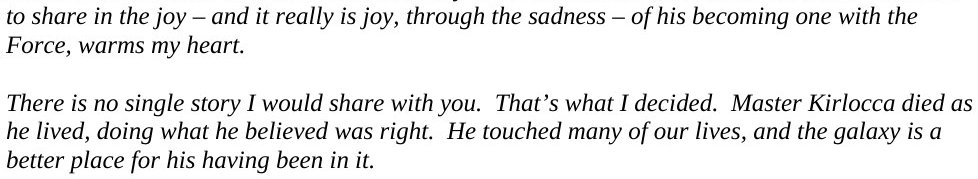

## scan p.5 (scan page 5)

Page contents: 218 words, 5 paragraphs | headings/entries: Westa Impeveri's Statement ~ 2 hours in

- **No single roster character (rules/setting/general)** — entry/section: Westa Impeveri's statement: "The lesson to take away from this is that duty and honor will be remembered. There is a shortage of heroes in our galaxy. It takes individuals like Kirlocca to mold them, and it takes deaths like Kirlocca's to remind us what heroism truly is." Source: *303 - Forces of Cularin - Force Convergence* (SWRPG d20 Revised Core), scan p.5
  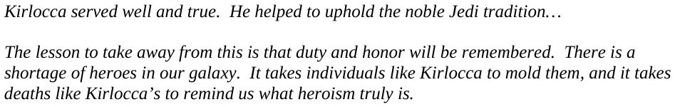
- **No single roster character (rules/setting/general)** — entry/section: Westa Impeveri's statement: "I hope that we will not allow Master Kirlocca's sacrifice to have been in vain. Always stand up for what is right. ALWAYS protect those who must be protected. And whatever ethos you follow — whether you call it "the Force" or something else entirely — always follow it in a way that is true to yourself." Source: *303 - Forces of Cularin - Force Convergence* (SWRPG d20 Revised Core), scan p.5
  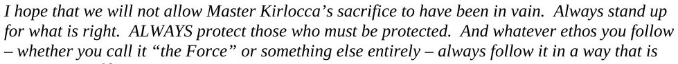

## scan p.6 (scan page 6)

Page contents: 259 words, 9 paragraphs | headings/entries: Mother Dariana's Statement ~ 2:40

- **No single roster character (rules/setting/general)** — entry/section: Mother Dariana's statement: "I don't know what Kirlocca would have wanted. Raucous celebration or quiet mourning, I couldn't say. He was always quiet, but you know those quiet types. Always something going on inside." Source: *303 - Forces of Cularin - Force Convergence* (SWRPG d20 Revised Core), scan p.6
  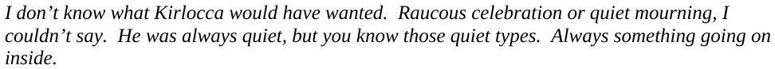
- **No single roster character (rules/setting/general)** — entry/section: Mother Dariana's statement: "This isn't about him. That's what you learn, when you see enough of these. It's almost never about what the person who's moved on would have wanted. It's about what the people who are still living need.
So, you know what? I'm not telling a single person what to do when I die. When the time comes, people will know. We all do what we must, in life, and then in death.
May the Force be with you. May Kirlocca be with the Force. May we all find peace." Source: *303 - Forces of Cularin - Force Convergence* (SWRPG d20 Revised Core), scan p.6
  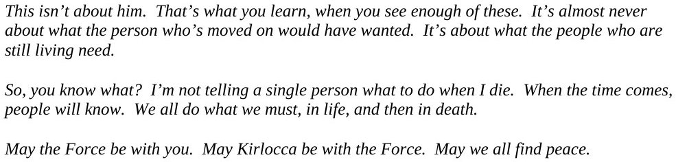

## scan p.1–6 (scan page 1)

Page contents: Spoiler warning and the scripted speeches at Kirlocca's memorial: Barnab Chistor, Thurm Loogg, Lanius, Westa Impeveri, Mother Dariana (hand-read)

## scan p.7 (scan page 7)

Page contents: 595 words, 6 paragraphs | headings/entries: 

- **No single roster character (rules/setting/general)** — entry/section: The two Jedi Academy representatives: "These two individuals, as in previous interactives, serve to demonstrate that being a member of the Jedi Order does not mean that one has a predetermined mind-set, but instead that two Jedi, equally responsible and reasonable, may come to different conclusions about the same situation." Source: *303 - Forces of Cularin - Force Convergence* (SWRPG d20 Revised Core), scan p.7
  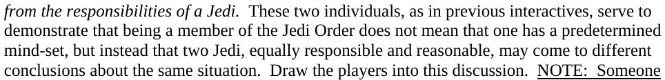
- **No single roster character (rules/setting/general)** — entry/section: The Wookiee at Vanster Enan's Sop House: "The Wookiee who normally armwrestles all comers is instead debating philosophy with them. He believes that anything which can "become one with the Force" can also separate itself from the Force once more." Source: *303 - Forces of Cularin - Force Convergence* (SWRPG d20 Revised Core), scan p.7
  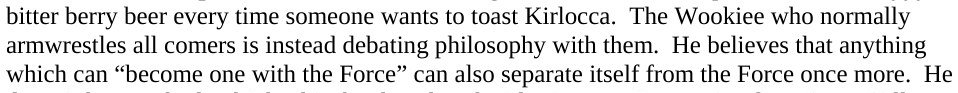

## scan p.8 (scan page 8)

Page contents: 94 words, 2 paragraphs | headings/entries: 

## scan p.9 (scan page 9)

Page contents: 150 words, 3 paragraphs | headings/entries: Suggested reward for attending:

- **No single roster character (rules/setting/general)** — entry/section: Blade Sliver: "This tiny sliver of metal was reportedly part of the first Rykk blade Kirlocca ever wielded, one that he broke when, as a young Wookiee, he saved the life of a playmate on Kashyyyk. The blade was kept by his family for years, and on Kirlocca's death it was sent to the Academy on Almas. Knowing the importance of Kirlocca to the people of Cularin, Master Lanius had the blade shaved down into tiny slivers, to be distributed to those who attended the celebration of Master Kirlocca's life. The sliver is suspended in a blue crystal matrix that seems to focus light on the tiny bit of metal in its heart.
The sliver has no game mechanic effect. It is a reminder that heroes are made young, and that what we leave behind, while small, may still hold vast importance to those who remain." Source: *303 - Forces of Cularin - Force Convergence* (SWRPG d20 Revised Core), scan p.9
  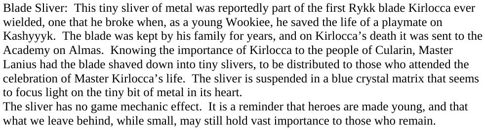

## scan p.7–9 (scan page 7)

Page contents: NPC notes for the interactive; the Blade Sliver reward (hand-read)

## scan p.10 (scan page 10)

Page contents: 431 words, 20 paragraphs | headings/entries: Lightsaber Duels:; Melee Duel:; Martial Arts Contests:

- **No single roster character (rules/setting/general)** — entry/section: Hero Contests: "As Master Kirlocca was a being who excelled in combat, it only seems fitting that several contests be held at his remembrance ceremony to celebrate him." Source: *303 - Forces of Cularin - Force Convergence* (SWRPG d20 Revised Core), scan p.10
  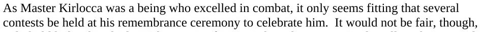

## scan p.11 (scan page 11)

Page contents: 296 words, 17 paragraphs | headings/entries: Marksmanship Contest:; Persuasion Contest (Non-Force):; Persuasion Contest (Force):

## scan p.10–11 (scan page 10)

Page contents: Hero contest rules: lightsaber, melee, martial arts, marksmanship, persuasion (hand-read)

