# Owner Material 037 — Star Wars D20 Drive folder (Core, Revised Core and Saga Edition): Living Force Campaign/Adventures/Among the Stars/Year 3/304 - Twi'light Storm.pdf [Star Wars Roleplaying Game Revised Core (d20, 2002)]

- **Source:** Wizards of the Coast Star Wars Roleplaying Game books, web enhancements, Living Force campaign modules and articles (2000–2010), from the owner's "Star Wars D20" Drive folder (only the three edition subfolders; "General" was not read, as instructed). Secondary source (licensed Legends reference). Scan OCR'd on the box; the scan stays box-only and is **not** published.
- **Method:** every scanned page was OCR'd and machine-screened sentence by sentence for power-relevant statements (fights, kills, defeats, Force feats, rankings, superweapons) that name a character on our roster; each kept sentence is quoted verbatim from the OCR text and has a crop of the printed passage directly under it. Pages with nothing power-relevant are still listed with what is on them.
- **Citation:** "*304 - Twi'light Storm* (SWRPG d20 Revised Core), p.X" by printed page ("scan p.X" where no printed number applies). **Weight:** Licensed RPG material: a secondary source. Narrative text sums up Legends lore; game statistics are rules for players, not canon power levels, and rank lowest.

## p.1 (scan page 1)

Page contents: 122 words, 7 paragraphs | headings/entries: LFA304; Twilight Storm; A One-Round Living Force Tournament; Edited by Jae Walker

## p.2 (scan page 2)

Page contents: 906 words, 18 paragraphs | headings/entries: Issuing Force and Dark Side Points; Twilight Storm; Page 2

## p.3 (scan page 3)

Page contents: 905 words, 24 paragraphs | headings/entries: General Notes to the GM; GM Overview; Encounter 1:_A Friend's Request; Encounter 2: Welcome to Ryloth; Encounter 3:_ The Fungus Pit; Twilight Storm; Page 3

- **No single roster character (rules/setting/general)** — entry/section: GM overview: Vhiin Thorla: "Approximately a year before the battle of Geonosis, a Twi'lek Jedi Master named Vhiin Thorla and his Padawan received an assignment from the Jedi Council to investigate a band of ruthless pirates operating in the Mid Rim. Two months later, the pirate band was in ruins and Master Thorla's Padawan was dead.
The exact events were never brought to light. The Council absolved Vhiin Thorla of any negligence in his apprentice's death, but Vhiin could not forgive himself." Source: *304 - Twi'light Storm* (SWRPG d20 Revised Core), p.3
  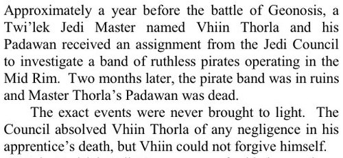
- **No single roster character (rules/setting/general)** — entry/section: GM overview: Vhiin's visions: "As Vhiin meditated on how he could have saved his Padawan, other images began to appear to him: Twi'leks wandering the badlands, abandoned to die; slavers striking families located in remote areas.
Master Thorla collected himself and, with renewed purpose, ventured out to help save some of his people. For almost a year now, Vhiin has rescued Twi'leks from certain death or enslavement and brought them back to a community he simply calls the Enclave." Source: *304 - Twi'light Storm* (SWRPG d20 Revised Core), p.3
  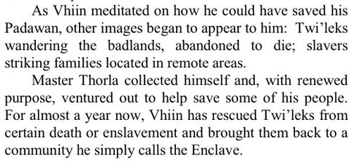

## p.4 (scan page 4)

Page contents: 761 words, 27 paragraphs | headings/entries: Encounter 4: Into the Barrens; Encounter 5: The Enclave; Encounter 6: Slavers; Encounter 7: Decisions; Opening Crawl; Encounter 1: A Friend's Request; Method One; Twilight Storm; Page 4

- **No single roster character (rules/setting/general)** — entry/section: Opening crawl: "A shroud of darkness has once again fallen over Cularin. Kirlocca, the Wookiee Jedi Master, has been struck down by the power of the dark side.
Remembrance ceremonies have been held all over the system. Beings from all walks of life have reflected on how the mighty Wookiee touched their lives. And yet... many of the citizens do not realize the void left by Kirlocca's death. The Almas Academy is now without its primary lightsaber instructor, and one of its two Jedi Masters.
Others, however, do realize and rejoice. In the darkest shadows of Cularin, there is celebration. With a mighty champion of light fallen, the cause of darkness may find its path a little easier ..." Source: *304 - Twi'light Storm* (SWRPG d20 Revised Core), p.4
  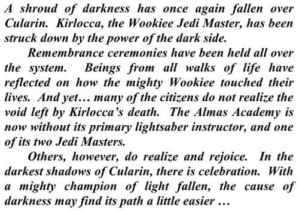

## p.5 (scan page 5)

Page contents: 852 words, 24 paragraphs | headings/entries: Almas Academy."; Method Two; Twilight Storm; Page 5

- **No single roster character (rules/setting/general)** — entry/section: Master Devan in the practice room: "Her red hair, bound tightly in a braid, seems to counterbalance her twirling form. She guides her lightsaber through forms used by the Jedi for generations, her movements fluid, almost dance-like; certainly the form of a Master. In a graceful move that is part bow, part salute, she stops and deactivates her lightsaber." Source: *304 - Twi'light Storm* (SWRPG d20 Revised Core), p.5
  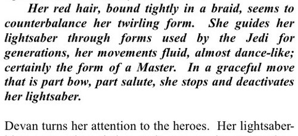
- **No single roster character (rules/setting/general)** — entry/section: Master Devan: ""The Clone Wars have depleted this school of most our Masters. Before Kirlocca's death, there were only three of us, and I was never meant to be a permanent fixture. Now there are two. When I go, there will be only Master Lanius, and while he's brilliant, he can't do everything alone.
"I would ask a favor. There is a Jedi I would like to request take over for Kirlocca. We knew each other as Padawans — and later as Knights — at the Coruscant temple. It might be a bit challenging to find him, as he was last seen disappearing into the wastelands of Ryloth over a year ago." Source: *304 - Twi'light Storm* (SWRPG d20 Revised Core), p.5
  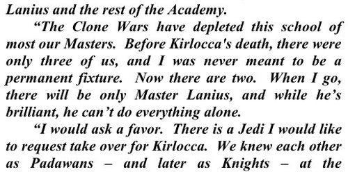

## p.6 (scan page 6)

Page contents: 830 words, 23 paragraphs | headings/entries: Twilight Storm; Page 6

- **No single roster character (rules/setting/general)** — entry/section: Master Devan on Vhiin: "Why? He is a good Jedi. His expertise with the lightsaber is such that he could fill Master Kirlocca's place. With the Clone Wars still raging, the Council cannot appoint another Master to Almas right now and Almas cannot afford to be without a lightsaber master." Source: *304 - Twi'light Storm* (SWRPG d20 Revised Core), p.6
  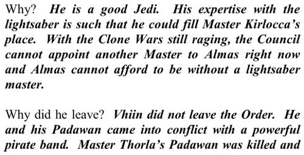
- **No single roster character (rules/setting/general)** — entry/section: Master Devan on slavery: "Figures. You Jedi ignore these things when it is convenient and only pay attention when you have something to gain. No. We do not condone slavery anywhere. But, right now, we are forced to look at events on a larger scale. Do you think this group <motions to the heroes> could rid the entire planet of slavers, and then remain to keep new ones from arriving?" Source: *304 - Twi'light Storm* (SWRPG d20 Revised Core), p.6
  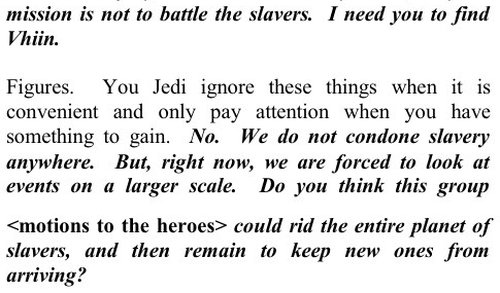
- **Orn Free Taa** — entry/section: Master Devan on Ryloth's loyalty: "Say. The Clone Wars are going on, right? Which side does Ryloth support? Senator Orn Free Taa is a staunch Loyalist and supports Supreme Chancellor Palpatine." Source: *304 - Twi'light Storm* (SWRPG d20 Revised Core), p.6
  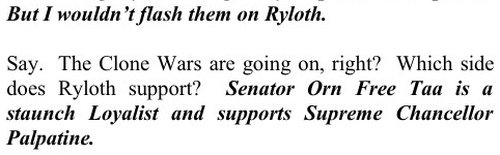

## p.7 (scan page 7)

Page contents: 876 words, 21 paragraphs | headings/entries: Encounter 2: Welcome to Ryloth; Twilight Storm; Page 7

## p.1–7 (scan page 1)

Page contents: Title; boilerplate; GM overview of Vhiin Thorla's exile and the Enclave; opening crawl; E1 Master Devan's request (hand-read)

## p.8 (scan page 8)

Page contents: 926 words, 19 paragraphs | headings/entries: Twilight Storm; Page 8

## p.9 (scan page 9)

Page contents: 774 words, 28 paragraphs | headings/entries: Weapon merchants:; Encounter 3: The Fungus Pit; Twilight Storm; Page 9

## p.10 (scan page 10)

Page contents: 905 words, 24 paragraphs | headings/entries: Twilight Storm; Page 10

- **Orn Free Taa** — entry/section: Fungus Pit rumor: "Twi'lek senator Orn Free Taa is returning to Ryloth to unify the major cities and form a planetary defense force." Source: *304 - Twi'light Storm* (SWRPG d20 Revised Core), p.10
  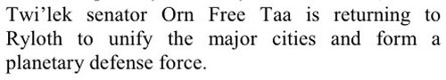
- **No single roster character (rules/setting/general)** — entry/section: Fungus Pit rumor: "There is a group of Jedi that have splintered off from Coruscant. They are seeking a way to quickly end the war with the Separatists. Apparently, this group has found a cache of long lost Sith weapons that they feel can be used to defeat the Separatists armies." Source: *304 - Twi'light Storm* (SWRPG d20 Revised Core), p.10
  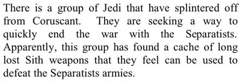

## p.11 (scan page 11)

Page contents: 876 words, 29 paragraphs | headings/entries: Twilight Storm; Page 11

- **No single roster character (rules/setting/general)** — entry/section: Jacynith and Cheib'Kalla: ""NO, Cheib'Kalla. This is MY decision. Or will you take away my freedom to make my own decisions, as Noric Gestal would do?"" Source: *304 - Twi'light Storm* (SWRPG d20 Revised Core), p.11
  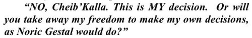

## p.12 (scan page 12)

Page contents: 825 words, 26 paragraphs | headings/entries: Encounter 4: Into the Barrens; Twilight Storm; Page 12

## p.13 (scan page 13)

Page contents: 836 words, 28 paragraphs | headings/entries: Encounter 5: The Enclave; Twilight Storm; Page 13

- **No single roster character (rules/setting/general)** — entry/section: Vhiin Thorla: "A male Twi'lek stands at front of the group. He is just above average height for a Twi'lek and has greenhued skin. His dark eyes look into each of you and his right hand brushes the lightsaber hilt hanging from his belt." Source: *304 - Twi'light Storm* (SWRPG d20 Revised Core), p.13
  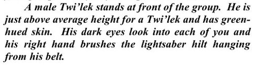

## p.7–13 (scan page 7)

Page contents: E2 Ryloth heat storm and Bashka customs; E3 the Fungus Pit brawl and Jacynith; E4 the Barrens hazards (hand-read)

## p.14 (scan page 14)

Page contents: 936 words, 23 paragraphs | headings/entries: Twilight Storm; Page 14

- **No single roster character (rules/setting/general)** — entry/section: Jarrti'Klomas on Vhiin: "Jarrti ruefully admits that Vhiin has handed him his lekku more than once in sparring. It's fairly clear that Vhiin has been helping to channel the boy's energy into defending the enclave rather than waging a war on the slavers that would only get him (and his supporters) killed." Source: *304 - Twi'light Storm* (SWRPG d20 Revised Core), p.14
  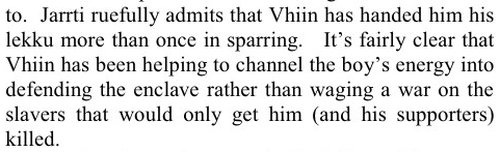

## p.15 (scan page 15)

Page contents: 821 words, 27 paragraphs | headings/entries: Twilight Storm; Page 15

- **No single roster character (rules/setting/general)** — entry/section: Vhiin Thorla: ""Slavers. I fear you have led them here. Intentional or not, you have brought them here and put my people in danger. I shall find their leader and deal with him. Please, help protect my friends -- stop the slavers from taking them."" Source: *304 - Twi'light Storm* (SWRPG d20 Revised Core), p.15
  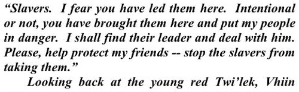

## p.16 (scan page 16)

Page contents: 863 words, 25 paragraphs | headings/entries: Encounter 6: Slavers; Encounter 7: Decisions; Twilight Storm; Page 16

- **No single roster character (rules/setting/general)** — entry/section: Vhiin and the Duros: "The encounter ends with Vhiin striking down the leader, a Duros. The remaining slavers try to escape after that. ... To ensure that the Duros stays out of fights with the heroes, we've declined to do statistics for him. Consider him a reasonably even match for Vhiin." Source: *304 - Twi'light Storm* (SWRPG d20 Revised Core), p.16
  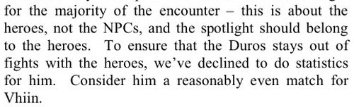

## p.17 (scan page 17)

Page contents: 773 words, 23 paragraphs | headings/entries: Conclusion; Here Ends Twi'light Storm; Experience Point Summary; Adventure Experience Award:

- **No single roster character (rules/setting/general)** — entry/section: Lumia'Silbossa: ""He's better off saving lives here than training soldiers elsewhere."" Source: *304 - Twi'light Storm* (SWRPG d20 Revised Core), p.17
  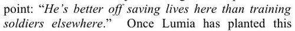
- **No single roster character (rules/setting/general)** — entry/section: Master Devan, conclusion: ""On behalf of Master Lanius and the Academy, I thank you. You performed a difficult task and had a hard decision to make, as did Vhiin. While his choice may be the right one for him, and his people, I worry for Cularin."" Source: *304 - Twi'light Storm* (SWRPG d20 Revised Core), p.17
  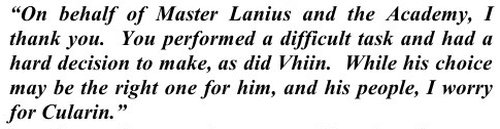

## p.18 (scan page 18)

Page contents: 351 words, 17 paragraphs | headings/entries: Loot Summary; Encounter 2; Encounter 4: Into the Barrens; Conclusion:; Twi light Storm; Page 18

## p.13–18 (scan page 13)

Page contents: E5 the Enclave and its residents; E6 the slaver attack; E7 Vhiin's decision; conclusion; XP; loot (hand-read)

## p.19 (scan page 19)

Page contents: 11 words, 2 paragraphs | headings/entries: Player Handout #1 — The Enclave @; Twilight Storm Page 19

## p.20 (scan page 20)

Page contents: 749 words, 24 paragraphs | headings/entries: GM Aid #1: NPC Stats; Low Tier (average Hero level 1 -3); Twilight Storm; Page 20

## p.21 (scan page 21)

Page contents: 782 words, 31 paragraphs | headings/entries: Mid Tier (average Hero level 4-6); High Tier (average Hero level 7-9); Feats: Armor Proficiency (light), Defensive; Twilight Storm; Page 21

## p.22 (scan page 22)

Page contents: 749 words, 29 paragraphs | headings/entries: Encounter 4: Into the Barrens; Encounter 5: The Enclave; Encounter 6: Slavers; Twilight Storm; Page 22

## p.23 (scan page 23)

Page contents: 114 words, 6 paragraphs | headings/entries: Twi'light Storm; Page 23

## p.24 (scan page 24)

Page contents: 114 words, 8 paragraphs | headings/entries: Critical Event Summary Twilight Storm; Yes No; GM Name, RPGA#:; GM Email Address:; Convention Name/Date; Twilight Storm Page 24

## p.19–24 (scan page 19)

Page contents: Enclave map; NPC stat blocks; critical event summary (hand-read)

