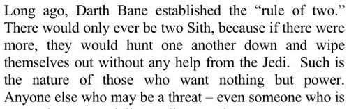
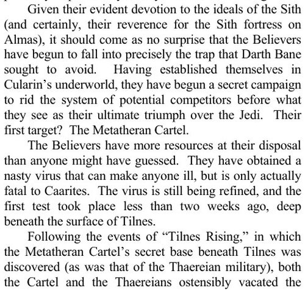
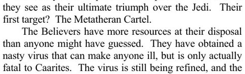
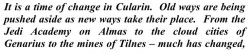
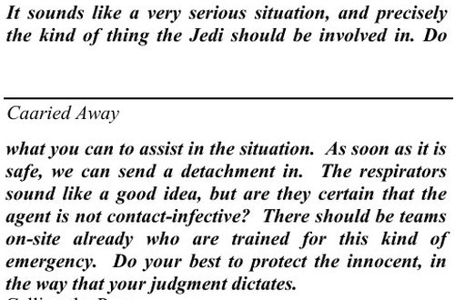
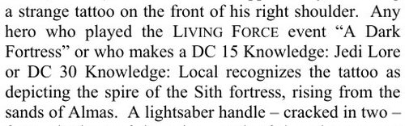
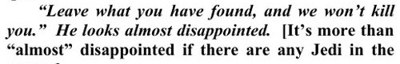
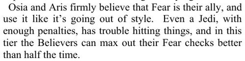
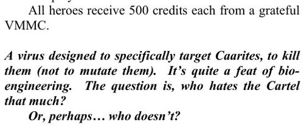
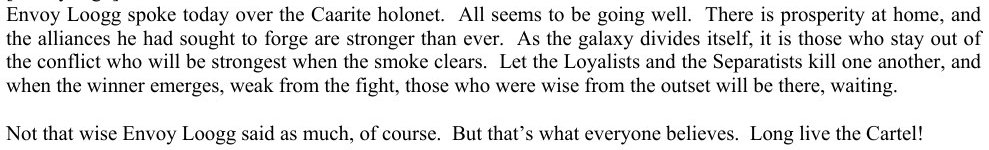

# Owner Material 037 — Star Wars D20 Drive folder (Core, Revised Core and Saga Edition): Living Force Campaign/Adventures/Among the Stars/Year 3/305 - Metatheran Caution - Caaried Away.pdf [Star Wars Roleplaying Game Revised Core (d20, 2002)]

- **Source:** Wizards of the Coast Star Wars Roleplaying Game books, web enhancements, Living Force campaign modules and articles (2000–2010), from the owner's "Star Wars D20" Drive folder (only the three edition subfolders; "General" was not read, as instructed). Secondary source (licensed Legends reference). Scan OCR'd on the box; the scan stays box-only and is **not** published.
- **Method:** every scanned page was OCR'd and machine-screened sentence by sentence for power-relevant statements (fights, kills, defeats, Force feats, rankings, superweapons) that name a character on our roster; each kept sentence is quoted verbatim from the OCR text and has a crop of the printed passage directly under it. Pages with nothing power-relevant are still listed with what is on them.
- **Citation:** "*305 - Metatheran Caution - Caaried Away* (SWRPG d20 Revised Core), p.X" by printed page ("scan p.X" where no printed number applies). **Weight:** Licensed RPG material: a secondary source. Narrative text sums up Legends lore; game statistics are rules for players, not canon power levels, and rank lowest.

## p.1 (scan page 1)

Page contents: 139 words, 7 paragraphs | headings/entries: LFA305; Caaried Away

## p.2 (scan page 2)

Page contents: 847 words, 21 paragraphs | headings/entries: House Rules; Atoning for Dark Side Points; Dissipate Energy; Caaried Away; Illusion; Stun; Hero Earnings; Page 2

## p.3 (scan page 3)

Page contents: 898 words, 18 paragraphs | headings/entries: Caaried Away; GM Overview; Page 3

- **Darth Bane** — entry/section: GM overview: the rule of two: "Long ago, Darth Bane established the "rule of two." There would only ever be two Sith, because if there were more, they would hunt one another down and wipe themselves out without any help from the Jedi. Such is the nature of those who want nothing but power. Anyone else who may be a threat — even someone who is presently or potentially an ally — can become a target." Source: *305 - Metatheran Caution - Caaried Away* (SWRPG d20 Revised Core), p.3
  
- **No single roster character (rules/setting/general)** — entry/section: GM overview: the Believers: "Given their evident devotion to the ideals of the Sith (and certainly, their reverence for the Sith fortress on Almas), it should come as no surprise that the Believers have begun to fall into precisely the trap that Darth Bane sought to avoid. Having established themselves in Cularin's underworld, they have begun a secret campaign to rid the system of potential competitors before what they see as their ultimate triumph over the Jedi. Their first target? The Metatheran Cartel." Source: *305 - Metatheran Caution - Caaried Away* (SWRPG d20 Revised Core), p.3
  
- **No single roster character (rules/setting/general)** — entry/section: GM overview: the virus: "The Believers have more resources at their disposal than anyone might have guessed. They have obtained a nasty virus that can make anyone ill, but is only actually fatal to Caarites." Source: *305 - Metatheran Caution - Caaried Away* (SWRPG d20 Revised Core), p.3
  

## p.4 (scan page 4)

Page contents: 895 words, 21 paragraphs | headings/entries: Encounter 1: Quarantine; Caaried Away; Encounter 2: Abandonment; Encounter 3: Queasy; Encounter 4: Abattoir; Encounter 5: Quarry; Encounter 6: Antidote?; Page 4

## p.5 (scan page 5)

Page contents: 795 words, 21 paragraphs | headings/entries: Encounter 7: Quarrel; Important Notes to Judges:; Opening Crawl; Caaried Away; Encounter 1: Quarantine; Page 5

- **No single roster character (rules/setting/general)** — entry/section: Opening crawl: "It is a time of change in Cularin. Old ways are being pushed aside as new ways take their place. From the Jedi Academy on Almas to the cloud cities of Genarius to the mines of Tilnes — much has changed, and much more will change. Soon.
The threats to Cularin have been many and varied, some appearing and then disappearing almost as soon as they emerge. Others maintain a peaceful facade — a facade that does little to ally the suspicions of Cularin's citizens. One group, though... a powerful group... has decided that is time to make its move..." Source: *305 - Metatheran Caution - Caaried Away* (SWRPG d20 Revised Core), p.5
  

## p.1–5 (scan page 1)

Page contents: Title; house rules; GM overview of the Believers' anti-Caarite virus on Tilnes; encounter summaries; opening crawl (hand-read)

## p.6 (scan page 6)

Page contents: 866 words, 22 paragraphs | headings/entries: Caaried Away; Encounter 2: Abandonment; Page 6

## p.7 (scan page 7)

Page contents: 919 words, 19 paragraphs | headings/entries: Calling a Friend/Mentor (Non-Jedi); Calling the Jedi; Caaried Away; Calling the Press; Page 7

- **No single roster character (rules/setting/general)** — entry/section: Calling the Jedi: "It sounds like a very serious situation, and precisely the kind of thing the Jedi should be involved in. Do what you can to assist in the situation. As soon as it is safe, we can send a detachment in. ... Do your best to protect the innocent, in the way that your judgment dictates." Source: *305 - Metatheran Caution - Caaried Away* (SWRPG d20 Revised Core), p.7
  

## p.8 (scan page 8)

Page contents: 839 words, 20 paragraphs | headings/entries: Encounter 3: Queasy; Caaried Away; Searching the Area; Search; DC What is found; Treat; Injury DC Information Gained; Page 8

## p.9 (scan page 9)

Page contents: 852 words, 19 paragraphs | headings/entries: Treat Injury DC; Slicing the Computer System; Encounter 4: Abattoir; Caaried Away; The Offices; Ko Bas's Office; Page 9

## p.10 (scan page 10)

Page contents: 942 words, 21 paragraphs | headings/entries: Ko Bas's Kitchen; Encounter 5: Quarry; Caaried Away; Middle Tier; Page 10

- **No single roster character (rules/setting/general)** — entry/section: The Believers' tattoo: "Any hero who played the LIVING FORCE event "A Dark Fortress" or who makes a DC 15 Knowledge: Jedi Lore or DC 30 Knowledge: Local recognizes the tattoo as depicting the spire of the Sith fortress, rising from the sands of Almas. A lightsaber handle — cracked in two — forms the base of the spire." Source: *305 - Metatheran Caution - Caaried Away* (SWRPG d20 Revised Core), p.10
  

## p.11 (scan page 11)

Page contents: 867 words, 24 paragraphs | headings/entries: Encounter 6: Antidote?; Caaried Away; If they succeed, read or paraphrase:; Encounter 7: Quarrel; Page 11

## p.5–11 (scan page 5)

Page contents: E1 quarantine after the EMP; E2 Neven Khash and the Cartel base door; E3 the dead Caarites; E4 Ko Bas's office and kitchen; E5 the mutated Ko Bas (hand-read)

## p.12 (scan page 12)

Page contents: 906 words, 23 paragraphs | headings/entries: Caaried Away; One of the men; Middle Tier; Page 12

- **No single roster character (rules/setting/general)** — entry/section: Osia: ""Leave what you have found, and we won't kill you." He looks almost disappointed." Source: *305 - Metatheran Caution - Caaried Away* (SWRPG d20 Revised Core), p.12
  

## p.13 (scan page 13)

Page contents: 956 words, 22 paragraphs | headings/entries: Caaried Away; Page 13

- **No single roster character (rules/setting/general)** — entry/section: Osia and Aris's tactics: "Osia and Aris firmly believe that Fear is their ally, and use it like it's going out of style. Even a Jedi, with enough penalties, has trouble hitting things, and in this tier the Believers can max out their Fear checks better than half the time." Source: *305 - Metatheran Caution - Caaried Away* (SWRPG d20 Revised Core), p.13
  

## p.14 (scan page 14)

Page contents: 847 words, 23 paragraphs | headings/entries: Conclusion; Caaried Away; Or, perhaps... who doesn't?; Here Ends Caaried Away; Experience Point Summary; Page 14

- **No single roster character (rules/setting/general)** — entry/section: Conclusion: "A virus designed to specifically target Caarites, to kill them (not to mutate them). It's quite a feat of bioengineering. The question is, who hates the Cartel that much?
Or, perhaps... who doesn't?" Source: *305 - Metatheran Caution - Caaried Away* (SWRPG d20 Revised Core), p.14
  

## p.15 (scan page 15)

Page contents: 516 words, 19 paragraphs | headings/entries: Adventure Experience Award:; Loot Summary; Caaried Away; Page 15

## p.11–15 (scan page 11)

Page contents: E6 the second viral bomb; E7 Osia and Aris with the mutants, the EMP; conclusion; XP; loot (hand-read)

## p.16 (scan page 16)

Page contents: 457 words, 15 paragraphs | headings/entries: TARASIN; WOOKIEE; RODIAN or DUROS; TWILEK or ZABRAK; Caaried Away Page 16

## p.17 (scan page 17)

Page contents: 174 words, 7 paragraphs | headings/entries: GUNGAN; BOTHAN; Caaried Away Page 17

## p.18 (scan page 18)

Page contents: 446 words, 15 paragraphs | headings/entries: Player Handout 2: Celis Bol's Personal Log; Caaried Away Page 18

- **No single roster character (rules/setting/general)** — entry/section: Celis Bol's log on Envoy Loogg: "Envoy Loogg spoke today over the Caarite holonet. All seems to be going well. There is prosperity at home, and the alliances he had sought to forge are stronger than ever. As the galaxy divides itself, it is those who stay out of the conflict who will be strongest when the smoke clears. Let the Loyalists and the Separatists kill one another, and when the winner emerges, weak from the fight, those who were wise from the outset will be there, waiting.
Not that wise Envoy Loogg said as much, of course. But that's what everyone believes. Long live the Cartel!" Source: *305 - Metatheran Caution - Caaried Away* (SWRPG d20 Revised Core), p.18
  

## p.19 (scan page 19)

Page contents: 22 words, 5 paragraphs | headings/entries: DM Aid #1: Cartel Base Layout; Ko Bas's Office -; Ko Bas's Lair; Caaried Away Page 19

## p.20 (scan page 20)

Page contents: 828 words, 24 paragraphs | headings/entries: DM Aid #2: NPC Stats; Encounter 5; Low Tier (levels 1-3); Middle Tier (levels 4-6); Feats: Improved Initiative, Improved Martial Arts; Caaried Away; Upper Tier (levels 7-9); Encounter 7 Low Tier (levels 1-3); Page 20

## p.21 (scan page 21)

Page contents: 647 words, 30 paragraphs | headings/entries: Middle Tier (levels 4-6); Alter, Control, Force Mind, Mind; Caaried Away; Upper Tier (levels 7-9); Force Mind,; Page 21

## p.22 (scan page 22)

Page contents: 222 words, 12 paragraphs | headings/entries: Creating a Maddened Creature; Caaried Away Page 22

## p.23 (scan page 23)

Page contents: 10 words, 2 paragraphs | headings/entries: DM Aid 4: Encounter 7 Layout; Caaried Away Page 23

## p.24 (scan page 24)

Page contents: 128 words, 9 paragraphs | headings/entries: Critical Event Summary Caaried Away; O Killed XC Captured CO Escaped; GM Name, RPGA#:; GM Email Address:; Convention Name/Date; Caaried Away Page 24

## p.16–24 (scan page 16)

Page contents: Player handouts (symptoms; Celis Bol's log); base map; NPC stats; Maddened template; Encounter 7 map; critical event summary (hand-read)

