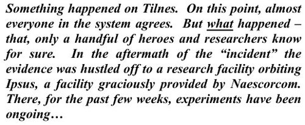
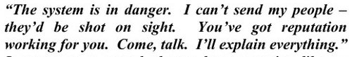
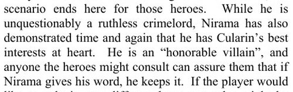
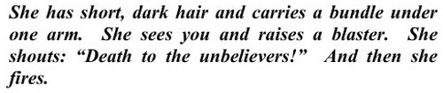
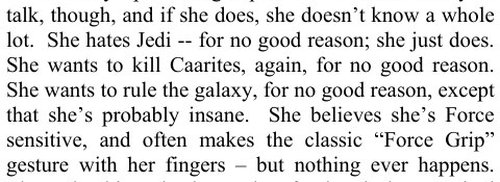
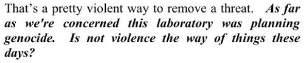
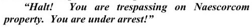
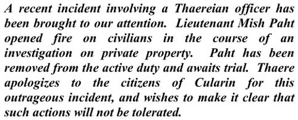
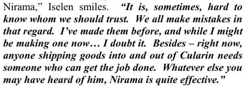

# Owner Material 037 — Star Wars D20 Drive folder (Core, Revised Core and Saga Edition): Living Force Campaign/Adventures/Among the Stars/Year 3/306 - Metatheran Caution - Open Aarms.pdf [Star Wars Roleplaying Game Revised Core (d20, 2002)]

- **Source:** Wizards of the Coast Star Wars Roleplaying Game books, web enhancements, Living Force campaign modules and articles (2000–2010), from the owner's "Star Wars D20" Drive folder (only the three edition subfolders; "General" was not read, as instructed). Secondary source (licensed Legends reference). Scan OCR'd on the box; the scan stays box-only and is **not** published.
- **Method:** every scanned page was OCR'd and machine-screened sentence by sentence for power-relevant statements (fights, kills, defeats, Force feats, rankings, superweapons) that name a character on our roster; each kept sentence is quoted verbatim from the OCR text and has a crop of the printed passage directly under it. Pages with nothing power-relevant are still listed with what is on them.
- **Citation:** "*306 - Metatheran Caution - Open Aarms* (SWRPG d20 Revised Core), p.X" by printed page ("scan p.X" where no printed number applies). **Weight:** Licensed RPG material: a secondary source. Narrative text sums up Legends lore; game statistics are rules for players, not canon power levels, and rank lowest.

## p.1 (scan page 1)

Page contents: 141 words, 7 paragraphs | headings/entries: LFA306; Open Aarms

## p.2 (scan page 2)

Page contents: 846 words, 21 paragraphs | headings/entries: House Rules; Atoning for Dark Side Points; Dissipate Energy; Open Aarms; Illusion; Stun; Hero Earnings; Page 2

## p.3 (scan page 3)

Page contents: 912 words, 18 paragraphs | headings/entries: General Notes to the GM; Open Aarms; GM Overview; Page 3

## p.4 (scan page 4)

Page contents: 788 words, 23 paragraphs | headings/entries: Encounter 1: A Worried Crime Lord; Encounter 2: Grunt Work; Encounter 3: Down the Line; Encounter 4: Up the Line; Encounter 5: Containment; Open Aarms; Encounter 6: With Feeling; Opening Crawl; Page 4

- **No single roster character (rules/setting/general)** — entry/section: Opening crawl: "Something happened on Tilnes. On this point, almost everyone in the system agrees. But what happened — that, only a handful of heroes and researchers know for sure. In the aftermath of the "incident" the evidence was hustled off to a research facility orbiting Ipsus, a facility graciously provided by Naescorcom. There, for the past few weeks, experiments have been ongoing..." Source: *306 - Metatheran Caution - Open Aarms* (SWRPG d20 Revised Core), p.4
  

## p.1–4 (scan page 1)

Page contents: Title; house rules; GM overview of the Believers' lab under the Ipsus thermal detonator line; encounter summaries; opening crawl (hand-read)

## p.5 (scan page 5)

Page contents: 873 words, 18 paragraphs | headings/entries: Encounter 1: A Worried Crime Lord; Open Aarms; Page 5

- **No single roster character (rules/setting/general)** — entry/section: Nirama's recorded message: ""The system is in danger. I can't send my people — they'd be shot on sight. You've got reputation working for you. Come, talk. I'll explain everything."" Source: *306 - Metatheran Caution - Open Aarms* (SWRPG d20 Revised Core), p.5
  
- **No single roster character (rules/setting/general)** — entry/section: Nirama, the honorable villain: "While he is unquestionably a ruthless crimelord, Nirama has also demonstrated time and again that he has Cularin's best interests at heart. He is an "honorable villain", and anyone the heroes might consult can assure them that if Nirama gives his word, he keeps it." Source: *306 - Metatheran Caution - Open Aarms* (SWRPG d20 Revised Core), p.5
  

## p.6 (scan page 6)

Page contents: 731 words, 31 paragraphs | headings/entries: Do you want to help your; I don't go through; Open Aarms; Page 6

## p.7 (scan page 7)

Page contents: 891 words, 21 paragraphs | headings/entries: Encounter 2: Grunt Work; Open Aarms; Encounter 3: Down the Line; Page 7

## p.8 (scan page 8)

Page contents: 988 words, 14 paragraphs | headings/entries: Open Aarms; Encounter 4: Up the Line; Page 8

## p.9 (scan page 9)

Page contents: 878 words, 31 paragraphs | headings/entries: Open Aarms; Page 9

- **No single roster character (rules/setting/general)** — entry/section: Canduri: "She has short, dark hair and carries a bundle under one arm. She sees you and raises a blaster. She shouts: "Death to the unbelievers!" And then she fires." Source: *306 - Metatheran Caution - Open Aarms* (SWRPG d20 Revised Core), p.9
  

## p.10 (scan page 10)

Page contents: 928 words, 20 paragraphs | headings/entries: Outcome; Encounter 5: Containment; Open Aarms; Page 10

- **No single roster character (rules/setting/general)** — entry/section: Canduri, deluded Believer: "She hates Jedi -- for no good reason; she just does. She wants to kill Caarites, again, for no good reason. She wants to rule the galaxy, for no good reason, except that she's probably insane. She believes she's Force sensitive, and often makes the classic "Force Grip" gesture with her fingers — but nothing ever happens." Source: *306 - Metatheran Caution - Open Aarms* (SWRPG d20 Revised Core), p.10
  

## p.5–10 (scan page 5)

Page contents: E1 Nirama at Riboga's Barge; E2 the Ugnaught exodus; E3 the detonator line; E4 Canduri and the chase table (hand-read)

## p.11 (scan page 11)

Page contents: 806 words, 23 paragraphs | headings/entries: Open Aarms; What_about Nirama's worry about the thermal detonators?; Encounter 6: With Feeling; Page 11

- **No single roster character (rules/setting/general)** — entry/section: Caarite negotiator: "As far as we're concerned this laboratory was planning genocide. Is not violence the way of things these days?" Source: *306 - Metatheran Caution - Open Aarms* (SWRPG d20 Revised Core), p.11
  

## p.12 (scan page 12)

Page contents: 802 words, 25 paragraphs | headings/entries: Open Aarms; We already knew; That would; Encounter 7: Utterly Unexpected Ambush; Page 12

- **No single roster character (rules/setting/general)** — entry/section: Lieutenant Mish Paht: ""Halt! You are trespassing on Naescorcom property. You are under arrest!"" Source: *306 - Metatheran Caution - Open Aarms* (SWRPG d20 Revised Core), p.12
  

## p.13 (scan page 13)

Page contents: 900 words, 19 paragraphs | headings/entries: Open Aarms; Conclusion; Thaereian Disavowment; Page 13

- **No single roster character (rules/setting/general)** — entry/section: Thaereian disavowal: "A recent incident involving a Thaereian officer has been brought to our attention. Lieutenant Mish Paht opened fire on civilians in the course of an investigation on private property. Paht has been removed from the active duty and awaits trial. Thaere apologizes to the citizens of Cularin for this outrageous incident, and wishes to make it clear that such actions will not be tolerated." Source: *306 - Metatheran Caution - Open Aarms* (SWRPG d20 Revised Core), p.13
  

## p.14 (scan page 14)

Page contents: 780 words, 27 paragraphs | headings/entries: Turning Canduri _and_the Virus Over to the; Open Aarms; Here Ends Open Aarms; Experience Point Summary; Adventure Experience Award:; Page 14

- **No single roster character (rules/setting/general)** — entry/section: Dalton Iselen on Nirama: ""It is, sometimes, hard to know whom we should trust. We all make mistakes in that regard. I've made them before, and while I might be making one now... I doubt it. Besides — right now, anyone shipping goods into and out of Cularin needs someone who can get the job done. Whatever else you may have heard of him, Nirama is quite effective."" Source: *306 - Metatheran Caution - Open Aarms* (SWRPG d20 Revised Core), p.14
  

## p.15 (scan page 15)

Page contents: 832 words, 21 paragraphs | headings/entries: Loot Summary; Open Aarms; As Thanks From Naescorcom:; Page 15

## p.16 (scan page 16)

Page contents: 506 words, 11 paragraphs | headings/entries: From Nirama; Open Aarms; Page 16

## p.10–16 (scan page 10)

Page contents: E5 the Cartel search squad; E6 Lt. Mish Paht; E7 the reprogrammed droids; conclusion with Lanius, the Militia and Dalton Iselen; XP; loot (hand-read)

## p.17 (scan page 17)

Page contents: 380 words, 21 paragraphs | headings/entries: The virus... [e) [e); Open Aarms; Page 17

## p.18 (scan page 18)

Page contents: 55 words, 9 paragraphs | headings/entries: Textile Line 1 [2 Security Droids]; Main Entrance [2 Security Droids]; Textile Line 2 [2 Security Droids]; Lower Sector Break Room; Textile Line 3 [2 Security Droids]; Security Area [12 Security Droids]; Thermal Detonator Line [2 Security Droids]; Open Aarms Page 18

## p.19 (scan page 19)

Page contents: 687 words, 35 paragraphs | headings/entries: GM Aid #1: Stat Blocks; Encounter 2 (Not tiered); Encounter 3 (Not tiered); Encounter 4 (Not tiered); Encounter 5 (Not tiered); Open Aarms; Encounter 6; Low Tier (Levels 1-3); Middle and High Tiers (levels 4-9); Page 19

## p.20 (scan page 20)

Page contents: 115 words, 7 paragraphs | headings/entries: Encounter 7 (Not tiered); Open Aarms; Page 20

## p.21 (scan page 21)

Page contents: 148 words, 18 paragraphs | headings/entries: Critical Event Summary Open Aarms; O Killed Oi Escaped Oi Captured; Other (please specify); Other (please specify); GM Name, RPGA#:; O Nirama; GM Email Address:; Convention Name/Date; Convention Coordinator:; Open Aarms; Page 21

## p.17–21 (scan page 17)

Page contents: Player handouts (virus findings; facility map); stat blocks; critical event summary (hand-read)

