# Owner Material 037 — Star Wars D20 Drive folder (Core, Revised Core and Saga Edition): Living Force Campaign/Adventures/Among the Stars/Year 3/307 - Metatheran Caution - Belly of the Beaast.pdf [Star Wars Roleplaying Game Revised Core (d20, 2002)]

- **Source:** Wizards of the Coast Star Wars Roleplaying Game books, web enhancements, Living Force campaign modules and articles (2000–2010), from the owner's "Star Wars D20" Drive folder (only the three edition subfolders; "General" was not read, as instructed). Secondary source (licensed Legends reference). Scan OCR'd on the box; the scan stays box-only and is **not** published.
- **Method:** every scanned page was OCR'd and machine-screened sentence by sentence for power-relevant statements (fights, kills, defeats, Force feats, rankings, superweapons) that name a character on our roster; each kept sentence is quoted verbatim from the OCR text and has a crop of the printed passage directly under it. Pages with nothing power-relevant are still listed with what is on them.
- **Citation:** "*307 - Metatheran Caution - Belly of the Beaast* (SWRPG d20 Revised Core), p.X" by printed page ("scan p.X" where no printed number applies). **Weight:** Licensed RPG material: a secondary source. Narrative text sums up Legends lore; game statistics are rules for players, not canon power levels, and rank lowest.

## p.1 (scan page 1)

Page contents: 190 words, 8 paragraphs | headings/entries: LFA307; Belly of the Beaast; Edited by Jae Walker

## p.2 (scan page 2)

Page contents: 861 words, 20 paragraphs | headings/entries: House Rules; Atoning for Dark Side Points; Dissipate Energy; Belly of the Beaast; Illusion; Stun; Hero Earnings; Page 2

## p.3 (scan page 3)

Page contents: 883 words, 17 paragraphs | headings/entries: General Notes to the GM; Belly of the Beaast; GM Overview; Page 3

## p.4 (scan page 4)

Page contents: 929 words, 17 paragraphs | headings/entries: Belly of the Beaast; Encounter 2: Joventusek; Encounter 3: Fields of Caarimon; Encounter 4: Cartel Central; Encounter 5: The Desolation; Encounter 6: Coordinated Attack; Page 4

## p.5 (scan page 5)

Page contents: 863 words, 19 paragraphs | headings/entries: Encounter 7: Other People's Messes; Belly of the Beaast; Opening Crawl; Page 5

- **No single roster character (rules/setting/general)** — entry/section: Opening crawl: "From one hidden location to the next, the Believers have never stopped moving. They have struck at Cularin, and now their target is the Metatheran Cartel. Their ultimate goal remains unclear — and that, more than anything else, worries those who know of their existence.
Now, the heroes of Cularin have received a request from the Cularin Militia. Something needs to be done, and diplomatic channels may not suffice..." Source: *307 - Metatheran Caution - Belly of the Beaast* (SWRPG d20 Revised Core), p.5
  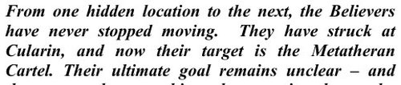

## p.1–5 (scan page 1)

Page contents: Title; house rules; GM overview of Melo Centris and the plot against Caarimon; encounter summaries; judge notes; opening crawl (hand-read)

## p.6 (scan page 6)

Page contents: 882 words, 27 paragraphs | headings/entries: Belly of the Beaast; Page 6

- **No single roster character (rules/setting/general)** — entry/section: Osten Dal'Nay: ""If you listen to the holonet in this system, Cularin has a lot of heroes. I asked for heroes, but what I really want is people who will do what it takes to save lives. Are you those people?"" Source: *307 - Metatheran Caution - Belly of the Beaast* (SWRPG d20 Revised Core), p.6
  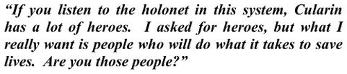
- **No single roster character (rules/setting/general)** — entry/section: Osten Dal'Nay on the virus: ""I assume some of you are familiar with the recent problems on Tilnes and Ipsus. There is a virus, which has been manufactured in Cularin. It's about to be released into the atmosphere of a planet, where it will kill thousands of innocents. It won't discriminate. Young, old, sick, healthy — they'll all die. We've analyzed the virus. It will be deadly. And painful."" Source: *307 - Metatheran Caution - Belly of the Beaast* (SWRPG d20 Revised Core), p.6
  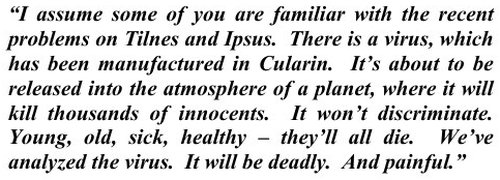
- **No single roster character (rules/setting/general)** — entry/section: Osten Dal'Nay's answers: "They're Caarites. They're part of the Metatheran Cartel. They deserve to die. Not all Caarites are part of the Cartel. But even if they were, what's being done here is wrong. I don't like the Cartel, but I can't sit by, knowing that innocents are going to be killed, and do nothing.
...
You're cracked. I just happen to believe that mass murder is wrong. If that makes me cracked, so be it.
...
You seriously want us to go and save Caarites? After everything the Cartel has done? I hope you will go and stop the slaughter of innocents. Whatever the Cartel has done here, most of the individuals on Caarimon had nothing to do with it." Source: *307 - Metatheran Caution - Belly of the Beaast* (SWRPG d20 Revised Core), p.6
  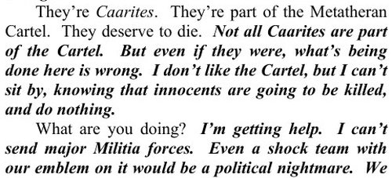

## p.7 (scan page 7)

Page contents: 904 words, 29 paragraphs | headings/entries: Yes, you could take; Belly of the Beaast; Encounter 2: Joventusek; Page 7

- **No single roster character (rules/setting/general)** — entry/section: Osten Dal'Nay on Master Devan: "Have you notified the Jedi Academy? I spoke with Master Devan about including Padawans and/or Knights in the mission. She assented. You are welcome to check with her, or your own mentors, as you see fit." Source: *307 - Metatheran Caution - Belly of the Beaast* (SWRPG d20 Revised Core), p.7
  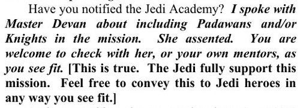

## p.8 (scan page 8)

Page contents: 918 words, 15 paragraphs | headings/entries: Belly of the Beaast; Page 8

- **No single roster character (rules/setting/general)** — entry/section: Nuris Blaht: ""Hello! I am Nuris Blaht, Deputy Undersecretary to the Assistant Chief Subcounsel of the Greater Caarimon Communications Division of the Caarimon Ministry of Conservation. Welcome to Caarimon!"" Source: *307 - Metatheran Caution - Belly of the Beaast* (SWRPG d20 Revised Core), p.8
  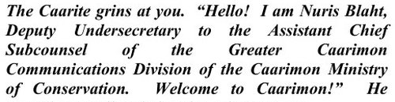

## p.9 (scan page 9)

Page contents: 888 words, 14 paragraphs | headings/entries: Belly of the Beaast; Page 9

## p.10 (scan page 10)

Page contents: 871 words, 20 paragraphs | headings/entries: Belly of the Beaast; Encounter 3: Fields of Caarimon; Page 10

## p.11 (scan page 11)

Page contents: 919 words, 30 paragraphs | headings/entries: Belly of the Beaast; Page 11

- **No single roster character (rules/setting/general)** — entry/section: Captured Believers on the speeders: "Why don't you act like a Jedi and beat me some, to see if I'll talk.
You're all weak and foolish. This planet is as good as gone already. There's nothing you can do to stop it." Source: *307 - Metatheran Caution - Belly of the Beaast* (SWRPG d20 Revised Core), p.11
  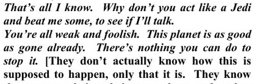
- **No single roster character (rules/setting/general)** — entry/section: Blik: "He's a Shistavanen (remember the werewolf in the Star Wars: Episode 4 - A New Hope cantina scene?) pilot who's renowned for his skills. No one's heard of him working with the Believers, although there were rumors that he'd been helping with the programming of droid pilots for the Separatist armies." Source: *307 - Metatheran Caution - Belly of the Beaast* (SWRPG d20 Revised Core), p.11
  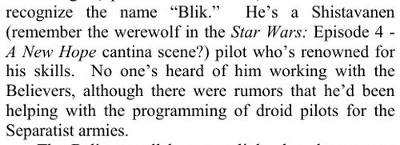

## p.12 (scan page 12)

Page contents: 883 words, 22 paragraphs | headings/entries: Encounter 4: Cartel Central; Belly of the Beaast; Page 12

## p.13 (scan page 13)

Page contents: 809 words, 37 paragraphs | headings/entries: Efellis; Belly of the Beaast; Information Gathered; Page 13

- **No single roster character (rules/setting/general)** — entry/section: Rikard: "I've heard that there are off-worlders on the planet. I don't think we need them here. I mean, no offense, welcome and all, but change brings trouble. I've got a bad feeling about them. [If anyone uses See Force on this youth (Rikard), he is Force-sensitive, but isn't aware that's what he's experiencing ...]" Source: *307 - Metatheran Caution - Belly of the Beaast* (SWRPG d20 Revised Core), p.13
  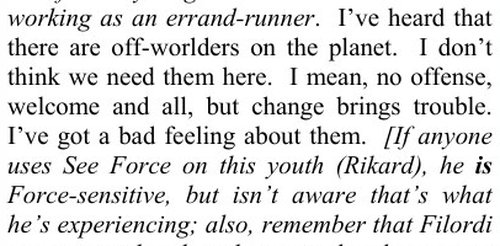

## p.14 (scan page 14)

Page contents: 868 words, 22 paragraphs | headings/entries: The Library at Joventusek; Encounter 5: The Desolation; Belly of the Beaast; Page 14

## p.5–14 (scan page 5)

Page contents: E1 Osten Dal'Nay's briefing; E2 Joventusek and Nuris Blaht; E3 the Believer airbike chase; E4 Jyll Xon, Patla Soo and Efellis (hand-read)

## p.15 (scan page 15)

Page contents: 946 words, 19 paragraphs | headings/entries: Encounter 6: Coordinated Attack; Belly of the Beaast; Page 15

- **No single roster character (rules/setting/general)** — entry/section: Blik's taunt: ""You were too cowardly to fight one on one, good luck stopping my companions inside. You'll need it."" Source: *307 - Metatheran Caution - Belly of the Beaast* (SWRPG d20 Revised Core), p.15
  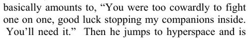

## p.16 (scan page 16)

Page contents: 1037 words, 16 paragraphs | headings/entries: Belly of the Beaast; Page 16

## p.17 (scan page 17)

Page contents: 990 words, 18 paragraphs | headings/entries: Belly of the Beaast; Page 17

- **No single roster character (rules/setting/general)** — entry/section: Melo Centris as Senator Wren: ""Help! They've kidnapped me and are planning to make it look as though I were involved!"" Source: *307 - Metatheran Caution - Belly of the Beaast* (SWRPG d20 Revised Core), p.17
  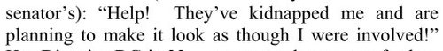

## p.18 (scan page 18)

Page contents: 965 words, 16 paragraphs | headings/entries: Encounter 7: Other People's Messes; Belly of the Beaast; Page 18

## p.19 (scan page 19)

Page contents: 879 words, 26 paragraphs | headings/entries: Belly of the Beaast; Conclusion; If the heroes met Patla before:; Page 19

- **No single roster character (rules/setting/general)** — entry/section: Melo Centris on the Believers: ""religious loons, the whole lot"" Source: *307 - Metatheran Caution - Belly of the Beaast* (SWRPG d20 Revised Core), p.19
  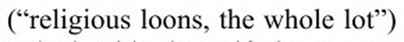
- **No single roster character (rules/setting/general)** — entry/section: The Believer tattoo: "Their tattoos (each of them has the standard Believer tattoo on the front of his or her right shoulder; it shows the spire of the Sith fortress, rising from the sands of Almas. A lightsaber handle — cracked in two — forms the base of the spire.) have been modified such that if they click their teeth in a set pattern, the tattoo activates a subdermal poison ... Examining the tattoo post-mortem shows that each of the broken lightsaber halves sprouted what looks like a blood-red blade when the poison was released." Source: *307 - Metatheran Caution - Belly of the Beaast* (SWRPG d20 Revised Core), p.19
  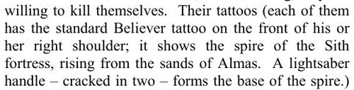
- **No single roster character (rules/setting/general)** — entry/section: Captured Believers on the station: "You're all going to die.
The galaxy will fall to the might of the ancient wisdom.
We are everywhere. Cularin cannot contain us.
The dark side is the only true power of the Force. Thaere is home to fools. The galaxy is home to many fools.
Our leader is the dark side.
We did this because it needed to be done. Or, we tried. Everyone suffers. This planet should be no different." Source: *307 - Metatheran Caution - Belly of the Beaast* (SWRPG d20 Revised Core), p.19
  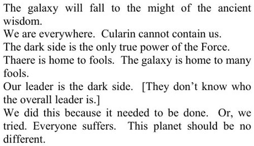

## p.20 (scan page 20)

Page contents: 620 words, 35 paragraphs | headings/entries: A Celebration on Caarimon; Who knew... Caarites can party!; Here Ends Belly of the Beaast; Experience Point Summary; Adventure Experience Award:; Belly of the Beaast; Loot Summary; Datacard: Knowledge (Caarimon Culture); From the Believers on the Speeders; Various blasters and gear; From the Caarimon Ministry of Conservation; A reward of 1000 credits per hero; Caarimon's ecology); From the Metatheran Cartel; From the battle aboard the orbiting station; Page 20

- **No single roster character (rules/setting/general)** — entry/section: Conclusion: "The words "Thank you!" flash across the screen as the image pauses with the heroes standing on the ramp, looking out at Caarimon.
Who knew... Caarites can party!" Source: *307 - Metatheran Caution - Belly of the Beaast* (SWRPG d20 Revised Core), p.20
  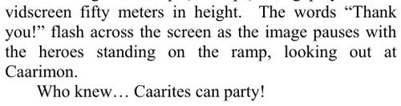

## p.21 (scan page 21)

Page contents: 368 words, 9 paragraphs | headings/entries: Other blasters, weapons, and gear; Belly of the Beaast Page 21

## p.14–21 (scan page 14)

Page contents: E5 the Desolation beacon; E6 the space fight with Blik and the research station battle; E7 prisoners and the Thaereian money; conclusion; XP; loot (hand-read)

## p.22 (scan page 22)

Page contents: 79 words, 5 paragraphs | headings/entries: Player Handout 1: Call for Assistance; Osten DalNay Cularin Militia; Belly of the Beaast Page 22

## p.23 (scan page 23)

Page contents: 608 words, 11 paragraphs | headings/entries: Player Handout 2: Cultural Awareness Documentation; Belly of the Beaast Page 23

- **No single roster character (rules/setting/general)** — entry/section: Cultural Awareness Documentation: "We are symbionts with our planet, and while we welcome visitors, we ask that you also take on the role of symbiont while on Caarimon. If this is beyond your capacity, we ask that you at least do minimal harm. We welcome you, and hope that the act of welcoming has not made you feel unwelcome. It is better to speak honestly, to convey the truth of a situation and to risk anger, than it is to leave those who would visit us in ignorance of our ways and hope for the best." Source: *307 - Metatheran Caution - Belly of the Beaast* (SWRPG d20 Revised Core), p.23
  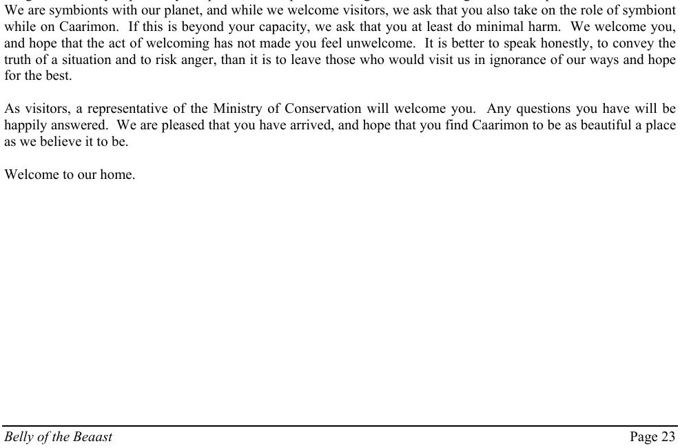

## p.24 (scan page 24)

Page contents: 683 words, 24 paragraphs | headings/entries: GM Aid #1: Combat Statistics; Encounter 3: Fields of Caarimon; Encounter 6: Coordinated Attack; All Tiers; Belly of the Beaast; Page 24

- **No single roster character (rules/setting/general)** — entry/section: Melo Centris: "Melo Centris, Tainted Human Female Force Adept 4/Scoundrel 5/Dark Side Devotee 1; IM +4; Def 22 (+4 Dex, +8 Class); Spd 10 m; VP/WP 52/10; Attack +10/+5 melee (1d4-1 + poison*, knife), +10/+5 ranged (1d4-1 + poison, knife, or 3d6, blaster pistol); SQ Poison Use, Poison Immunity, Illicit Barter, Lucky 1/day, Precise Attack +1, DR 4 (mastercraft armor); SV Fort +4, Ref +11, Will +8; SZ M; FP 2; DSP 6; Rep 1; Str 8, Dex 18, Con 10, Int 14, Wis 12, Cha 14.
Force Skills: Empathy +9, Enhance Ability +9, Fear +15, Force Grip +10, Force Stealth +11, Move Object +7.
Force Feats: Alter, Burst of Speed, Control, Sense." Source: *307 - Metatheran Caution - Belly of the Beaast* (SWRPG d20 Revised Core), p.24
  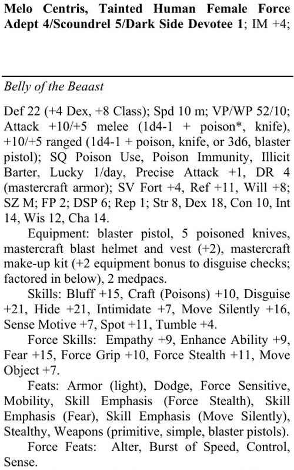

## p.25 (scan page 25)

Page contents: 785 words, 29 paragraphs | headings/entries: Low Tier (Levels 1-3); Skills: Appraise +5, Computer Use +10, Craft; Belly of the Beaast; Page 25

## p.26 (scan page 26)

Page contents: 782 words, 28 paragraphs | headings/entries: Middle Tier; Belly of the Beaast; Page 26

## p.27 (scan page 27)

Page contents: 777 words, 27 paragraphs | headings/entries: Upper Tier; Feats: Cautious, Gearhead, Improved Initiative,; Belly of the Beaast; Page 27

## p.28 (scan page 28)

Page contents: 114 words, 7 paragraphs | headings/entries: Belly of the Beaast; Page 28

## p.29 (scan page 29)

Page contents: 84 words, 4 paragraphs | headings/entries: GM Aid #2: Space Combat Grid; Belly of the Beaast Page 29

## p.30 (scan page 30)

Page contents: 13 words, 3 paragraphs | headings/entries: GM Aid #3: Standard Combat Map; Belly of the Beaast Page 30

## p.31 (scan page 31)

Page contents: 77 words, 5 paragraphs | headings/entries: GM Aid #4: Ship Counters; BOOM OO eeeee?; Belly of the Beaast Page 31

## p.32 (scan page 32)

Page contents: 266 words, 15 paragraphs | headings/entries: Other (please specify); GM Name, RPGA#:; GM Email Address:; Convention Name/Date; Belly of the Beaast Page 32

## p.22–32 (scan page 22)

Page contents: Player handouts; stat blocks; space grid; station map; ship counters; critical event summary (hand-read)

