# Owner Material 037 — Star Wars D20 Drive folder (Core, Revised Core and Saga Edition): Living Force Campaign/Adventures/Among the Stars/Year 3/308 - Metatheran Caution - Paarty On.pdf [Star Wars Roleplaying Game Revised Core (d20, 2002)]

- **Source:** Wizards of the Coast Star Wars Roleplaying Game books, web enhancements, Living Force campaign modules and articles (2000–2010), from the owner's "Star Wars D20" Drive folder (only the three edition subfolders; "General" was not read, as instructed). Secondary source (licensed Legends reference). Scan OCR'd on the box; the scan stays box-only and is **not** published.
- **Method:** every scanned page was OCR'd and machine-screened sentence by sentence for power-relevant statements (fights, kills, defeats, Force feats, rankings, superweapons) that name a character on our roster; each kept sentence is quoted verbatim from the OCR text and has a crop of the printed passage directly under it. Pages with nothing power-relevant are still listed with what is on them.
- **Citation:** "*308 - Metatheran Caution - Paarty On* (SWRPG d20 Revised Core), p.X" by printed page ("scan p.X" where no printed number applies). **Weight:** Licensed RPG material: a secondary source. Narrative text sums up Legends lore; game statistics are rules for players, not canon power levels, and rank lowest.

## p.1 (scan page 1)

Page contents: 137 words, 8 paragraphs | headings/entries: LFA308; Paarty On!

## p.2 (scan page 2)

Page contents: 894 words, 23 paragraphs | headings/entries: Hero Earnings; General Notes to the GM; The Story; Paarty On!; Page 2

## p.3 (scan page 3)

Page contents: 842 words, 19 paragraphs | headings/entries: Paarty On!; Opening Crawl; The Details; Page 3

- **No single roster character (rules/setting/general)** — entry/section: Opening crawl: "Evil comes and evil goes. Somehow, the Metatheran Cartel remains. For all the harm and mistrust they've brought to Cularin, they continue to make attempts at peace while behaving in less than honest ways. Now, in the aftermath of the salvation of their planet, the Cartel has decided to throw a party for the heroes of Cularin at the exclusive Greetree resort on Dorumaa. And it's just that simple, isn't it? Of course. Because after all, the Cartel looooves Cularin..." Source: *308 - Metatheran Caution - Paarty On* (SWRPG d20 Revised Core), p.3
  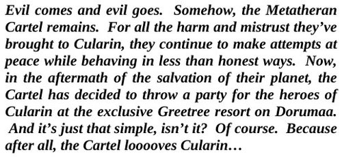
- **No single roster character (rules/setting/general)** — entry/section: The Cartel's excuse: "The Cartel gleefully accepts responsibility. Of course they wanted the heroes to go out and adventure — it would not be a Cularin celebration without adventure and hunting of one another, would it? There was never any danger to anyone. Really. The Cartel would not do that. The Cartel loves Cularin!
So, at least, says Thurm Loogg's holoprojection." Source: *308 - Metatheran Caution - Paarty On* (SWRPG d20 Revised Core), p.3
  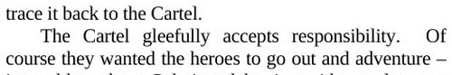

## p.4 (scan page 4)

Page contents: 759 words, 33 paragraphs | headings/entries: Timeline; Thurm Loogg Shooting Gallery; Paarty On!; Patla Soo's Address; Simulation Piloting; Page 4

## p.5 (scan page 5)

Page contents: 338 words, 11 paragraphs | headings/entries: Paarty On!; Page 5

## p.1–5 (scan page 1)

Page contents: Title; story of the Cartel party on Dorumaa and the Tarasin band PatON; Caarimon guests; opening crawl; timeline; shooting gallery; contests; rumors (hand-read)

## p.6 (scan page 6)

Page contents: 926 words, 22 paragraphs | headings/entries: Mini-Mission; Scene One: Into the Woods; Paarty On!; Scene Two: Attack of the Killer WHAT?; Page 6

- **No single roster character (rules/setting/general)** — entry/section: Cartel announcement: ""Attention brave and honorable citizens of Cularin. A threat has emerged to the safety of all present, particularly those affiliated with the omnibenevolent Metatheran Cartel. We request assistance. Those who would harm this gathering lurk just outside the boundaries of the resort — we need teams to assist in finding and subduing them before harm can be done."" Source: *308 - Metatheran Caution - Paarty On* (SWRPG d20 Revised Core), p.6
  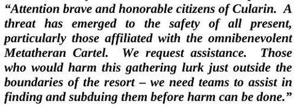

## p.7 (scan page 7)

Page contents: 829 words, 17 paragraphs | headings/entries: Scene Three: The Handlers Talk; Paarty On!; They are; End of Mini Mission; Page 7

- **No single roster character (rules/setting/general)** — entry/section: Nyronusa: "The Cartel is evil. They blight the galaxy. They should be destroyed.
Yes, I brought the creatures here, along with some others from my irstat. They weren't supposed to attack anyone who wasn't a Caarite, but you must have the smell on you.
I was part of "Piggie and the Orbiting Nasties," yes. It's hard to make a living as an activist, so I had to get another job.
My irstat was responsible for protecting the ch'hala grove that the Caarites cut. We are forever shamed by our failure.
There is no such thing as an innocent Caarite. Every one of them I've seen in Cularin has been exactly the same.
It is the right time for revenge. They are celebrating, and weak!
Well, no. I've never actually interacted with any of the children." Source: *308 - Metatheran Caution - Paarty On* (SWRPG d20 Revised Core), p.7
  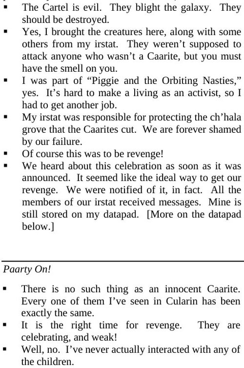
- **No single roster character (rules/setting/general)** — entry/section: The planted message: ""The Caarites will gather on Dorumaa soon. The time for revenge is at hand. They will be weakened, and not expecting attack."" Source: *308 - Metatheran Caution - Paarty On* (SWRPG d20 Revised Core), p.7
  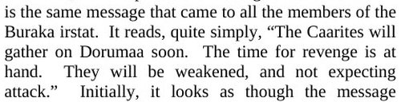

## p.8 (scan page 8)

Page contents: 368 words, 15 paragraphs | headings/entries: Conclusion; Here Ends, "Paarty On!"; Adventure Experience Award:; Loot Summary; Paarty On!; Page 8

- **No single roster character (rules/setting/general)** — entry/section: Patla Soo's farewell: ""I must return to Caarimon. But do not worry, Cularin. I have seen that there is something wrong here, and I will speak with the body of the Metatheran Cartel. The actions of Thurm Loogg and the Cularin branch of our Cartel will no longer go unnoticed. Of that, you have my promise."" Source: *308 - Metatheran Caution - Paarty On* (SWRPG d20 Revised Core), p.8
  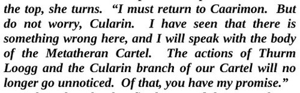

## p.6–8 (scan page 6)

Page contents: Mini-mission: tracking, maddened mulissiki and sclarin, the Tarasin Nyronusa and the Cartel's planted message; Patla Soo's farewell; XP; loot (hand-read)

## p.9 (scan page 9)

Page contents: 515 words, 11 paragraphs | headings/entries: Appendix 1: Thurm Loogg's Address; Paarty On! Page 9

## p.10 (scan page 10)

Page contents: 465 words, 6 paragraphs | headings/entries: Appendix #2: The Jedi Position; Paarty On! Page 10

- **No single roster character (rules/setting/general)** — entry/section: Krin D'bis: "Krin D'bis is a female Kel Dor Jedi Guardian who has had just about enough of the rampant evil in Cularin. She's slightly hotheaded, and speaks her mind, but is actually fairly patient in acting. She believes that, left unchecked, the Believers will only cause more trouble for Cularin." Source: *308 - Metatheran Caution - Paarty On* (SWRPG d20 Revised Core), p.10
  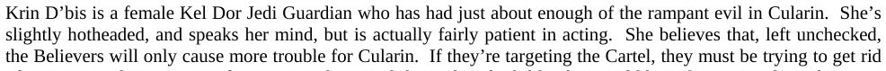
- **No single roster character (rules/setting/general)** — entry/section: Akial: "Akial is a male Jawa Jedi Counselor. He speaks Basic perfectly, without any trace of an accent, and whenever someone says "Utinni!" to him, he wrinkles his face as though the person just pulled out a packet of spoiled mynock meat in a small turbolift." Source: *308 - Metatheran Caution - Paarty On* (SWRPG d20 Revised Core), p.10
  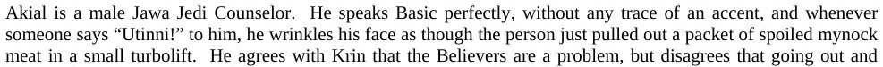

## p.11 (scan page 11)

Page contents: 751 words, 11 paragraphs | headings/entries: Paarty On! Page 11

- **No single roster character (rules/setting/general)** — entry/section: Patla Soo: "You have a defense of 15 and 12 WP. Your Will save is +5. You have several levels of Diplomat, and your Diplomacy bonus is +19, your Sense Motive is +12, and your Bluff is +11." Source: *308 - Metatheran Caution - Paarty On* (SWRPG d20 Revised Core), p.11
  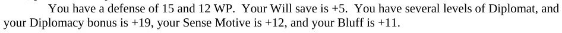

## p.12 (scan page 12)

Page contents: 292 words, 3 paragraphs | headings/entries: Paarty On! Page 12

- **No single roster character (rules/setting/general)** — entry/section: Hospitality Brigade: ""How wonderful it is that we can all celebrate together!" "As most exalted Minister Loogg says, the Cartel loves Cularin!" "Are we not most generous in our celebratory activities?"" Source: *308 - Metatheran Caution - Paarty On* (SWRPG d20 Revised Core), p.12
  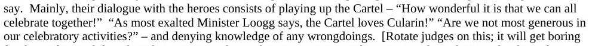

## p.13 (scan page 13)

Page contents: 445 words, 15 paragraphs | headings/entries: Appendix #4: Patla Soo's Address; Closing comments:; Paarty On! Page 13

- **No single roster character (rules/setting/general)** — entry/section: Patla Soo's address: "I do not need an introduction from someone who is not here. I am quite certain that the introduction I have received from the various individuals already present more than suffices — and from what I've heard, Envoy Loogg has already addressed you once today.
...
Such manipulation, however wellintentioned Envoy Loogg may believe it to be, is not at all appropriate and not even remotely what good business is made of.
...
Old wounds are slow to heal, but if we can all forgive transgressions, the galaxy will be a much more pleasant place. Thank you." Source: *308 - Metatheran Caution - Paarty On* (SWRPG d20 Revised Core), p.13
  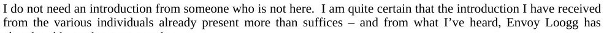

## p.14 (scan page 14)

Page contents: 168 words, 11 paragraphs | headings/entries: Paarty On! Page 14

## p.15 (scan page 15)

Page contents: 13 words, 2 paragraphs | headings/entries: Paarty On! Page 15

## p.16 (scan page 16)

Page contents: 326 words, 25 paragraphs | headings/entries: General Supplies; NPCs:; Props:; Paarty On! Page 16

## p.9–16 (scan page 9)

Page contents: Thurm Loogg's address; Jedi recruiters Krin D'bis and Akial; NPC motivations; Patla Soo's address; rumor slips; roster; coordinator list (hand-read)

## p.17 (scan page 17)

Page contents: 349 words, 23 paragraphs | headings/entries: Contest #1: Computer Use; Rules e; Scratch paper; Running the Contest; Paarty On! Page 17

## p.18 (scan page 18)

Page contents: 428 words, 23 paragraphs | headings/entries: Contest #2: Lightsaber; Rules; Scratch paper; Paarty On! Page 18

## p.19 (scan page 19)

Page contents: 503 words, 22 paragraphs | headings/entries: Contest #3: Marksmanship; Rules; Preparation; Physical Setup; Scratch paper; Running the Contest; Paarty On! Page 19

## p.20 (scan page 20)

Page contents: 294 words, 18 paragraphs | headings/entries: Contest #4: Oratory; Rules; Scratch paper; Paarty On! Page 20

## p.21 (scan page 21)

Page contents: 344 words, 23 paragraphs | headings/entries: Contest #5: Repair; Rules; Scratch paper; Paarty On! Page 21

## p.22 (scan page 22)

Page contents: 613 words, 15 paragraphs | headings/entries: Contest #6: Simulation Piloting; Scratch paper; Paarty On! Page 22

## p.23 (scan page 23)

Page contents: 9 words, 1 paragraphs | headings/entries: 

## p.24 (scan page 24)

Page contents: 622 words, 32 paragraphs | headings/entries: Computer Use; Lightsaber; Marksmanship; Paarty On! Page 24

## p.25 (scan page 25)

Page contents: 537 words, 36 paragraphs | headings/entries: Oratory; Repair; O Boos = -2; Simulation Piloting; Paarty On! Page 25

## p.26 (scan page 26)

Page contents: 22 words, 2 paragraphs | headings/entries: Paarty On! Page 26

## p.27 (scan page 27)

Page contents: 9 words, 3 paragraphs | headings/entries: LF Contest Sheet; Paarty On! Page 27

## p.17–27 (scan page 17)

Page contents: Contest rules (Computer Use, Lightsaber, Marksmanship, Oratory, Repair, Simulation Piloting); ship counters; player rules; heat sheets (hand-read)

