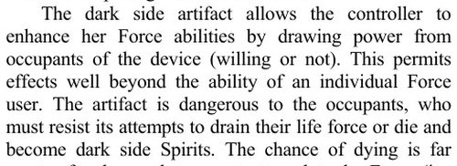
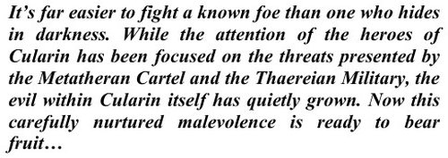
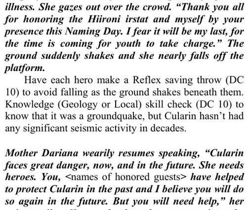
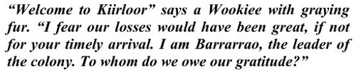
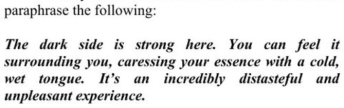
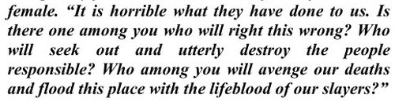
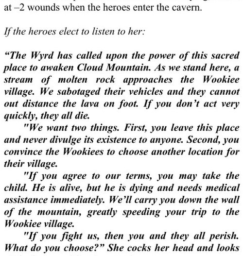
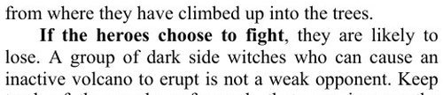
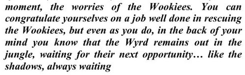

# Owner Material 037 — Star Wars D20 Drive folder (Core, Revised Core and Saga Edition): Living Force Campaign/Adventures/Among the Stars/Year 3/309 - From The Trees.pdf [Star Wars Roleplaying Game Revised Core (d20, 2002)]

- **Source:** Wizards of the Coast Star Wars Roleplaying Game books, web enhancements, Living Force campaign modules and articles (2000–2010), from the owner's "Star Wars D20" Drive folder (only the three edition subfolders; "General" was not read, as instructed). Secondary source (licensed Legends reference). Scan OCR'd on the box; the scan stays box-only and is **not** published.
- **Method:** every scanned page was OCR'd and machine-screened sentence by sentence for power-relevant statements (fights, kills, defeats, Force feats, rankings, superweapons) that name a character on our roster; each kept sentence is quoted verbatim from the OCR text and has a crop of the printed passage directly under it. Pages with nothing power-relevant are still listed with what is on them.
- **Citation:** "*309 - From The Trees* (SWRPG d20 Revised Core), p.X" by printed page ("scan p.X" where no printed number applies). **Weight:** Licensed RPG material: a secondary source. Narrative text sums up Legends lore; game statistics are rules for players, not canon power levels, and rank lowest.

## p.1 (scan page 1)

Page contents: 121 words, 8 paragraphs | headings/entries: LFA307; From the Trees; A One-Round LIVING FORCE Tournament

## p.2 (scan page 2)

Page contents: 891 words, 20 paragraphs | headings/entries: House Rules; Atoning for Dark Side Points; Dissipate Energy; From the Trees; Illusion; Stun; Hero Earnings; Page 2

## p.3 (scan page 3)

Page contents: 930 words, 26 paragraphs | headings/entries: General Notes to the GM; From the Trees; GM Overview; Page 3

- **No single roster character (rules/setting/general)** — entry/section: The dark side artifact: "The dark side artifact allows the controller to enhance her Force abilities by drawing power from occupants of the device (willing or not). This permits effects well beyond the ability of an individual Force user. The artifact is dangerous to the occupants, who must resist its attempts to drain their life force or die and become dark side Spirits." Source: *309 - From The Trees* (SWRPG d20 Revised Core), p.3
  

## p.4 (scan page 4)

Page contents: 767 words, 24 paragraphs | headings/entries: Encounter 1: Naming Day; Encounter 3: Dangerous Devastation; Encounter 4: Wookiee Welcome, Wookiee Woes; Encounter 5: Spirited Assistance; From the Trees; Encounter 7: Deal with the Dark Side; Opening Crawl; Encounter 1: Naming Day; Page 4

- **No single roster character (rules/setting/general)** — entry/section: Opening crawl: "It's far easier to fight a known foe than one who hides in darkness. While the attention of the heroes of Cularin has been focused on the threats presented by the Metatheran Cartel and the Thaereian Military, the evil within Cularin itself has quietly grown. Now this carefully nurtured malevolence is ready to bear fruit..." Source: *309 - From The Trees* (SWRPG d20 Revised Core), p.4
  

## p.1–4 (scan page 1)

Page contents: Title; house rules; GM overview of the Wyrd lieutenant Xinishia and the Cloud Mountain artifact; encounter summaries; opening crawl (hand-read)

## p.5 (scan page 5)

Page contents: 848 words, 19 paragraphs | headings/entries: From the Trees; Page 5

- **No single roster character (rules/setting/general)** — entry/section: Mother Dariana: ""Thank you all for honoring the Hiironi irstat and myself by your presence this Naming Day. I fear it will be my last, for the time is coming for youth to take charge."
...
"Cularin faces great danger, now, and in the future. She needs heroes. You, <names of honored guests> have helped to protect Cularin in the past and I believe you will do so again in the future. But you will need help,"" Source: *309 - From The Trees* (SWRPG d20 Revised Core), p.5
  

## p.6 (scan page 6)

Page contents: 806 words, 27 paragraphs | headings/entries: From the Trees; Encounter 3: Dangerous Devastation; Page 6

## p.7 (scan page 7)

Page contents: 841 words, 26 paragraphs | headings/entries: Options include:; From the Trees; Page 7

## p.8 (scan page 8)

Page contents: 759 words, 34 paragraphs | headings/entries: Encounter 4: Wookiee Welcome, Wookiee Woes; From the Trees; Allow the heroes to introduce themselves. The; Page 8

- **No single roster character (rules/setting/general)** — entry/section: Barrarrao: ""Welcome to Kiirloor" says a Wookiee with graying fur. "I fear our losses would have been great, if not for your timely arrival. I am Barrarrao, the leader of the colony. To whom do we owe our gratitude?"" Source: *309 - From The Trees* (SWRPG d20 Revised Core), p.8
  

## p.9 (scan page 9)

Page contents: 974 words, 21 paragraphs | headings/entries: From the Trees; Page 9

## p.4–9 (scan page 4)

Page contents: E1 Naming Day and Mother Dariana; E2 the speeder trip and attacking trees; E3 the wrecked Wookiee village and illusory fire; E4 Barrarrao and the climb (hand-read)

## p.10 (scan page 10)

Page contents: 880 words, 24 paragraphs | headings/entries: Low Tier:; Mid/High Tier:; Encounter 5: Spirited Assistance; From the Trees; Page 10

- **No single roster character (rules/setting/general)** — entry/section: The dark side in Cloud Mountain: "The dark side is strong here. You can feel it surrounding you, caressing your essence with a cold, wet tongue. It's an incredibly distasteful and unpleasant experience." Source: *309 - From The Trees* (SWRPG d20 Revised Core), p.10
  

## p.11 (scan page 11)

Page contents: 866 words, 26 paragraphs | headings/entries: Encounter 6: Spirited Assault; From the Trees; Auf wy; Page 11

- **No single roster character (rules/setting/general)** — entry/section: Tarasin dark side spirit: ""It is horrible what they have done to us. Is there one among you who will right this wrong? Who will seek out and utterly destroy the people responsible? Who among you will avenge our deaths and flood this place with the lifeblood of our slayers?"" Source: *309 - From The Trees* (SWRPG d20 Revised Core), p.11
  

## p.12 (scan page 12)

Page contents: 900 words, 22 paragraphs | headings/entries: See stats in GM Aid #1; Encounter 7: Deal with the Dark Side; From the Trees; Page 12

- **No single roster character (rules/setting/general)** — entry/section: Xinishia: ""Stop", the leader cries. "I suggest you hear me out before attacking".
...
"The Wyrd has called upon the power of this sacred place to awaken Cloud Mountain. As we stand here, a stream of molten rock approaches the Wookiee village. We sabotaged their vehicles and they cannot out distance the lava on foot. If you don't act very quickly, they all die.
"We want two things. First, you leave this place and never divulge its existence to anyone. Second, you convince the Wookiees to choose another location for their village.
...
"If you fight us, then you and they all perish. What do you choose?"" Source: *309 - From The Trees* (SWRPG d20 Revised Core), p.12
  
- **No single roster character (rules/setting/general)** — entry/section: The Wyrd's power: "If the heroes choose to fight, they are likely to lose. A group of dark side witches who can cause an inactive volcano to erupt is not a weak opponent." Source: *309 - From The Trees* (SWRPG d20 Revised Core), p.12
  

## p.13 (scan page 13)

Page contents: 719 words, 28 paragraphs | headings/entries: Conclusion; Read or paraphrase the following:; From the Trees; Here Ends From the Trees; Experience Point Summary; Adventure Experience Award:; Loot Summary; Page 13

- **No single roster character (rules/setting/general)** — entry/section: Conclusion: "You can congratulate yourselves on a job well done in rescuing the Wookiees, but even as you do, in the back of your mind you know that the Wyrd remains out in the jungle, waiting for their next opportunity... like the shadows, always waiting" Source: *309 - From The Trees* (SWRPG d20 Revised Core), p.13
  

## p.14 (scan page 14)

Page contents: 99 words, 6 paragraphs | headings/entries: If the heroes save the village:; From the Trees; Page 14

## p.10–14 (scan page 10)

Page contents: E5 Risstenni's spirit; E6 the Tarasin spirit's possession attack; E7 Xinishia's bargain and the lava; conclusion; XP; loot (hand-read)

## p.15 (scan page 15)

Page contents: 689 words, 26 paragraphs | headings/entries: GM Aid 1: Combat Statistics; Encounter 3: Dangerous Devastation All Tiers; Encounter 4: Wookiee Welcome, Wookiee Woes; Low Tier; Mid/High Tiers; Encounter 5: Spirited Assistance All Tiers; From the Trees; Encounter 6: Spirited Assault; Low Tier; Mid Tier; High Tier; Page 15

## p.16 (scan page 16)

Page contents: 325 words, 13 paragraphs | headings/entries: Encounter 7: Deal With the Dark Side; Low Tier; Mid Tier; High Tier; From the Trees; Page 16

## p.17 (scan page 17)

Page contents: 203 words, 13 paragraphs | headings/entries: GM Name, RPGA#:; GM Email Address:; Convention Name/Date; From the Trees Page 17

## p.15–17 (scan page 15)

Page contents: GM Aid 1 stat blocks and Force Light table; critical event summary (hand-read)

