# Owner Material 037 — Star Wars D20 Drive folder (Core, Revised Core and Saga Edition): Living Force Campaign/Adventures/Among the Stars/Year 3/310 - Who Goes Thaere.pdf [Star Wars Roleplaying Game Revised Core (d20, 2002)]

- **Source:** Wizards of the Coast Star Wars Roleplaying Game books, web enhancements, Living Force campaign modules and articles (2000–2010), from the owner's "Star Wars D20" Drive folder (only the three edition subfolders; "General" was not read, as instructed). Secondary source (licensed Legends reference). Scan OCR'd on the box; the scan stays box-only and is **not** published.
- **Method:** every scanned page was OCR'd and machine-screened sentence by sentence for power-relevant statements (fights, kills, defeats, Force feats, rankings, superweapons) that name a character on our roster; each kept sentence is quoted verbatim from the OCR text and has a crop of the printed passage directly under it. Pages with nothing power-relevant are still listed with what is on them.
- **Citation:** "*310 - Who Goes Thaere* (SWRPG d20 Revised Core), p.X" by printed page ("scan p.X" where no printed number applies). **Weight:** Licensed RPG material: a secondary source. Narrative text sums up Legends lore; game statistics are rules for players, not canon power levels, and rank lowest.

## p.1 (scan page 1)

Page contents: 113 words, 7 paragraphs | headings/entries: LFA0310; Who Goes Thaere?; A One-Round LIVING FORCE Tournament; Edited by Jae Walker

## p.2 (scan page 2)

Page contents: 877 words, 22 paragraphs | headings/entries: House Rules; Atoning for Dark Side Points; Dissipate Energy; Illusion; Who Goes Thaere?; Stun; Hero Earnings; Page 2

## p.3 (scan page 3)

Page contents: 828 words, 20 paragraphs | headings/entries: General Notes to the GM; Who Goes Thaere?; GM Overview; Encounter 1: Waiting for Sa'arli; Encounter 3: Haven't We Met?; Page 3

## p.4 (scan page 4)

Page contents: 745 words, 26 paragraphs | headings/entries: Encounter 5: Home Again, Home Again; Encounter 7: We've Got a Secret (Maybe); Important Note to Judges:; Who Goes Thaere?; Encounter 1: Waiting for Sa'arli; Page 4

- **No single roster character (rules/setting/general)** — entry/section: Opening crawl: "Things have changed in the Cularin System, and not for the better. Cularin's desire to become selfgoverning has come at the worst possible time in Republic history: the Senate and the Supreme Chancellor seem to find it necessary to exercise more and more power, and any talk of "independence" is often viewed as being Separatist, if not actual treason. Whether or not you have met Senator Wren, most people in the Cularin system agree that, if there is to be a peaceful solution to this problem, and to the increasingly militant grip of the former "peacekeepers", the Thaereians, it will be Senator Wren who spearheads that solution.
Now, she has a job for some of you, and a favor to ask from others..." Source: *310 - Who Goes Thaere* (SWRPG d20 Revised Core), p.4
  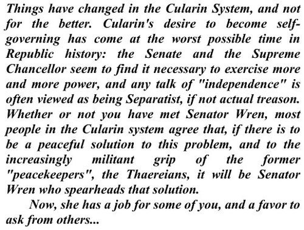
- **No single roster character (rules/setting/general)** — entry/section: The Near Vacuum cantina: "Stull, the cantina is reasonably clean and the drinks are decent-- and not too overpriced. There's a live band that's playing a new razzu tune that's pretty catchy. It will probably make its way out to cantinas in wretched hives of scum and villainy on Rimworlds in about twenty years or so." Source: *310 - Who Goes Thaere* (SWRPG d20 Revised Core), p.4
  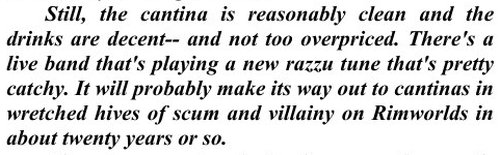

## p.1–4 (scan page 1)

Page contents: Title; house rules; GM overview of Sa'arli's mission to Ostfrei; encounter summaries; opening crawl on Senator Wren and Cularin's independence (hand-read)

## p.5 (scan page 5)

Page contents: 982 words, 24 paragraphs | headings/entries: Encounter Details:; Who Goes Thaere?; Page 5

## p.6 (scan page 6)

Page contents: 927 words, 19 paragraphs | headings/entries: Dealing with potential problems:; Who Goes Thaere?; Encounter 2: Who Goes Thaere?; Page 6

- **No single roster character (rules/setting/general)** — entry/section: Sa'arli: ""As you are, no doubt, aware, the Senator is very concerned with questions of the Cularin system's autonomy. She is hoping that Cularin will, one day, have its own space security forces and not have to rely on the Republic to provide contracted patrols. As it stands, every time we ask the Thaereian Navy to investigate a potential problem, we give away a little more of our own. We make it easier for those who would profit from our dependence to argue against our self-governance." Source: *310 - Who Goes Thaere* (SWRPG d20 Revised Core), p.6
  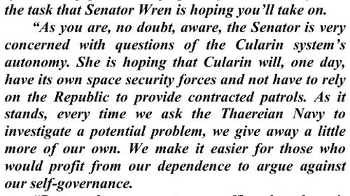

## p.7 (scan page 7)

Page contents: 940 words, 24 paragraphs | headings/entries: Encounter Details:; Who Goes Thaere?; General Information about Ostfrei: The heroes; Page 7

- **No single roster character (rules/setting/general)** — entry/section: Sa'arli: ""We believe that there may be smugglers trying to use Ostfrei for a base. If not that, then the Senator would like to know what is happening there. It would be a minor coup if we could steal a march on the Thaereians. Of course, we are all friends, here, and the Thaereians are the duly authorized representatives of the Republic in our space. But... it wouldn't hurt to show that we do not need to go to them for everything." Source: *310 - Who Goes Thaere* (SWRPG d20 Revised Core), p.7
  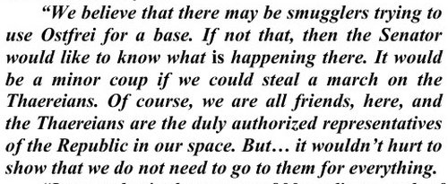

## p.8 (scan page 8)

Page contents: 894 words, 22 paragraphs | headings/entries: Who Goes Thaere?; Page 8

- **No single roster character (rules/setting/general)** — entry/section: Rumor: "Some Wookiees were in the city last week, buying a LOT of detonite and other explosives. One was called Roogar. He has a dark stripe of fur running down his side. [*** True. ]" Source: *310 - Who Goes Thaere* (SWRPG d20 Revised Core), p.8
  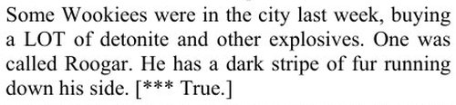
- **No single roster character (rules/setting/general)** — entry/section: Rumor: "Riboga the Hutt has only left Tolea Biqua in name. He's planning to make a big comeback, and soon. [* False.]" Source: *310 - Who Goes Thaere* (SWRPG d20 Revised Core), p.8
  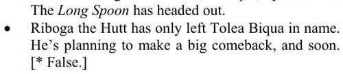
- **No single roster character (rules/setting/general)** — entry/section: Rumor: "The Jedi have been nosing around Ostfrei and Tolea Biqua lately. Rumor is that a Jedi gone bad has taken up residence on the "dark moon". What better place? [* False, although relevant to this episode as a red herring. Hero Jedi have heard nothing of this. If they can check back with Almas, it is denied. ]" Source: *310 - Who Goes Thaere* (SWRPG d20 Revised Core), p.8
  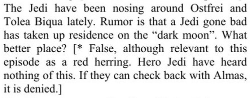

## p.9 (scan page 9)

Page contents: 847 words, 28 paragraphs | headings/entries: Encounter 3: Haven't We Met?; Who Goes Thaere?; Encounter Details:; Page 9

## p.4–9 (scan page 4)

Page contents: E1 Near Vacuum cantina brawl with Thaereian crewmen and Alto Janss; E2 Sa'arli's briefing, negotiation and the rumor list (hand-read)

## p.10 (scan page 10)

Page contents: 872 words, 25 paragraphs | headings/entries: Encounter Details resume:; Who Goes Thaere?; Potential Force Points:; Encounter Details:; Page 10

- **No single roster character (rules/setting/general)** — entry/section: Captain Yfridian: ""This is Captain Yfridian, of the TNV Vigilant. We'll deal with this scum and be back for you, whoever you are. Wait for us. Out"" Source: *310 - Who Goes Thaere* (SWRPG d20 Revised Core), p.10
  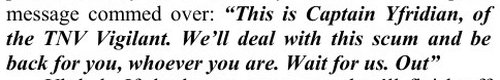

## p.11 (scan page 11)

Page contents: 914 words, 18 paragraphs | headings/entries: Encounter Details:; Who Goes Thaere?; From the map key:; Page 11

- **No single roster character (rules/setting/general)** — entry/section: Ostfrei: ""Bleak" would be far too much a compliment for this rock. You seem to have landed just at the end of its two hours of dim, smudgy daylight, which means another 25 standard hours of darkness before the next "dawn"." Source: *310 - Who Goes Thaere* (SWRPG d20 Revised Core), p.11
  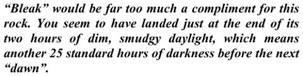

## p.12 (scan page 12)

Page contents: 934 words, 21 paragraphs | headings/entries: Potential Force Points:; Who Goes Thaere?; Encounter 5: Home Again, Home Again; Encounter Details:; Page 12

## p.13 (scan page 13)

Page contents: 855 words, 31 paragraphs | headings/entries: Encounter Details:; Who Goes Thaere?; Searching (since they know the correct direction); Page 13

## p.14 (scan page 14)

Page contents: 955 words, 21 paragraphs | headings/entries: Resolution:; Who Goes Thaere?; Page 14

- **No single roster character (rules/setting/general)** — entry/section: The secret Thaereian base: "The Thaereian Navy has not cleared the existence of this base with anyone in the Cularin system, least of all Senator Wren, as it turns out. Some well-traveled heroes realize that this seems to be a trend..." Source: *310 - Who Goes Thaere* (SWRPG d20 Revised Core), p.14
  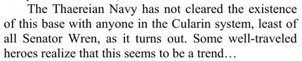

## p.15 (scan page 15)

Page contents: 772 words, 25 paragraphs | headings/entries: Force Point Potential:; Encounter 7: We've Gota Secret (Maybe); Encounter Details:; Who Goes Thaere?; Conclusion; Here Ends Who Goes Thaere?; Experience Point Summary; Page 15

- **No single roster character (rules/setting/general)** — entry/section: Sa'arli: "If Sa'arli is informed of the illicit Thaereian base, a strange mixture of emotions washes over her face. She seems pleased and almost triumphant or hopeful, for a moment. Then, something very uncharacteristic appears for a moment— indecision." Source: *310 - Who Goes Thaere* (SWRPG d20 Revised Core), p.15
  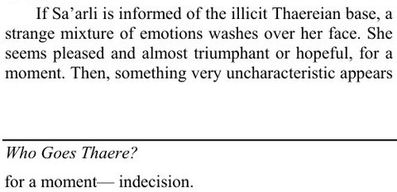
- **No single roster character (rules/setting/general)** — entry/section: Conclusion: "Secrets discovered: some revealed, some not. A web of strange events seems to be surrounding both you and Senator Wren. Your job has been successful, but it is obvious that you have not heard the last of these events. You have, as usual, become of interest to a great many people. It's nice that at least one of them is a potential friend. Or...?" Source: *310 - Who Goes Thaere* (SWRPG d20 Revised Core), p.15
  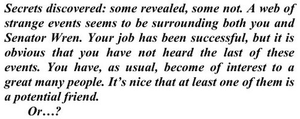

## p.9–15 (scan page 9)

Page contents: E3 pirates and Captain Yfridian; E4 Ostfrei's crystal vent, space slug and ruins; E5 the pirate ship returns; E6 the pirate base and the secret Thaereian base; E7 debriefing (hand-read)

## p.16 (scan page 16)

Page contents: 800 words, 27 paragraphs | headings/entries: Adventure Experience Award:; Loot Summary; Encounter 2; Encounter 3; Encounter 4; Who Goes Thaere?; Encounter 6; One for each hero:; Page 16

## p.17 (scan page 17)

Page contents: 220 words, 6 paragraphs | headings/entries: One only:; Who Goes Thaere?; Page 17

## p.18 (scan page 18)

Page contents: 23 words, 5 paragraphs | headings/entries: Dance Floor / Stage; Back Area; Entrance; Who Goes Thaere? Page 18

## p.19 (scan page 19)

Page contents: 9 words, 1 paragraphs | headings/entries: 

## p.20 (scan page 20)

Page contents: 13 words, 2 paragraphs | headings/entries: Who Goes Thaere? Page 20

## p.21 (scan page 21)

Page contents: 698 words, 28 paragraphs | headings/entries: Untiered; Who Goes Thaere?; Low Tier (levels 1-3); Middle tier (levels 4-6); Feats: Improved Initiative, Point Blank Shot; Page 21

## p.22 (scan page 22)

Page contents: 733 words, 23 paragraphs | headings/entries: High Tier (levels 7-9); Encounter 3 — Don't | Know You?; Pirate Crew: Low Tier: "Green"/untrained; Check Modifier—4 Attack bonus —1; Pirate Crew: Middle Tier: Experienced; Who Goes Thaere?; Low Tier (levels 1-3); Page 22

## p.23 (scan page 23)

Page contents: 718 words, 29 paragraphs | headings/entries: Mid Tier (levels 4-6); High Tier (levels 7-9); Who Goes Thaere?; Feats: Improved Initiative, Point Blank Shot; Mid Tier (levels 4-6); High Tier (levels 7-9); Page 23

## p.24 (scan page 24)

Page contents: 316 words, 11 paragraphs | headings/entries: Who Goes Thaere?; Page 24

- **No single roster character (rules/setting/general)** — entry/section: Captain Baltor Yfridian: "He is a middle-aged Human, black hair graying at the temples. He has grey eyes. He is wise enough in diplomacy to act graciously, if the heroes have been of assistance with pirates or if any of them has a reputation as a hero of Cularin. He is respectful to Jedi.
...
GM knowledge only: Yfridian is good at what he does and he despises the Cularin Militia. He has his own agenda concerning shipping within Cularin, and concerning the independence movement. None of that can come out now, however." Source: *310 - Who Goes Thaere* (SWRPG d20 Revised Core), p.24
  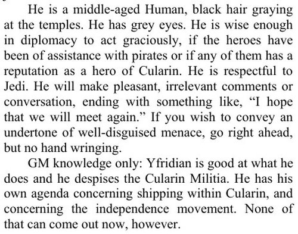

## p.25 (scan page 25)

Page contents: 13 words, 2 paragraphs | headings/entries: Page 25

## p.26 (scan page 26)

Page contents: 15 words, 2 paragraphs | headings/entries: Who Goes Thaere? Page 26

## p.27 (scan page 27)

Page contents: 525 words, 19 paragraphs | headings/entries: Encounter Five: decisions. The main possibilities are:; Who Goes Thaere?; Page 27

## p.15–27 (scan page 15)

Page contents: Conclusion, XP and loot; handout maps; GM Aid stat blocks, keyed maps and organizational notes (hand-read)

