# Owner Material 037 — Star Wars D20 Drive folder (Core, Revised Core and Saga Edition): Living Force Campaign/Adventures/Among the Stars/Year 3/311 - Belted In - Incursion.pdf [Star Wars Roleplaying Game Revised Core (d20, 2002)]

- **Source:** Wizards of the Coast Star Wars Roleplaying Game books, web enhancements, Living Force campaign modules and articles (2000–2010), from the owner's "Star Wars D20" Drive folder (only the three edition subfolders; "General" was not read, as instructed). Secondary source (licensed Legends reference). Scan OCR'd on the box; the scan stays box-only and is **not** published.
- **Method:** every scanned page was OCR'd and machine-screened sentence by sentence for power-relevant statements (fights, kills, defeats, Force feats, rankings, superweapons) that name a character on our roster; each kept sentence is quoted verbatim from the OCR text and has a crop of the printed passage directly under it. Pages with nothing power-relevant are still listed with what is on them.
- **Citation:** "*311 - Belted In - Incursion* (SWRPG d20 Revised Core), p.X" by printed page ("scan p.X" where no printed number applies). **Weight:** Licensed RPG material: a secondary source. Narrative text sums up Legends lore; game statistics are rules for players, not canon power levels, and rank lowest.

## p.1 (scan page 1)

Page contents: 153 words, 7 paragraphs | headings/entries: LFA311; Incursion

## p.2 (scan page 2)

Page contents: 874 words, 22 paragraphs | headings/entries: House Rules; Atoning for Dark Side Points; Dissipate Energy; Illusion; Incursion; Stun; Hero Earnings; Page 2

## p.3 (scan page 3)

Page contents: 910 words, 19 paragraphs | headings/entries: General Notes to the GM; Incursion; GM Overview; Page 3

- **No single roster character (rules/setting/general)** — entry/section: Nirama: "Nirama is a scoundrel, a crime lord...and a force for good in Cularin. Years ago, he drove Riboga the Hutt— and the worst of his excesses—out of the system. Nirama has prohibited slavery in Cularin, and he has worked very hard to keep the people of the system safe. His unorthodox methods have earned him more than a little disdain from many who believe they "know what he's up to," and he accepts this as part of his role." Source: *311 - Belted In - Incursion* (SWRPG d20 Revised Core), p.3
  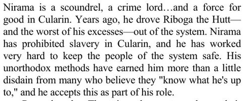
- **No single roster character (rules/setting/general)** — entry/section: Nirama and Len Markus: "Beyond that, he continues to try to discover what it was that his former lieutenant, Len Markus, was looking for, and what he found, in the Asteroid Belt where Nirama makes his home, though this is secondary in this scenario." Source: *311 - Belted In - Incursion* (SWRPG d20 Revised Core), p.3
  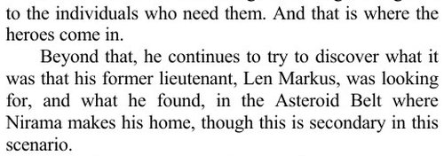

## p.4 (scan page 4)

Page contents: 845 words, 24 paragraphs | headings/entries: Encounter 1: In a Time of War; Encounter 2: Confidential Commission; Encounter 3: Threading the Eye; Encounter 4: Distressing Call; Incursion; Encounter 5: Ghost Base; Encounter 7: Shadows of Present and Future; Page 4

## p.5 (scan page 5)

Page contents: 785 words, 21 paragraphs | headings/entries: Important Advice:; Opening Crawl; Encounter 1: In a Time of War; Incursion; The heroes all received the following communication; Page 5

- **No single roster character (rules/setting/general)** — entry/section: Opening crawl: "As the Clone Wars rage outside of Cularin, the conflict between the Thaereian Navy and the Cularin Militia grows increasingly disruptive to the lives of those in Cularin. In an effort to "protect the people from the dangers of smugglers", the Thaereian Navy has initiated a blockade preventing many shipping vessels from entering or leaving Cularin. This affects legitimate trade ships as well as smugglers, and that's proving to be a problem not only for the trading houses, but for crimelord Nirama as well. And when Nirama needs help, he turns to the heroes of Cularin..." Source: *311 - Belted In - Incursion* (SWRPG d20 Revised Core), p.5
  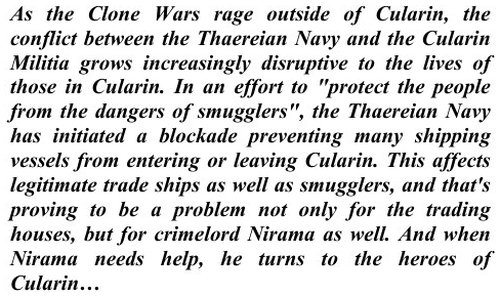
- **No single roster character (rules/setting/general)** — entry/section: Nirama's message: "Please meet my representative, Veneziano Haas, at the Hedrett Observation Lounge, at 2 pm today. I wish your services for a delivery of utmost importance; I prefer not to discuss the details in this medium, as the Thaereians have their long noses into everything these days. Suffice to say that the assignment promotes the welfare of Cularin, and you will be compensated appropriately." Source: *311 - Belted In - Incursion* (SWRPG d20 Revised Core), p.5
  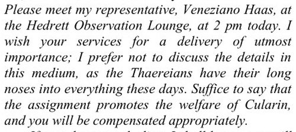

## p.1–5 (scan page 1)

Page contents: Title; house rules; GM overview of Nirama's blockade run for the Militia; encounter summaries; opening crawl (hand-read)

## p.6 (scan page 6)

Page contents: 806 words, 19 paragraphs | headings/entries: Incursion; Encounter 2: Confidential Commission; Page 6

- **No single roster character (rules/setting/general)** — entry/section: Veneziano Haas: ""Forgive my tardiness, it seems our brave protectors needed to know every detail of my business on Cularin, my family history and that of everyone I've ever known. We ended up having a very lengthy conversation."" Source: *311 - Belted In - Incursion* (SWRPG d20 Revised Core), p.6
  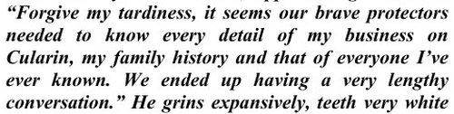
- **No single roster character (rules/setting/general)** — entry/section: Nirama: ""Given the situation, I thought it best to verify for you that Veneziano Haas is empowered to act for me in the matter of securing your services. I would like you to take a shipment of medical and non-military supplies to one of my customers in the asteroid belt. The Thaereians have been most diligent at preventing this shipment," the crimelord's distinctive gravelly voice drops to a growl, "and I am determined that it get through. This is becoming most... annoying." Source: *311 - Belted In - Incursion* (SWRPG d20 Revised Core), p.6
  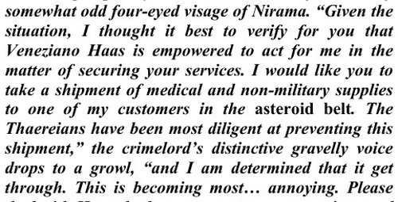

## p.7 (scan page 7)

Page contents: 778 words, 23 paragraphs | headings/entries: Incursion; Encounter 3: Threading the Eye; Planning; Page 7

- **No single roster character (rules/setting/general)** — entry/section: Veneziano Haas on the Thaereians: "The stated purpose—and you have to dig through their correspondence to find this—is that any paramilitary organization that exists in Cularin may serve as a foothold for the Separatists, and must therefore not receive aid or supplies as a result of Thaereian policy. Or, put more briefly, because they don't want anyone else with power." Source: *311 - Belted In - Incursion* (SWRPG d20 Revised Core), p.7
  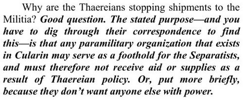

## p.8 (scan page 8)

Page contents: 819 words, 28 paragraphs | headings/entries: Talk Their Way Through; Sneak Around the Blockade; Outrunning the blockade; Incursion; Execution; Tiering:; Page 8

- **No single roster character (rules/setting/general)** — entry/section: Lt. Bisilt: "Lt. Bisilt, a Bothan, is the kind of unpleasant individual who gives customs officers a bad name. He enjoys pushing people around, and isn't above shooting someone in cold blood if he perceives them as a threat. At the same time, he's susceptible to flattery and manipulation — he knows that he deserves better than customs patrol in this backwater, and diplomatically gifted heroes can take advantage of that." Source: *311 - Belted In - Incursion* (SWRPG d20 Revised Core), p.8
  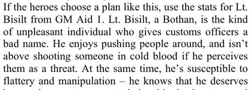

## p.9 (scan page 9)

Page contents: 962 words, 19 paragraphs | headings/entries: Incursion; Outrunning the blockade; Page 9

## p.10 (scan page 10)

Page contents: 774 words, 31 paragraphs | headings/entries: If Everything Goes Wrong; Encounter 4: Distressing Call; Incursion; Encounter 5: Ghost Base; Page 10

- **No single roster character (rules/setting/general)** — entry/section: Distress call: ""Someone... anyone... is there anyone out there? This is the Aggressive Negotiation. The... the captain and officers have been murdered; we're dead in space and leaking atmosphere. Somebody... anybody... help me!"" Source: *311 - Belted In - Incursion* (SWRPG d20 Revised Core), p.10
  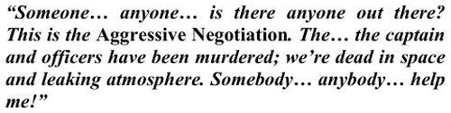
- **No single roster character (rules/setting/general)** — entry/section: Gille Narvis: "When my husband— the captain—tried to stop them, they killed him. [Tears] Just shot him. And... and... then they just started killing people.
...
They laughed at me and said they'd leave me for last. Kalee hid when things got noisy—they didn't see her." Source: *311 - Belted In - Incursion* (SWRPG d20 Revised Core), p.10
  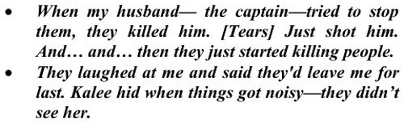

## p.5–10 (scan page 5)

Page contents: E1 Senator Wren's blockade speech; E2 Veneziano Haas and Nirama's commission; E3 running the Thaereian blockade and Lt. Bisilt; E4 the Aggressive Negotiation and Gille Narvis (hand-read)

## p.11 (scan page 11)

Page contents: 838 words, 24 paragraphs | headings/entries: Incursion; Page 11

- **No single roster character (rules/setting/general)** — entry/section: Lorwin Derlynn: ""Put your weapons on the floor and step away from them, and no one has to get hurt."" Source: *311 - Belted In - Incursion* (SWRPG d20 Revised Core), p.11
  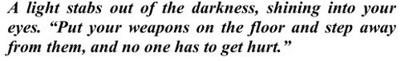

## p.12 (scan page 12)

Page contents: 849 words, 26 paragraphs | headings/entries: Choosing to fight; Incursion; Page 12

- **No single roster character (rules/setting/general)** — entry/section: Lorwin Derlynn: "Nirama? [He spits on the floor.] A worthless malcontent. No better than a Hutt, and half as clean." Source: *311 - Belted In - Incursion* (SWRPG d20 Revised Core), p.12
  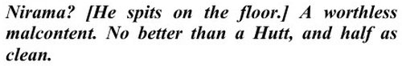
- **No single roster character (rules/setting/general)** — entry/section: Lorwin Derlynn: "Or I heard that rumor. Admiral Tramsig has issued an official denial." Source: *311 - Belted In - Incursion* (SWRPG d20 Revised Core), p.12
  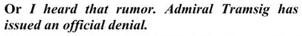

## p.13 (scan page 13)

Page contents: 731 words, 31 paragraphs | headings/entries: Encounter 7: Shadows of Past and Future; Results for Search checks are listed below:; DC | Information Gathered; Incursion; Conclusion; Here Ends, "Incursion"; Experience Point Summary; Page 13

- **No single roster character (rules/setting/general)** — entry/section: Nirama: ""Thank you. I asked for a delivery. You did so. What you found—or did not find—is troubling. I will be coordinating a sweep of the asteroid field for your Militia. Would you be interested in assisting?"
...
"Oh, one more thing. The owner of the Aggressive Negotiation asked me to give you these." He hands each of you a chit. "I have the distinct impression that you will need them."" Source: *311 - Belted In - Incursion* (SWRPG d20 Revised Core), p.13
  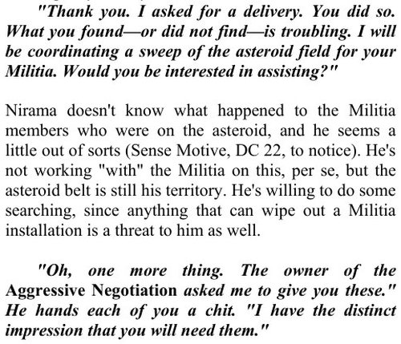

## p.14 (scan page 14)

Page contents: 571 words, 36 paragraphs | headings/entries: Adventure Experience Award:; Loot Summary; Encounter 4: Distressing Call; Restricted Item OR Restricted Item Permit; Choose one: Permit, Item; Incursion; Page 14

- **No single roster character (rules/setting/general)** — entry/section: Enmity of Thaere: "In his resignation from the Thaereian Navy, Lorwin Derlynn named the hero above as an exemplar of "all that is good in the galaxy." The Thaereian High Command subsequently named this hero an "Enemy of the State," and found him/her guilty of high crimes against the Thaereian Protectorate. The hero learned of this decision upon spotting a wanted poster of him- or herself at the Hedrett Groundport." Source: *311 - Belted In - Incursion* (SWRPG d20 Revised Core), p.14
  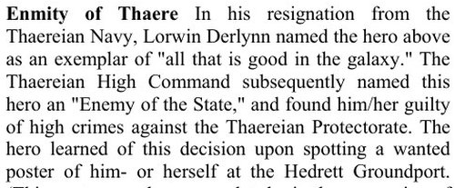

## p.10–14 (scan page 10)

Page contents: E5 the empty Militia base; E6 Lorwin Derlynn's squad; E7 the shadow echoes; conclusion with Nirama; XP and loot (hand-read)

## p.15 (scan page 15)

Page contents: 136 words, 6 paragraphs | headings/entries: Player Handout 1:; Incursion Page 15

## p.16 (scan page 16)

Page contents: 822 words, 27 paragraphs | headings/entries: Compartment Key; Incursion; Space: Attack (6; Page 16

## p.17 (scan page 17)

Page contents: 58 words, 19 paragraphs | headings/entries: Wayfarer-class Medium Transport; Cargo Cretes; Cosputer; Hatch>s; Hyperdrive; Lite Support; Power Core; THE; Power Loader; Sublight Engine; June 03 Dungeon/Polyhedron 21; Incursion

## p.18 (scan page 18)

Page contents: 647 words, 22 paragraphs | headings/entries: GM Aid #1: NPC and Vehicle Statistics; Encounter 2: Confidential Commission; Veneziano Haas, Human Scoundrel 4/Scout 4;; Encounter 3: Threading the Eye; Incursion; Page 18

## p.19 (scan page 19)

Page contents: 741 words, 19 paragraphs | headings/entries: Feats: Armor Proficiency (light), Dodge,; Feats: Armor Proficiency (light), Point Blank; Incursion; Page 19

- **No single roster character (rules/setting/general)** — entry/section: Lorwin Derlynn: "Derlynn is a career officer, an honest man who believes in what he does. He leads his squad with intelligence and competence. His greatest flaw is his unquestioning belief that what his superiors tell him is true. He honestly believes that the Cularin Militia may be a front for a Separatist cell, because that's what his superiors have told him." Source: *311 - Belted In - Incursion* (SWRPG d20 Revised Core), p.19
  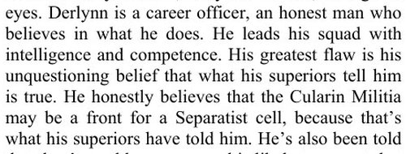
- **No single roster character (rules/setting/general)** — entry/section: Gareth Nawling: "Gareth knows that their superiors have been providing misinformation, and has been giving serious consideration to deserting. Only his loyalty to Derlynn has kept him on the squad this long. He's seen evidence relating to the slave arena on Burnout, a space station in Thaereian space." Source: *311 - Belted In - Incursion* (SWRPG d20 Revised Core), p.19
  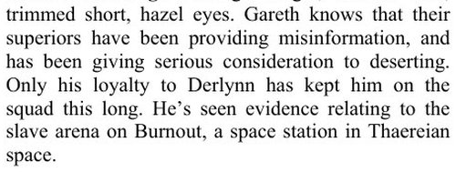

## p.20 (scan page 20)

Page contents: 759 words, 23 paragraphs | headings/entries: Low Tier (average hero level 1-3):; Mid Tier (average hero level 4-6):; Incursion; Upper Tier (average hero level 7-9):; Page 20

## p.21 (scan page 21)

Page contents: 340 words, 10 paragraphs | headings/entries: Incursion; Page 21

## p.22 (scan page 22)

Page contents: 85 words, 4 paragraphs | headings/entries: GM Aid #2: Ship Counters; Incursion Page 22

## p.23 (scan page 23)

Page contents: 3 words, 2 paragraphs | headings/entries: Incursion; Page 23

## p.24 (scan page 24)

Page contents: 164 words, 11 paragraphs | headings/entries: Critical Event Summary Incursion; GM Name, RPGA#:; GM Email Address:; Convention Name/Date; Incursion Page 24

## p.15–24 (scan page 15)

Page contents: Player handouts (Nirama's message, the Wayfarer-class Fortune's Favor); GM Aid stat blocks, ship counters, base map; critical event summary (hand-read)

