# Owner Material 037 — Star Wars D20 Drive folder (Core, Revised Core and Saga Edition): Living Force Campaign/Adventures/Among the Stars/Year 3/312 - Belted In - Excursion.pdf [Star Wars Roleplaying Game Revised Core (d20, 2002)]

- **Source:** Wizards of the Coast Star Wars Roleplaying Game books, web enhancements, Living Force campaign modules and articles (2000–2010), from the owner's "Star Wars D20" Drive folder (only the three edition subfolders; "General" was not read, as instructed). Secondary source (licensed Legends reference). Scan OCR'd on the box; the scan stays box-only and is **not** published.
- **Method:** every scanned page was OCR'd and machine-screened sentence by sentence for power-relevant statements (fights, kills, defeats, Force feats, rankings, superweapons) that name a character on our roster; each kept sentence is quoted verbatim from the OCR text and has a crop of the printed passage directly under it. Pages with nothing power-relevant are still listed with what is on them.
- **Citation:** "*312 - Belted In - Excursion* (SWRPG d20 Revised Core), p.X" by printed page ("scan p.X" where no printed number applies). **Weight:** Licensed RPG material: a secondary source. Narrative text sums up Legends lore; game statistics are rules for players, not canon power levels, and rank lowest.

## p.1 (scan page 1)

Page contents: 127 words, 6 paragraphs | headings/entries: LFA312; Excursion

## p.2 (scan page 2)

Page contents: 844 words, 21 paragraphs | headings/entries: House Rules; Atoning for Dark Side Points; Dissipate Energy; Excursion; Illusion; Stun; Hero Earnings; Page 2

## p.3 (scan page 3)

Page contents: 866 words, 18 paragraphs | headings/entries: Excursion; GM Overview; Page 3

- **No single roster character (rules/setting/general)** — entry/section: Shadow creatures: "The shadow creatures, survivors — after a fashion — of the cataclysm that destroyed a planet and created the Asteroid Belt, have been attempting to communicate with the beings they keep stumbling across. Unfortunately, these attempts have resulted in the beings being shifted into a shadow of existance." Source: *312 - Belted In - Excursion* (SWRPG d20 Revised Core), p.3
  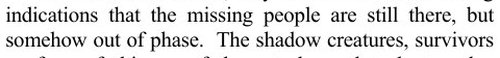

## p.4 (scan page 4)

Page contents: 704 words, 29 paragraphs | headings/entries: Encounter 1: Missing In Action; Encounter 2: Back to Basics; Encounter 3: Survivor; Encounter 4: Bits and Pieces; Encounter 5: Old Enemies; Encounter 6: The Mine's Eye; Excursion; Encounter 7: Mobius Trip; Important Note to Judges:; Opening Crawl; Encounter 1: Missing In Action; Page 4

- **No single roster character (rules/setting/general)** — entry/section: Opening crawl: "In the wake of the discovery of a mysteriously abandoned Militia base, citizens of Cularin began to scour the Asteroid Belt for the missing militia members. Ships swept the belt, quadrant by quadrant, turning up nothing. Some began to say that there might be nothing at all to be found - but nothing might be the greatest danger of all, among the asteroids..." Source: *312 - Belted In - Excursion* (SWRPG d20 Revised Core), p.4
  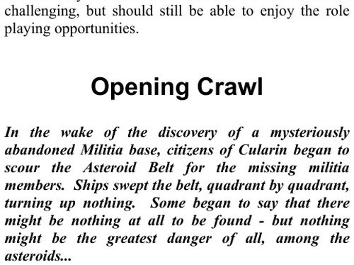

## p.5 (scan page 5)

Page contents: 827 words, 20 paragraphs | headings/entries: Excursion; Encounter 2: Back to Basics; Page 5

- **No single roster character (rules/setting/general)** — entry/section: Veneziano Haas: "Thank you for your prompt response. I shall get straight to the point. You may be aware that the search for the missing Militia members has been, thus far, unfruitful. Unfortunately, it's worse than that — we seem, now, to have lost one of the search teams as well." Source: *312 - Belted In - Excursion* (SWRPG d20 Revised Core), p.5
  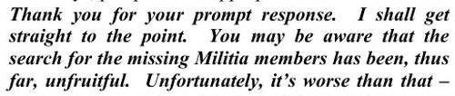
- **No single roster character (rules/setting/general)** — entry/section: Veneziano Haas: ""We have been getting reports from some of the search teams about large, ship-sized objects with no lights and no transponder signals."" Source: *312 - Belted In - Excursion* (SWRPG d20 Revised Core), p.5
  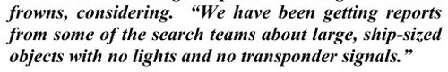

## p.1–5 (scan page 1)

Page contents: Title; house rules; GM overview of the shadow creatures; encounter summaries; opening crawl; E1 Haas's briefing (hand-read)

## p.6 (scan page 6)

Page contents: 837 words, 24 paragraphs | headings/entries: Encounter 3: Survivor; Excursion; Page 6

- **No single roster character (rules/setting/general)** — entry/section: Farseeing vision: "A female Human Militia member in garrison uniform (black trimmed with emerald green) works at one of the computer terminals. A humanoid shadow oozes from the corner, looming beside her. She glances over her other shoulder, not seeing the shadow, but clearly aware of something. The shadow touches her shoulder and she whips around, reaching for her blaster. The shadow envelops the blaster and you can see, through the shadowy hand, the indicator dropping to zero. The woman screams as the shadow flows over her, and fades from sight. Others rush into the room, finding nothing but the drained blaster." Source: *312 - Belted In - Excursion* (SWRPG d20 Revised Core), p.6
  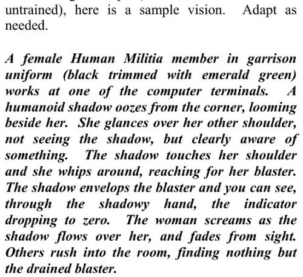

## p.7 (scan page 7)

Page contents: 833 words, 27 paragraphs | headings/entries: Excursion; Encounter 4: Bits and Pieces; Page 7

- **No single roster character (rules/setting/general)** — entry/section: Jander Bibbbi: ""No shadows, need light, can't stand the light, safe in the light..."" Source: *312 - Belted In - Excursion* (SWRPG d20 Revised Core), p.7
  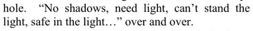
- **No single roster character (rules/setting/general)** — entry/section: Jander Bibbbi: "They come from the shadows. You'll only be safe if there are no shadows at all." Source: *312 - Belted In - Excursion* (SWRPG d20 Revised Core), p.7
  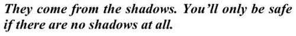

## p.8 (scan page 8)

Page contents: 868 words, 24 paragraphs | headings/entries: Encounter 5: Old Enemies; A Bunch of Corpses; Excursion; Page 8

- **No single roster character (rules/setting/general)** — entry/section: Jander Bibbbi: ""They're here, they're here — turn on all the lights or they'll get us too!"" Source: *312 - Belted In - Excursion* (SWRPG d20 Revised Core), p.8
  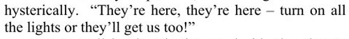

## p.9 (scan page 9)

Page contents: 919 words, 19 paragraphs | headings/entries: Other Important Information; Excursion; Encounter 6: Mine's Eye; Page 9

- **No single roster character (rules/setting/general)** — entry/section: Captain Jans Tolen: ""This is Captain Jans Tolen, of the Stark Wing. This is my final log entry as captain of this vessel. We have come under attack from an enemy that we cannot see, and which I have come to believe takes up residence inside a living host. After Corporal Bennings began to speak of evacuating Cularin, a certain paranoia set in. Then others, both enlisted and officers, began to behave strangely. No one knew whom to trust. Trust is a tough thing to come by, these days. I am uncertain when the fighting began, but the certainty that some of us were not who we appeared caused the initial firefight. It sustained itself despite all efforts on my part, and those of others, to stop it.
"I will not let whatever this is take me over. My command is doomed, but I will not allow something else to lead this ship onto a path inconsistent with the goals of the Thaereian Navy. All pertinent data have been transferred to Thaereian High Command; I will wipe the memory of my systems and leave only this log behind, to warn those who might find the Stark Wing. Leave this ship now. It's your only hope."" Source: *312 - Belted In - Excursion* (SWRPG d20 Revised Core), p.9
  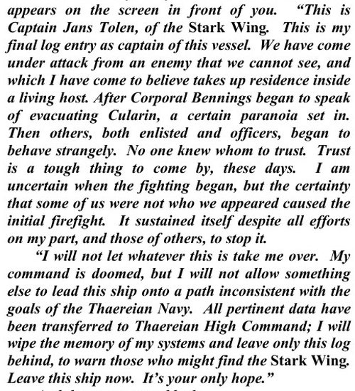

## p.10 (scan page 10)

Page contents: 781 words, 26 paragraphs | headings/entries: Excursion; Encounter 7: Mobius Trip; Page 10

- **No single roster character (rules/setting/general)** — entry/section: Sergeant Dregz: "One of the Caarites in the second guard squad has the name "Dregz" on his uniform. (Heroes who have participated in LIVING FORCE scenarios going back to year one may have encountered Sergeant Dregz back when he was only a Corporal, in the event "A Cularin Presence" and later in "Tilnes Rising". Dregz and his squad were slaughtered in the living quarters, having barricaded themselves behind several overturned beds." Source: *312 - Belted In - Excursion* (SWRPG d20 Revised Core), p.10
  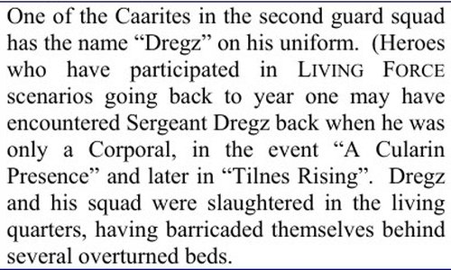

## p.5–10 (scan page 5)

Page contents: E2 base search and Farseeing vision; E3 Jander Bibbbi on the Jackpot; E4 vanishing items; E5 the Stark Wing and Captain Tolen's log; E6 the slaughtered Caarite mine and Sgt. Dregz (hand-read)

## p.11 (scan page 11)

Page contents: 932 words, 17 paragraphs | headings/entries: Excursion; Page 11

- **No single roster character (rules/setting/general)** — entry/section: Animated Sergeant Dregz: ""I can help you find your friends."" Source: *312 - Belted In - Excursion* (SWRPG d20 Revised Core), p.11
  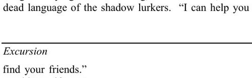

## p.12 (scan page 12)

Page contents: 945 words, 19 paragraphs | headings/entries: Dregz's Message; Excursion; Page 12

- **No single roster character (rules/setting/general)** — entry/section: Shadow lurkers: "This is a problem the shadow lurkers hadn't anticipated when they began working on a way to bring those who are still living into the shadowy realm created when the darkstaff destroyed their world. They exist without sound, and have done so for thousands of years." Source: *312 - Belted In - Excursion* (SWRPG d20 Revised Core), p.12
  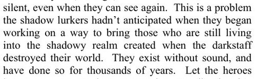
- **No single roster character (rules/setting/general)** — entry/section: The dark path and the light path: "The dark path and the light path — like the dark side and the light side — are not truly different. They're just different ways of approaching the same thing." Source: *312 - Belted In - Excursion* (SWRPG d20 Revised Core), p.12
  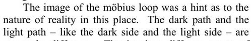

## p.13 (scan page 13)

Page contents: 801 words, 30 paragraphs | headings/entries: Conclusion; Excursion; Here Ends, "Excursion"; Experience Point Summary; Page 13

- **No single roster character (rules/setting/general)** — entry/section: Conclusion: "The lost are found, friends are reunited and for now, it seems the problem is resolved, despite a number of unanswered questions. Who are the shadow lurkers, what were they doing, why did they stop, and what does the future hold? Important questions, but ones that have to wait for another day. For now, the heroes of Cularin can take a well-earned rest." Source: *312 - Belted In - Excursion* (SWRPG d20 Revised Core), p.13
  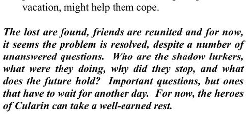

## p.14 (scan page 14)

Page contents: 423 words, 19 paragraphs | headings/entries: Adventure Experience Award:; Loot Summary; Encounter 1 — From Nirama 500 credits; Excursion; Conclusion - From the Militia; Page 14

## p.10–14 (scan page 10)

Page contents: E7 animated Dregz and the light and dark paths; conclusion; XP and loot (hand-read)

## p.15 (scan page 15)

Page contents: 822 words, 27 paragraphs | headings/entries: Compartment Key; Excursion; Space: Attack (6; Page 15

## p.16 (scan page 16)

Page contents: 60 words, 19 paragraphs | headings/entries: Wayfarer-class Medium Transport; Cargo Cretes; Cosputer; Hatch>s; Hyperdrive; Lite Support; Power Core; Power Loader; Sublight Engine; June 03 Dungeon/Polyhedron 21; Excursion Page 16

## p.17 (scan page 17)

Page contents: 91 words, 6 paragraphs | headings/entries: Bobet s seeuumn; Pere; Page 17; Excursion

## p.18 (scan page 18)

Page contents: 138 words, 5 paragraphs | headings/entries: Player Handout 3: Aftermath; Excursion Page 18

## p.19 (scan page 19)

Page contents: 355 words, 16 paragraphs | headings/entries: GM Aid #1: NPC Statistics; Encounter 1: Missing in Action; Veneziano Haas, Human Scoundrel 4/Scout 4;; Encounter 7 - All Tiers; Equipment: burned out blaster rifle; Excursion; Page 19

- **No single roster character (rules/setting/general)** — entry/section: Veneziano Haas: "Veneziano Haas is high enough in Nirama's organization to be trusted with seeing that the right people are hired to get the job done. He is friendly and collegial with the males and flirtatious with the females, whatever their species." Source: *312 - Belted In - Excursion* (SWRPG d20 Revised Core), p.19
  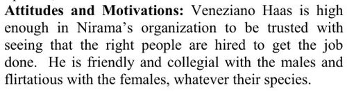

## p.20 (scan page 20)

Page contents: 102 words, 11 paragraphs | headings/entries: Critical Event Summary Excursion; Other (please specify); GM Name, RPGA#:; GM Email Address:; Convention Name/Date; Convention Coordinator:; Excursion; Page 20

## p.15–20 (scan page 15)

Page contents: Fortune's Favor handout; Militia base map; Aftermath handout; Haas and Dregz stats; critical event summary (hand-read)

