# Owner Material 037 — Star Wars D20 Drive folder (Core, Revised Core and Saga Edition): Living Force Campaign/Adventures/Among the Stars/Year 3/313 - Belted In - Recursion.pdf [Star Wars Roleplaying Game Revised Core (d20, 2002)]

- **Source:** Wizards of the Coast Star Wars Roleplaying Game books, web enhancements, Living Force campaign modules and articles (2000–2010), from the owner's "Star Wars D20" Drive folder (only the three edition subfolders; "General" was not read, as instructed). Secondary source (licensed Legends reference). Scan OCR'd on the box; the scan stays box-only and is **not** published.
- **Method:** every scanned page was OCR'd and machine-screened sentence by sentence for power-relevant statements (fights, kills, defeats, Force feats, rankings, superweapons) that name a character on our roster; each kept sentence is quoted verbatim from the OCR text and has a crop of the printed passage directly under it. Pages with nothing power-relevant are still listed with what is on them.
- **Citation:** "*313 - Belted In - Recursion* (SWRPG d20 Revised Core), p.X" by printed page ("scan p.X" where no printed number applies). **Weight:** Licensed RPG material: a secondary source. Narrative text sums up Legends lore; game statistics are rules for players, not canon power levels, and rank lowest.

## scan p.1 (scan page 1)

Page contents: 119 words, 7 paragraphs | headings/entries: LFA313; Recursion; Edited by Jae Walker

## p.1 (scan page 2)

Page contents: 844 words, 21 paragraphs | headings/entries: House Rules; Atoning for Dark Side Points; Dissipate Energy; Recursion; Illusion; Stun; Hero Earnings; Page |

## p.2 (scan page 3)

Page contents: 888 words, 15 paragraphs | headings/entries: Recursion; GM Overview; Page 2

- **No single roster character (rules/setting/general)** — entry/section: Shadow lurkers: "The shadow lurkers, the after-images of creatures who lived millennia ago in Cularin before destroying themselves with the darkstaff, are dying. They've tried to communicate with those who love Cularin, redoubling their efforts after Len Markus stole the darkstaff from the guardians they had put in place." Source: *313 - Belted In - Recursion* (SWRPG d20 Revised Core), p.2
  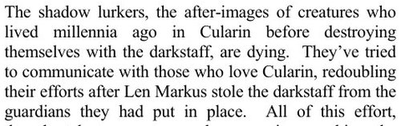

## p.3 (scan page 4)

Page contents: 946 words, 17 paragraphs | headings/entries: Encounter 1: DreamTime; Encounter 2: Common Ground; Recursion; Encounter 3: Market Value; Encounter 4: Priests of Nether; Encounter 5:_The Scientist-Philosophers; Page 3

## p.4 (scan page 5)

Page contents: 835 words, 19 paragraphs | headings/entries: Encounter 6: Only the Strong; Encounter 7: After the Fire; Recursion; Opening Crawl; Encounter 1: DreamTime; Page 4

## p.5 (scan page 6)

Page contents: 839 words, 25 paragraphs | headings/entries: Recursion; Droids; Page 5

- **No single roster character (rules/setting/general)** — entry/section: The dream: "The twin suns, Morasil and Termadus, hang low in the sky. Too low, and too small to be the way they would be viewed from Cularin. Too large to be the view from Almas.
...
A cloud moves between you and the suns, blacker than any you've ever seen. It begins to expand. It eats the sky. Shadows leap across the plain, and the mountains are devoured — all but the three highest peaks. A beam of silver light arcs up from the horizon, slams into the black. The air shimmers, then shudders.
...
Light. Heat. Pain.
Then, nothing." Source: *313 - Belted In - Recursion* (SWRPG d20 Revised Core), p.5
  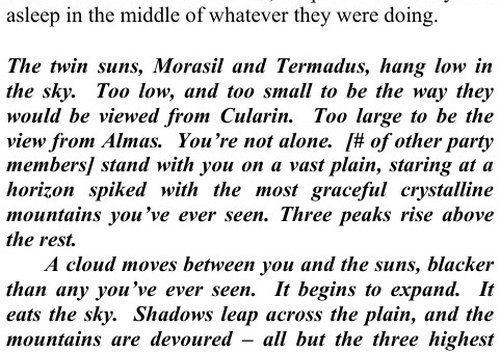
- **No single roster character (rules/setting/general)** — entry/section: Nirama's distress signal: ""This is Nirama. I am in need of assistance. Please come to this signal. This is Nirama. I am in need of assistance. Please come to this signal."" Source: *313 - Belted In - Recursion* (SWRPG d20 Revised Core), p.5
  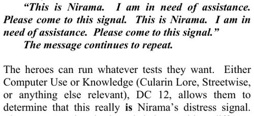

## scan p.1–5 (scan page 1)

Page contents: Title; house rules; GM overview of the Oblee shadow lurkers; encounter summaries; opening crawl; E1 shared dream and Nirama's distress call (hand-read)

## p.6 (scan page 7)

Page contents: 890 words, 22 paragraphs | headings/entries: Encounter 2: Common Ground; Recursion; I say we just leave him. Hit; Page 6

- **No single roster character (rules/setting/general)** — entry/section: Nirama, common knowledge: "Nirama is Cularin's crimelord, having bested Riboga the Hutt in a fairly chancy gamble and taken control of all the smuggling and illegal traffic that moves into and out of the system. He is fiercely opposed to slavery in any form, and has recently shown himself to be VERY protective of his home system. He does not like Thaere, nor does he like the Cartel, and he has stated publicly that he wants them all gone, that Cularin should be allowed to protect itself and determine its own course. He has worked with the heroes of Cularin a number of times in the past, or had them work for him, and has generally been a fair and reasonable employer. He does not lie (some speculate that he is incapable of it) and he values loyalty above all else. Finally, he looks unlike any species the heroes have encountered before. He has two sets of eyes — one atop the other — and a third arm that grows from the middle of his back, which frequently holds a blaster pistol." Source: *313 - Belted In - Recursion* (SWRPG d20 Revised Core), p.6
  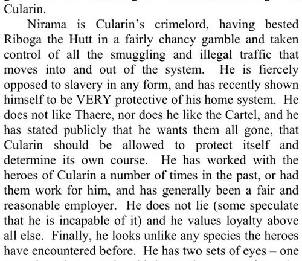

## p.7 (scan page 8)

Page contents: 913 words, 19 paragraphs | headings/entries: Recursion; Page 7

- **No single roster character (rules/setting/general)** — entry/section: Nirama: ""You're here. I'm not alone."" Source: *313 - Belted In - Recursion* (SWRPG d20 Revised Core), p.7
  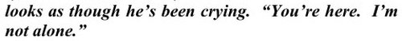

## p.8 (scan page 9)

Page contents: 825 words, 27 paragraphs | headings/entries: No Shard; Recursion; Page 8

## p.9 (scan page 10)

Page contents: 708 words, 30 paragraphs | headings/entries: Recursion; Subsequent Visits; Nirama in Encounter 3; Encounter 4: Priests of Nether; No Shard; Page 9

- **No single roster character (rules/setting/general)** — entry/section: Nirama: "He's in shock to see so many like him, when he believed himself to be the only one of his kind in the galaxy." Source: *313 - Belted In - Recursion* (SWRPG d20 Revised Core), p.9
  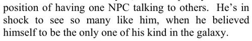

## p.10 (scan page 11)

Page contents: 775 words, 29 paragraphs | headings/entries: Recursion; Page 10

## p.11 (scan page 12)

Page contents: 798 words, 24 paragraphs | headings/entries: Recursion; Subsequent Visits; Nirama in Encounter 4; Page 11

- **No single roster character (rules/setting/general)** — entry/section: Priests of Nether on Nirama: "How did he survive? He didn't. He was born. The scientist-philosophers made arrangements for such, if we were to all die." Source: *313 - Belted In - Recursion* (SWRPG d20 Revised Core), p.11
  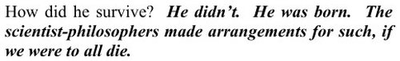
- **No single roster character (rules/setting/general)** — entry/section: Priests of Nether: "What are the forms? Nothingness. Restfulness. Watchfulness. Life. These are the forms.
You can come back to life? We can. We never died, simply shifted along the continuum." Source: *313 - Belted In - Recursion* (SWRPG d20 Revised Core), p.11
  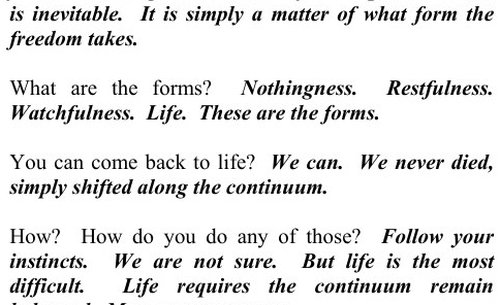

## p.12 (scan page 13)

Page contents: 804 words, 26 paragraphs | headings/entries: Encounter 5: The Scientist-Philosophers; No Shard; Recursion; Page 12

- **No single roster character (rules/setting/general)** — entry/section: Scientist-philosophers: "Who are you? As a species, we are the Oblee, inhabitants of the planet Oblis. Our planet is now your asteroid belt. We are not even a memory, to you. Those of us gathered here were the scientist-philosophers. We were the leaders of our people. It was our mistakes that led us to ruin." Source: *313 - Belted In - Recursion* (SWRPG d20 Revised Core), p.12
  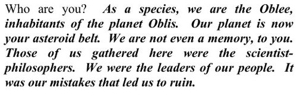

## p.13 (scan page 14)

Page contents: 771 words, 26 paragraphs | headings/entries: Recursion; Page 13

- **No single roster character (rules/setting/general)** — entry/section: Scientist-philosophers on the darkstaff: "What is the darkstaff? It is an object that draws on what we would call the continuum, but which you would more likely call the "Force". It can do amazing things. It is perhaps the most powerful object we have ever seen.
Where did it come from? It came to us from a wandering trader. His name was never known to us. We analyzed it and saw its power, but also saw no need for such power. Then the shadow creature came, and we had a need.
...
What happened to it after that? Someone found it recently, didn't they? A powerful man came and took it. We could not stop him." Source: *313 - Belted In - Recursion* (SWRPG d20 Revised Core), p.13
  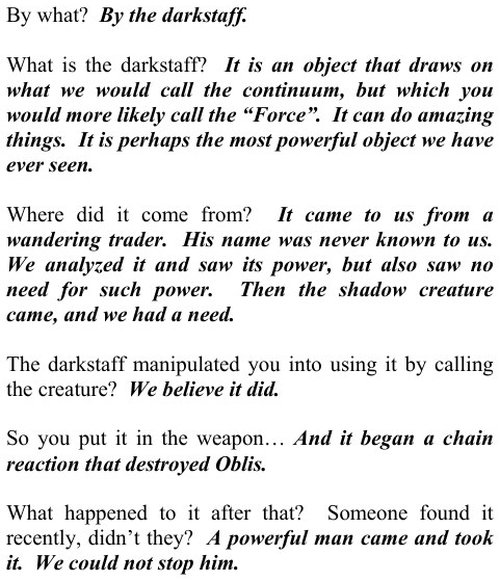
- **No single roster character (rules/setting/general)** — entry/section: Scientist-philosophers on Nirama: "How did he survive? He didn't. He was born. We spread our genetic material throughout the galaxy, so that we could never be fully destroyed. His hostmother must have been very surprised at her child." Source: *313 - Belted In - Recursion* (SWRPG d20 Revised Core), p.13
  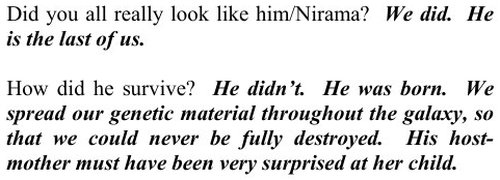

## p.14 (scan page 15)

Page contents: 841 words, 24 paragraphs | headings/entries: Recursion; Nirama in Encounter 5; Encounter 6: Only the Strong; Page 14

- **No single roster character (rules/setting/general)** — entry/section: Scientist-philosophers: "What is it that's so important you had to tell us? That the darkstaff's wielder must be stopped. We have not felt his presence in Cularin, but his influence is here. He controls those who believe. We have heard their violent thoughts on the continuum. They wish destruction. What was done to Oblis, they wish done to all your worlds. You must stop all of them, but most especially, him. He must be removed from the continuum, or the galaxy will be destroyed." Source: *313 - Belted In - Recursion* (SWRPG d20 Revised Core), p.14
  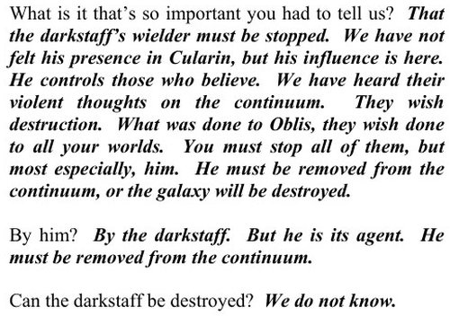
- **No single roster character (rules/setting/general)** — entry/section: Nirama: "You have given much to Cularin. There are some things that I cannot ask. I never felt alone until I knew there had been others. I will not be alone if they remain memories. I cannot, and will not, ask you to do this for me. But if it is right for you, then I give you my word — you will not be forgotten." Source: *313 - Belted In - Recursion* (SWRPG d20 Revised Core), p.14
  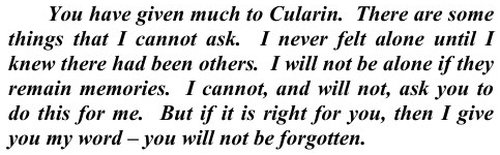

## p.6–14 (scan page 7)

Page contents: E2 Nirama and the Oblee skeleton; the random 1d3 loop; E3 market-goers, E4 Priests of Nether, E5 scientist-philosophers Q&As (hand-read)

## p.15 (scan page 16)

Page contents: 804 words, 33 paragraphs | headings/entries: Why; Encounter 7: After the Fire; Recursion; Watchfulness; Page 15

- **No single roster character (rules/setting/general)** — entry/section: Nirama: "Nirama, remember, doesn't lie. He's also feeling rather cranky about having his emotions brutalized, and then having these chuckleheads attack him and the people who answered his distress call." Source: *313 - Belted In - Recursion* (SWRPG d20 Revised Core), p.15
  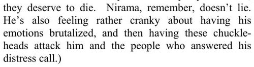

## p.16 (scan page 17)

Page contents: 876 words, 28 paragraphs | headings/entries: Life; Recursion; Thank you; Page 16

- **No single roster character (rules/setting/general)** — entry/section: Oblee: ""Thank you."" Source: *313 - Belted In - Recursion* (SWRPG d20 Revised Core), p.16
  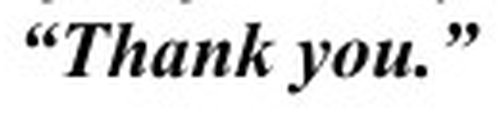
- **No single roster character (rules/setting/general)** — entry/section: Nirama: ""My friend, I lack the words to express what I feel. I have tried to do what is best for many. You have set a standard that I will forever strive to uphold. Your bravery — your sacrifice — will not be forgotten. You have my word."" Source: *313 - Belted In - Recursion* (SWRPG d20 Revised Core), p.16
  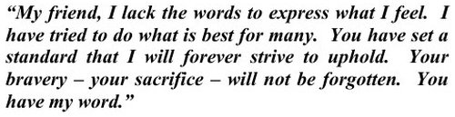
- **No single roster character (rules/setting/general)** — entry/section: Nirama: "My friends... I thank you for what you did for my people. They are no longer under the sway of the darkstaff, no longer forced to do anything to keep themselves alive.
While it might have been nice to know them, I have other people. I am of Cularin. You are of Cularin. That both of these statements are true makes me very proud.
Thank you" Source: *313 - Belted In - Recursion* (SWRPG d20 Revised Core), p.16
  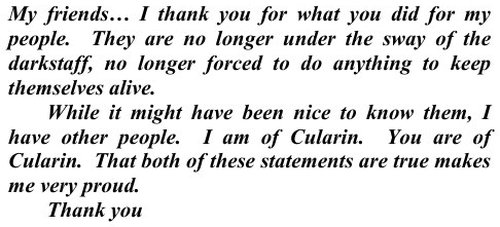

## p.17 (scan page 18)

Page contents: 777 words, 26 paragraphs | headings/entries: Conclusion; Recursion; You have again validated; Here Ends "Recursion"; Experience Point Summary; Page 17

- **No single roster character (rules/setting/general)** — entry/section: Nirama: ""People of Cularin, I come to you on a day of mourning. There are those among us who do not value life, who are willing to condemn an entire species to oblivion. So be it. I am a fair individual, and am allowing them a fair choice. Their decision renders them unsuitable as citizens of Cularin. They may leave if they so desire. If they do not, I will have them killed. They know who they are. They have one day."" Source: *313 - Belted In - Recursion* (SWRPG d20 Revised Core), p.17
  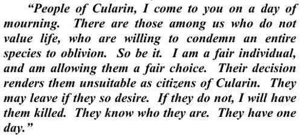
- **No single roster character (rules/setting/general)** — entry/section: Nirama: ""There is no one as remarkable, as important, as the hero who would give up his life for another. If, when I die, I do so in as noble a manner as [hero], I will consider my life well lived.
"Tomorrow, the Cularin Militia will receive a medical frigate. Its name is [hero's name]'s Choice — to remind us all that our choices can save lives. Thank you, [hero]. Thank you, Cularin."" Source: *313 - Belted In - Recursion* (SWRPG d20 Revised Core), p.17
  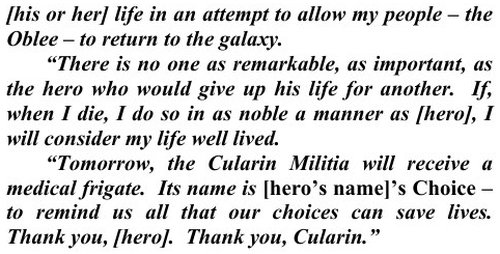
- **No single roster character (rules/setting/general)** — entry/section: Nirama: ""People of Cularin... in life, we make choices. Through choices, ordinary men and women become heroes. Cularin is blessed with extraordinary heroes.
"Long ago, a species who very much resembled myself inhabited Cularin. A darkness threatened Cularin then, a darkness that threatens Cularin again today. My people did not realize the threat. They paid an awful price, and were imprisoned by the darkness until yesterday. I cannot begin to guess how many years they remained subject to its power.
"A hero is not someone who does things for power, glory, or wealth. A hero does things because they must be done — because there is no other way. Yesterday, I watched as true heroes freed the Oblee — not because of any promised reward, but because it was right.
"Thank you, Cularin. You have again validated the love I feel for my home."" Source: *313 - Belted In - Recursion* (SWRPG d20 Revised Core), p.17
  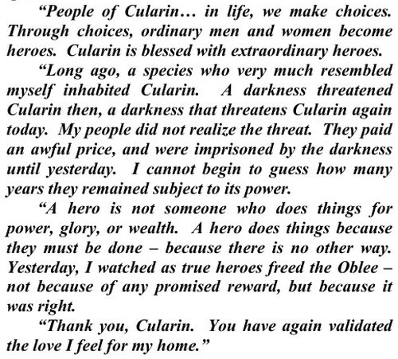

## p.18 (scan page 19)

Page contents: 730 words, 40 paragraphs | headings/entries: Adventure Experience Award:; Loot Summary; Encounter 7; Conclusion; Nirama's Gratitude; Permission to play an Oblee; Recursion; Oblee possess the following species traits:; Page 18

- **No single roster character (rules/setting/general)** — entry/section: Oblee cert: "The Oblee are Nirama's race, and the hero created using this certificate is considered by Nirama to be a cousin. This Oblee can be either gender, and can begin as any non-Jedi class (there were no Jedi in Cularin when the Oblee ran afoul of the darkstaff)." Source: *313 - Belted In - Recursion* (SWRPG d20 Revised Core), p.18
  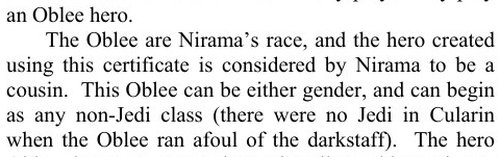

## p.14–18 (scan page 15)

Page contents: E6 the Believers; E7 the four fates of the Oblee; Nirama's holovids; XP; Nirama's Gratitude and Oblee certs with species traits (hand-read)

## p.19 (scan page 20)

Page contents: 746 words, 29 paragraphs | headings/entries: GM Aid #1: NPC Statistics; Encounter 3; Recursion; Encounter 6; Low Tier (Average hero level 1-3); Page 19

## p.20 (scan page 21)

Page contents: 738 words, 34 paragraphs | headings/entries: Alter, Control, Force Mind, Mind; Upper Tier (Average hero level 7-9); Rorvek and Kropporrr: Male Wookiee Soldier 2;; Recursion; Force Mind,; Page 20

## p.21 (scan page 22)

Page contents: 762 words, 11 paragraphs | headings/entries: Recursion Page 21

- **Darth Rivan** — entry/section: 313 - Belted In - Recursion: "Its creator (as reported in the journals of Darth Rivan) regretted the creation of the darkstaff, but the artifact killed him (or her) before its unmaking could be accomplished." Source: *313 - Belted In - Recursion* (SWRPG d20 Revised Core), p.21
  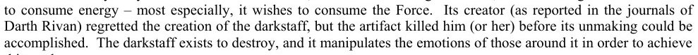
- **No single roster character (rules/setting/general)** — entry/section: History of the shadow lurkers: "Oblis was destroyed by the darkstaff. This artifact, a creation of a long-dead Sith, wants nothing more or less than to consume energy — most especially, it wishes to consume the Force. Its creator (as reported in the journals of Darth Rivan) regretted the creation of the darkstaff, but the artifact killed him (or her) before its unmaking could be accomplished. The darkstaff exists to destroy, and it manipulates the emotions of those around it in order to achieve this goal." Source: *313 - Belted In - Recursion* (SWRPG d20 Revised Core), p.21
  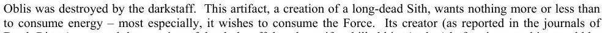
- **No single roster character (rules/setting/general)** — entry/section: History of the shadow lurkers: "Thus, the darkstaff took two species that had no natural enmity, and turned them against one another to power itself." Source: *313 - Belted In - Recursion* (SWRPG d20 Revised Core), p.21
  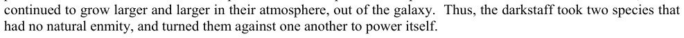

## p.22 (scan page 23)

Page contents: 106 words, 4 paragraphs | headings/entries: GM Aid#3 - The Shards; Recursion Page 22

## p.23 (scan page 24)

Page contents: 182 words, 10 paragraphs | headings/entries: Critical Event Summary Recursion; GM Name, RPGA#:; GM Email Address:; Event Name/Date; Recursion Page 23

## p.19–23 (scan page 20)

Page contents: Stats for Nirama, the Oblee crowd and the Believers; history of the shadow lurkers; shard diagram; critical event summary (hand-read)

