# Owner Material 037 — Star Wars D20 Drive folder (Core, Revised Core and Saga Edition): Living Force Campaign/Adventures/Among the Stars/Year 3/314 - Night Eyes - Night's Promise.pdf [Star Wars Roleplaying Game Revised Core (d20, 2002)]

- **Source:** Wizards of the Coast Star Wars Roleplaying Game books, web enhancements, Living Force campaign modules and articles (2000–2010), from the owner's "Star Wars D20" Drive folder (only the three edition subfolders; "General" was not read, as instructed). Secondary source (licensed Legends reference). Scan OCR'd on the box; the scan stays box-only and is **not** published.
- **Method:** every scanned page was OCR'd and machine-screened sentence by sentence for power-relevant statements (fights, kills, defeats, Force feats, rankings, superweapons) that name a character on our roster; each kept sentence is quoted verbatim from the OCR text and has a crop of the printed passage directly under it. Pages with nothing power-relevant are still listed with what is on them.
- **Citation:** "*314 - Night Eyes - Night's Promise* (SWRPG d20 Revised Core), p.X" by printed page ("scan p.X" where no printed number applies). **Weight:** Licensed RPG material: a secondary source. Narrative text sums up Legends lore; game statistics are rules for players, not canon power levels, and rank lowest.

## p.1 (scan page 1)

Page contents: 136 words, 7 paragraphs | headings/entries: LFA313; Night's Promise; Edited by Ron Heintz and Jae Walker

## p.2 (scan page 2)

Page contents: 846 words, 21 paragraphs | headings/entries: House Rules; Atoning for Dark Side Points; Dissipate Energy; Night's Promise; Illusion; Stun; Hero Earnings; Page 2

## p.3 (scan page 3)

Page contents: 881 words, 16 paragraphs | headings/entries: Night's Promise; GM Overview; Page 3

- **No single roster character (rules/setting/general)** — entry/section: Dark Side Sourcebook quoted: "To quote the Star Wars Roleplaying Game Dark Side Sourcebook... "Evil is not always easy to recognize. An innocent act may ultimately result in great suffering. An act of revenge may save the lives of millions of people. The pure at heart can lash out in anger. Evil may lurk beneath a mask of virtue. Whether an act is evil or not often boils down to a question of motivation, and motivation can be hard to identify." Source: *314 - Night Eyes - Night's Promise* (SWRPG d20 Revised Core), p.3
  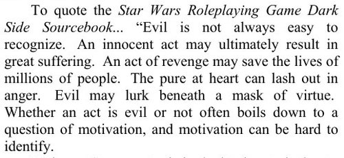
- **No single roster character (rules/setting/general)** — entry/section: Task Force Pest: "Task Force Pest, under the command of Lieutenant Dalin, was ordered to round up, incarcerate and ready for transport any non-Jedi who showed an aptitude for the Force. Force Adepts, mystics, crackpots and Tarasin shamans within the cities were identified, watched and dossiers compiled." Source: *314 - Night Eyes - Night's Promise* (SWRPG d20 Revised Core), p.3
  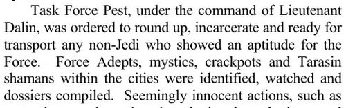

## p.4 (scan page 4)

Page contents: 748 words, 26 paragraphs | headings/entries: Encounter 1: Film at Eleven; Encounter 3: Just Me and My Shadow; Encounter 5: Have Fun Storming the Castle!; Important Note to Judges:; Night's Promise; Opening Crawl; Encounter 1: Film at Eleven; Page 4

- **No single roster character (rules/setting/general)** — entry/section: Opening crawl: "It can be said that any sudden growth results in pain and awkwardness. The same can be said for the reemergence of Cularin into the Republic. While ten years is only a small fraction of the history of the Republic, it is long enough for several subtle cultural and political shifts. The rise in military presence, for example, is particularly grating in a system that prides itself for its "can do" and frontier roots. The fact that it is a foreign military presence, albeit an invited one, makes it that much harder to bear. And when that military presence becomes restrictive-- it can only be a matter of time before something boils over." Source: *314 - Night Eyes - Night's Promise* (SWRPG d20 Revised Core), p.4
  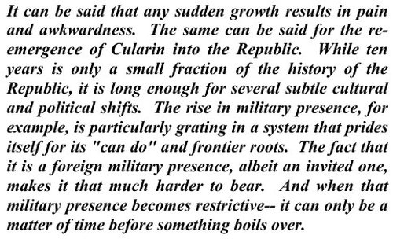
- **No single roster character (rules/setting/general)** — entry/section: Borus Ferthyn: "Borus Ferthyn was the Force sensitive "beggar" who lived by the garbage dump and was first introduced in "Eye of the Sun", the original LIVING FORCE trilogy. He is very much a staple of Gadrin and generally has a reputation as a hermit, crackpot or mystic. The adjective "harmless" is usually used in reference to him as well." Source: *314 - Night Eyes - Night's Promise* (SWRPG d20 Revised Core), p.4
  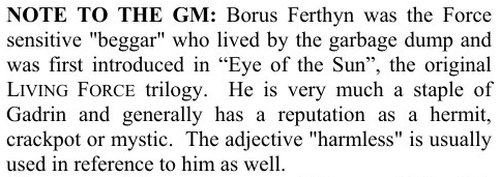

## p.5 (scan page 5)

Page contents: 763 words, 26 paragraphs | headings/entries: Night's Promise; DC/Skill Situation; Militia Thaereian thugs. I didn't support a; Page 5

- **No single roster character (rules/setting/general)** — entry/section: The Massacre: "The holopicture is chilling. While you are used to color, sound and movement, the frozen shot touches an ancient nerve of terror. Forced to his knees by two Thaereian soldiers, Borus Ferthyn stares in defiance, or madness, at the barrel of a heavy blaster. You know that moments later that heavy blaster ended his life." Source: *314 - Night Eyes - Night's Promise* (SWRPG d20 Revised Core), p.5
  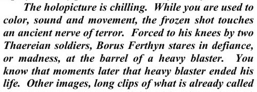
- **No single roster character (rules/setting/general)** — entry/section: Citizen to a Force Adept: "They'll come for you next if they think you're able to do... things. Like Ferthyn could." Source: *314 - Night Eyes - Night's Promise* (SWRPG d20 Revised Core), p.5
  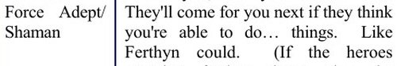

## p.1–5 (scan page 1)

Page contents: Title; house rules; GM overview of Task Force Pest and the execution of Borus Ferthyn; encounter summaries; opening crawl; E1 aftermath of the Massacre in Gadrin (hand-read)

## p.6 (scan page 6)

Page contents: 751 words, 31 paragraphs | headings/entries: If the party; Shaman; Night's Promise; Encounter 3: Just Me and My Shadow; Page 6

## p.7 (scan page 7)

Page contents: 745 words, 27 paragraphs | headings/entries: Listen or Spot <15; Night's Promise; Encounter 4: Uncle Dal'Nay Wants You!; Page 7

- **No single roster character (rules/setting/general)** — entry/section: Tail's message: ""Listen, I've been following you all day and there's someone who wants to speak to you. Dal'Nay has a proposition for you. He wants to meet in an hour."" Source: *314 - Night Eyes - Night's Promise* (SWRPG d20 Revised Core), p.7
  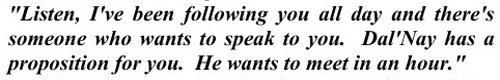
- **No single roster character (rules/setting/general)** — entry/section: Osten Dal'Nay: ""For the last few weeks a Thaereian task force has been gathering up people who have many of the same talents as the Jedi. Anyone who shows any ability with the Force is subject to arrest without any warning or due process. The Thaereians have already shipped one group out of Cularin to Thaere. We can't help them."
"However, they're holding several people in a security facility they commandeered from the Office of Peace and Security here in the city. Informants have told us that the prisoners are due to be shipped out tomorrow morning. That's not enough time for the Militia to act and, frankly, I don't want to tip our hand just yet. I was wondering if a few concerned citizens might be willing to help out? Rescue some innocent people and maybe find out why this is happening?"" Source: *314 - Night Eyes - Night's Promise* (SWRPG d20 Revised Core), p.7
  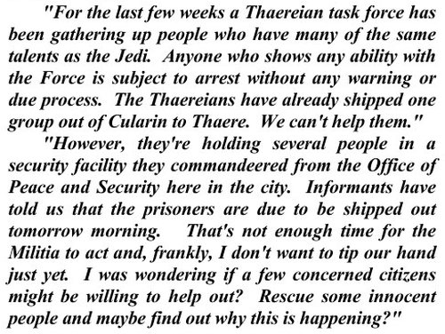

## p.8 (scan page 8)

Page contents: 839 words, 27 paragraphs | headings/entries: What Osten Dal'Nay (or others) do know:; Night's Promise; Encounter 5: Have Fun Storming the Castle!; Page 8

## p.9 (scan page 9)

Page contents: 667 words, 32 paragraphs | headings/entries: Conclusion; Night's Promise; Here Ends Night's Promise; Experience Point Summary; Adventure Experience Award:; Page 9

- **No single roster character (rules/setting/general)** — entry/section: Osten Dal'Nay: ""Excellent work. Not only did you get the prisoners out but also our code experts are busy with the data you retrieved. Based on the level of security we think it was something important, no one is that cautious with a shopping list!"" Source: *314 - Night Eyes - Night's Promise* (SWRPG d20 Revised Core), p.9
  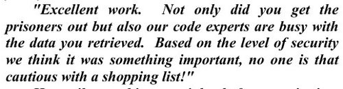
- **No single roster character (rules/setting/general)** — entry/section: Rescued prisoner: ""Thank you again. You've done a great service not only to us, but also to Cularin. We have nothing to give you but our gratitude for our futures."" Source: *314 - Night Eyes - Night's Promise* (SWRPG d20 Revised Core), p.9
  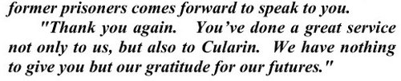
- **No single roster character (rules/setting/general)** — entry/section: Osten Dal'Nay: ""Thank you for trying; I was afraid the odds were long and I guess I was hoping for a miracle. This... conflict... with Thaere isn't over. I hope I can call on you again."" Source: *314 - Night Eyes - Night's Promise* (SWRPG d20 Revised Core), p.9
  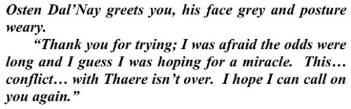

## p.6–9 (scan page 6)

Page contents: E2 the two mobs; E3 the youthful tails; E4 Osten Dal'Nay's request; E5 the raid on Security Facility Number 12; E6 thanks; conclusion; XP (hand-read)

## p.10 (scan page 10)

Page contents: 173 words, 9 paragraphs | headings/entries: Loot Summary; Encounter 1: Film at Eleven; Night's Promise; Page 10

## p.11 (scan page 11)

Page contents: 15 words, 5 paragraphs | headings/entries: Player Handout 1: Street Map ——————— |; MOB 1; Night's Promise; MOB 2; Page 11

## p.12 (scan page 12)

Page contents: 41 words, 4 paragraphs | headings/entries: Page 12; Night's Promise

## p.13 (scan page 13)

Page contents: 208 words, 21 paragraphs | headings/entries: Memo; To: all Thaereian personnel From: Lt. Dalin; CC: Commandant Elis' Gan; Dalin, LT; Memo; To: all Thaereian personnel From: Lt. Dalin; CC: Commandant Elis' Gan; Dalin, LT; Memo; To: all Thaereian personnel From: Lt. Dalin; CC: Commandant Elis' Gan; Dalin, LT; Night's Promise Page 13

## p.14 (scan page 14)

Page contents: 88 words, 8 paragraphs | headings/entries: Memo; To: all Thaereian personnel From: Lt. Dalin; CC: Commandant Elis' Gan; Dalin, LT; Night's Promise Page 14

## p.15 (scan page 15)

Page contents: 711 words, 31 paragraphs | headings/entries: GM Aid #1: NPC Statistics; Equipment: Blaster Pistol, comlink; Equipment: Blaster Pistol; Equipment: Blaster Pistol, comlink; Equipment: Blaster Pistol; Night's Promise; Equipment: Blaster Pistol, comlink; Equipment: Blaster Pistol; Equipment: Blaster Pistol, comlink; Skills: Intimidate +5; Page 15

## p.16 (scan page 16)

Page contents: 739 words, 29 paragraphs | headings/entries: Skills: Intimidate +3, Profession (garrison soldier) 3; Skills: Intimidate +3, Profession (garrison soldier) +3; Night's Promise; Skills: Intimidate +4, Profession (garrison soldier) +3; Skills: Intimidate +4, Profession (garrison soldier) +3; Skills: Intimidate +6, Profession (garrison soldier) ED; Skills: Intimidate +6, Profession (garrison soldier) 5; Page 16

## p.17 (scan page 17)

Page contents: 121 words, 25 paragraphs | headings/entries: Realy uoWUs}eg wwe |-bu07; Rally uoUaEq; Pero y PZ 203 STUN; Pery 6s ySeq; J0puloy §; Tequinu Pray pz 10 smeyo; Page 17; Night's Promise

## p.18 (scan page 18)

Page contents: 114 words, 14 paragraphs | headings/entries: Critical Event Summary Night's Promise; Other (please specify); GM Name, RPGA#:; GM Email Address:; Convention Name/Date; Convention Coordinator:; Night's Promise; Page 18

## p.10–18 (scan page 10)

Page contents: Loot certs; player handouts (street map, floor plan, Dalin's memos); NPC stats; GM facility map; critical event summary (hand-read)

