# Owner Material 037 — Star Wars D20 Drive folder (Core, Revised Core and Saga Edition): Living Force Campaign/Adventures/Among the Stars/Year 3/315 - Night Eyes - Night's Friend.pdf [Star Wars Roleplaying Game Revised Core (d20, 2002)]

- **Source:** Wizards of the Coast Star Wars Roleplaying Game books, web enhancements, Living Force campaign modules and articles (2000–2010), from the owner's "Star Wars D20" Drive folder (only the three edition subfolders; "General" was not read, as instructed). Secondary source (licensed Legends reference). Scan OCR'd on the box; the scan stays box-only and is **not** published.
- **Method:** every scanned page was OCR'd and machine-screened sentence by sentence for power-relevant statements (fights, kills, defeats, Force feats, rankings, superweapons) that name a character on our roster; each kept sentence is quoted verbatim from the OCR text and has a crop of the printed passage directly under it. Pages with nothing power-relevant are still listed with what is on them.
- **Citation:** "*315 - Night Eyes - Night's Friend* (SWRPG d20 Revised Core), p.X" by printed page ("scan p.X" where no printed number applies). **Weight:** Licensed RPG material: a secondary source. Narrative text sums up Legends lore; game statistics are rules for players, not canon power levels, and rank lowest.

## p.1 (scan page 1)

Page contents: 128 words, 7 paragraphs | headings/entries: LFA315; Night's Friend; Edited by Ron Heintz

## p.2 (scan page 2)

Page contents: 876 words, 22 paragraphs | headings/entries: House Rules; Atoning for Dark Side Points; Dissipate Energy; Illusion; Night's Friend; Stun; Hero Earnings; Page 2

## p.3 (scan page 3)

Page contents: 911 words, 17 paragraphs | headings/entries: General Notes to the GM; Night's Friend; GM Overview; Page 3

- **No single roster character (rules/setting/general)** — entry/section: Task Force Vermin: "Task Force Vermin is the second task force under Colonel Rast'Tul's command charged with clearing the streets of "underage rabble". The goal is multi-layered. If the person abducted is an older teen they'll be offered equipment, training and incentives to "raise hell" on Cularin. This will demonstrate that the Cularin OPS can't control their own citizens and that the Thaereians should expand their security to the surface. If the person abducted refuses they are taken to Thaere Privo for indoctrination before their return to Cularin. Thaere hopes to use these brainwashed "sleeper" agents when they take control of the Cularin system." Source: *315 - Night Eyes - Night's Friend* (SWRPG d20 Revised Core), p.3
  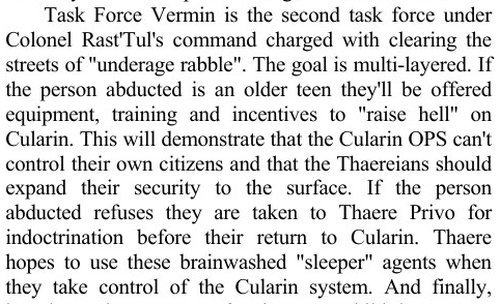

## p.4 (scan page 4)

Page contents: 705 words, 30 paragraphs | headings/entries: Encounter 2: Down In The Dumps; Encounter 4: The Talented Mr. Fallon; Encounter _5: Thaereian; Hideout; Encounter 6: Cut To The Chase; Night's Friend; Important Note to GMs:; Opening Crawl; Page 4

- **No single roster character (rules/setting/general)** — entry/section: Opening crawl: "Although relative calm has returned to Gadrin in recent weeks, the atmosphere is far from normal. The noisy, obvious unrest and near-riots have been replaced by a feeling of unease and insecurity. Something quiet is going on—something quiet and sinister..." Source: *315 - Night Eyes - Night's Friend* (SWRPG d20 Revised Core), p.4
  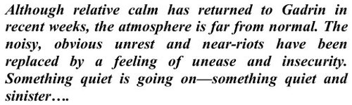

## p.5 (scan page 5)

Page contents: 751 words, 35 paragraphs | headings/entries: Night's Friend; Encounter 2: Down In The Dumps; Fighting Borus's Boys; Page 5

- **No single roster character (rules/setting/general)** — entry/section: Janna: ""Thank you for coming," the 10-year-old girl says. "You are my only hope."" Source: *315 - Night Eyes - Night's Friend* (SWRPG d20 Revised Core), p.5
  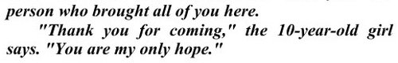
- **No single roster character (rules/setting/general)** — entry/section: Janna: ""For a long time, since the riots, people have been disappearing. Mom and Dad said they were hiding from the Thaereians but you chased them away and not everyone has come back. There are children missing: name, name, name, name. I want you to find them." She pauses and digs into a pink carryall. "In the holos, they always give a reward. I have 20 dataries and a signed holopic of the jango band "Kessel Runners'."" Source: *315 - Night Eyes - Night's Friend* (SWRPG d20 Revised Core), p.5
  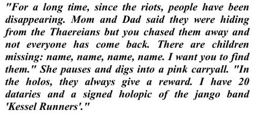
- **No single roster character (rules/setting/general)** — entry/section: Janna: "Daddy just looked at me like the time I broke my arm and hugged me tight. But I heard him tell Mom that if someone stole me he'd set fire to a ch'hala (the trees sacred to the Tarasin) if they told him to." Source: *315 - Night Eyes - Night's Friend* (SWRPG d20 Revised Core), p.5
  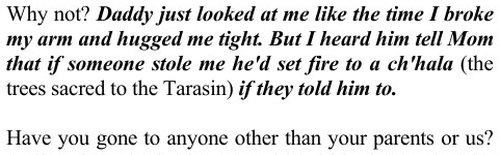
- **No single roster character (rules/setting/general)** — entry/section: Janna: "Fallon, he's the leader. He said he'd look after it. This is Fallon [hand one of the heroes a holopic of a youth]. Umm, I can get that back, right?" Source: *315 - Night Eyes - Night's Friend* (SWRPG d20 Revised Core), p.5
  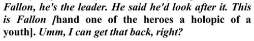

## p.1–5 (scan page 1)

Page contents: Title; house rules; GM overview of Task Force Vermin and Lt. Krayle; encounter summaries; opening crawl; E1 Janna's request (hand-read)

## p.6 (scan page 6)

Page contents: 756 words, 29 paragraphs | headings/entries: Talking to Borus's Boys; Night's Friend; What the children know:; Page 6

## p.7 (scan page 7)

Page contents: 747 words, 27 paragraphs | headings/entries: What the children need:; Encounter 4: The Talented Mr. Fallon; What Fallon Knows:; Night's Friend; Page 7

- **No single roster character (rules/setting/general)** — entry/section: Jarro Freen: ""They said they grabbed me because my mom was asking too many questions. They said they had other OPS children at some place. I can tell you where. One of them mentioned the warehouse when he thought I was unconscious."" Source: *315 - Night Eyes - Night's Friend* (SWRPG d20 Revised Core), p.7
  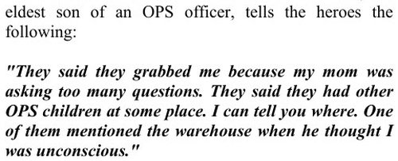
- **No single roster character (rules/setting/general)** — entry/section: Fallon and the SkyHawks: ""You commed us for a ride, Fallon?" the lead biker asks.
Fallon shakes his head and points to the heroes. "Yeah, I did, but now they need it more."
The lead biker looks over the heroes and then nods. "Any friend of Fallon is a friend of the SkyHawks. Where to?"" Source: *315 - Night Eyes - Night's Friend* (SWRPG d20 Revised Core), p.7
  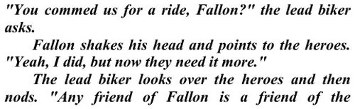

## p.8 (scan page 8)

Page contents: 719 words, 29 paragraphs | headings/entries: SkyHawks. Where to?"; Encounter 5: Yet Another Thaereian Hideout; To skip both Encounter 5 and 6:; To skip Encounter 5 only:; Night's Friend; If you have time for Encounter 5:; Encounter 6: Cut To The Chase; Page 8

## p.9 (scan page 9)

Page contents: 823 words, 21 paragraphs | headings/entries: Penalty for failure; Obstacle and Pilot DC needed; Night's Friend; Roll Obstacle and Pilot DC needed; Page 9

## p.10 (scan page 10)

Page contents: 693 words, 34 paragraphs | headings/entries: Stopping the groundspeeder before the hangar:; Groundspeeder makes it to the hangar:; Round 1-2; Round 5-8; Round 9-14; Night's Friend; When the fight ends; Conclusion; Page 10

- **No single roster character (rules/setting/general)** — entry/section: Conclusion: "As OPS and grateful parents quietly question you, you know that you can feel pride in reuniting so many families. Only one thought distracts you from your sense of accomplishment...
How many children were already taken off planet?" Source: *315 - Night Eyes - Night's Friend* (SWRPG d20 Revised Core), p.10
  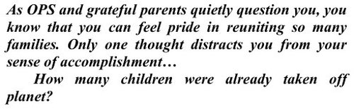

## p.5–10 (scan page 5)

Page contents: E2 Borus's Boys at Gadrin Dump; E3 the orphans' warehouse; E4 rescuing Fallon and the SkyHawks; E5 the holding pen; E6 speeder chase; E7 Krayle's hangar (hand-read)

## p.11 (scan page 11)

Page contents: 411 words, 21 paragraphs | headings/entries: Here Ends Night's Friend; Experience Point Summary; Adventure Experience Award:; Night's Friend; Loot Summary; Page 11

## p.12 (scan page 12)

Page contents: 9 words, 2 paragraphs | headings/entries: Player Handout 1: Foot Chase; Night's Friend Page 12

## p.13 (scan page 13)

Page contents: 9 words, 2 paragraphs | headings/entries: Player Handout 2: Holding Pen; Night's Friend Page 13

## p.14 (scan page 14)

Page contents: 235 words, 10 paragraphs | headings/entries: Player Handout 3: Vehicle Stat Blocks; Night's Friend Page 14

## p.15 (scan page 15)

Page contents: 24 words, 5 paragraphs | headings/entries: Player Handout 4: Hangar; Night's Friend Page 15

## p.16 (scan page 16)

Page contents: 274 words, 12 paragraphs | headings/entries: GM Aid #1: Contact Information; Specific NPCs:; Information Gathered; Night's Friend Page 16

- **No single roster character (rules/setting/general)** — entry/section: Osten Dal'Nay or the Militia: "We're still deciphering the datapad. The encryption on it is amazingly complex. We have uncovered more details about the plot you uncovered plus one involving children. We haven't been able to come up with the goal of this Task Force Vermin/Pest but the word "leverage" and "hostage" is mentioned in a few instances. I'll keep you up to date as the decryption continues." Source: *315 - Night Eyes - Night's Friend* (SWRPG d20 Revised Core), p.16
  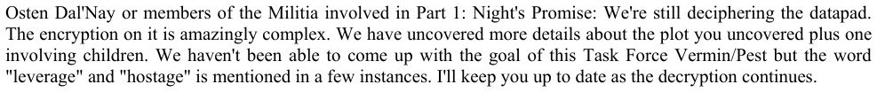
- **No single roster character (rules/setting/general)** — entry/section: Senator Wren's office: "Senator Wren, her husband and all her senior staff are currently out of the system and no return date has been formalized. I will take your message and when the senator and her staff return they will contact you." Source: *315 - Night Eyes - Night's Friend* (SWRPG d20 Revised Core), p.16
  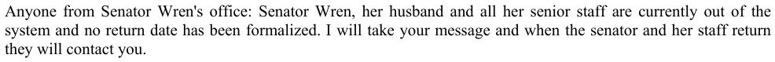

## p.17 (scan page 17)

Page contents: 176 words, 24 paragraphs | headings/entries: GM Aid #2: Warehouse Children; Male Human | Red hair; Female | Human | Pig tails; Male Rodian | Green jacket; Male Human | Thaereian cap; Female | Rodian | Bead necklace; Male Tarasin | Yellowish skin; Male Bothan | Black fur; WI) D] NB] Wir]; Male Human | The "quiet" one; Night's Friend Page 17

## p.18 (scan page 18)

Page contents: 477 words, 20 paragraphs | headings/entries: GM Aid #3: Stat Blocks; Thaereians (low tier):; Skills: Intimidate +3, Profession +2; Skills: Intimidate +3, Profession +2; Encounter 7; Night's Friend Page 18

## p.19 (scan page 19)

Page contents: 506 words, 19 paragraphs | headings/entries: GM Aid #3: Stat Blocks, continued; Skills: Intimidate +4, Profession +3; Skills: Intimidate +4, Profession +3; Encounter 7; Night's Friend Page 19

## p.20 (scan page 20)

Page contents: 497 words, 19 paragraphs | headings/entries: GM Aid #3: Stat Blocks, continued; Skills: Intimidate +6, Profession +5; Skills: Intimidate +6, Profession +5; Encounter 7; Night's Friend Page 20

## p.21 (scan page 21)

Page contents: 380 words, 14 paragraphs | headings/entries: GM Aid #3: Stat Blocks, continued; Lt. Krayle (middle and high tier):; Night's Friend Page 21

- **No single roster character (rules/setting/general)** — entry/section: Lt. Krayle: "Tactics: Krayle is very much the paranoid coward. He will hide behind his men using them as human cover. He will, however, fight while he can because he knows that the Cularins, when they find out what he has done, will not make life at all pleasant." Source: *315 - Night Eyes - Night's Friend* (SWRPG d20 Revised Core), p.21
  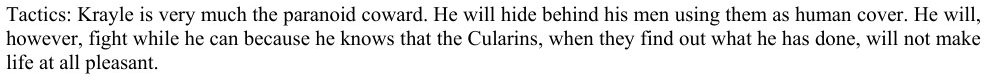

## p.22 (scan page 22)

Page contents: 170 words, 7 paragraphs | headings/entries: GM Aid #4: Vehicle Stat Blocks; Night's Friend Page 22

## p.23 (scan page 23)

Page contents: 94 words, 11 paragraphs | headings/entries: Detention Area; Bunkroom; Ready Room Corridor Corridor; G; Controlled Access; Night's Friend Page 23

## p.24 (scan page 24)

Page contents: 128 words, 11 paragraphs | headings/entries: Critical Event Summary Night's Friend; O Other (please specify); GM Name, RPGA#:; GM Email Address:; Convention Name/Date; Night's Friend Page 24

## p.10–24 (scan page 10)

Page contents: Conclusion; XP; loot; player handouts (maps, vehicle stats); contact information; warehouse children; stats; GM maps; critical event summary (hand-read)

