# Owner Material 037 — Star Wars D20 Drive folder (Core, Revised Core and Saga Edition): Living Force Campaign/Adventures/Among the Stars/Year 3/316 - Night Eyes - Night's Homecoming.pdf [Star Wars Roleplaying Game Revised Core (d20, 2002)]

- **Source:** Wizards of the Coast Star Wars Roleplaying Game books, web enhancements, Living Force campaign modules and articles (2000–2010), from the owner's "Star Wars D20" Drive folder (only the three edition subfolders; "General" was not read, as instructed). Secondary source (licensed Legends reference). Scan OCR'd on the box; the scan stays box-only and is **not** published.
- **Method:** every scanned page was OCR'd and machine-screened sentence by sentence for power-relevant statements (fights, kills, defeats, Force feats, rankings, superweapons) that name a character on our roster; each kept sentence is quoted verbatim from the OCR text and has a crop of the printed passage directly under it. Pages with nothing power-relevant are still listed with what is on them.
- **Citation:** "*316 - Night Eyes - Night's Homecoming* (SWRPG d20 Revised Core), p.X" by printed page ("scan p.X" where no printed number applies). **Weight:** Licensed RPG material: a secondary source. Narrative text sums up Legends lore; game statistics are rules for players, not canon power levels, and rank lowest.

## p.1 (scan page 1)

Page contents: 138 words, 9 paragraphs | headings/entries: LFA316; Night's Homecoming; Edited by Ron Heintz

## p.2 (scan page 2)

Page contents: 880 words, 22 paragraphs | headings/entries: House Rules; Atoning for Dark Side Points; Dissipate Energy; Night's Homecoming; Illusion; Stun; Hero Earnings; Page 2

## p.3 (scan page 3)

Page contents: 889 words, 17 paragraphs | headings/entries: General Notes to the GM; Night's Homecoming; GM Overview; Page 3

- **No single roster character (rules/setting/general)** — entry/section: GM overview: "In the time that Cularin was "removed" from the galaxy, life went on as normal for Senator Wren. She maintained her seat in the Senate as the Jedi investigated the whereabouts of her constituents, and even had a child — a daughter named Night Forael Wren, whose existence she kept almost completely out of the public eye. In the hoopla surrounding the recovery of Cularin from the dark side void into which it had been sucked, someone kidnapped Night, to obtain leverage over Senator Wren. Fearing for the life of her daughter, Senator Wren did nothing, and has been little more than a puppet to the Thaereians — who have her daughter — for over a year." Source: *316 - Night Eyes - Night's Homecoming* (SWRPG d20 Revised Core), p.3
  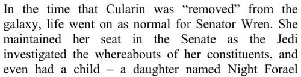

## p.4 (scan page 4)

Page contents: 698 words, 29 paragraphs | headings/entries: Encounter 2: ...And the Pitch; Encounter 6: Run, Run Away; Night's Homecoming; Opening Crawl; Page 4

- **No single roster character (rules/setting/general)** — entry/section: Opening crawl: "It is a time of turmoil in the Cularin system. The citizens of Cularin grow uneasy as the Thaereian forces assume more and more power to handle each new "crisis". As each is revealed as Thaereian manipulation the tension mounts and it seems everyone with access to the holonet has an opinion or a suggestion.
But one voice remains silent—that of Senator Wren.
Now, for the first time since Cularin reemerged from the time vortex that displaced it for a decade, the Senator is returning to her home system." Source: *316 - Night Eyes - Night's Homecoming* (SWRPG d20 Revised Core), p.4
  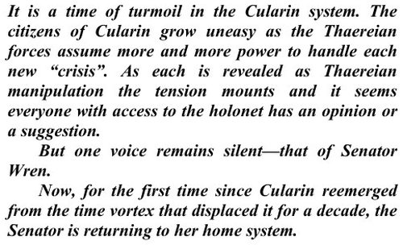

## p.5 (scan page 5)

Page contents: 714 words, 32 paragraphs | headings/entries: Night's Homecoming; Encounter 2: ...And the Pitch; Page 5

- **No single roster character (rules/setting/general)** — entry/section: Thaereian customs: ""Attention. This is the Thaereian Custom Frigate Watcher. Prepare for custom inspection. Have all cargo manifests, passenger manifests and travel documentation ready for inspection."" Source: *316 - Night Eyes - Night's Homecoming* (SWRPG d20 Revised Core), p.5
  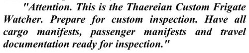
- **No single roster character (rules/setting/general)** — entry/section: Thaereian customs: "(If occupation is Jedi) Right. Jedi. Hmph." Source: *316 - Night Eyes - Night's Homecoming* (SWRPG d20 Revised Core), p.5
  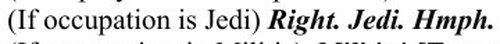

## p.1–5 (scan page 1)

Page contents: Title; house rules; GM overview of Night Forael Wren's kidnapping; timeline; encounter summaries; opening crawl; E1 the Thaereian customs inspection (hand-read)

## p.6 (scan page 6)

Page contents: 912 words, 31 paragraphs | headings/entries: What's her name? Night. Night Forael Wren; Night's Homecoming; Page 6

- **No single roster character (rules/setting/general)** — entry/section: Senator Wren: "The decade has not treated Senator Wren kindly. Lines of stress and exhaustion crease her forehead and eyes. Her hair is already streaking with gray. Only her voice remains the same.
"Thank you, friends. It's been so long since I've seen you although I know it's been only a short time for you. I have a dilemma which I hope that you can help me resolve."" Source: *316 - Night Eyes - Night's Homecoming* (SWRPG d20 Revised Core), p.6
  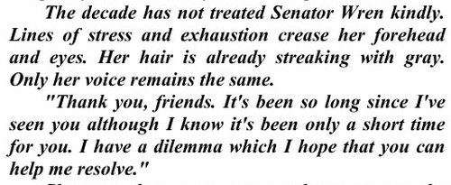
- **No single roster character (rules/setting/general)** — entry/section: Senator Wren: ""It is a long and complicated story but I can summarize it in two sentences. I have a nine-year-old daughter. The Thaereians have held her hostage for nearly a year."" Source: *316 - Night Eyes - Night's Homecoming* (SWRPG d20 Revised Core), p.6
  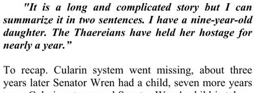
- **No single roster character (rules/setting/general)** — entry/section: Senator Wren: "Do you know where they've got her? Thaere Privo. He taunted me with that... that Night was safe in the military compound.
He? Colonel Rast'Tul. I believe Night is being held at his quarters. [voice grows bitter] His guest." Source: *316 - Night Eyes - Night's Homecoming* (SWRPG d20 Revised Core), p.6
  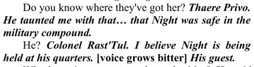
- **No single roster character (rules/setting/general)** — entry/section: Senator Wren: "Why didn't you step aside? Give up your Senate position so that you couldn't aid them? He said if I did he'd kill Night. He preferred a puppet to a new Senator that he couldn't control." Source: *316 - Night Eyes - Night's Homecoming* (SWRPG d20 Revised Core), p.6
  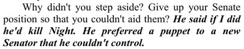
- **No single roster character (rules/setting/general)** — entry/section: Senator Wren: "Are you planning to keep her existence secret when you've got her back? No. This has proven that sometimes the best way to protect something is to shine a bright light on it.
Is there anything you can tell us that would let Night know that you've sent us? Our family password is 'purple bantha'. She had a stuffed one when she was sick with Corellian fever when she was four." Source: *316 - Night Eyes - Night's Homecoming* (SWRPG d20 Revised Core), p.6
  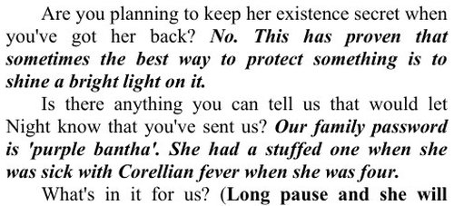

## p.7 (scan page 7)

Page contents: 783 words, 23 paragraphs | headings/entries: Encounter 3: That Pesky Planning Thing; Night's Homecoming; Page 7

- **No single roster character (rules/setting/general)** — entry/section: Senator Wren: ""Please tell her I love her. That morning, we had a silly argument over clearing the breakfast table. I know you'll bring her back to me but if you can tell her that... I've wanted to tell her that for a year."" Source: *316 - Night Eyes - Night's Homecoming* (SWRPG d20 Revised Core), p.7
  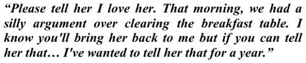
- **No single roster character (rules/setting/general)** — entry/section: Osten Dal'Nay: ""The Senator has told me a bit about what you're planning on doing. My job is to get you to stop thinking like citizens of Cularin and thinking like Thaereians, either citizens or inhabitants. Let's go over the assets we've gathered for you and come up with a plan."" Source: *316 - Night Eyes - Night's Homecoming* (SWRPG d20 Revised Core), p.7
  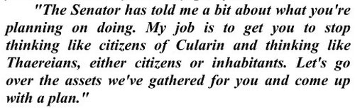

## p.8 (scan page 8)

Page contents: 798 words, 27 paragraphs | headings/entries: What they don't comments); Night's Homecoming; Page 8

## p.9 (scan page 9)

Page contents: 797 words, 27 paragraphs | headings/entries: Night's Homecoming; Convincing or Befriending Their Way In; Page 9

## p.10 (scan page 10)

Page contents: 857 words, 33 paragraphs | headings/entries: Night's Homecoming; Encounter 6: Run, Run Away; Is it fight or flight?; Fight; Flight; Page 10

- **No single roster character (rules/setting/general)** — entry/section: Night: "Uncle Colonel said Mommy and Papa told him to look after me because it was too dangerous for me to live with them for a while. It's been a long time." Source: *316 - Night Eyes - Night's Homecoming* (SWRPG d20 Revised Core), p.10
  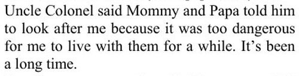
- **No single roster character (rules/setting/general)** — entry/section: Night: "Uncle Colonel lets me play "Starfighter Pilot" all day and eat my desert before lunch. Will mommy let me do that too?" Source: *316 - Night Eyes - Night's Homecoming* (SWRPG d20 Revised Core), p.10
  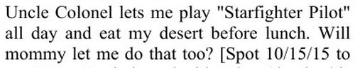
- **No single roster character (rules/setting/general)** — entry/section: Night: "Can I get my treasure box? It's in Unc... Colonel Rast'Tul's office." Source: *316 - Night Eyes - Night's Homecoming* (SWRPG d20 Revised Core), p.10
  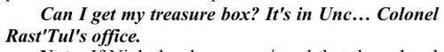

## p.11 (scan page 11)

Page contents: 861 words, 28 paragraphs | headings/entries: Encounter 7: | Have A Ship Waiting!; Night's Homecoming; Conclusion; Page 11

- **No single roster character (rules/setting/general)** — entry/section: Colonel Rast'Tul: ""Attention Cularins. I know you have my little girl and I can't risk her safety, so I am calling off the ships.
"Night, I'll be here for you. Know that you'll always be welcome home, here, with me."" Source: *316 - Night Eyes - Night's Homecoming* (SWRPG d20 Revised Core), p.11
  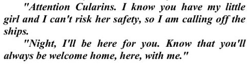

## p.6–11 (scan page 6)

Page contents: E2 Senator Wren's plea; E3 Osten Dal'Nay's cover packages; E4 the trip to Thaere Privo; E5 Night and Nannat in Rast'Tul's house; E6 the RRT; E7 the escape (hand-read)

## p.12 (scan page 12)

Page contents: 701 words, 33 paragraphs | headings/entries: Here Ends Night's Homecoming; Experience Point Summary; Night's Homecoming; Adventure Experience Award:; Loot Summary; Page 12

- **No single roster character (rules/setting/general)** — entry/section: Night: ""This is all I want. The rest is for you. I stole it. He deserved it."" Source: *316 - Night Eyes - Night's Homecoming* (SWRPG d20 Revised Core), p.12
  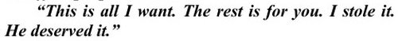
- **No single roster character (rules/setting/general)** — entry/section: Night: ""Papa! Mommy!"" Source: *316 - Night Eyes - Night's Homecoming* (SWRPG d20 Revised Core), p.12
  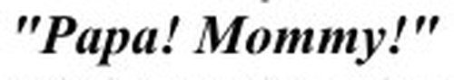
- **No single roster character (rules/setting/general)** — entry/section: Senator Wren: ""People of Cularin. When Thaere was entrusted with the responsibility of protecting the sovereignty of Cularin space we agreed to give them compensation. But it is not fair compensation when they build facilities without our knowledge, mine resources beyond what the treaty provides for. When they take and murder our citizens, steal our children.
"But no more. Cularin serves notice to Thaere that their services are no longer required. The Cularin Militia will protect the Cularin system from all who threaten it. Even from Thaere."
...
"Especially from Thaere."" Source: *316 - Night Eyes - Night's Homecoming* (SWRPG d20 Revised Core), p.12
  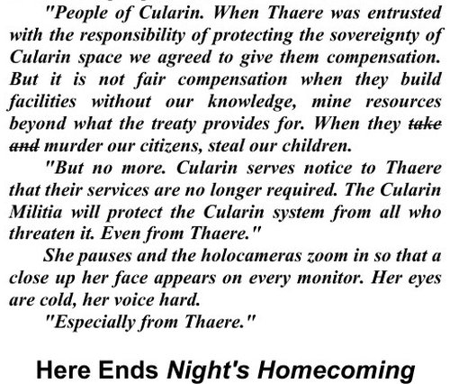

## p.13 (scan page 13)

Page contents: 184 words, 7 paragraphs | headings/entries: Night's Homecoming; Page 13

## p.14 (scan page 14)

Page contents: 378 words, 14 paragraphs | headings/entries: Player Handout 1a: The Ship; Player Handout 1b: The Rentals; Description:; Night's Homecoming Page 14

## p.15 (scan page 15)

Page contents: 18 words, 4 paragraphs | headings/entries: Night's Homecoming Page 15

## p.16 (scan page 16)

Page contents: 525 words, 21 paragraphs | headings/entries: GM Aid #1: Combat Statistics; Rapid Response Team (Encounter 5 or 6); VEHICLE STATS, ALL TIERS; Night's Homecoming Page 16

## p.17 (scan page 17)

Page contents: 505 words, 39 paragraphs | headings/entries: Thaere Privo System Defense Fighters (Encounter 7); LOWER TIER; MEDIUM TIER; HIGH TIER; HERO'S SHIP FOR REFERENCE, ALL TIERS; Night's Homecoming Page 17

## p.18 (scan page 18)

Page contents: 69 words, 15 paragraphs | headings/entries: A = alarm button; X = RRT vehicle parks here; Night's Homecoming Page 18

## p.19 (scan page 19)

Page contents: 387 words, 13 paragraphs | headings/entries: Night; Night's Homecoming Page 19

- **No single roster character (rules/setting/general)** — entry/section: Night: "Night was only 7 years old when taken from her mother and father. As fate would have it the kidnapping occurred immediately after Night and her mother had argued and soon after Cularin's return. Colonel Rast'Tul, aware of the argument via paid informants, has used that argument, as well as the sudden increase in the Senator's workload. He arranged an attack on the vehicle carrying Night to school and, while his men dealt with Night's bodyguards, arrived to "save" her. Night is unaware that he had anything to do with the attack." Source: *316 - Night Eyes - Night's Homecoming* (SWRPG d20 Revised Core), p.19
  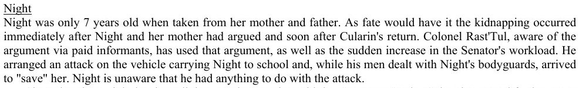
- **No single roster character (rules/setting/general)** — entry/section: Night: "Feats: none. No, she's not Force Sensitive." Source: *316 - Night Eyes - Night's Homecoming* (SWRPG d20 Revised Core), p.19
  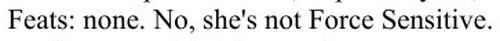

## p.20 (scan page 20)

Page contents: 331 words, 11 paragraphs | headings/entries: Feats: none; Colonel Rast'Tul; Night's Homecoming Page 20

- **No single roster character (rules/setting/general)** — entry/section: Nannat: "Nannat is the daughter of two Thaereian soldiers killed in action. She is 16. She is now a ward of the military and earns her keep babysitting for other officers until she is old enough to join the military. She doesn't particularly like Colonel Rast'Tul but she is a military brat and gives him all the respect his rank demands." Source: *316 - Night Eyes - Night's Homecoming* (SWRPG d20 Revised Core), p.20
  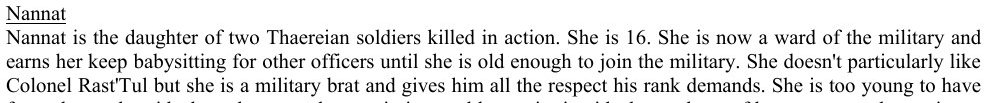
- **No single roster character (rules/setting/general)** — entry/section: Colonel Rast'Tul: "Rast'Tul is a conniving, manipulative and greedy person who is only looking out for Rast'Tul. Anything he does to further the careers of his protégés or the Thaereian cause is actually done as a side effect of securing more power for himself. He has absolutely no emotional attachment to Night, although he will always give every indication, to Night and the heroes, that he has her best interests at heart. She is, first and always, a bargaining chip and if he cannot control Night directly he will keep whatever control he can over her." Source: *316 - Night Eyes - Night's Homecoming* (SWRPG d20 Revised Core), p.20
  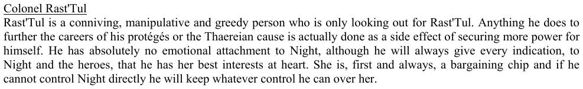

## p.21 (scan page 21)

Page contents: 511 words, 19 paragraphs | headings/entries: GM Aid #4: Fast Forward; Night's Homecoming Page 21

## p.22 (scan page 22)

Page contents: 100 words, 10 paragraphs | headings/entries: Critical Event Summary Night's Homecoming; Character Name Player Name RPGA #; GM Name, RPGA#:; GM Email Address:; Convention Name/Date; Night's Homecoming Page 22

## p.11–22 (scan page 11)

Page contents: Conclusion and Senator Wren's speech; XP; loot certs; ship and rental stats; maps; combat stats; character profiles; fast-forward texts; critical event summary (hand-read)

