# Owner Material 037 — Star Wars D20 Drive folder (Core, Revised Core and Saga Edition): Living Force Campaign/Adventures/Among the Stars/Year 3/317 - Dorumaa's Children.pdf [Star Wars Roleplaying Game Revised Core (d20, 2002)]

- **Source:** Wizards of the Coast Star Wars Roleplaying Game books, web enhancements, Living Force campaign modules and articles (2000–2010), from the owner's "Star Wars D20" Drive folder (only the three edition subfolders; "General" was not read, as instructed). Secondary source (licensed Legends reference). Scan OCR'd on the box; the scan stays box-only and is **not** published.
- **Method:** every scanned page was OCR'd and machine-screened sentence by sentence for power-relevant statements (fights, kills, defeats, Force feats, rankings, superweapons) that name a character on our roster; each kept sentence is quoted verbatim from the OCR text and has a crop of the printed passage directly under it. Pages with nothing power-relevant are still listed with what is on them.
- **Citation:** "*317 - Dorumaa's Children* (SWRPG d20 Revised Core), p.X" by printed page ("scan p.X" where no printed number applies). **Weight:** Licensed RPG material: a secondary source. Narrative text sums up Legends lore; game statistics are rules for players, not canon power levels, and rank lowest.

## p.1 (scan page 1)

Page contents: 137 words, 7 paragraphs | headings/entries: LFA317; Dorumaa's Children; A One-Round LIVING FORCE Tournament; Edited by Ron Heintz and Jae Walker

## p.2 (scan page 2)

Page contents: 846 words, 21 paragraphs | headings/entries: House Rules; Atoning for Dark Side Points; Dissipate Energy; Dorumaa's Children; Illusion; Stun; Hero Earnings; Page 2

## p.3 (scan page 3)

Page contents: 892 words, 18 paragraphs | headings/entries: Dorumaa's Children; GM Overview; Page 3

- **No single roster character (rules/setting/general)** — entry/section: GM overview: "For some, this level of interest always converts to credit chips, and Rufus Trammel is such a person. Trammel is a poacher, a crime lord or, in his own words, an "acquirer of exotic biologics". Now, he has found a buyer for a Leviathan, for a price more than worth the effort, and he has gathered the resources and personnel for an ambitious snatch.
Unfortunately for Trammel, the heroes of Cularin are on hand to throw a hydro-spanner in the works." Source: *317 - Dorumaa's Children* (SWRPG d20 Revised Core), p.3
  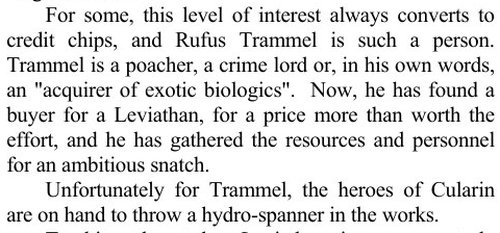

## p.4 (scan page 4)

Page contents: 756 words, 30 paragraphs | headings/entries: Encounter 1: That Sinking Feeling; Encounter 3: The isle of Rufus Trammel; Encounter 4: In the Interests of Science; Encounter 5: A Difference of Opinion; Encounter 6: The Crystal Wasters; Dorumaa's Children; Encounter 7: Fish and Ships; Opening Crawl; Encounter 1: That Sinking Feeling; Page 4

- **No single roster character (rules/setting/general)** — entry/section: Opening crawl: "A thing of wonder and beauty is a thing of value. Some see value in terms of knowledge and understanding; some see value simply in experiencing that wonder. But even the pleasant resort moon of Dorumaa has its share of people who can only see value in terms of credits..." Source: *317 - Dorumaa's Children* (SWRPG d20 Revised Core), p.4
  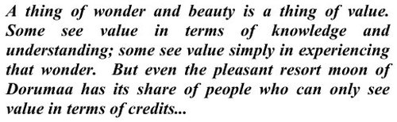

## p.5 (scan page 5)

Page contents: 882 words, 25 paragraphs | headings/entries: Read or paraphrase:; I thought the Leviathans were called <flerg>?; Dorumaa's Children; Page 5

- **No single roster character (rules/setting/general)** — entry/section: Solwyn: ""Beautiful, isn't she?" asks Solwyn. From his tone it sounds like the research student is delighted to be your pilot and guide for this little excursion. "I never get tired of watching them," he adds in a hushed voice, "although it is a shame Titon is not about at the moment. The pair of them together is even more impressive."" Source: *317 - Dorumaa's Children* (SWRPG d20 Revised Core), p.5
  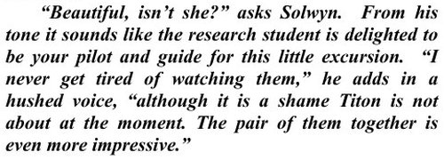
- **No single roster character (rules/setting/general)** — entry/section: Solwyn: "What do they eat? (Solwyn laughs) Whatever they want! Seriously, mostly smaller fish and crustaceans." Source: *317 - Dorumaa's Children* (SWRPG d20 Revised Core), p.5
  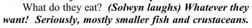
- **No single roster character (rules/setting/general)** — entry/section: Solwyn: "Is she intelligent? Yes, we think so. It is difficult to be entirely sure, but my professors certainly think she's more intelligent than your average research student. (Solwyn rolls his eyes)" Source: *317 - Dorumaa's Children* (SWRPG d20 Revised Core), p.5
  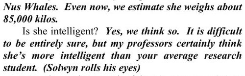

## p.6 (scan page 6)

Page contents: 914 words, 35 paragraphs | headings/entries: Fixing the hull breach; Dorumaa's Children; Checking out Solwyn; Monitoring the Leviathans/Sending a distress call; Going through the equipment lockers; Page 6

## p.7 (scan page 7)

Page contents: 757 words, 35 paragraphs | headings/entries: If all else fails; Dorumaa's Children; Information outside; DC Information Gathered; Using the Track feat; Page 7

## p.1–7 (scan page 1)

Page contents: Title; house rules; GM overview of the Leviathan calves and Rufus Trammel; encounter summaries; opening crawl; E1 the grounding of the Scientific Method (hand-read)

## p.8 (scan page 8)

Page contents: 830 words, 27 paragraphs | headings/entries: DC | Information Gathered; Titon's arrival; Encounter 3: The Isle of Rufus Trammel; Dorumaa's Children; Page 8

## p.9 (scan page 9)

Page contents: 824 words, 27 paragraphs | headings/entries: If it all goes horribly wrong; Dorumaa's Children; Encounter 4: In the Interests of Science; Page 9

- **No single roster character (rules/setting/general)** — entry/section: Trammel's poachers: ""Rufus is up at his meeting," says one of the poachers, nodding to the ship that sits at the center of the island "I wouldn't bother him with that just now. I wouldn't bother him till we've got that whale gone."
"Ttsa big old fish, how yousa t'ink da boss gonna move it?"" Source: *317 - Dorumaa's Children* (SWRPG d20 Revised Core), p.9
  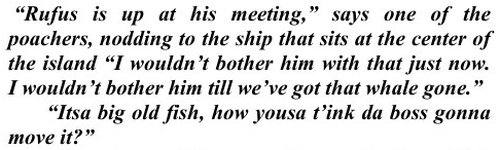
- **No single roster character (rules/setting/general)** — entry/section: Captain Parx: ""Denal? Where is Denal? If he's off playing surfer with those Crystal Wasters again, I will personally cut him in half. Miliac, you take that group instead. And please shoot Denal next time you see him." Source: *317 - Dorumaa's Children* (SWRPG d20 Revised Core), p.9
  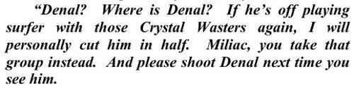

## p.10 (scan page 10)

Page contents: 866 words, 31 paragraphs | headings/entries: Dorumaa's Children; Encounter 5: A Difference of Opinion; Talking to the Professor; Page 10

- **No single roster character (rules/setting/general)** — entry/section: Rufus Trammel: "The slight man at the back smiles broadly at the group. "Remember," he says "if this goes without a hitch tonight, you will all be seeing bonuses you've never dreamed of. I'm sure you will do me proud." He paces towards the captive Kel Dor.
"But it is very important that the Leviathan survives the trip. That is certainly one hitch I can do without. I'm sure you agree professor?"" Source: *317 - Dorumaa's Children* (SWRPG d20 Revised Core), p.10
  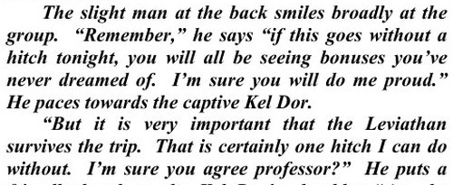
- **No single roster character (rules/setting/general)** — entry/section: Professor Rahring: "Why did they have you prisoner? I am the greatest authority on the Leviathans. When that Trammel person decided to steal one alive, he knew he would need me to vet the arrangements. I would be flattered if I wasn't so furious." Source: *317 - Dorumaa's Children* (SWRPG d20 Revised Core), p.10
  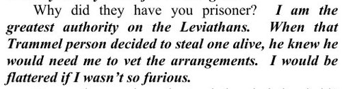

## p.11 (scan page 11)

Page contents: 835 words, 34 paragraphs | headings/entries: Talking to Solwyn; Great. (Solwyn smiles wanly); Dorumaa's Children; Encounter 6: The Crystal Wasters; Page 11

- **No single roster character (rules/setting/general)** — entry/section: Solwyn: "How good? Er ... pretty good, I'd say. Um. Fairly. Better than average, anyway." Source: *317 - Dorumaa's Children* (SWRPG d20 Revised Core), p.11
  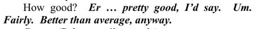
- **No single roster character (rules/setting/general)** — entry/section: Ko-oda: ""It's a sad tale and we want to help, but we have to see both sides here. Danel is one of us, though not for much longer if what you say is true.
"I know where Danel goes, and that is more than likely where the Leviathan is being kept. I can tell you where that is."
...
"I can't just give up one of our own, but if you were one of us, it would be different. Then we would be keeping it in the family."
He smiles at his own solution. "Yes, bring up the spare boards, let's see who among our new friends is fit to join the Wasters!"" Source: *317 - Dorumaa's Children* (SWRPG d20 Revised Core), p.11
  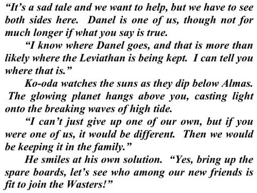

## p.12 (scan page 12)

Page contents: 871 words, 29 paragraphs | headings/entries: Dorumaa's Children; Encounter 7: Fish and Ships; Approaching the Island; Page 12

## p.13 (scan page 13)

Page contents: 939 words, 26 paragraphs | headings/entries: Preventing the loading; Dorumaa's Children; Page 13

- **No single roster character (rules/setting/general)** — entry/section: Captain Parx: "Captain Parx has apparently seen far too many holo-vids about pirates, because he plays the role to the hilt. He blusters, shoots at the person who seems to be the largest threat, taunts the Jedi (if there are any) to come up and fight him "man to man". In melee he uses his vibroblade to good effect." Source: *317 - Dorumaa's Children* (SWRPG d20 Revised Core), p.13
  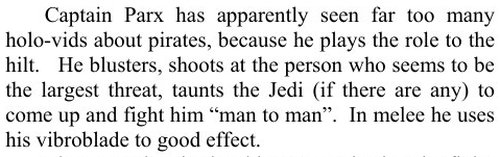

## p.14 (scan page 14)

Page contents: 732 words, 31 paragraphs | headings/entries: Tier 3 (levels 7-9); Conclusion; Dorumaa's Children; Here Ends Dorumaa's Children; Experience Point Summary; Adventure Experience Award:; Page 14

## p.7–14 (scan page 7)

Page contents: E2 the missing Leviathan; E3 Trammel's floating island; E4 Parx's meeting and Rahring's rescue; E5 Rahring and Solwyn; E6 the Crystal Wasters; E7 the cave and the winch; conclusion; XP (hand-read)

## p.15 (scan page 15)

Page contents: 292 words, 28 paragraphs | headings/entries: Loot Summary; Encounter 6; Mastercraft Surfboard; Encounter 7; All Tiers:; Heavy Blaster Pistol; Tier 2; Mastercraft (+1) Blaster Carbine; Tier 3; Mastercraft (+1) Blaster Rifle; Conclusion; Dorumaa's Children; Page 15

## p.16 (scan page 16)

Page contents: 946 words, 13 paragraphs | headings/entries: Dorumaa's Children Page 16

## p.17 (scan page 17)

Page contents: 391 words, 7 paragraphs | headings/entries: Player Handout 2 — Rufus Trammel; Dorumaa's Children Page 17

- **No single roster character (rules/setting/general)** — entry/section: Rufus Trammel: "Trammel is a skinny Human with sandy hair that exists primarily around the fringes of his head. He looks small and frail, but he possesses a friendly, ready smile and a warm handshake that he always holds a half-second longer than is comfortable." Source: *317 - Dorumaa's Children* (SWRPG d20 Revised Core), p.17
  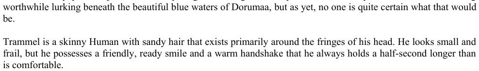

## p.18 (scan page 18)

Page contents: 22 words, 3 paragraphs | headings/entries: Dorumaa's Children Page 18

## p.19 (scan page 19)

Page contents: 751 words, 34 paragraphs | headings/entries: GM Aid #1: NPC Statistics; Encounter 3 & 4; Equipment: Blaster pistol, Baton; Skills: Intimidate +3, Listen +0, Spot +0; Equipment: Blaster pistol, Baton; Skills: Intimidate +5, Listen +2, Spot +2; Dorumaa's Children; Encounter 7: Fish and Ships; Low Tier (average Hero level 1-3); Page 19

## p.20 (scan page 20)

Page contents: 735 words, 32 paragraphs | headings/entries: Skills: Intimidate +3; Equipment: Blaster pistol, Baton (club); Skills: Intimidate +3; Equipment: Heavy Blaster pistol, vibroblade, combat gloves; Equipment: Blaster pistol, Baton (club); Skills: Intimidate +3; Equipment: Mastercraft (+1) Blaster carbine, Baton (club); Equipment: Heavy blaster pistol, vibroblade,; Dorumaa's Children; Upper Tier (average Hero level 7-9); Equipment: Blaster pistol, Baton (club); Skills: Intimidate +3; Equipment: Mastercraft (+1) Blaster rifle, Baton (club); Equipment: Heavy blaster pistol, vibroblade, combat gloves; Page 20

## p.21 (scan page 21)

Page contents: 88 words, 10 paragraphs | headings/entries: GM Aid #2: Map of the Cave; Notes on this map:; X = Guards P = Parx; Dorumaa's Children; BEES SEES EE &; Page 21

## p.22 (scan page 22)

Page contents: 111 words, 14 paragraphs | headings/entries: Critical Event Summary Dorumaa's Children; Other (please specify); GM Name, RPGA#:; GM Email Address:; Convention Name/Date; Convention Coordinator:; Dorumaa's Children; Page 22

## p.15–22 (scan page 15)

Page contents: Loot; documentary excerpt; Trammel handout; cave map; NPC stats; GM cave map; critical event summary (hand-read)

