# Owner Material 037 — Star Wars D20 Drive folder (Core, Revised Core and Saga Edition): Living Force Campaign/Adventures/Among the Stars/Year 3/318 - At Your Service.pdf [Star Wars Roleplaying Game Revised Core (d20, 2002)]

- **Source:** Wizards of the Coast Star Wars Roleplaying Game books, web enhancements, Living Force campaign modules and articles (2000–2010), from the owner's "Star Wars D20" Drive folder (only the three edition subfolders; "General" was not read, as instructed). Secondary source (licensed Legends reference). Scan OCR'd on the box; the scan stays box-only and is **not** published.
- **Method:** every scanned page was OCR'd and machine-screened sentence by sentence for power-relevant statements (fights, kills, defeats, Force feats, rankings, superweapons) that name a character on our roster; each kept sentence is quoted verbatim from the OCR text and has a crop of the printed passage directly under it. Pages with nothing power-relevant are still listed with what is on them.
- **Citation:** "*318 - At Your Service* (SWRPG d20 Revised Core), p.X" by printed page ("scan p.X" where no printed number applies). **Weight:** Licensed RPG material: a secondary source. Narrative text sums up Legends lore; game statistics are rules for players, not canon power levels, and rank lowest.

## p.1 (scan page 1)

Page contents: 111 words, 7 paragraphs | headings/entries: LFA318; At Your Service; A One-Round LIVING FORCE Tournament; Edited by Margaret Heintz and Jae Walker

## p.2 (scan page 2)

Page contents: 848 words, 21 paragraphs | headings/entries: House Rules; Atoning for Dark Side Points; Dissipate Energy; At Your Service; Illusion; Stun; Hero Earnings; Page 2

## p.3 (scan page 3)

Page contents: 876 words, 18 paragraphs | headings/entries: At Your Service; GM Overview; Page 3

## p.4 (scan page 4)

Page contents: 808 words, 28 paragraphs | headings/entries: Encounter 1: Mayday!; At Your Service; Encounter 4: These Aren't The Wookiees; Day (and Not Go Splat); Encounter 7: Whom Can You Trust?; Page 4

## p.5 (scan page 5)

Page contents: 909 words, 20 paragraphs | headings/entries: Opening Crawl; Encounter 1: Mayday!; At Your Service; Page 5

- **No single roster character (rules/setting/general)** — entry/section: Opening crawl: "Sinister forces are working towards the destruction of all that the heroes of the Cularin system hold dear. As tensions between Cularin and Thaere build, and as anti-Jedi organizations are discovered to be plotting, many of the citizens of Cularin are thinking that it is time to strike back. In this time of turmoil, there are many heroic beings who have helped foil plots and avert tragedies large and small.
Now it is time to see just how huge a menace these heroes can truly take on..." Source: *318 - At Your Service* (SWRPG d20 Revised Core), p.5
  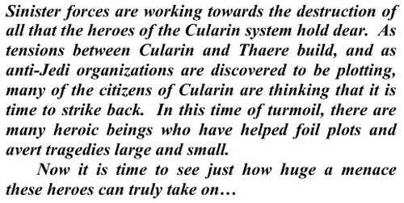

## p.1–5 (scan page 1)

Page contents: Title; house rules; GM overview of the frame-up of Master Lanius; encounter summaries; Seeker and Enja Ode; opening crawl (hand-read)

## p.6 (scan page 6)

Page contents: 977 words, 21 paragraphs | headings/entries: At Your Service; Page 6

- **No single roster character (rules/setting/general)** — entry/section: Jyn N'oram: "It would be better if you abandoned ship and we got you to safety. Not unless there's no other way. This is our livelihood; we're contractors for Hedrett Shipping and Investments, but it's our ship. Will you help us try to save her?" Source: *318 - At Your Service* (SWRPG d20 Revised Core), p.6
  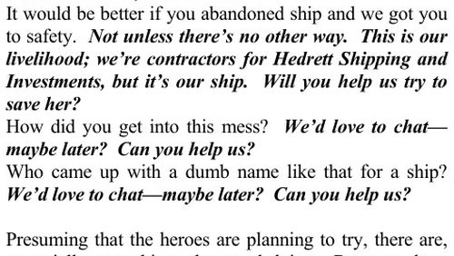
- **No single roster character (rules/setting/general)** — entry/section: Jyn N'oram: "Who came up with a dumb name like that for a ship? We'd love to chat—maybe later? Can you help us?" Source: *318 - At Your Service* (SWRPG d20 Revised Core), p.6
  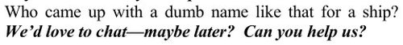

## p.7 (scan page 7)

Page contents: 927 words, 23 paragraphs | headings/entries: At Your Service; Page 7

## p.8 (scan page 8)

Page contents: 838 words, 24 paragraphs | headings/entries: At Your Service; Page 8

## p.9 (scan page 9)

Page contents: 830 words, 23 paragraphs | headings/entries: At Your Service; DC 10/15; Information Gathered; Page 9

## p.10 (scan page 10)

Page contents: 844 words, 24 paragraphs | headings/entries: At Your Service; Here are our credentials. examine them?; Why would I wish to; Page 10

- **No single roster character (rules/setting/general)** — entry/section: Comet Broom reception droid: "The receptionist is a droid—well, the torso of a droid, anyway. It seems to be plugged right into its "chair". It turns its head towards you and grates out, in a businesslike tone, "Welcome to Comet Broom. How may I be of service?"" Source: *318 - At Your Service* (SWRPG d20 Revised Core), p.10
  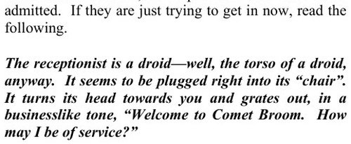

## p.11 (scan page 11)

Page contents: 755 words, 20 paragraphs | headings/entries: At Your Service; Page 11

- **No single roster character (rules/setting/general)** — entry/section: Rroorgli: "I tell, you, we sent the data. We have copies. (Rroorgli)" Source: *318 - At Your Service* (SWRPG d20 Revised Core), p.11
  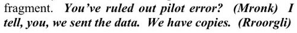
- **No single roster character (rules/setting/general)** — entry/section: Rroorgli: "Not bad for Wookiees, eh? Uhrm—sorry. I get a little tense when I think people are out to place blame. How can we clear this up? (Rroogli)" Source: *318 - At Your Service* (SWRPG d20 Revised Core), p.11
  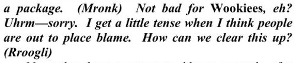

## p.12 (scan page 12)

Page contents: 838 words, 23 paragraphs | headings/entries: At Your Service; She says:; Page 12

- **No single roster character (rules/setting/general)** — entry/section: Comet Busters spokeswoman: ""Those people, you know, they're pretty much interested in the fast datary, and that's about it. I've heard a bit about you people—you're really into public service. Look, we could do each other a favor, here. How about you let us make a quick copy of the data we know they gave you, and in return we give you 500 credits each for your favorite charity—or some other... good cause?"" Source: *318 - At Your Service* (SWRPG d20 Revised Core), p.12
  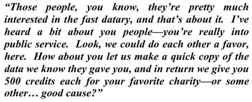
- **No single roster character (rules/setting/general)** — entry/section: Dark side echo: "You suddenly feel a chill go down your spine, and a mixture of rage, fear and malevolence splashes over you and is quickly gone. Was it from these people? No, you are pretty sure it was not. But there is a great evil somewhere near." Source: *318 - At Your Service* (SWRPG d20 Revised Core), p.12
  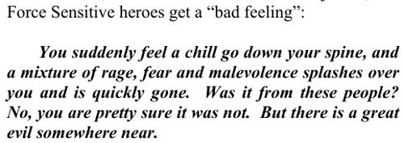

## p.13 (scan page 13)

Page contents: 822 words, 26 paragraphs | headings/entries: At Your Service; Page 13

- **No single roster character (rules/setting/general)** — entry/section: Comet Broom murders: "And the Wookiees—the Wookiees have obviously been murdered. They lie still on the floor with terrible burn scars and hack marks on their bodies. Each has precisely two wounds, almost an identical pair: a long gash from shoulder to opposite hip, followed by a circular puncture hole straight back through the chest, through the heart." Source: *318 - At Your Service* (SWRPG d20 Revised Core), p.13
  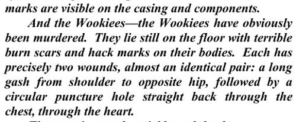

## p.5–13 (scan page 5)

Page contents: E1 rescuing the Fricasseed Nerf; E2 Artom Station and the Comet Broom Wookiees; E3 the Comet Busters hirelings and Hedrett's reply (hand-read)

## p.14 (scan page 14)

Page contents: 845 words, 23 paragraphs | headings/entries: We're technically; At Your Service; DC Information Gathered; Page 14

## p.15 (scan page 15)

Page contents: 858 words, 25 paragraphs | headings/entries: Time DC | Information Gathered; The perpetrator was either Human or Near-Human; At Your Service; Page 15

## p.16 (scan page 16)

Page contents: 850 words, 26 paragraphs | headings/entries: Information Gathered; It looks like the slicer accidentally; At Your Service; Page 16

## p.17 (scan page 17)

Page contents: 941 words, 18 paragraphs | headings/entries: At Your Service; Page 17

- **No single roster character (rules/setting/general)** — entry/section: Cometary Water Reclamation Project: "The annotation says that it was to be "a surprise gift from the Jedi to the Cularin system, and to Almas specifically".
According to all records, here and elsewhere, Master Lanius Qel-Bertok, of the Almas Jedi Academy, commissioned the Cometary Water Reclamation Project." Source: *318 - At Your Service* (SWRPG d20 Revised Core), p.17
  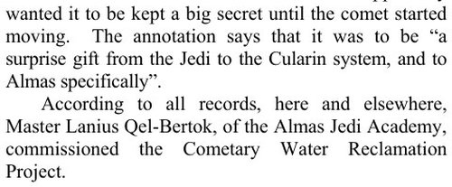

## p.18 (scan page 18)

Page contents: 957 words, 21 paragraphs | headings/entries: At Your Service; Page 18

## p.19 (scan page 19)

Page contents: 821 words, 27 paragraphs | headings/entries: Once they are in, read the following:; At Your Service; Page 19

- **No single roster character (rules/setting/general)** — entry/section: Comet control computer: ""Accepted, Enlightened One."" Source: *318 - At Your Service* (SWRPG d20 Revised Core), p.19
  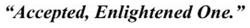
- **No single roster character (rules/setting/general)** — entry/section: Comet control computer: ""Acknowledged, Master Lanius. Please enter your personal Alpha Prime Security code."" Source: *318 - At Your Service* (SWRPG d20 Revised Core), p.19
  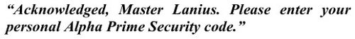

## p.20 (scan page 20)

Page contents: 838 words, 24 paragraphs | headings/entries: Information Gathered; At Your Service; Page 20

## p.21 (scan page 21)

Page contents: 774 words, 23 paragraphs | headings/entries: Encounter 7: Whom Can You Trust?; At Your Service; Page 21

- **No single roster character (rules/setting/general)** — entry/section: Ul-Modo: ""We are all extremely grateful for what you have already done. There still remain many unanswered questions, of course. What information have you collected, and what in your opinion was actually going on?"
...
"In your considered opinions—who is responsible for this near-atrocity?"" Source: *318 - At Your Service* (SWRPG d20 Revised Core), p.21
  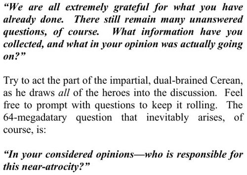

## p.13–21 (scan page 13)

Page contents: E4 the murdered Wookiees and slicing the core; E5 the hazard run and laser emplacements on the Big One; E6 the control centre and the second slicing table (hand-read)

## p.22 (scan page 22)

Page contents: 655 words, 30 paragraphs | headings/entries: Conclusion; Who, indeed?; Here Ends, "At Your Service"; Experience Point Summary; At Your Service; Adventure Experience Award:; Loot Summary; Encounter 1; Encounter 2; Page 22

- **No single roster character (rules/setting/general)** — entry/section: E1-6RA: ""Master Lanius and every Jedi, ultimately, are on a quest for truth, He would certainly not wish anything suppressed. However, I will, with the permission of this council, take copies of the information to him, so that he may prepare an answer."" Source: *318 - At Your Service* (SWRPG d20 Revised Core), p.22
  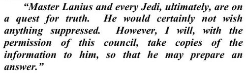
- **No single roster character (rules/setting/general)** — entry/section: Ul-Modo: ""Well, this is quite a mystery. We will analyze all of the data that you have obtained, and see what may be seen. Once again, thank you so much for your heroic efforts. We cannot jump to conclusions, but the evidence that you have provided certainly does seem to point to some powerful person or group, rich and ruthless, with a consuming hatred for the Jedi. Whoever or whatever the agent of this calamity was, the being seemed to be able to deceive the unfortunate managers of Comet Broom into believing that he was a Jedi, and a very well-known one.
"It may be a member of one of the two anti-Jedi groups that have come to our attention, and that of Master Lanius. Still, this complex and expensive plan, and the extraordinary talents of the murderer and go-between, suggest that this plot may have originated outside the Cularin system: one would think such a menace would be known to the Jedi, if he was a local. But who, outside Cularin system, could have such a hatred of the Jedi as to want to blacken their name throughout our entire system?"" Source: *318 - At Your Service* (SWRPG d20 Revised Core), p.22
  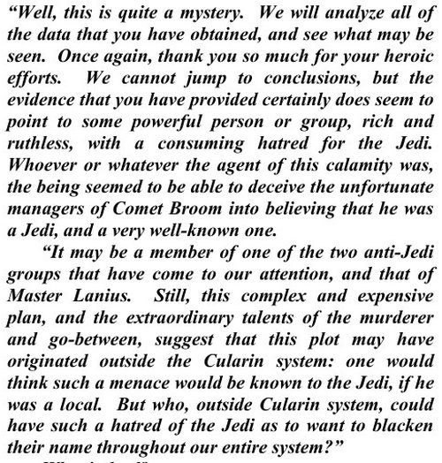

## p.23 (scan page 23)

Page contents: 261 words, 13 paragraphs | headings/entries: Conclusion; Restricted Item Permit; Mastercraft +1 Security kit; Two only, provided by Karrel Engineering:; Mastercraft (+2) Tool Kit:; At Your Service; Page 23

- **No single roster character (rules/setting/general)** — entry/section: Dingraz Fabrication: ""If anyone can be trusted with one of these things, it's you folks. Thanks for saving a lot of lives."" Source: *318 - At Your Service* (SWRPG d20 Revised Core), p.23
  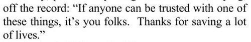

## p.24 (scan page 24)

Page contents: 156 words, 17 paragraphs | headings/entries: Class: Space Transport; Size: Small (26.7 meters); Hyperdrive: x2, x12 backup; Passengers: 6; Cargo Capacity: 100 metric tons; Consumables: 2 months; Cost: 150,000 (new), 37,500 (used); Crew: 1| or 2; Initiative: +1 size, plus crew mod; Shield Points: 30 (DR 5) (A modification); Hull Points: 120 (DR 10); At Your Service Page 24

## p.25 (scan page 25)

Page contents: 703 words, 30 paragraphs | headings/entries: GM Aid #1: NPC Statistics; Encounter 1: Mayday!; Low Tier; Middle Tier; At Your Service; Equipment: Blaster pistol, stun baton; Skills: Intimidate +3; Page 25

## p.26 (scan page 26)

Page contents: 571 words, 19 paragraphs | headings/entries: Equipment: Blaster pistol, stun baton; Skills: Intimidate +5; Skills: Intimidate +5, Jump +4; Encounter 7; Feats: Cautious, Great Fortitude, Lightning Reflexes, Sharp-eyed; At Your Service; Page 26

- **No single roster character (rules/setting/general)** — entry/section: E1-6RA: "Something of an all-purpose droid, E1 is prepared for anything and always willing to do Lanius's bidding. Using her heuristic processor, she learns which new skill smay be required and programs herself to handle whatever situation may come up at the academy. Stuffy but not prissy, she expresses herself with stiff speech patterns and convoluted sentences. Working with the Jedi has been the best service she remembers. She is utterly devoted to serving Lanius and the academy." Source: *318 - At Your Service* (SWRPG d20 Revised Core), p.26
  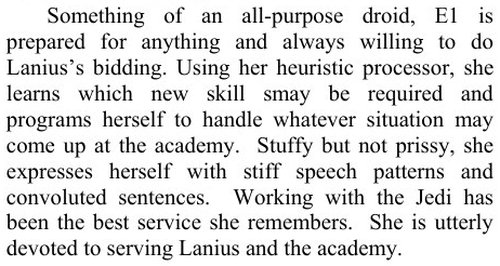
- **No single roster character (rules/setting/general)** — entry/section: E1-6RA: "Lanius calls her Era, but students must refer to her as E1-6 or EeOne." Source: *318 - At Your Service* (SWRPG d20 Revised Core), p.26
  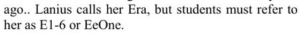

## p.27 (scan page 27)

Page contents: 819 words, 11 paragraphs | headings/entries: GM Aid #2: What's Really Going On?; At Your Service Page 27

## p.28 (scan page 28)

Page contents: 335 words, 20 paragraphs | headings/entries: GM Aid #3 — Table of Hazards; Hazard/Pilot DC |; Success; At Your Service; Page 28

- **No single roster character (rules/setting/general)** — entry/section: GM Aid 3 hazards: "Despite your best efforts, the spine of rock smashes into you. Fortunately, it was a rather small finger of doom—perhaps a pinky of doom? (2d10/x2 damage.)" Source: *318 - At Your Service* (SWRPG d20 Revised Core), p.28
  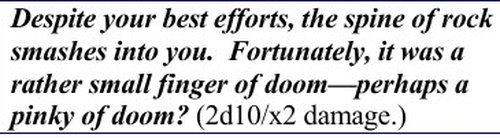

## p.29 (scan page 29)

Page contents: 388 words, 43 paragraphs | headings/entries: Class: Space Transport; Size: Small (26.7 meters); Hyperdrive: x2, x12 backup; Passengers: 6; Cargo Capacity: 100 metric tons; Consumables: 2 months; Cost: 150,000 (new), 37,500 (used); Crew: | or 2; Initiative: +1 size, plus crew mod; Defense: 21 (+1 size, +10 armor); Shield Points: 30 (DR 5) (A modification); Hull Points: 120 (DR 10); Maximum Speed in Space: Attack (8 squares/action); Atmospheric Speed: 800 km/h (13 squares/action); Class: Space Transport; Size: Small (26.7 meters); Hyperdrive: x2, x12 backup; Passengers: 6; Consumables: 1.5 months; Cost: 200,000 (new), 50,000 (used); Crew: | or 2; Initiative: +1 size, plus crew mod; Defense: 22 (+1 size, +12 modified armor); Shield Points: 50 (DR 5) (A modification); Hull Points: 130 (DR 10) (A modification); Maximum Speed in Space: Attack (8 squares/action); Atmospheric Speed: 750 km/h (12 squares/action); At Your Service Page 29

## p.30 (scan page 30)

Page contents: 172 words, 11 paragraphs | headings/entries: Critical Event Summary AtY ourS evice; GM Name, RPGA#:; GM Email Address:; Convention Name/Date; At Your Service Page 30

## p.21–30 (scan page 21)

Page contents: E7 the debriefing; conclusion; XP; loot; Seeker handout; NPC stats; plot synopsis; hazard table; starships; critical event template (hand-read)

